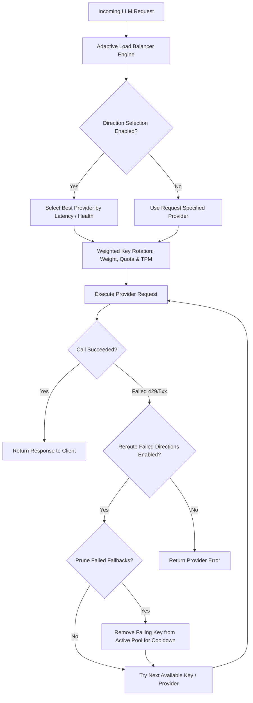

# UnifAI Adaptive Routing & Load Balancing Architecture

This document details the architectural design, dynamic load balancing algorithms, route selection policies, and fallback pruning engines for the **Adaptive Routing** subsystem in the UnifAI Gateway.

---

## 1. Architectural Overview

**Adaptive Routing** provides dynamic, multi-provider traffic distribution, weighted key rotation, automatic failure avoidance, and performance-based load balancing across upstream LLM infrastructure.



---

## 2. Workspace Routes & Sub-Modules

| Route | Sub-Module | Capabilities |
| :--- | :--- | :--- |
| `/workspace/adaptive-routing` | **Adaptive Routing Dashboard** | Live topology map showing provider directions, active keys, health status (`healthy`, `disabled`, `not_configured`), and real-time traffic distribution. |
| `/workspace/adaptive-routing/settings` | **Load Balancer Settings** | Toggle direction selection, route selection, fallback pruning, and failure rerouting thresholds. |

---

## 3. Configuration Policies

Stored in `workspace_settings` under `configstore.WorkspaceSettingLoadBalancer`:

```json
{
  "enabled": true,
  "direction_selection_enabled": true,
  "route_selection_enabled": true,
  "reroute_failed_directions": true,
  "prune_failed_fallbacks": true
}
```

### Policy Definitions:
* **`direction_selection_enabled`:** Automatically picks the healthiest provider for a given model when multiple providers support that model.
* **`route_selection_enabled`:** Distributes requests among multiple registered API keys for a single provider according to assigned key weights.
* **`reroute_failed_directions`:** If an upstream call fails (e.g. Rate Limit 429), automatically intercepts the error and routes the payload to the next designated fallback provider.
* **`prune_failed_fallbacks`:** Temporarily removes failing or depleted keys from the active rotation ring to avoid unnecessary timeout penalties.

---

## 4. Key API Endpoints

* `GET /api/load-balancer/config`: Fetch current adaptive routing configuration flags.
* `PUT /api/load-balancer/config`: Update load balancer operational policies.
* `GET /api/load-balancer/routes`: Retrieve real-time provider directions, active keys, rotation weights, and health statuses.
