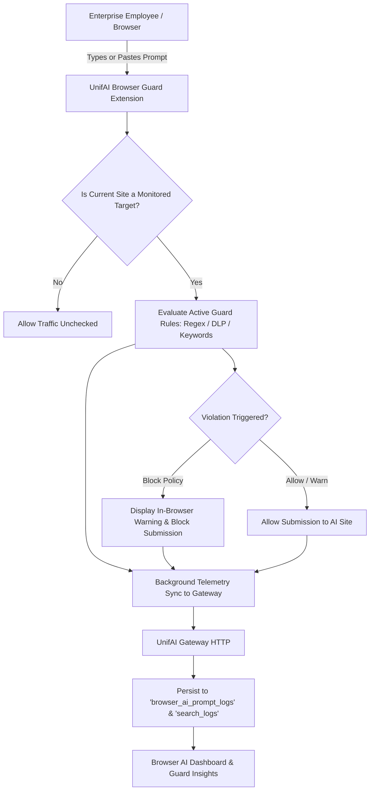

# UnifAI Browser AI & Endpoint Data Loss Prevention Architecture

This document details the architectural design, endpoint agent protocols, data loss prevention (DLP) rules, and compliance auditing pipelines for the **Browser AI** module in the UnifAI platform.

---

## 1. Overview & Purpose

**Browser AI** provides real-time, client-side data loss prevention (DLP) and compliance auditing for enterprise employees interacting with external web-based AI tools (e.g., ChatGPT, Claude.ai, Google Gemini, Microsoft Copilot, Perplexity, DeepSeek).



---

## 2. Workspace Routes & Tabs

| Route Tab | Sub-Module | Capabilities |
| :--- | :--- | :--- |
| `?tab=overview` | **Overview Dashboard** | Executive summary of monitored endpoints, daily prompt volume, violation trends, and top visited AI sites. |
| `?tab=targets` | **Target Websites** | Whitelisted/Blacklisted external AI domains (e.g. `chatgpt.com`, `claude.ai`, `gemini.google.com`) with custom DOM selector hooks. |
| `?tab=rules` | **Guard Rules** | Real-time DLP inspection patterns (PII, credit card, source code, medical records, credentials) with `Block`, `Warn`, or `Audit` actions. |
| `?tab=logs` | **Prompt Logs** | Complete searchable log of prompts sent by employees to monitored AI websites, including matched rules and risk scores. |
| `?tab=search-logs` | **Search Logs** | Audit log of search queries performed on AI-powered search engines. |
| `?tab=agents` | **Guard Agents** | Inventory of enrolled endpoint browser extensions, hostnames, OS, extension versions, and active heartbeats. |
| `?tab=telemetry` | **Guard Insights** | Trend analysis, frequent DLP violators, department risk breakdown, and compliance export reports. |
| `?tab=setup` | **Setup & Enrollment** | Enterprise deployment kits, Chrome/Edge GPO / MDM configuration profiles, and dynamic enrollment tokens. |

---

## 3. Rule Engine & Inspection Policies

### 3.1. Match Conditions
* **Pattern Types:** Regular Expressions (RE2-compatible), Keyword Lists, and Predefined DLP Classifiers (SSN, PCI-DSS Credit Cards, HIPAA PHI, Private Keys).
* **AI Bot Simulator:** Built-in endpoint rule testing interface (`POST /api/browser-ai/rules/test-bot`) that validates patterns against sample employee prompts prior to deployment.
* **Auto-Regex Generator:** Generates optimized regex from natural language or sample text (`POST /api/browser-ai/rules/generate-regex`).

### 3.2. Actions
* **Block:** The extension prevents the form/textarea from submitting, showing an enterprise compliance alert.
* **Warn:** Displays a confirmation prompt explaining the risk, allowing the user to proceed only after acknowledgment.
* **Audit Only:** Submits silently while recording the payload in audit logs for compliance review.

---

## 4. Database Schema: Browser AI Entities

```sql
-- Monitored AI Target Websites
CREATE TABLE browser_ai_targets (
    id SERIAL PRIMARY KEY,
    name VARCHAR(255) NOT NULL,
    domain VARCHAR(255) UNIQUE NOT NULL,
    selector_input TEXT,
    selector_submit TEXT,
    enabled BOOLEAN DEFAULT TRUE,
    created_at TIMESTAMP WITH TIME ZONE DEFAULT NOW()
);

-- DLP Guard Rules
CREATE TABLE browser_ai_rules (
    id SERIAL PRIMARY KEY,
    name VARCHAR(255) NOT NULL,
    description TEXT,
    action VARCHAR(50) NOT NULL, -- 'block', 'warn', 'audit'
    pattern_type VARCHAR(50) NOT NULL, -- 'regex', 'keywords'
    pattern TEXT NOT NULL,
    severity VARCHAR(20) DEFAULT 'medium',
    enabled BOOLEAN DEFAULT TRUE,
    created_at TIMESTAMP WITH TIME ZONE DEFAULT NOW()
);

-- Prompt Audit Logs
CREATE TABLE browser_ai_prompt_logs (
    id VARCHAR(255) PRIMARY KEY,
    agent_id VARCHAR(255) NOT NULL,
    user_email VARCHAR(255),
    target_domain VARCHAR(255) NOT NULL,
    prompt_text TEXT,
    action_taken VARCHAR(50) NOT NULL,
    matched_rule_ids JSONB,
    risk_score INT DEFAULT 0,
    timestamp TIMESTAMP WITH TIME ZONE NOT NULL
);
```

---

## 5. Key API Endpoints

* `GET /api/browser-ai/targets` & `POST /api/browser-ai/targets`: Manage monitored AI web applications.
* `GET /api/browser-ai/rules` & `POST /api/browser-ai/rules`: Configure DLP guard rules.
* `POST /api/browser-ai/rules/test-bot`: Test rules with simulated prompts.
* `GET /api/browser-ai/logs` & `DELETE /api/browser-ai/logs/bulk-delete`: Query and purge prompt logs.
* `GET /api/browser-ai/agents`: View active enrolled browser extensions.
* `GET /api/browser-ai/fleet-config`: Dynamic policy bundle downloaded by extension agents during periodic sync.
