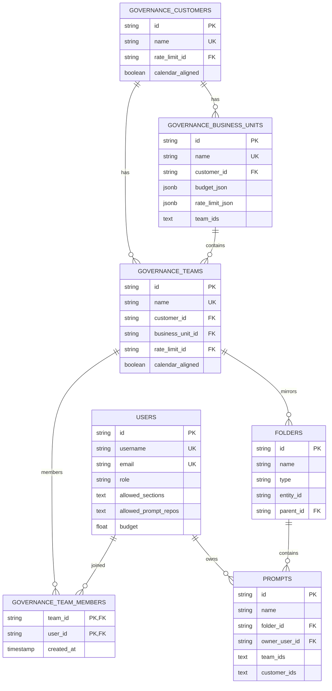

# Gateway Governance, Organization & Prompt Hierarchy Guide (Governance.md)

Welcome to the definitive reference manual for the Gateway Enterprise Governance and Multi-Tenant Organization system. This document outlines the hierarchy shapes, database schemas, prompt repository auto-structuring, drag-and-drop synchronization, spend budgets, token rate limits, and comprehensive error handling across the platform.

For user authentication, login lockout, password recovery, session cookies, and registration approval flows, refer to [`Login.md`](file:///d:/unifai_project/Login.md).  
For the prompt engineering playground, immutable version control, session management, and prompt history retention policies, refer to [`Prompt_Repository.md`](file:///d:/unifai_project/Prompt_Repository.md).

---

## 1. Master Architectural Shapes & Hierarchy Mapping

The Gateway supports five explicit organizational hierarchy shapes connecting **Customers**, **Business Units**, **Teams**, and **Users**. Every connection configured in Governance is automatically mirrored as a folder and prompt hierarchy inside the **Prompt Repository**:

```mermaid
graph TD
    subgraph Shape 1: Full Enterprise Hierarchy
        C1[Customer] --> BU1[Business Unit]
        BU1 --> T1[Team]
        T1 --> U1[User Prompt]
    end

    subgraph Shape 2: Direct Customer Team
        C2[Customer] --> T2[Team]
        T2 --> U2[User Prompt]
    end

    subgraph Shape 3: Direct Business Unit Team
        BU2[Business Unit] --> T3[Team]
        T3 --> U3[User Prompt]
    end

    subgraph Shape 4: Standalone Team
        T4[Team] --> U4[User Prompt]
    end

    subgraph Shape 5: Unassigned User
        U5[User with No Team]
    end
```



### Hierarchy Shape Reference Table

| Connection Shape | PostgreSQL Storage Model | Prompt Repository Folder Hierarchy | User Prompt Location |
| :--- | :--- | :--- | :--- |
| **Customer → BU → Team → User** | `team.customer_id = cust.id`<br>`team.business_unit_id = bu.id` | `Customers / {customer} / {business unit} / {team}` | Inside `{team}` folder |
| **Customer → Team → User** | `team.customer_id = cust.id`<br>`team.business_unit_id = NULL` | `Customers / {customer} / {team}` | Inside `{team}` folder |
| **BU → Team → User** | `team.customer_id = NULL`<br>`team.business_unit_id = bu.id` | `Business Units / {business unit} / {team}` | Inside `{team}` folder |
| **Team → User** | `team.customer_id = NULL`<br>`team.business_unit_id = NULL` | `Teams / {team}` | Inside `{team}` folder |
| **Direct User** | User row with no `governance_team_members` entry | `Users / {email or username}` | Inside `{email or username}` folder |

---

## 2. Core Governance Rules & Strict Constraints

1. **Strict Single-Team Rule (CWE-284 Defense):**
   * A user can belong to **exactly one team** at any given time.
   * Attempting to add a user to a second team returns HTTP `409 Conflict`:
     *"This user is already a member of team '{team_name}'. A user can belong to only one team — remove them from '{team_name}' first."*
   * To change teams, the administrator must either:
     * Remove the user from their current team and add them to the new team, OR
     * Drag the user's prompt in the Prompt Repository from their old team folder into the target team folder.
2. **Case-Insensitive Uniqueness:**
   * Customer names are strictly unique across the system (HTTP `409 Conflict`).
   * Business Unit names are strictly unique across the system, evaluated case-insensitively (`Finance` and `finance` conflict, HTTP `409 Conflict`).
   * Team names are strictly unique across the system (HTTP `409 Conflict`).
   * Usernames and emails are strictly unique (HTTP `409 Conflict`).
3. **Multi-Budget Reset Durations:**
   * An entity (Customer or Team) can have multiple budgets as long as each budget has a **distinct reset duration** (`1h`, `1d`, `1w`, `1M`, `1y`). Duplicate durations on the same entity return HTTP `400 Bad Request`.
4. **Customer Budget Allocation Ceiling:**
   * The sum of team budgets under a customer for any reset duration cannot exceed the customer's budget for that same period. Violating this ceiling returns HTTP `400 Bad Request`.
5. **Pointer Sensor Drag Protection (18px Activation):**
   * Clicking or double-clicking a prompt inside a folder **NEVER** detaches or moves the prompt. Pointer drag requires an intentional movement threshold of **18 pixels** (`PointerActivationConstraints.Distance({ value: 18 })`).
6. **Root Drop Ejection Protection:**
   * Governance-linked prompts (prompts owned by users, assigned to teams/customers, or residing in system hierarchies) **CANNOT** be dropped onto the root workspace area (`root-drop-zone`). Any accidental release over empty space is ignored, preventing prompts from being ejected from their folders.

---

## 3. Comprehensive Master Error Handling Matrix

The following matrix documents every error condition across Governance, User Management, and Prompt Repository, detailing HTTP status codes, exact server message strings, root causes, frontend handling, and resolution paths:

| HTTP Status | Exact Error Message String | Trigger / Root Cause | Frontend Handling & Toast | Recovery / Resolution Action |
| :--- | :--- | :--- | :--- | :--- |
| **`400 Bad Request`** | `"Customer name is required"` | Submitting customer creation or update with empty or whitespace-only name. | Error toast: *"Customer name is required"*. Red input border. | Provide a non-empty name string. |
| **`400 Bad Request`** | `"only one of 'budget' or 'budgets' may be set"` | API payload provided both the legacy singular `budget` object and the modern `budgets` array. | Error toast: *"Invalid budget configuration"*. | Submit either `budget` or `budgets`, not both. |
| **`400 Bad Request`** | `"budget max_limit cannot be negative: {amount}"` | Budget limit value was submitted as $< 0$. | Form validation highlights the limit field in red. | Enter a positive number or $0$ for unlimited. |
| **`400 Bad Request`** | `"invalid reset duration format: {duration}"` | Duration is not one of `1h`, `1d`, `1w`, `1M`, `1y`. | Error banner in sheet. | Select a valid duration from the dropdown. |
| **`400 Bad Request`** | `"duplicate reset_duration in budgets: {duration}"` | Submitting two budgets with the same reset period on the same entity (e.g., two monthly budgets). | Toast: *"Duplicate reset duration in budgets"*. Highlights duplicate row. | Keep only one budget per reset period. |
| **`400 Bad Request`** | `"Customer budget allocation exceeded: period {period} requested {req} exceeds available {avail}"` | Total team budgets for period exceed the parent customer's budget for that period. | Error alert modal detailing requested vs. available shortfall. | Increase customer budget or reduce team limits. |
| **`400 Bad Request`** | `"Invalid rate limit: {details}"` | Token or request rate limits submitted with invalid reset duration or negative value. | Error toast with exact parsing reason. | Fix rate limit duration or limits. |
| **`400 Bad Request`** | `"Team name is required"` | Creating or editing a team with an empty name. | Form validation highlights team name field. | Enter a valid team name. |
| **`400 Bad Request`** | `"name is required"` | Creating or editing a Business Unit with an empty name. | Form highlights Business Unit name field. | Enter a valid Business Unit name. |
| **`400 Bad Request`** | `"user_id is required"` | Calling `POST /api/governance/teams/{id}/members` without `user_id` in JSON body. | Error toast: *"User ID is required"*. | Select a user from the member picker dropdown. |
| **`400 Bad Request`** | `"team_id and user_id are required"` | Deleting team member without specifying both route identifiers. | Error toast: *"Failed to remove member"*. | Ensure valid team ID and user ID are passed in URL. |
| **`400 Bad Request`** | `"Password does not meet complexity requirements"` | Password violates one of the 5 password policy rules (length, upper, lower, digit, symbol). | Detailed checklist highlights missing rules in red. | Enter a password fulfilling all 5 rules. |
| **`401 Unauthorized`** | `"Invalid username or password"` | Incorrect login credentials or non-existent account. | Red error banner on login card. Failure counter incremented. | Re-enter correct credentials or use Forgot Password. |
| **`403 Forbidden`** | `"Security Notice: Your Gateway account has been blocked by an administrator..."` | User account is in `disabled` (blocked) status. | Full-width warning banner: *"Account Blocked"*. Session revoked. | Contact administrator to unblock the account. |
| **`403 Forbidden`** | `"Your registration is waiting for admin approval"` | User account is in `pending` approval status. | Informational notice on login page. | Wait for administrator email approval. |
| **`403 Forbidden`** | `"Admin has not accepted your request"` | User account was rejected by an administrator. | Red error alert: *"Registration Denied"*. | Contact workspace administrator. |
| **`403 Forbidden`** | `"Super admin privileges required to create administrator accounts"` | A sub-admin or non-superadmin attempted to create an account with role `admin`. | Toast: *"Permission denied: Super admin required"*. | Perform action from super admin account. |
| **`403 Forbidden`** | `"Cannot grant sections that you do not have access to"` | Caller attempted to assign workspace sections they do not possess. | Checkbox disabled in UI; API blocks request. | Only grant sections within your own permission scope. |
| **`404 Not Found`** | `"customer not found"` | Customer ID in URL path does not exist in database. | Toast: *"Customer not found"*. Redirects to Customers list. | Verify customer ID or refresh the table. |
| **`404 Not Found`** | `"business unit not found"` | Business Unit ID in URL path does not exist. | Toast: *"Business unit not found"*. Redirects to BU list. | Verify Business Unit ID or refresh the list. |
| **`404 Not Found`** | `"team not found"` | Team ID in URL path does not exist in database. | Toast: *"Team not found"*. Redirects to Teams list. | Verify team ID or refresh the table. |
| **`404 Not Found`** | `"user not found"` | User ID does not exist in `users` table. | Toast: *"User not found"*. | Verify user ID or refresh user table. |
| **`404 Not Found`** | `"prompt not found"` | Prompt ID in request does not exist in `prompts` table. | Toast: *"Prompt not found"*. Clears prompt selection. | Select an existing prompt from the sidebar. |
| **`409 Conflict`** | `"A customer with this name already exists"` | Attempting to create or rename a customer to an existing name. | Form error message directly under Customer Name input. | Choose a unique customer name. |
| **`409 Conflict`** | `"a business unit with this name already exists"` | Attempting to create or rename a Business Unit to an existing name (case-insensitive). | Form error directly under Business Unit Name input. | Choose a unique Business Unit name. |
| **`409 Conflict`** | `"A team with this name already exists"` | Attempting to create or rename a team to an existing name. | Form error directly under Team Name input. | Choose a unique team name. |
| **`409 Conflict`** | `"This user is already a member of team '{team}'. A user can belong to only one team — remove them from '{team}' first."` | Adding a user to a team when they already belong to another team. | Alert dialog: *"User already assigned"*. Details existing team. | Remove user from current team before adding to new team, or use drag-and-drop. |
| **`409 Conflict`** | `"Username is already taken"` | Creating a user with a username that conflicts (case-insensitively) with an existing user. | Error highlight on Username field. | Choose a different username. |
| **`409 Conflict`** | `"Email is already registered"` | Creating a user with an email address already registered. | Error highlight on Email field. | Use a different email address or log into existing account. |
| **`429 Too Many Requests`** | `"Too many failed login attempts. Account locked for about 20 minutes"` | 3 consecutive incorrect passwords entered for this account. | Screen switches to lockout state with countdown timer. | **Must wait the full 20 minutes**. No bypass allowed. |
| **`429 Too Many Requests`** | `"Budget exceeded: {entity_id}"` | Spend budget limit reached for Virtual Key, Team, BU, or Customer. | Gateway rejects API proxy request with standard OpenAI error JSON. | Increase entity budget or wait for next reset cycle. |
| **`429 Too Many Requests`** | `"Rate limit exceeded: {entity_id}"` | Token limit or request count limit exceeded for Team, BU, or Customer. | Gateway returns HTTP 429 with `Retry-After` header. | Reduce traffic throughput or increase rate limit caps. |
| **`500 Internal Server Error`** | `"failed to create customer"`, `"failed to save business unit"`, etc. | Database transaction error or connection failure. | Error toast: *"Internal server error. Please try again."* Logs captured in server journal. | Check PostgreSQL database connectivity and logs. |

---

## 4. Entity Lifecycle & Creation Workflows

### 4.1 Step 1: Create a Customer
* **UI Screen:** Governance → Customers
* **API Route:** `POST /api/governance/customers`
* **Workflow:**
  1. Admin provides **Customer Name** (strictly required and unique).
  2. Optional spend limits configured via `budgets` (one budget per distinct reset duration).
  3. Optional token rate limits (`token_max_limit`, `token_reset_duration`) and request rate limits (`request_max_limit`, `request_reset_duration`).
  4. Database executes transaction: creates `governance_customers` row and linked `governance_budgets` / `governance_rate_limits`.
  5. Lifecycle hook `OnCustomerCreated` creates the folder:
     `Customers / {customer_name}` in the Prompt Repository.
  6. Renaming the customer triggers `OnCustomerUpdated` which renames the folder in the Prompt Repository.

### 4.2 Step 2: Create a Business Unit
* **UI Screen:** Governance → Business Units
* **API Route:** `POST /api/governance/business-units`
* **Workflow:**
  1. Admin provides **Business Unit Name** (unique, case-insensitive).
  2. Optional `customer_id`:
     * **If linked to a customer:** Prompt folder is created under `Customers / {customer_name} / {bu_name}`.
     * **If standalone:** Prompt folder is created under `Business Units / {bu_name}`.
  3. Optional budget (`max_limit`, `reset_duration`). Saved in `governance_business_units.budget_json`.
  4. Optional rate limits (`token_max_limit`, `request_max_limit`). Saved in `governance_business_units.rate_limit_json`.
  5. Lifecycle hook `OnBusinessUnitCreated` creates the matching folder hierarchy.
  6. Updating or assigning teams updates `governance_business_units.team_ids` and calls `reloadBusinessUnitTeamIndex` to update in-memory log routing and rate limit tracking.

### 4.3 Step 3: Create a Team
* **UI Screen:** Governance → Teams
* **API Route:** `POST /api/governance/teams`
* **Workflow:**
  1. Admin provides **Team Name** (strictly required and unique).
  2. Optional parent linkages: `customer_id` and/or `business_unit_id`.
  3. Optional team budgets: validated against parent customer budget ceilings via `checkCustomerBudgetAllocation`.
  4. Optional team rate limits.
  5. Lifecycle hook `OnTeamCreated` creates the team folder in Prompt Repository:
     * **Under BU (if linked):** `Customers / {customer} / {business_unit} / {team}` or `Business Units / {business_unit} / {team}`.
     * **Under Customer (if linked without BU):** `Customers / {customer} / {team}`.
     * **Standalone:** `Teams / {team}`.

### 4.4 Step 4: Create a User & Auto-Prompt Generation
* **UI Screen:** Governance → Users
* **API Route:** `POST /api/session/users`
* **Workflow:**
  1. Admin provides **Username**, **Email**, **Role** (`user`, `sub_admin`, `admin`), and **Allowed Sections**.
  2. Password Handling:
     * If empty: system generates a secure temporary password and dispatches an email via SMTP. `MustChangePassword` is set to `true`.
     * If typed: must satisfy all 5 password policy rules. `MustChangePassword` is set to `true`.
  3. **Auto Create Prompt Toggle:**
     * **`auto_create_prompt = false`:** No prompt is created initially.
     * **`auto_create_prompt = true`:** System creates a prompt named after the user's email/username, sets `owner_user_id = user.id`, creates a default playground session, and adds the prompt ID to `user.allowed_prompt_repos`.
     * If user is in a team: prompt is placed inside that team's folder.
     * If user is not yet in a team: prompt is placed under `Users / {email or username}`.

---

## 5. Connecting Entities & Single-Team Enforcement

To build an organization hierarchy cleanly, create entities in top-down order:

```text
Customer  ──>  Business Unit  ──>  Team  ──>  User Member
```

### 5.1 Adding a User to a Team
* **API Route:** `POST /api/governance/teams/{team_id}/members`
* **Payload:** `{"user_id": "{user_uuid}"}`
* **Execution & Single-Team Verification:**
  1. Backend checks if `user_id` is already present in `governance_team_members` for any other team.
  2. If an existing membership is found: request is **aborted with HTTP 409 Conflict**.
  3. If no conflict: user is inserted into `governance_team_members`.
  4. Lifecycle hook `OnTeamMemberAdded`:
     * Moves the user's personal prompt (matched by `owner_user_id`) from `Users /` or an unlinked location into the team's folder.
     * If the user had no prompt and auto-create is enabled, creates a new prompt inside the team folder.
     * Grants the user access to all shared prompts in that team's audience.

### 5.2 Removing a User from a Team
* **API Route:** `DELETE /api/governance/teams/{team_id}/members/{user_id}`
* **Execution:**
  1. Deletes the junction row in `governance_team_members`.
  2. Lifecycle hook `OnTeamMemberRemoved`:
     * Moves the user's personal prompt back to `Users / {email or username}`.
     * Revokes team-level shared prompts from `user.allowed_prompt_repos`.

---

## 6. Prompt Repository Drag-and-Drop Synchronization

The Prompt Repository provides bi-directional synchronization with Governance. Dragging prompts between folders updates team memberships in PostgreSQL automatically:

### 6.1 Drag & Drop Mechanics
* **Moving a User's Personal Prompt (`owner_user_id`):**
  * When an administrator drags a user's prompt onto another **Team folder**:
    1. Hook `OnPromptMoved` detects folder transition.
    2. Calls `syncUserTeamOnPromptMove` in `prompts_lifecycle.go`.
    3. Old team membership in `governance_team_members` is removed.
    4. Old team shared prompts are revoked from the user.
    5. New team membership is inserted into `governance_team_members`.
    6. New team shared prompts are granted to the user.
  * If dropped onto a **Customer** or **Business Unit** folder containing teams:
    * `resolveTeamIDFromFolder` traverses the hierarchy tree and automatically assigns the user to the **first active team** under that folder.
* **Moving Shared Prompts:**
  * Dragging a prompt that has no `owner_user_id` (a team or company template) updates prompt visibility for team members but **never** alters any user's team membership.

### 6.2 Accidental Drag Prevention & Double-Click Protection
* **Pointer Activation Distance (18px):**
  * In [sidebar.tsx](file:///d:/unifai_project/ui/components/prompts/fragments/sidebar.tsx), the pointer sensor constraint is set to `18px`:
    ```tsx
    PointerSensor.configure({
        activationConstraints: [new PointerActivationConstraints.Distance({ value: 18 })],
    })
    ```
  * Fast clicking, double-clicking, or double-tapping on trackpads/touchscreens will **NEVER** initiate a drag operation.
* **Root Drop Protection Guard:**
  * If a prompt is dragged and released over empty sidebar space (`targetId === "root-drop-zone"`):
    * The system checks whether the prompt has an `owner_user_id`, `team_ids`, `customer_ids`, or resides inside a system hierarchy (Customers, Business Units, Teams, Users).
    * If true: **the move is strictly rejected**.
    * Governance prompts can never be orphaned or kicked out of their folders into root.

---

## 7. Signed-In User Workspace & Chat Experience

When an end-user (`role: "user"`) signs in, the UI isolates their view for focused interaction:

1. **Sidebar "Your Prompts" Mode:**
   * The complex administrator folder tree is hidden.
   * The sidebar displays only prompts explicitly allowed for that user in `allowed_prompt_repos`.
   * Each prompt displays a hierarchy badge indicating its location (e.g., `Engineering Team / Python Copilot` or `Customer A / BU / Prompt`).
2. **Auto-Selection on Login:**
   * If no prompt is active in the URL, the interface automatically selects the user's first available prompt.
3. **Chat History & Sessions:**
   * Loading a prompt fetches its dedicated chat sessions (`useGetSessionsQuery`).
   * Clicking **"New Chat"** initializes a fresh conversation session with provider/model settings preloaded from the prompt's latest committed version.
   * All conversation messages are securely stored in `prompt_sessions` and `prompt_messages` keyed by user ID.
4. **Action Restrictions:**
   * End-users cannot create root folders, delete prompts, rename folders, or access governance settings. Action menus are hidden, and administrative APIs return HTTP `403 Forbidden`.

---

## 8. Deletion & Non-Destructive Archiving (`Removed ...`)

Deleting an entity in Governance **NEVER** destroys data or prompts. Everything is non-destructively archived into dedicated `Removed ...` folders:

| Deleted Entity | Target Archive Folder in Prompt Repository | Database Foreign Key Action | Child Entities Behavior |
| :--- | :--- | :--- | :--- |
| **Customer** | `Removed Customers / {name} (Archived)` | `customer_id` is set to `NULL` across all linked Business Units and Teams in `governance_business_units` and `governance_teams`. | Active BUs move to `Business Units /`. Active teams move to `Teams /`. Prompts are preserved. |
| **Business Unit** | `Removed Business Units / {name}` | `business_unit_id` is set to `NULL` across all linked Teams in `governance_teams`. | Child teams move back under their parent Customer (if any) or to `Teams /`. Prompts are preserved. |
| **Team** | `Removed Teams / {name}` | `governance_team_members` entries are cleared. Prompt folder moves into archive. | Prompts and complete chat histories remain intact inside the archived team folder. |
| **User Account** | `Removed Users / {username or email}` | User row marked deleted. Team membership cleared. | The user's personal prompt moves to `Removed Users`. If the same user signs up again, the prompt is restored. |
| **Individual Prompt** | `Removed Users / {prompt_name}` | Removed from `allowed_prompt_repos`. | A second delete action on an already archived prompt permanently deletes it. |

---

## 9. Spend Budgets & Token Rate Limit Engine

Gateway governance enforces two independent, parallel metering systems: **Financial Spend Budgets ($ USD)** and **Throughput Rate Limits (Tokens & Requests)**.

### 9.1 Evaluation Order (Top-to-Bottom)
Every API proxy call traverses the full governance stack and checks limits at all levels:
1. **Provider & Model Config Budgets**
2. **Virtual Key Budgets & Rate Limits**
3. **Customer Budgets & Rate Limits** (`cust_` and `cust_rl_`)
4. **Business Unit Budgets & Rate Limits** (`bu_` and `bu_rl_`)
5. **Team Budgets & Rate Limits** (`team_` and `team_rl_`)
6. **User Budgets & Rate Limits** (`user_` and `user_rl_`)

If any limit in the hierarchy is exhausted, the request is rejected immediately with HTTP `429 Too Many Requests`.

### 9.2 Business Unit Budget & Token Persistence
* Business Units support both spend budgets and token rate limits configured directly on the BU:
  * **Spend Budget:** Stored in `governance_business_units.budget_json`. Metered in-memory under key `bu_{bu_id}`. New usage is atomically persisted back to PostgreSQL via `persistBusinessUnitBudgetUsage`.
  * **Rate Limit:** Stored in `governance_business_units.rate_limit_json`. Metered in-memory under key `bu_rl_{bu_id}`. Token and request usage are persisted via `persistBusinessUnitRateLimitUsage`.
  * **Reset Clock Preservation:** The reset duration clock (`LastReset`) is preserved during server restarts and index reloads, ensuring the budget period never restarts prematurely.
  * **Request Stamping:** All gateway context requests stamp `BusinessUnitID` and `BusinessUnitName` for observability, Prometheus metrics, and spending breakdown dashboards.

---

## 10. PostgreSQL Database Schema Reference

The Governance engine operates on the following core PostgreSQL tables:



---

*Document compiled and verified against `governance.go`, `businessunits.go`, `team_members.go`, `prompts_lifecycle.go`, `store.go`, and `sidebar.tsx`.*
