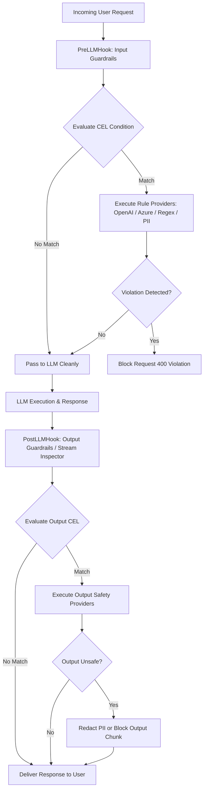
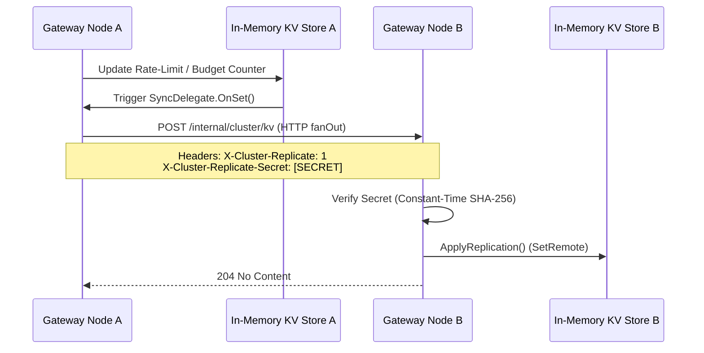

# UnifAI Guardrails & Cluster Architecture

This document covers the architectural design, inspection hooks, rule engine, content moderation providers, and cross-node cluster synchronization for **Guardrails** in the UnifAI Gateway.

---

## 1. Architectural Overview

The Guardrails module protects AI applications by inspecting user inputs (PreLLMHook) and model outputs (PostLLMHook) in real-time. It enforces data loss prevention (PII masking), content safety (toxicity, hate speech, sexual content), prompt injection defenses, and custom regex policies.



---

## 2. Workspace Routes & Sub-Modules

| Route | Sub-Module | Capabilities |
| :--- | :--- | :--- |
| `/workspace/guardrails/configuration` | **Guardrail Rules** | Manage input/output inspection rules, CEL matching logic, and provider binding. |
| `/workspace/guardrails/providers` | **Rule Providers** | Register moderation engines: OpenAI Moderation, Azure AI Content Safety, Custom Webhook, or Regex PII engines. |
| `/workspace/cluster` | **Cluster Config** | Configure gateway mesh/broker clustering, peer discovery, and real-time state synchronization. |

---

## 3. CEL Rule Evaluation & Context Scoping

Guardrail rules use Google Common Expression Language (CEL) to determine when a provider should inspect a prompt:

### Context Variables:
* `request.model`: Evaluated model name (e.g. `"gpt-4o"`, `"claude-3-5-sonnet"`).
* `request.prompt_id`: Active Prompt Repository template ID.
* `request.virtual_key_id`: ID of the calling Virtual Key.
* `request.virtual_key_name`: Display name of the Virtual Key.

```cel
// Example 1: Enforce strict PII checks only for customer-facing Virtual Keys
request.virtual_key_name.startsWith("prod-customer-")

// Example 2: Target specific model family
request.model.startsWith("claude-")
```

### Request-Level Isolation:
* Rules are evaluated strictly per-request in an isolated `GatewayContext`. Non-matching messages are completely unaffected.
* In streaming requests, a sliding scan window inspects token chunks as they arrive, cutting off streams immediately if a violation triggers.

---

## 4. Cluster Configuration & Cross-Node Replication

The Cluster Config sub-module enables multiple UnifAI Gateway instances to run in high-availability active-active clusters.



### Cluster Features:
* **Peer Normalization:** Accepts `host:port` (e.g. `10.0.0.12:6000`) or `http(s)://host:port`.
* **Security & Authentication:** Requests to `/internal/cluster/kv` require constant-time validation of `CLUSTER_REPLICATE_SECRET`.
* **Conflict-Free Updates:** Payloads include timestamps (`written_at`, `expires_at`, `deleted_at`) ensuring latest-write-wins convergence.

---

## 5. Key API Endpoints

* `GET /api/guardrails/config`: Fetch active guardrails configuration.
* `PUT /api/guardrails/rules`: Save guardrail rules and provider mappings.
* `PUT /api/guardrails/providers`: Configure moderation providers and API credentials.
* `GET /api/cluster`: Fetch cluster mode status, peer lists, and node health.
* `PUT /api/cluster`: Enable/disable cluster mode and update peer nodes.
* `POST /internal/cluster/kv`: Internal peer state replication endpoint.
