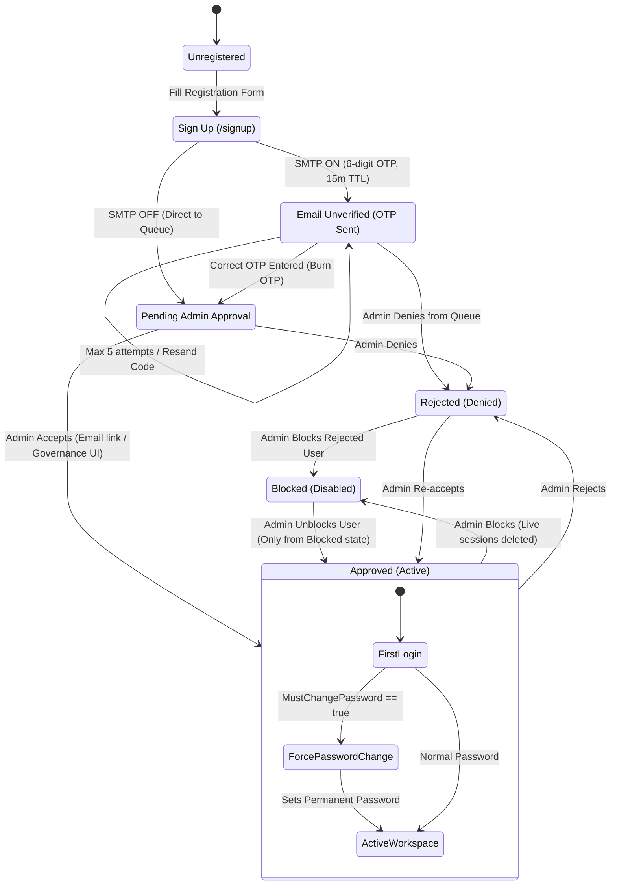

# Gateway Authentication, Session & User Lifecycle Guide (Login.md)

Welcome to the definitive reference manual for the Gateway Identity & Access Management system. This document outlines every authentication flow, UI/API interaction, security constraint, email dispatch template, and timeout threshold implemented in the system.

---

## 1. Master Security Limits & Timing Thresholds

The following table summarizes all cryptographic tokens, session durations, rate limits, and time-to-live (TTL) counters enforced by the backend:

| Token / Event | Duration / Limit | Enforcing File & Logic | Description |
| :--- | :--- | :--- | :--- |
| **Login Session Cookie** | **24 Hours** (Default) | `session.go` (`SESSION_LIFETIME_HOURS`) | Stored in an `HttpOnly`, `SameSite=Lax` cookie. Revoked on logout, block, or password reset. |
| **Failed Login Lockout** | **3 Attempts $\rightarrow$ 20 Mins** | `smtp.go` (`loginMaxFailedAttempts = 3`, `loginLockoutDuration = 20m`) | If 3 consecutive incorrect passwords are submitted, the account identifier is locked for 20 minutes. Sends HTTP `429 Too Many Requests` with a `Retry-After` header. |
| **Email Verification OTP** | **15 Minutes** | `session_register_verify.go` (`passwordResetOTPTTL = 15m`) | 6-digit numeric OTP generated via cryptographically secure `crypto/rand`, stored as a salted Bcrypt hash. |
| **Password Reset OTP** | **15 Minutes** | `session.go` (`passwordResetOTPTTL = 15m`) | 6-digit numeric OTP generated for forgotten password recovery. |
| **Max Failed OTP Attempts** | **5 Attempts** | `session.go` (`maxOTPAttempts = 5`) | If a user inputs an incorrect OTP 5 times, that OTP row is permanently burned/marked used. |
| **Password Reset Token** | **10 Minutes** | `session.go` (`issuePasswordResetToken`, `10m`) | Issued only after successful OTP verification. Signed with HMAC-SHA256 (`PASSWORD_RESET_SECRET`). |
| **Admin Review Link Token** | **48 Hours** | `session_registration_review.go` (`registrationReviewTokenTTL = 48h`) | Token in emails sent to administrators with Accept/Deny one-click action links. |
| **WebSocket Nonce Ticket** | **30 Seconds** | `ws_ticket.go` (`wsTicketTTL = 30s`) | Single-use ticket exchanged for long-lived session tokens to keep URLs clean in browser history. |

---

## 2. Password Security Policy

Every password submitted during **Sign Up**, **Temporary Password Change**, **Password Reset**, or **Admin User Creation** must meet all five strict criteria (tested and validated by `getPasswordPolicyFailures` in `config.go`):

1. **Length:** Minimum **8 characters**, Maximum **128 characters** (prevents Bcrypt CPU exhaustion attacks).
2. **Uppercase:** At least one uppercase English letter (`A-Z`).
3. **Lowercase:** At least one lowercase English letter (`a-z`).
4. **Digit:** At least one numeric digit (`0-9`).
5. **Special Symbol:** At least one non-alphanumeric character (e.g., `!@#$%^&*()_+-=[]{}|;:,.<>?`).
6. **Non-reuse Rule:** 
   * A new password cannot match the current active password.
   * A new permanent password cannot match the temporary password assigned by an administrator (`sameAsTemporary` validation).

---

## 3. Flow 1: User Registration (Sign Up)

### 3.1 Step-by-Step Flow
1. The applicant opens the Sign Up page at `/signup`.
2. The user enters **Username**, **Email Address**, **Password**, and **Confirm Password**.
3. **Validation:** The frontend validates password requirements; the backend enforces unique case-insensitive usernames (`usernameCaseConflict`) and ensures the username/email does not match reserved administrator identities.
4. **Role Assignment:** Public registration strictly forces the default role: `"user"`. No public user can self-assign elevated permissions.
5. **State Transition:**
   * **If SMTP is enabled:** The account is saved with status `email_unverified`. A 6-digit OTP is generated and emailed to the user.
   * **If SMTP is disabled:** The account is saved with status `pending` directly, and the applicant is told to wait for admin approval.

### 3.2 Exact Sign-Up Verification Email Template
* **Sender Display Name:** `Raksha Security System`
* **Recipient:** Registered Email
* **Subject:** `Gateway sign-up verification code`
* **Message Body:**
```text
Hello {username},

Your Gateway sign-up verification code is: {6-digit OTP}

It expires in 15 minutes. After you verify, an administrator must approve your account.
If you did not sign up, ignore this email.
```

### 3.3 Verifying the Sign-Up OTP
* The applicant submits the 6-digit code on the `/signup` screen.
* The backend (`verifyRegistration`) checks:
  1. The code matches the Bcrypt hash.
  2. The code has not expired (within 15 minutes).
  3. Failed attempts are under 5 (otherwise it burns the OTP).
* Upon success, the user's status transitions from `email_unverified` to `pending`.
* The system notifies all active administrators via email that a new sign-up is awaiting approval.

---

## 4. Flow 2: Sign In (Login) & Lockout Behavior

### 4.1 Login Lifecycle
1. The user navigates to `/login` and provides `username` (or registered email) and `password`.
2. **Account Status Verification:**
   * **`pending`:** Blocked with HTTP 403: *"Your registration is waiting for admin approval"*.
   * **`rejected`:** Blocked with HTTP 403: *"Admin has not accepted your request"*.
   * **`disabled` (blocked):** Blocked with HTTP 403: *"Security Notice: Your Gateway account has been blocked by an administrator. You will not be able to sign in or access workspaces. Please contact your administrator to unblock."*
   * **`email_unverified`:** Blocked with HTTP 403: *"Verify your email first — enter the code we emailed you on the Sign Up page"*.
   * **`approved`:** Allowed to proceed.
3. **Success:** A new UUIDv4 session token is generated and stored in the database. An `HttpOnly`, `SameSite=Lax`, `Path=/` cookie named `token` is set on the response.

### 4.2 The 3-Attempt Failed Login Lockout (20-Minute Mandatory Waiting Period)
* **Threshold:** If a user submits an incorrect password **3 times**, that specific account identifier is locked for **20 minutes**.
* **Response:** HTTP `429 Too Many Requests`
* **Header:** `Retry-After: 1200` (in seconds)
* **Message:** *"Too many failed login attempts. Account locked for about 20 minutes"*
* **Strict Lockout Enforcement (Zero Bypass):**
  * **Mandatory Wait:** The user **MUST wait the full 20 minutes**. There is **NO BYPASS**.
  * **All Recovery Blocked for this ID:** During these 20 minutes, `Sign In`, `Forgot Password`, `Forgot Username`, `Verify OTP`, and `Password Reset` are all **completely blocked** for that specific account ID (`429 Too Many Requests`).
  * **Isolated to that Account ID:** Only that specific account identifier is locked. Other accounts, users, and administrators on the system continue working normally without disruption.
  * **After 20 Minutes:** Once the 20-minute waiting window ends, the user can either sign in with their correct password or use Forgot Password / Username to recover it.

### 4.3 Role-Based Redirection & Scoped Feature Access
Upon successful authentication, the frontend (`workspaceAccess.ts`) inspects the user's `role` and `allowed_sections` to redirect them:

1. **Administrator / Super Admin:**
   * **Destination:** `/workspace/dashboard` (Full admin portal).
   * **Access:** Full access to all workspace features (Virtual Keys, Governance, Models, Teams, Customers, Business Units, Audit Logs, Settings).
2. **Standard User (`role: "user"`):**
   * **Destination:** `/workspace/prompt-repository` (User page / Playground).
   * **Access:** Dedicated user interface for prompt engineering, chat sessions, model playground, and team prompt sharing. Admin configuration menus are hidden.
3. **Sub-Administrator / Scoped Roles (`allowed_sections`):**
   * **Destination:** Redirected to their first allowed feature path (e.g., `/workspace/analytics` or `/workspace/governance`).
   * **Access Filter:** The navigation sidebar renders **only their permitted features**. Any direct navigation to unauthorized sections is intercepted by `getWorkspaceAccessRedirect` and blocked with HTTP 403 by `rbac_enforce.go`.

### 4.4 Sign-In Security Alerts (First Login, New Device/System & Dormant Return)
When SMTP is enabled, the backend (`smtp.go`: `trySendLoginNoticeEmail`) records the device fingerprint (hash of client IP + User-Agent header) in `login_devices`:

1. **Sign-In from New Device / Different System / First-Time Login:**
   * **Trigger:** If the IP or Browser User-Agent is new, or if this is the user's first login.
   * **Sender Display Name:** `Raksha Security System`
   * **Recipient:** User's registered email address.
   * **Subject:** `Security Alert: Sign-in from new device or first-time login`
   * **Message Template:**
   ```text
   Hello {username},

   Your Gateway account signed in from a new device or for the first time.

   • Account: {username}
   • IP Address: {client_ip}
   • Device / Browser: {user_agent}
   • Timestamp: {RFC1123_timestamp}

   If this was not you, secure your account and reset your password immediately here:
   https://unifai.yespanchi.com/login?mode=forgot&email={encoded_email}

   Please keep your credentials confidential. If you authorized this sign-in, no action is needed.
   ```
2. **Sign-In After Extended Inactivity (> 7 Days):**
   * **Trigger:** If a user logs in from an existing device after more than 7 days of inactivity.
   * **Subject:** `Security Alert: Sign-in after extended inactivity`
   * **Message Template:** Same detailed metadata (IP, Device, Timestamp) with reason: *"Your Gateway account was signed into after an extended period of inactivity."*

### 4.5 Error Handling & Account Enumeration Defense
* **Wrong Email or Non-Existent Account:**
  * To prevent attackers from enumerating valid emails or usernames, the system responds with:
    `401 Unauthorized: "Invalid username or password"`
  * Dummy password hashing (`padPasswordCompare`) is executed so response time is identical to an existing account, preventing timing attacks.
* **Wrong Password:**
  * Returns `401 Unauthorized: "Invalid username or password"` and increments the failed attempt counter.
  * Once 3 failed attempts are reached, transitions into the 20-minute account lockout described in Section 4.2.

---

## 5. Flow 3: First-Time Login with Temporary Password

When an administrator creates a user under **Governance $\rightarrow$ Users** and selects "Send Temporary Password" (or leaves the password empty for auto-generation):

### 5.1 Temporary Password Welcome Email Template
* **Sender Display Name:** `Raksha Security System`
* **Recipient:** Employee's Email Address
* **Subject:** `Your Gateway Account - Login Credentials`
* **Message Body:**
```text
Hello {username},

Your Gateway Enterprise account has been created.

Sign in: https://unifai.yespanchi.com/login

Username: {username}
Email: {email}

Temporary Password: {Generated_Temporary_Password}

Important: You will be required to set a new permanent password upon your first sign in.

Please keep your credentials confidential.
```

### 5.2 First-Time Login Flow
1. The employee opens `/login` and enters their username and the temporary password received in the email.
2. The backend validates the password and detects `user.MustChangePassword == true`.
3. The login response returns:
   ```json
   {
     "message": "Login successful",
     "role": "user",
     "must_change_password": true
   }
   ```
4. **Strict RBAC Gate Enforcement:** 
   * The backend middleware (`rbac_enforce.go`) intercepts all API calls. If `user.MustChangePassword` is `true`, **every dashboard route returns HTTP 403 Forbidden**.
   * Only three paths are allowed:
     1. `POST /api/session/change-temporary-password`
     2. `GET /api/session/is-auth-enabled`
     3. `POST /api/session/logout`
5. **UI Transition:** The frontend immediately switches into `force_change_password` mode.
6. The user submits their **New Password** and **Confirm Password**.
7. **Security Checks:**
   * User must be `approved` and have `MustChangePassword == true`.
   * Must meet all 5 password policy rules.
   * Cannot match the temporary password (`sameAsTemporary` validation).
8. **Activation:** 
   * The new password is encrypted with Bcrypt.
   * `user.MustChangePassword` is set to `false`.
   * Live sessions are refreshed, and the user is redirected into the workspace dashboard.

---

## 6. Flow 4: Forgot Password & Recovery Flow

### 6.1 Forgot Password Request
* The user enters their email or username on `/login?mode=forgot`.
* **Anti-Account Enumeration:** The Reset Password screen always shows the same green notice, whether or not that email has an account:
  ```json
  {"message": "If an account matches, a one-time code was sent by email"}
  ```
* **No account for that email:** No code is generated and no mail is sent. The green notice still appears. This is intentional. A different error such as "this email has no account" would tell an outsider which addresses are registered.
* **Account exists and is approved:** The 6-digit code is emailed, and the screen shows the same green notice.
* **Account is inside the 20-minute login lock:** Forgot Password does not continue. The API returns `429` and tells that identifier to wait. Other accounts are not locked.

### 6.2 Password Reset OTP Email Template
* **Sender Display Name:** `Raksha Security System`
* **Recipient:** User's Email Address
* **Subject:** `Gateway password reset code`
* **Message Body:**
```text
Hello {username},

Your Gateway password reset code is: {6-digit OTP}

It expires in 15 minutes. If you did not request this, ignore this email.
```

### 6.3 Verification & Token Issuance
1. The user inputs the 6-digit OTP on the screen.
2. If the OTP is correct, the raw OTP row in the database is immediately burned (`BurnPasswordResetOTPCode`) so it cannot be replayed.
3. The server generates a short-lived **HMAC-SHA256 Signed `reset_token`** with a **10-minute lifetime**.
4. The user inputs their new password along with the `reset_token`.
5. **Post-Reset Actions:**
   * The new password is saved.
   * **CWE-613 Session Termination:** All active sessions across all devices for this user are terminated immediately.
   * Account lockout counters are reset.
   * The user is redirected to sign in with their new password.

---

## 7. Flow 5: Forgot Username Flow

### 7.1 Forgot Username Request
* The user inputs their email address on `/login?mode=forgot_username`.
* The server always responds with the same sentence, whether or not that email has an account:
  ```json
  {"message": "If an account matches, your username was sent to your email."}
  ```
* **No account for that email:** No mail is sent. The same sentence is still shown, so outsiders cannot learn which emails are registered.
* **Account exists and is approved:** The username is emailed, and the screen shows the same sentence.
* **Account is inside the 20-minute login lock:** Forgot Username does not continue for that identifier. Other accounts still work.

### 7.2 Forgot Username Email Template
* **Sender Display Name:** `Raksha Security System`
* **Recipient:** User's Email Address
* **Subject:** `Your Gateway Username`
* **Message Body:**
```text
Hello,

Your Gateway username associated with this email address is: {username}

If you did not request this, please ignore this email.
```

---

## 8. Flow 6: Admin Management Actions (Accept, Deny, Block, Unblock, Delete)

Administrators manage accounts either via one-click signed links in registration notification emails or directly through the **Governance $\rightarrow$ Users** table.

### 8.1 Admin Registration Notification Email (Accept / Deny Links)
When a new user signs up and verifies their email, all administrators receive an email containing HMAC-SHA256 signed tokens valid for **48 hours**:
* **Sender Display Name:** `Raksha Security System`
* **Recipient:** Admin Email Address
* **Subject:** `Gateway registration pending: {applicant_username}`
* **Message Body:**
```text
A new Gateway sign-up is waiting for approval.

Username: {applicant_username}
Email: {applicant_email}

Accept (activate account):
https://unifai.yespanchi.com/api/session/users/review?token={hmac_approve_token}

Deny (block access):
https://unifai.yespanchi.com/api/session/users/review?token={hmac_deny_token}

Or open Governance → Users:
https://unifai.yespanchi.com/workspace/governance/users

These links expire in 48 hours.
```

---

### 8.2 Admin Action: Accept (Approve) User
* **Allowed Target Statuses:** `pending`, `rejected`, or `disabled`.
* **Action:** Sets `user.Status = "approved"`.
* **Applicant Email Notification:**
  * **Sender Display Name:** `Raksha Security System`
  * **Subject:** `Gateway account approved`
  * **Message Body:**
```text
Hello {username},

Your Gateway registration was approved by an administrator.

Sign in: https://unifai.yespanchi.com/login

You can sign in now with the username and password you registered with.

If you forgot your password, use Forgot password on the login page.
```

---

### 8.3 Admin Action: Deny (Reject) User
* **Allowed Target Statuses:** `pending`, `email_unverified`, or `approved`.
* **Self-Action Guard:** An admin cannot deny their own account.
* **Action:** Sets `user.Status = "rejected"` and immediately terminates any active sessions.
* **Applicant Email Notification:**
  * **Sender Display Name:** `Raksha Security System`
  * **Subject:** `Gateway registration not approved`
  * **Message Body:**
```text
Hello {username},

Your Gateway registration was reviewed and was not approved.

You will not be able to sign in with this account. Contact your administrator if you believe this is a mistake.
```

---

### 8.4 Admin Action: Block User
* **Allowed Target Roles & Statuses:** `approved` or `rejected` accounts across all roles (**User**, **Sub-Admin**, and **Admin**).
* **Self-Action & Root Protection Guards:**
  * **Self-Block Strictly Blocked:** An administrator **cannot block their own account** under any circumstances (enforced in UI with disabled button and in backend `session.go` with HTTP 400).
  * **Primary Root Admin Protected:** The bootstrap root administrator credentials defined in `.env` cannot be blocked (HTTP 403).
  * **Sub-Admin Restrictions:** Sub-administrators cannot block full administrator accounts.
* **Action:** Sets `user.Status = "disabled"` and immediately purges all active sessions from the database.
* **User Email Notification:**
  * **Sender Display Name:** `Raksha Security System`
  * **Subject:** `Security Notice: Your Account Has Been Blocked`
  * **Message Body:**
```text
Hello {username},

Security Notice: Your Gateway account has been blocked by an administrator.

You will not be able to sign in while your account is blocked. Please contact your administrator if you believe this is an error.
```

---

### 8.5 Admin Action: Unblock User
* **Allowed Target Statuses:** Only accounts with status `disabled` (blocked) can be unblocked.
* **Action:** Sets `user.Status = "approved"`.
* **User Email Notification:**
  * **Sender Display Name:** `Raksha Security System`
  * **Subject:** `Account Notice: Your Account Has Been Unblocked`
  * **Message Body:**
```text
Hello {username},

Your Gateway account has been unblocked by an administrator.

You can now sign in normally with your credentials.

Sign in link: https://unifai.yespanchi.com/login

If you have any questions, please contact your administrator.
```

---

### 8.6 Admin Action: Delete User
* **Self-Action Guard:** An administrator **cannot delete their own account**.
* **Action:**
  1. Purges user relations across Governance, Teams, Prompt Repositories, and Quotas.
  2. Permanently removes the record from the database.
  3. Immediately invalidates all active sessions for that username.

---

## 9. Flow 7: Sign Out (Logout)

1. The user clicks **Sign Out** from the workspace dropdown.
2. The browser sends a `POST /api/session/logout` request.
3. The server deletes the session token from the `sessions` database table.
4. The client clears the `token` cookie (`Max-Age: 0`) and invalidates local authentication storage and cache.
5. The browser redirects the user to `/login?logged_out=1`.

---

## 10. Advanced Security Mechanisms & Automated Alerts

### 10.1 Automated Sign-In Security Alerts (`trySendLoginNoticeEmail`)
When SMTP is enabled, the system monitors login signatures (IP address, User-Agent, and last sign-in timestamp). If an anomaly is detected, an automated security alert is instantly dispatched to the user's email:

* **Scenario A: New Device or First-Time Login**
  * **Sender Display Name:** `Raksha Security System`
  * **Subject:** `Security Alert: Sign-in from new device or first-time login`
  * **Email Body:**
```text
Hello {username},

Your Gateway account signed in from a new device or for the first time.

• Account: {username}
• IP Address: {ip_address}
• Device / Browser: {user_agent}
• Timestamp: {RFC1123_timestamp}

If this was not you, secure your account and reset your password immediately here:
https://unifai.yespanchi.com/login?mode=forgot&email={email}

Please keep your credentials confidential. If you authorized this sign-in, no action is needed.
```

* **Scenario B: Sign-in After Extended Inactivity**
  * **Sender Display Name:** `Raksha Security System`
  * **Subject:** `Security Alert: Sign-in after extended inactivity`
  * **Email Body:**
```text
Hello {username},

Your Gateway account was signed into after an extended period of inactivity.

• Account: {username}
• IP Address: {ip_address}
• Device / Browser: {user_agent}
• Timestamp: {RFC1123_timestamp}

If this was not you, secure your account and reset your password immediately here:
https://unifai.yespanchi.com/login?mode=forgot&email={email}

Please keep your credentials confidential. If you authorized this sign-in, no action is needed.
```

---

### 10.2 Network-Wide IP Rate Limiting (Anti-Password Spraying)
* While Account Lockout (3 attempts) protects individual accounts, **Network IP Rate Limiting** (`checkLoginIPRateLimit`) protects the infrastructure against automated password-spraying attacks where an attacker cycles through dozens of accounts from the same IP.
* If an IP exceeds threshold failures, that IP is temporarily blocked with HTTP `429 Too Many Requests`:
  * **Message:** *"Too many login attempts from this network. Try again in about 20 minutes"*

---

### 10.3 Multi-Device & Multi-Tab Concurrent Sessions
* Users can maintain concurrent active sessions across multiple devices or browser tabs (e.g., desktop browser, laptop, and mobile). Logging into a second tab or new device **does NOT log out** existing active tabs.
* **Centralized Revocation (CWE-613):** If a user changes/resets their password, or if an administrator **Blocks**, **Rejects**, or **Deletes** the account, all sessions across all devices are immediately invalidated in the database simultaneously.

---

### 10.4 Resend Code Anti-Spam Cooldown
* Both `/signup` and `/login?mode=forgot` enforce a **60-second cooldown timer** (`CODE_RESEND_COOLDOWN_SECONDS`) between OTP resend requests to protect mail server reputation and prevent email inbox flooding.

---

### 10.5 Built-In Super Admin Shadow Protection
* The bootstrap administrator identity configured in the deployment environment (`ADMIN_EMAIL` / `admin`) is cryptographically protected against shadowing. No public sign-up or user creation can overwrite, shadow, or lock out the built-in system administrator.

---

## 11. End-to-End Architectural State Machine Diagram



---

*Document compiled and verified against Gateway Enterprise Codebase.*
