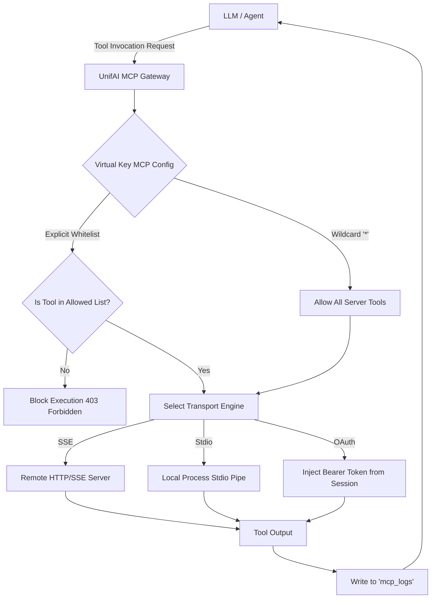

# UnifAI MCP Gateway Architecture & Reference Guide

This document details the architectural design, transport protocols, security isolation, tool filtering, and API specifications for the **Model Context Protocol (MCP) Gateway** within the UnifAI platform.

---

## 1. Overview & Purpose

The **MCP Gateway** standardizes how AI models and agentic workflows interact with external tools, APIs, enterprise databases, and local systems. It serves as an enterprise reverse-proxy and authorization layer between LLMs and external MCP servers.



---

## 2. Workspace Routes & Sub-Modules

| Route | Sub-Module | Capabilities |
| :--- | :--- | :--- |
| `/workspace/mcp-registry` | **MCP Catalog** | View and manage registered MCP server connections (SSE and Stdio), check heartbeat/health status, and view active tool manifests. |
| `/workspace/mcp-registry/library` | **MCP Library** | Directory of pre-built open-source and enterprise MCP connectors (Filesystem, PostgreSQL, GitHub, Slack, Brave Search, Puppeteer, Memory). |
| `/workspace/mcp-tool-groups` | **Tool Groups** | Bundles of curated tools that can be granted collectively to Virtual Keys, Teams, or Projects. |
| `/workspace/mcp-sessions` | **Auth Sessions** | Active stateful sessions maintained with stateful MCP servers. |
| `/workspace/oauth-grants` | **OAuth Grants** | OAuth 2.0 PKCE / Client Credential connections authorized for third-party MCP endpoints. |
| `/workspace/mcp-settings` | **MCP Settings** | Global transport timeouts, max tool output buffer limits, and security sandboxing policies. |

---

## 3. Tool Execution & Security Scoping

### 3.1. Tool Filtering via Virtual Keys
When a Virtual Key is associated with an MCP Client, execution permissions are governed by `governance_virtual_key_mcp_configs`:

* **`tools_to_execute`:**
  * `["*"]`: **Wildcard Unrestricted Mode**. The model can invoke any tool published by the MCP server (`IsUnrestricted() == true`).
  * `["get_weather", "search_docs"]`: **Explicit Whitelist**. Only the enumerated tools are callable; all other tools are rejected before execution.
* **`tools_to_auto_execute`:**
  * Tools approved for autonomous execution without interactive user confirmation.
* **`allowed_extra_headers`:**
  * `["*"]` or explicit list of HTTP request headers forwarded upstream to SSE servers.

---

## 4. Database Schema: MCP Entities

```sql
-- MCP Client Connection Profiles
CREATE TABLE mcp_clients (
    id SERIAL PRIMARY KEY,
    name VARCHAR(255) UNIQUE NOT NULL,
    description TEXT,
    transport VARCHAR(50) NOT NULL, -- 'sse' or 'stdio'
    url TEXT,                       -- For SSE endpoints
    command TEXT,                   -- For Stdio binary execution
    args JSONB,                     -- Stdio argument array
    env JSONB,                      -- Environment variables
    headers JSONB,                  -- Custom authentication headers
    allow_on_all_virtual_keys BOOLEAN DEFAULT FALSE,
    is_active BOOLEAN DEFAULT TRUE,
    created_at TIMESTAMP WITH TIME ZONE DEFAULT NOW(),
    updated_at TIMESTAMP WITH TIME ZONE DEFAULT NOW()
);

-- Virtual Key to MCP Client Authorization Table
CREATE TABLE governance_virtual_key_mcp_configs (
    id SERIAL PRIMARY KEY,
    virtual_key_id VARCHAR(255) NOT NULL REFERENCES governance_virtual_keys(id) ON DELETE CASCADE,
    mcp_client_id INT NOT NULL REFERENCES mcp_clients(id) ON DELETE CASCADE,
    tools_to_execute TEXT, -- JSON Array of tool names or ["*"]
    CONSTRAINT uix_vk_mcp UNIQUE (virtual_key_id, mcp_client_id)
);
```

---

## 5. Key API Endpoints

* `GET /api/mcp/clients` & `POST /api/mcp/clients`: List and register MCP servers.
* `GET /api/mcp/clients/{id}/tools`: Query tool schemas exported by the client.
* `POST /api/mcp/clients/{id}/execute`: Test/execute a tool directly from the admin interface.
* `GET /api/mcp/library`: Fetch the pre-indexed public library of certified MCP connectors.
* `GET /api/mcp/tool-groups` & `POST /api/mcp/tool-groups`: Manage composite tool bundles.
