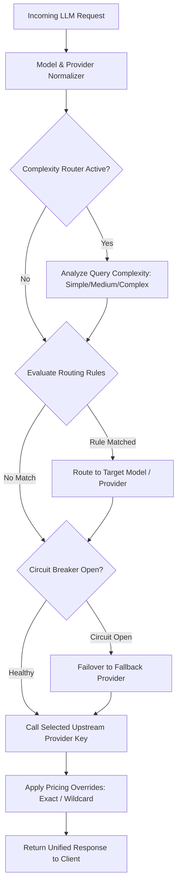

# UnifAI Models & Intelligent Routing Architecture

This document covers the complete architecture, routing pipeline, pricing resolution, and health monitoring for **Models** and **Intelligent Gateway Routing** in the UnifAI platform.

---

## 1. Architectural Overview

The Models subsystem handles multi-provider abstraction, model catalog synchronization, dynamic cost overrides, rate-limiting, and intelligent request rerouting (via CEL rules and Complexity Routing).



---

## 2. Sub-Modules & Workspace Routes

| Route | Sub-Module | Capabilities |
| :--- | :--- | :--- |
| `/workspace/providers` | **Model Providers** | Manage upstream LLM providers (OpenAI, Anthropic, Bedrock, Vertex AI, Azure, Groq, Mistral, Ollama, DeepSeek) and their API keys. |
| `/workspace/model-catalog` | **Model Catalog** | Complete synchronized catalog of all AI models, capability flags (tools, vision, reasoning), default limits, and context windows. |
| `/workspace/model-limits` | **Budgets & Limits** | Per-model and per-provider rate limits (RPM / TPM) and spending caps with auto-blocking. |
| `/workspace/complexity-router` | **Complexity Router** | Evaluates prompt depth, code complexity, and token demand to classify requests into `simple`, `moderate`, or `complex`, dynamically mapping them to small vs frontier models. |
| `/workspace/routing-rules` | **Routing Rules** | Google Common Expression Language (CEL) rules evaluating headers, params, models, budget usage, and user identity to trigger weighted load balancing and provider fallback chains. |
| `/workspace/circuit-breaker` | **Circuit Breaker** | Real-time health policies tripping on upstream errors (HTTP 429, 500, rate limits) with automatic failover and configurable cooldown durations. |
| `/workspace/custom-pricing/overrides` | **Pricing Overrides** | 6-tier scoped pricing patches (`exact` and `wildcard` prefix matching) for prompt tokens, completion tokens, and request fees. |
| `/workspace/custom-pricing` | **Model Settings** | Platform-level token cost defaults and regional multipliers. |

---

## 3. Intelligent Routing Engine & CEL Rules

Routing Rules in UnifAI use **Google CEL (Common Expression Language)**. Expressions are compiled and evaluated in milliseconds before the upstream call.

### 3.1. Context Variables Available in CEL
* `model`: e.g., `"gpt-4o"`, `"claude-3-5-sonnet"`
* `provider`: e.g., `"openai"`, `"anthropic"`
* `request_type`: e.g., `"chat_completion"`, `"embedding"`
* `headers["<name>"]`: Normalized lowercase incoming HTTP request headers.
* `params["<name>"]`: Normalized query parameters.
* `budget_used`: Current percentage of budget consumed (0.0 to 100.0).
* `tokens_used`: Rate limit token consumption percentage.
* `request`: Rate limit request count percentage.
* `complexity_tier`: Evaluated tier (`"simple"`, `"moderate"`, `"complex"`).
* `virtual_key_id`, `virtual_key_name`: Calling Virtual Key.
* `team_id`, `customer_id`, `user_id`: Governance scoping dimensions.

### 3.2. Example Routing CEL Expressions
```cel
// 1. High-tier client routing
headers["x-tier"] == "enterprise"

// 2. Budget threshold failover
budget_used > 85.0 && model == "gpt-4o"

// 3. Complexity based routing
complexity_tier == "complex" && request_type == "chat_completion"
```

---

## 4. Circuit Breaker & Health Failover

The Circuit Breaker continuously monitors upstream provider response headers and error codes.

### 4.1. Trip Signals
* **Header Matching:** Evaluates `x-ratelimit-remaining-tokens`, `x-ratelimit-remaining-requests`, `retry-after`, or custom error headers.
* **Operators:** Supports `AND` and `OR` logic across multiple signals.
* **Cooldown & Auto-Reset:** When tripped, the policy transitions to `open` state for `default_cooldown` or the dynamically parsed `retry-after` header duration. During cooldown, calls automatically swap from Primary to Fallback Provider.

---

## 5. Pricing Overrides & 6-Scope Resolution Hierarchy

Token cost calculation follows a strict 6-tier hierarchical resolution (most specific to least specific):

1. **Virtual Key + Provider + Key ID** (`virtual_key_provider_key`)
2. **Virtual Key + Provider** (`virtual_key_provider`)
3. **Virtual Key** (`virtual_key`)
4. **Provider + Key ID** (`provider_key`)
5. **Provider** (`provider`)
6. **Global** (`global` - applies across the entire workspace)

### Wildcard Matching:
When `match_type: "wildcard"` is specified, pattern `gpt-*` matches all GPT models, applying token price patches dynamically without touching default datasheets.

---

## 6. Key API Endpoints

* `GET /api/providers` & `POST /api/providers`: Provider configuration.
* `GET /api/keys` & `POST /api/keys`: Upstream provider API keys with rotation weights.
* `GET /api/routing-rules` & `POST /api/routing-rules`: CEL routing rules management.
* `GET /api/circuit-breaker/policies` & `POST /api/circuit-breaker/policies`: Health trip policies.
* `GET /api/pricing-overrides` & `POST /api/pricing-overrides`: Custom pricing rules.
