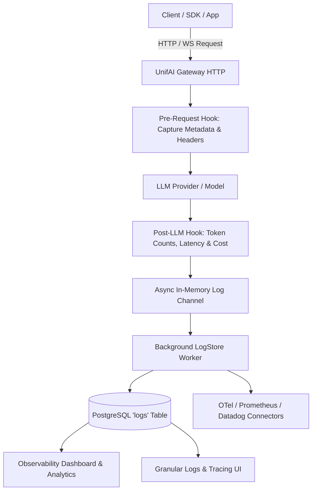

# UnifAI Observability Architecture & Reference Guide

This document details the complete architectural design, data pipelines, endpoints, storage models, and configuration workflows for the **Observability** subsystem of the UnifAI Gateway.

---

## 1. Overview & Objectives

The Observability module provides enterprise-grade, real-time monitoring, granular tracing, cost accounting, and audit logging for all AI interactions passing through the UnifAI Gateway.

### Core Capabilities:
* **LLM Request & Response Tracing:** Captures complete request payloads, model responses, system prompts, streaming chunks, token counts, and latency breakdowns.
* **Cost & Budget Auditing:** Real-time calculation of token costs based on active datasheets and custom pricing overrides.
* **MCP Tool Execution Logging:** Dedicated tracing for Model Context Protocol (MCP) server interactions, tool calls, arguments, and return payloads.
* **Enterprise Connectors:** Native export to third-party APM platforms (OpenTelemetry, Datadog, Prometheus, Langfuse, Grafana).
* **Configurable Retention & Compliance:** Automated background log rotation, TTL enforcement, and data privacy redaction.



---

## 2. Sub-Modules & Workspace Routes

| Route | Sub-Module | Purpose |
| :--- | :--- | :--- |
| `/workspace/dashboard` | **Analytics Dashboard** | Aggregated KPI metrics: request volume, error rates, token consumption, cost breakdown by user/team/model. |
| `/workspace/logs` | **LLM Logs** | High-throughput searchable log table with full JSON payload inspector and trace spans. |
| `/workspace/mcp-logs` | **MCP Logs** | Dedicated logs for agentic tool calls executed via Model Context Protocol servers. |
| `/workspace/observability` | **Connectors** | Integration settings for OpenTelemetry, Datadog, Langfuse, and external exporters. |
| `/workspace/config/logging` | **Logs Settings** | Data retention policy (days), vector indexing, sensitive field redaction, and log rotation. |

---

## 3. Database Schema: `logs` Table

All LLM interaction logs are persisted to PostgreSQL in the `logs` table:

```sql
CREATE TABLE logs (
    id VARCHAR(255) PRIMARY KEY,
    timestamp TIMESTAMP WITH TIME ZONE NOT NULL,
    status_code INT NOT NULL,
    request_duration_ms BIGINT NOT NULL,
    provider VARCHAR(50) NOT NULL,
    model VARCHAR(255) NOT NULL,
    original_model VARCHAR(255),
    request_type VARCHAR(50) NOT NULL,
    
    -- Token & Financial Accounting
    prompt_tokens INT DEFAULT 0,
    completion_tokens INT DEFAULT 0,
    total_tokens INT DEFAULT 0,
    reasoning_tokens INT DEFAULT 0,
    cost NUMERIC(16, 8) DEFAULT 0.0,
    
    -- Governance Scoping Dimensions
    user_id VARCHAR(255),
    user_name VARCHAR(255),
    team_id VARCHAR(255),
    team_name VARCHAR(255),
    business_unit_id VARCHAR(255),
    customer_id VARCHAR(255),
    virtual_key_id VARCHAR(255),
    virtual_key_name VARCHAR(255),
    prompt_id VARCHAR(255),
    prompt_version INT,
    
    -- Payloads & Metadata
    request_payload JSONB,
    response_payload JSONB,
    metadata JSONB,
    error_message TEXT,
    streaming BOOLEAN DEFAULT FALSE
);
```

### High-Performance GIN & Partial Indexes:
* `idx_logs_timestamp`: Accelerated time-series range queries.
* `idx_logs_user_team_bu`: Fast composite lookups for team/BU quota monitoring.
* `idx_logs_metadata_gin`: JSONB inverted index for arbitrary tag and header searches.

---

## 4. API Endpoints Reference

### 4.1. LLM Logs & Search
* `GET /api/logs?limit=50&offset=0&start_time=...&end_time=...&provider=...&model=...`
  * Returns paginated request log records matching filters.
* `GET /api/logs/{id}`
  * Returns full trace details, request messages, model output, and routing engine logs for a specific call.
* `GET /api/logs/stats`
  * Computes aggregated aggregate token usage, requests per minute (RPM), and cost summaries.

### 4.2. MCP Tool Execution Logs
* `GET /api/mcp-logs?limit=50&offset=0`
  * Queries agentic tool invocations made through the MCP gateway.

### 4.3. Logging Configuration & Retention
* `GET /api/config/logging`
  * Fetches current logging settings (retention days, payload logging toggles).
* `PUT /api/config/logging`
  * Updates retention threshold (e.g., 30, 90, 365 days). Background cleaner sweeps logs exceeding `retention_days`.

---

## 5. Security, Redaction & Privacy

1. **API Key Masking:** Upstream provider API keys and authorization headers are scrubbed before writing to logs.
2. **PII Masking Integration:** When Guardrails PII filters are active, detected sensitive entities (SSN, credit card, phone numbers) are masked in the stored log payload.
3. **RBAC Scoping:** Non-admin users only see logs matching their assigned Virtual Keys or Team IDs; super-admins have global audit access.
