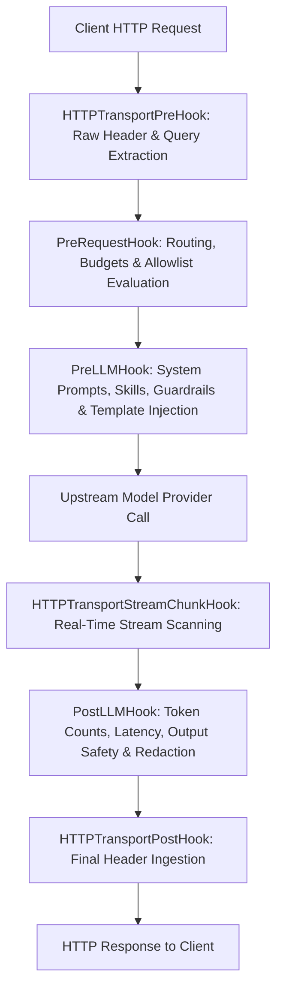

# UnifAI Plugin Architecture & Extensibility Guide

This document covers the architectural model, execution lifecycle hooks, built-in vs custom plugin management, and configuration APIs for the **Plugin Subsystem** in the UnifAI Gateway.

---

## 1. Overview & Extensibility Model

The UnifAI Gateway employs a modular, event-driven plugin architecture. Every inbound request passes through an ordered chain of plugins that execute custom logic at distinct lifecycle phases—from raw HTTP transport ingestion down to low-level LLM streaming chunks.

---

## 2. Plugin Lifecycle Hooks

Every plugin in UnifAI implements one or more interfaces defined in `core/schemas`:

| Hook Name | Lifecycle Point | Core Use Cases |
| :--- | :--- | :--- |
| `HTTPTransportPreHook` | Before request decoding | Capture raw headers, IP extraction, authentication token decoding. |
| `PreRequestHook` | After context initialization | Identity resolution, budget limit checks, allowlist gating, routing rule execution. |
| `PreLLMHook` | Immediately before provider call | Prompt template compilation, Skill markdown injection, PII input masking, model parameter overrides. |
| `HTTPTransportStreamChunkHook` | During streaming response | Real-time sliding window safety scan, immediate stream termination on policy violation. |
| `PostLLMHook` | After provider completion | Token counting, cost calculation, response sanitization, circuit breaker trip evaluation. |
| `HTTPTransportPostHook` | Right before sending response | Inject custom headers, metrics timing headers. |

---

## 3. Built-in vs Custom Plugins

### 3.1. Core Built-in Plugins
The gateway ships with high-performance native Go plugins compiled directly into the binary:

1. **`governance`:** Manages Virtual Key authentication, team/customer scoping, budget enforcement, rate-limits, and CEL routing rules.
2. **`guardrails`:** In-memory inspection engine executing OpenAI Moderation, Azure Content Safety, and regex DLP rules.
3. **`prompts`:** Resolves Prompt Repository templates, variables, versioning, and Skill markdown injection.
4. **`logging`:** Asynchronous capture of complete request/response traces to PostgreSQL and memory buffers.
5. **`model-catalog-resolver`:** Normalizes model identifiers (e.g. `openai/gpt-4o` vs `gpt-4o`) across upstream providers.
6. **`connectors` & `compat`:** Compatibility layers for legacy formats and third-party observability exporters.
7. **`semantic_cache`:** Embedding-based vector caching for recurring queries.
8. **`otel` & `telemetry`:** OpenTelemetry distributed tracing and metrics emission.

### 3.2. Custom Plugins
Enterprises can develop and load dynamic plugins (`.so` shared libraries):
* **Placement:**
  * `pre_builtin`: Runs before built-in plugins (e.g., custom enterprise authentication proxies).
  * `post_builtin`: Runs after built-in plugins (e.g., custom downstream analytics).
* **Order:** Numerical execution weight within the placement group.

---

## 4. Key API Endpoints

* `GET /api/plugins/builtins`: Returns all native built-in plugins available in the engine.
* `GET /api/plugins/loaded`: Lists all plugins currently active in the running memory pipeline.
* `GET /api/plugins`: Retrieves all configured plugins and their enabled/disabled states.
* `POST /api/plugins`: Registers a new custom plugin definition.
* `GET /api/plugins/{name}`: Fetches specific plugin configuration parameters.
* `PUT /api/plugins/{name}`: Updates plugin settings, configuration dictionary, or enables/disables the plugin.
* `DELETE /api/plugins/{name}`: Unregisters and removes a custom plugin.
