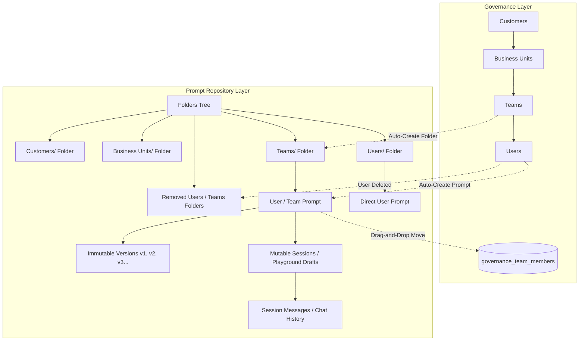
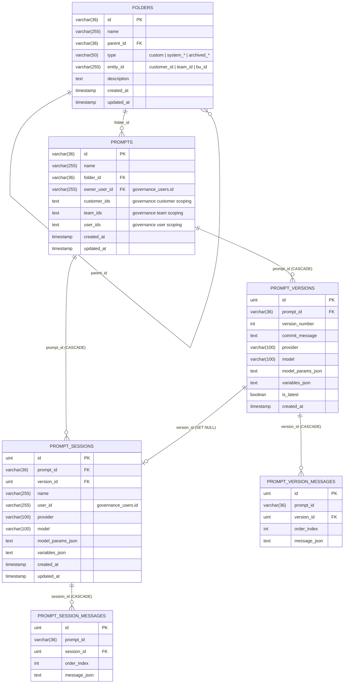
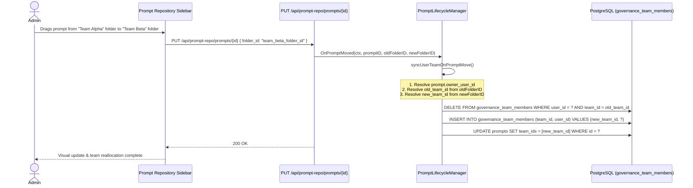
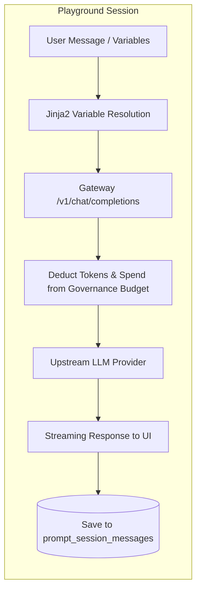
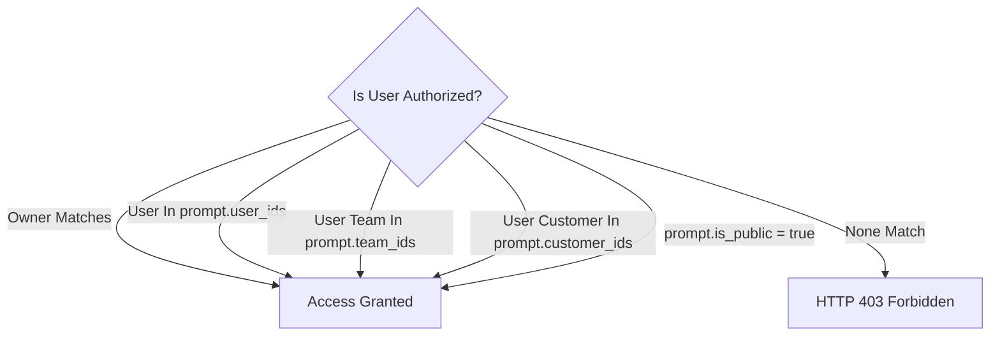

# Gateway Prompt Repository & Lifecycle Management Guide (Prompt_Repository.md)

Welcome to the definitive reference manual for the Gateway Prompt Repository, Interactive Engineering Playground, Multi-Tenant Hierarchy Synchronization, and Versioning System. This document outlines the relational schemas, system folder structures, bidirectional Governance synchronization, drag-and-drop team migrations, template variable processing, and history retention policies across the platform.

For user authentication, login lockout, and session tokens, refer to [`Login.md`](file:///d:/unifai_project/Login.md).  
For organizational shapes, spend budgets, rate limits, and team membership rules, refer to [`Governance.md`](file:///d:/unifai_project/Governance.md).

---

## 1. Master Architectural Overview

The Prompt Repository serves as both an enterprise-grade prompt version control system and an interactive sandbox playground. It is deeply connected to the Governance module: every organizational change in Governance is reflected in the prompt folder tree, and every prompt movement across team folders in the UI immediately reallocates team memberships in Governance.



---

## 2. PostgreSQL Relational Data Model

The Prompt Repository uses six core tables in PostgreSQL. Foreign key constraints with `ON DELETE CASCADE` ensure data integrity across versions, sessions, and messages.



### Table Specifications

| Table Name | Go Struct | Primary Key | Key Relationships & Purpose |
| :--- | :--- | :--- | :--- |
| `folders` | [`TableFolder`](file:///d:/unifai_project/framework/configstore/tables/folders.go) | `id` (UUID string) | Organizes prompts in a hierarchical tree. `type` defines if the folder is `custom`, `system_teams`, `system_customers`, `system_users`, or `archived_users`. |
| `prompts` | [`TablePrompt`](file:///d:/unifai_project/framework/configstore/tables/prompts.go) | `id` (UUID string) | Primary prompt container. Holds `owner_user_id` for personal prompts and `team_ids`/`customer_ids` for governance visibility. |
| `prompt_versions` | [`TablePromptVersion`](file:///d:/unifai_project/framework/configstore/tables/promptVersions.go) | `id` (Auto-increment uint) | **Immutable snapshot** of a prompt configuration (model, provider, parameters, template variables). Cannot be edited once committed. |
| `prompt_version_messages` | [`TablePromptVersionMessage`](file:///d:/unifai_project/framework/configstore/tables/promptVersions.go) | `id` (Auto-increment uint) | Ordered system and user template messages locked to a specific version. |
| `prompt_sessions` | [`TablePromptSession`](file:///d:/unifai_project/framework/configstore/tables/promptSessions.go) | `id` (Auto-increment uint) | **Mutable interactive playground draft**. Scoped per user (`user_id`). Holds working parameters and active conversation history. |
| `prompt_session_messages` | [`TablePromptSessionMessage`](file:///d:/unifai_project/framework/configstore/tables/promptSessions.go) | `id` (Auto-increment uint) | Multi-turn chat message history, including user prompts, model responses, tokens, and execution latencies. |
| `prompt_history_settings` | `TablePromptHistorySettings` | Single configuration row | Configures automated purging of chat history: `auto_delete` (boolean) and `retention` (`24h`, `7d`, `30d`, `90d`, `180d`, `365d`). |

---

## 3. System Folder Hierarchy & Governance Mirroring

The Prompt Repository dynamically organizes prompts into intuitive categories:

```text
Prompt Repository /
├── Customers /
│   └── {Customer Name} /
│       ├── {Business Unit Name} /
│       │   └── {Team Name} /
│       │       └── user_prompt_1
│       └── {Direct Customer Team} /
│           └── user_prompt_2
├── Business Units /
│   └── {Standalone Business Unit} /
│       └── {Team Name} /
│           └── user_prompt_3
├── Teams /
│   └── {Standalone Team} /
│       └── user_prompt_4
├── Users /
│   └── direct_user_prompt (users with no team)
├── Removed Users /
│   └── archived_user_prompt (retained chat history)
├── Removed Teams /
│   └── archived_team_folders
└── Custom Folders / (created by administrators / managers)
```

### Folder Types & Operational Rules

1. **`Customers/` Root (`system_customers`):**
   * Automatically generated by the system.
   * Mirrors all customers created in Governance.
2. **`Business Units/` Root (`system_business_units`):**
   * Houses standalone Business Units or acts as mid-level grouping under Customers.
3. **`Teams/` Root (`system_teams`):**
   * Houses teams that do not belong to a Customer or Business Unit.
4. **`Users/` Root (`system_users`):**
   * Default home for direct users who have not yet been assigned to any Governance Team.
5. **`Removed Users/` Root (`archived_users`):**
   * Safe archive directory. When a user is deleted in Governance, their prompt is moved here. **Prompts and chat sessions are never deleted on user removal.**
6. **`Removed Teams/` Root (`archived_teams`):**
   * When a team is deleted in Governance, its folder and remaining prompts move here to prevent orphaned records.

---

## 4. Bidirectional Synchronization & Drag-and-Drop

The Gateway implements full two-way synchronization between Governance and the Prompt Repository.

### Direction A: Governance Actions Synchronize to Prompt Repository

| Governance Event | Prompt Repository Action | Code Execution Path |
| :--- | :--- | :--- |
| **Create Customer** | Creates folder under `Customers/{customer_name}`. | `OnCustomerCreated` |
| **Create Business Unit** | Creates folder under `Customers/{customer_name}/{bu_name}` or `Business Units/{bu_name}`. | `OnBusinessUnitCreated` |
| **Create Team** | Creates team folder in the appropriate parent folder hierarchy. | `OnTeamCreated` |
| **Create User** (`auto_create_prompt: true`) | Auto-creates a default user prompt. If the user is assigned to a Team, prompt goes into that Team folder; otherwise into `Users/`. | `OnUserCreated` |
| **Add Member to Team** | Moves user's prompt into the team folder; updates `prompt.team_ids`. | `OnTeamMemberAdded` |
| **Remove Member from Team** | Moves user's prompt out of the team folder and into `Users/`; clears `team_ids`. | `OnTeamMemberRemoved` |
| **Delete User** | Moves user's prompt to `Removed Users/`. Preserves all sessions and chat messages. | `OnUserDeleted` |
| **Delete Team** | Moves team folder and its contents to `Removed Teams/`. | `OnTeamDeleted` |

---

### Direction B: Prompt Repository Folder Creation & Actions Synchronize to Governance

Administrators can also create, rename, and delete organizational entities directly from the Prompt Repository folder tree:

| Prompt Repository Action | Governance Result | Operational Details |
| :--- | :--- | :--- |
| **Create Folder under `Teams/`** | **Creates Team in Governance** | Automatically creates a `governance_teams` row with default spend budget (`$500 / 1h`). The folder type becomes `"team"` and `entity_id` is linked. |
| **Create Folder under `Customers/{customer}`** | **Creates Team under Customer** | Automatically creates a team linked to that customer (`CustomerID = parent.EntityID`) with default budget. |
| **Create Folder under `Business Units/{bu}`** | **Creates Team under Business Unit** | Automatically creates a team linked to that BU (`BusinessUnitID = parent.EntityID`) with default budget. |
| **Create Folder under `Customers/` Root** | **Creates Customer in Governance** | Automatically creates a `governance_customers` entity. |
| **Create Folder under `Business Units/` Root** | **Creates Business Unit in Governance** | Automatically creates a `governance_business_units` entity. |
| **Rename Folder in Prompt Repo** | **Renames Governance Entity** | Automatically syncs the updated name to the linked Team, Customer, or Business Unit in Governance. |
| **Delete Folder in Prompt Repo** | **Deletes Governance Entity & Archives Folder** | Deletes the entity from active Governance records and cleanly soft-archives the folder to `Removed Teams/`, `Removed Customers/`, etc. (preserving all child prompts and chat history). |

---

### Direction C: Prompt Repository Drag-and-Drop Synchronizes to Governance

When an administrator or manager drags and drops a prompt inside the Prompt Repository UI:



#### Drag-and-Drop Scenarios

1. **Move between Team Folders (Team Alpha $\rightarrow$ Team Beta):**
   * The user is atomically removed from Team Alpha and enrolled into Team Beta in `governance_team_members`.
   * Enforces the **Strict Single-Team Rule**: the user never has dual memberships.
   * Prompt `team_ids` and allowed permissions are updated to the target team.
2. **Move from Team Folder to `Users/` Root Folder:**
   * The user is cleanly removed from their team in Governance.
   * `prompt.team_ids` is cleared.
   * The user is now a direct user with no team constraints.
3. **Guard Against Accidental Ejection (`isGovernancePrompt`):**
   * In [sidebar.tsx](file:///d:/unifai_project/ui/components/prompts/fragments/sidebar.tsx#L557-L576), dropping a prompt onto the empty space / `root-drop-zone` is strictly prevented for governance-linked prompts.
   * Accidental clicks, double-clicks, or drops onto empty space cannot accidentally orphan a user or team prompt.

---

## 5. Interactive Playground & Multi-Turn Chat Sessions

The Prompt Repository includes an interactive execution environment supporting all major LLM providers (OpenAI, Anthropic, Gemini, Groq, Ollama, DeepSeek, Cerebras, etc.).



### Dynamic Template Variables

Prompts support Jinja2-style variable syntax:
```jinja2
You are an expert customer support engineer for {{company_name}}.
The user's account tier is {{account_tier}}.
Always respond politely in {{language}}.
```

* **In Sessions (Working Drafts):** Users can enter live values for each variable in the playground sidebar. The system automatically extracts all `{{variable_names}}` into `variables_json`.
* **In Versions (Committed Snapshots):** Variable keys are preserved with empty default values, ready for API substitution.

### Spend & Budget Deductions

When executing a prompt run in the playground:
1. The request routes through `/v1/chat/completions` or `/api/prompt-repo/sessions/{id}/messages`.
2. The user's Governance Virtual Key is evaluated:
   * Checks **User Token Limit**.
   * Checks **Team Spend Budget** (e.g. `$500 / 1 hour`).
   * Checks **Business Unit / Customer Budget Caps**.
3. If any budget limit is exceeded, execution halts immediately with HTTP `429 Too Many Requests`:
   `{"error": "Budget limit exceeded for team 'Engineering'"}`.

---

## 6. Prompt History Retention & Automated Purge

To comply with data privacy policies (GDPR, SOC2, HIPAA) and conserve database storage, the Gateway includes an automated prompt chat history retention cleaner.

### Retention Configuration

Administrators can configure the retention window via `PUT /api/prompt-repo/settings`:

| Retention Value | Duration Purged | Description |
| :--- | :--- | :--- |
| `24h` / `1d` | Older than 24 hours | Strict ephemeral mode; purge daily. |
| `7d` | Older than 7 days | Standard weekly retention (default). |
| `30d` | Older than 30 days | Standard monthly retention. |
| `90d` | Older than 90 days | Quarterly compliance window. |
| `180d` | Older than 180 days | Semi-annual compliance window. |
| `365d` | Older than 365 days | Annual enterprise archival. |

### Purge Safety Rules

* **Recurring Background Daemon:** The background worker (`startPromptHistoryRetentionCleanup`) wakes up every 5 minutes and runs during system startup.
* **Scope Guarantee:** It **only** deletes chat sessions and message records (`prompt_sessions`, `prompt_session_messages`) older than the cutoff date.
* **Data Integrity Guarantee:** It **never** touches users, teams, customers, folders, prompt definitions, committed versions, or calculated governance spend budgets.
* **Manual Clear:** Administrators can instantly clear all session history at any time by calling `POST /api/prompt-repo/history/clear`.

---

## 7. Security, Scoping & Enterprise License Guards

### Access Scoping Matrix

Prompts implement a granular multi-tier permission model:



### Enterprise Seat License Guard

The server actively checks seat quotas against `browser_ai_license`:
* If `max_seats` is reached (e.g. 10/10 active seats), creating an additional user or auto-generating a prompt returns:
  `HTTP 403 Forbidden: {"error": "PRODUCT_USER_LIMIT", "message": "Enterprise seat limit reached"}`.
* Deleted users free up license seats immediately.

---

## 8. Complete API Reference

All Prompt Repository endpoints are mounted under `/api/prompt-repo/`.

### Folders API

| Method | Path | Description | Access Required |
| :--- | :--- | :--- | :--- |
| `GET` | `/api/prompt-repo/folders` | Lists all folders including prompts count and hierarchy. | User / Admin |
| `GET` | `/api/prompt-repo/folders/{id}` | Retrieves a single folder by ID. | User / Admin |
| `POST` | `/api/prompt-repo/folders` | Creates a new custom folder. Body: `{ name, parent_id?, description? }` | Admin / Manager |
| `PUT` | `/api/prompt-repo/folders/{id}` | Updates folder name, description, or parent folder. | Admin / Manager |
| `DELETE`| `/api/prompt-repo/folders/{id}` | Deletes a folder and cascades to child items. | Admin |

### Prompts API

| Method | Path | Description | Access Required |
| :--- | :--- | :--- | :--- |
| `GET` | `/api/prompt-repo/prompts` | Lists all prompts accessible to the authenticated user. | User / Admin |
| `GET` | `/api/prompt-repo/prompts/{id}` | Gets prompt details, including latest version and parameters. | User / Admin |
| `POST` | `/api/prompt-repo/prompts` | Creates a new prompt. Body: `{ name, folder_id?, model?, provider? }` | User / Admin |
| `PUT` | `/api/prompt-repo/prompts/{id}` | Updates prompt metadata or moves prompt (`folder_id`). **Triggers Governance Drag & Drop sync.** | User / Admin |
| `DELETE`| `/api/prompt-repo/prompts/{id}` | Deletes a prompt and all its versions and sessions. | Admin / Owner |
| `GET` | `/api/prompt-repo/prompts/{id}/access` | Gets allowed users, teams, and customer visibility IDs. | Admin / Manager |
| `PUT` | `/api/prompt-repo/prompts/{id}/access` | Updates visibility lists (`user_ids`, `team_ids`, `customer_ids`). | Admin / Manager |

### Versions API (Immutable Snapshots)

| Method | Path | Description | Access Required |
| :--- | :--- | :--- | :--- |
| `GET` | `/api/prompt-repo/prompts/{id}/versions` | Lists all historical versions of a prompt. | User / Admin |
| `GET` | `/api/prompt-repo/versions/{id}` | Gets details of a specific immutable version. | User / Admin |
| `POST` | `/api/prompt-repo/prompts/{id}/versions` | Commits a new immutable version (v1, v2, etc.). | User / Admin |
| `DELETE`| `/api/prompt-repo/versions/{id}` | Deletes an individual version. | Admin |

### Sessions API (Interactive Playground Drafts)

| Method | Path | Description | Access Required |
| :--- | :--- | :--- | :--- |
| `GET` | `/api/prompt-repo/prompts/{id}/sessions` | Lists all playground sessions for a prompt. | User / Admin |
| `GET` | `/api/prompt-repo/sessions/{id}` | Gets active session state and full chat messages history. | User / Admin |
| `POST` | `/api/prompt-repo/prompts/{id}/sessions` | Creates a new playground chat session. | User / Admin |
| `PUT` | `/api/prompt-repo/sessions/{id}` | Saves mutable draft state (model, params, variables). | User / Admin |
| `PUT` | `/api/prompt-repo/sessions/{id}/rename` | Renames an existing session tab. | User / Admin |
| `POST` | `/api/prompt-repo/sessions/{id}/commit` | Commits current session state into a new immutable version. | User / Admin |
| `DELETE`| `/api/prompt-repo/sessions/{id}` | Deletes a playground session and its message history. | User / Admin |

### History Retention Settings API

| Method | Path | Description | Access Required |
| :--- | :--- | :--- | :--- |
| `GET` | `/api/prompt-repo/settings` | Gets current auto-delete retention settings. | Admin |
| `PUT` | `/api/prompt-repo/settings` | Updates auto-delete flag and retention period (`7d`, `30d`, etc.). | Admin |
| `POST` | `/api/prompt-repo/history/clear` | Instantly purges all playground session chat history. | Admin |

---

## 9. Error Reference & Status Matrix

| HTTP Status | Error Code | Common Cause | Resolution |
| :--- | :--- | :--- | :--- |
| `400 Bad Request` | `INVALID_INPUT` | Missing prompt name, malformed JSON, or invalid duration format. | Verify JSON payload structure against API documentation. |
| `401 Unauthorized` | `UNAUTHORIZED` | Expired session cookie, missing bearer token, or invalid ticket. | Log in via `/api/session/login` to obtain a fresh session. |
| `403 Forbidden` | `FORBIDDEN` | User does not own the prompt and is not in allowed team/customer list. | Request prompt access from an administrator. |
| `403 Forbidden` | `PRODUCT_USER_LIMIT` | Enterprise license seat limit reached (`browser_ai_license`). | Remove inactive users or upgrade enterprise license seat limit. |
| `404 Not Found` | `NOT_FOUND` | Prompt ID, Folder ID, or Version ID does not exist in database. | Refresh list to obtain active IDs. |
| `409 Conflict` | `CONFLICT` | Prompt with identical name already exists in target folder, or single-team constraint violated. | Use unique prompt name, or resolve user team assignment first. |
| `429 Too Many Requests` | `RATE_LIMIT_EXCEEDED` | User or team has exceeded assigned token rate limit or spend budget. | Wait for budget reset window, or increase team limit in Governance. |
| `500 Internal Error` | `INTERNAL_SERVER_ERROR` | Database connection lost or unexpected server failure. | Check server health at `/api/health` and review gateway logs. |

---

## 10. Summary Checklist for Administrators

1. **Hierarchy Integrity:** Folders in `Customers/`, `Business Units/`, and `Teams/` are system-managed. Do not manually delete them while active members are attached.
2. **Safe User Deletion:** Deleting a user in Governance will **never destroy their prompts or chat history**; their prompt will automatically move to `Removed Users/`.
3. **Team Reallocation:** Moving a prompt between team folders in the Prompt Repository immediately updates the user's team in Governance database records.
4. **License Awareness:** User creation automatically verifies seat quotas; keep active seats within licensed thresholds.
5. **Retention Compliance:** Enable `auto_delete: true` in Prompt Settings to ensure chat history adheres to corporate data retention guidelines.
