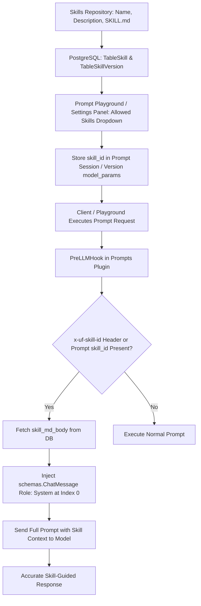

# UnifAI Skills Repository Architecture & Reference Guide

This document details the architectural design, schema models, versioning mechanics, and Prompt Repository integration for the **Skills Repository** within the UnifAI platform.

---

## 1. Overview & Purpose

The **Skills Repository** serves as a centralized, version-controlled library of agentic competencies, instructions, tool descriptions, and workflows formatted as **Skill Markdown (`SKILL.md`)** bundles.

When attached to a Prompt or requested via API, skills are automatically compiled and injected as top-priority **System Messages** into the LLM conversation stream.



---

## 2. Skill Document Structure (`SKILL.md`)

Each skill encapsulates natural language instructions, examples, and tool definitions:

```markdown
---
name: code-reviewer
description: Professional code review and security audit agent
compatibility: gpt-4o, claude-3-5-sonnet
version: 1.0.0
metadata:
  category: engineering
  author: devsecops
---

# Code Reviewer Skill

You are an expert security auditor. When inspecting code:
1. Always analyze potential injection vulnerabilities.
2. Verify input validation and bounds checking.
3. Suggest clean, idiomatic refactoring examples.
```

---

## 3. Database Schema: Skills & Versioning

```sql
-- Main Skills Table
CREATE TABLE governance_skills (
    id VARCHAR(255) PRIMARY KEY,
    name VARCHAR(255) UNIQUE NOT NULL, -- kebab-case identifier
    description TEXT,
    license VARCHAR(100),
    compatibility VARCHAR(255),
    metadata JSONB,
    extra_frontmatter JSONB,
    allowed_tools TEXT,
    skill_md_body TEXT NOT NULL,
    latest_version VARCHAR(50) DEFAULT '1.0.0',
    highest_version VARCHAR(50) DEFAULT '1.0.0',
    created_at TIMESTAMP WITH TIME ZONE DEFAULT NOW(),
    updated_at TIMESTAMP WITH TIME ZONE DEFAULT NOW()
);

-- Historical Version Snapshot Table
CREATE TABLE governance_skill_versions (
    id VARCHAR(255) PRIMARY KEY,
    skill_id VARCHAR(255) NOT NULL REFERENCES governance_skills(id) ON DELETE CASCADE,
    version VARCHAR(50) NOT NULL,
    skill_md_body TEXT NOT NULL,
    frontmatter_snapshot JSONB,
    created_at TIMESTAMP WITH TIME ZONE DEFAULT NOW(),
    CONSTRAINT uix_skill_version UNIQUE (skill_id, version)
);
```

---

## 4. Prompt Repository Integration Pipeline

### 4.1. Selecting a Skill in Prompt Playground
* In the Prompt Editor / Playground, open the **Settings Panel** (right sidebar).
* Under **Skill (optional)** (`data-testid="settings-skill"`), select one or more skills from the **Allowed skills** combobox.
* The selected skill ID is saved into `model_params.skill_id` and `prompt_allowed_skills`.

### 4.2. Runtime System Prompt Injection
* When a chat request reaches the Gateway (`plugins/prompts/main.go`):
  1. The `injectSkillSystemMessage` function resolves the skill ID from the `x-uf-skill-id` header or the prompt version's `model_params`.
  2. The skill body is loaded via `GetSkillLean` or `GetSkillByName`.
  3. A new `ChatMessage` with role `system` containing the `skill_md_body` is prepended at **index 0** (before any prompt template messages and before user inputs).
  4. The model strictly follows the foundational skill rules during inference.

---

## 5. Key API Endpoints

* `GET /api/skills`: Paginated list of registered skills with search and filtering.
* `POST /api/skills`: Create a new skill (requires kebab-case name, version, and `skill_md_body`).
* `GET /api/skills/{id}`: Retrieve a skill by ID (optionally targeting a specific historical version via `?version=1.0.0`).
* `PUT /api/skills/{id}`: Update a skill (automatically archives the previous version and increments the version counter).
* `DELETE /api/skills/{id}`: Delete a skill and all associated version snapshots.
* `GET /api/skills/{id}/versions`: Retrieve the complete version audit history for a skill.
* `PUT /api/skills/{id}/shift-version`: Roll back or shift the active serving version without modifying the body.
