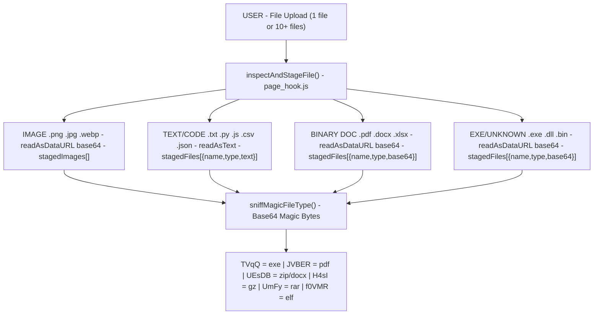
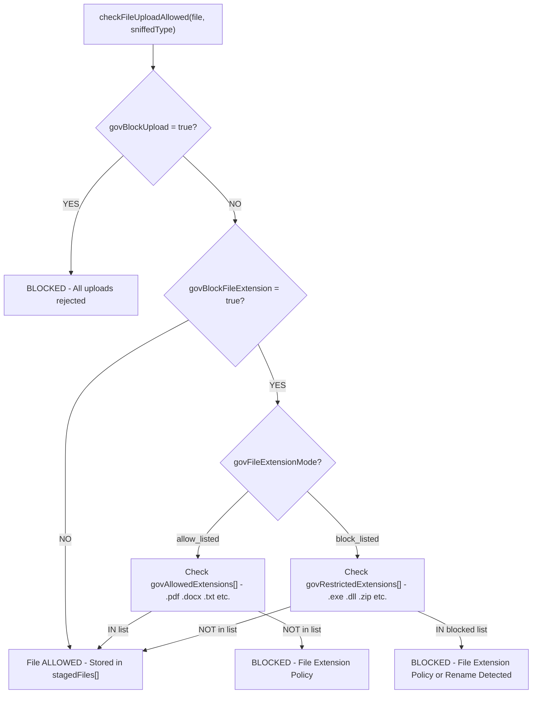
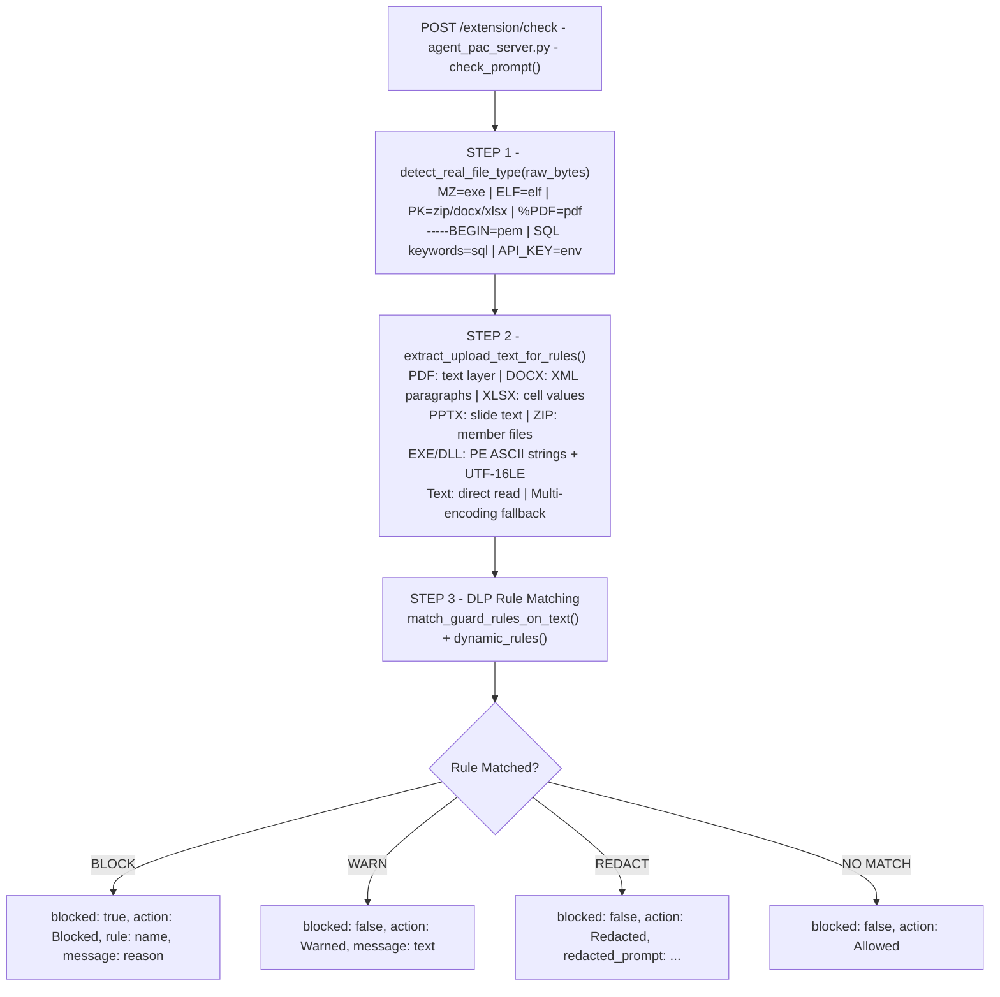
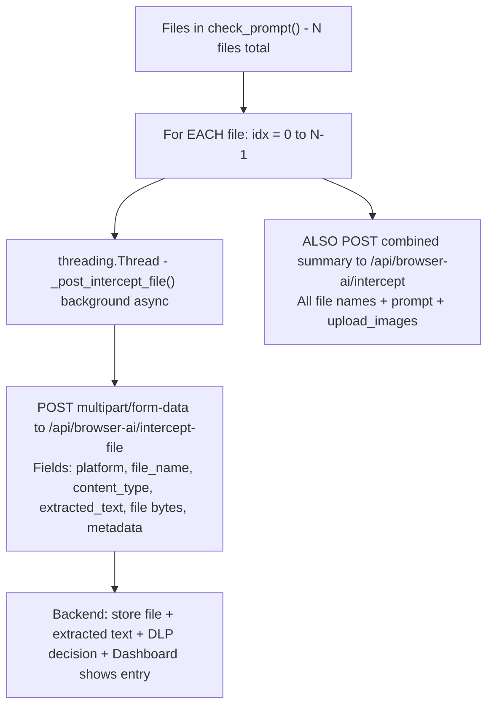

# File Predict System — Architecture & Flow

> **YP-Raksha Browser Guard** — Full In-Browser DLP: File Interception, Type Prediction, Deep Extraction & Rule Enforcement.

---

## Overview

When a user uploads any file (single or multiple) to a monitored AI platform (ChatGPT, Claude, Gemini, Copilot, etc.), the system processes it in **4 stages**:

| Stage | Where | What |
|-------|-------|------|
| **1. File Read + Type Predict** | Extension (`page_hook.js`) | Read content, sniff real file type via magic bytes |
| **2. Browser Policy Condition** | Extension (`page_hook.js`) | Apply admin-configured allow/block rules before send |
| **3. Deep Extract + Rule Check** | EXE Agent (`agent_extension.py`) | Extract text by file type, run DLP rule matching |
| **4. Backend Post** | EXE Agent (`agent_extension.py`) | Store file + decision in backend DB, show in dashboard |

---

## Stage 1 — Extension: File Read & Type Prediction



### Key File Types Detected (Extension)

| Base64 Prefix | Real Type | Detection Method |
|---------------|-----------|-----------------|
| `TVqQ` | `.exe` | MZ header magic |
| `JVBER` | `.pdf` | `%PDF-` magic |
| `UEsDB` | `.zip` / `.docx` / `.xlsx` | PK zip magic |
| `H4sI` | `.gz` | gzip magic |
| `UmFy` | `.rar` | Rar! magic |
| `f0VMR` | `.elf` | ELF binary |
| `-----BEGIN` | `.pem` / `.cert` | Text signature |
| SQL keywords | `.sql` | Text signature |
| `API_KEY=` pattern | `.env` | Text signature |

---

## Stage 2 — Extension: Browser Policy Condition Apply



### Browser Settings (from Admin Policy)

| Setting | Description |
|---------|-------------|
| `govBlockUpload` | Block ALL file uploads to AI sites |
| `govFileExtensionMode` | `allow_listed` or `block_listed` |
| `govAllowedExtensions` | Whitelist: `[".pdf", ".txt", ".docx"]` |
| `govRestrictedExtensions` | Blacklist: `[".exe", ".dll", ".zip"]` |
| `govFileExtensionTargetWebsites` | Which sites policy applies to |
| `govFileExtensionBlockMessage` | Custom block message shown to user |

---

## Stage 3 — EXE Agent: Deep Extract + Rule Check



### EXE Extraction Capabilities by File Type

| File Type | Extraction Method |
|-----------|------------------|
| `.pdf` | PDF text layer (pdfminer / pdfplumber) |
| `.docx` / `.doc` | OOXML paragraph content (python-docx) |
| `.xlsx` / `.xls` | Cell values (openpyxl) |
| `.pptx` | Slide text shapes |
| `.zip` / `.tar` / `.gz` | Recurse into member files |
| `.exe` / `.dll` | PE ASCII strings `[\x20-\x7E]{4,}` + UTF-16LE |
| `.txt` / `.csv` / `.json` | Direct text read |
| `.py` / `.js` / `.sql` | Source code text |
| Image | OCR (if model available) |
| Audio | STT transcript |
| Unknown | Multi-encoding decode fallback |

---

## Stage 4 — Backend Post (Per File)



---

## Complete End-to-End Flow

```
USER uploads file(s)
        │
        ▼
[EXTENSION] inspectAndStageFile()
   Read content: text/base64 by file type
   sniffMagicFileType() → predict real type
        │
        ▼
[EXTENSION] checkFileUploadAllowed()
   Apply browser admin policy conditions:
   ├── govBlockUpload → block all? ❌
   ├── allow_listed → only .pdf .docx allowed? ❌ others
   └── block_listed → .exe .dll blocked? ❌
        │ PASS ✅
        ▼
[EXTENSION] stagedFiles[] — stored with full content
        │
   User clicks SEND
        │
        ▼
[EXTENSION] mergeStagedAndDomFiles()
   Combine: staged + DOM files + cache lookup
   ChatGPT asset_pointer → positional content match
        │
        ▼
[EXTENSION] evaluateClientRules() — instant, no network
   ├── BLOCK rule match → block immediately ❌
   ├── REDACT rule → replace [REDACTED] ✏️
   └── CLEAN → proceed
        │
        ▼
[EXTENSION] ask(prompt, files, images)
   window.postMessage → content.js
        │
        ▼
[content.js] POST http://127.0.0.1:18195/extension/check
        │
        ▼
[EXE AGENT] check_prompt()
   detect_real_file_type() → magic bytes
   extract_upload_text_for_rules() → deep extract
   DLP rule match → action
   _post_intercept_file() × N → Backend API
        │
        ▼
DECISION returned to Extension:
   ├── {blocked: true, action: "Blocked"}  → 🚫 Block bubble shown
   ├── {action: "Warned"}                  → ⚠️ Warning bubble shown
   ├── {action: "Redacted"}                → ✏️ Prompt redacted, send
   └── {blocked: false, action: "Allowed"} → ✅ Send proceeds normally
```

---

## File References

| File | Role |
|------|------|
| `extension/page_hook.js` | `inspectAndStageFile()`, `sniffMagicFileType()`, `checkFileUploadAllowed()`, `ask()` |
| `extension/content.js` | Message relay, POST `/extension/check` |
| `agent/agent_pac_server.py` | `/extension/check` HTTP handler |
| `agent/agent_extension.py` | `check_prompt()`, `detect_real_file_type()`, `_post_intercept_file()` |
| `proxy/gateway_proxy_parts/.../extract_office_backend.py` | `extract_upload_text_for_rules()`, `match_guard_rules_on_text()` |
