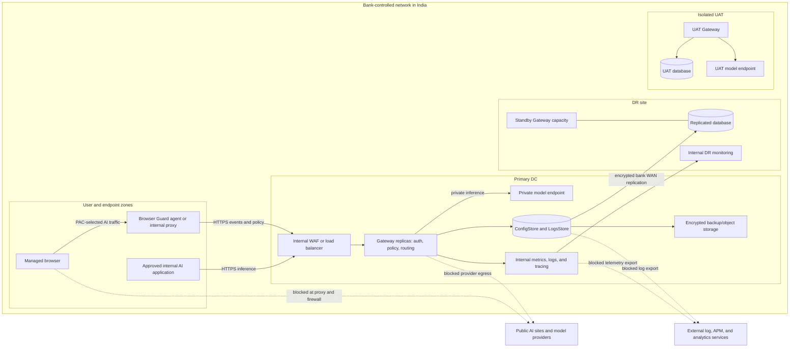

# YP-Raksha Gateway & Browser AI Guard — On-Premises Deployment Architecture

## 1. Design objective

This reference describes a bank-operated YP-Raksha deployment across a primary data centre (DC), disaster recovery site (DR) and isolated user-acceptance environment (UAT), all located within the approved India boundary. It covers site topology, infrastructure sizing for 120,000 managed endpoints, network/data flows, endpoint compatibility scope, database/storage design and rollout.

**120,000-endpoint position:** YP-Raksha is a suitable candidate for this target when deployed against the planning envelope below and qualified with the selected release, workload, endpoint estate and private model service. The reference assumes 12,000 busy-period active users, about 67 steady Guard events/second and 100 steady inference requests/second, with design targets of 150 events/second and 200 inference requests/second. These are planning assumptions, not a benchmark, certified maximum, SLA or unconditional production guarantee.

A no-egress result is achieved only when model, identity, storage, operations, updates, licensing, email, connectors, backups and support dependencies are inside the bank boundary or disabled, and bank network controls deny all other outbound routes. If direct public AI or external telemetry paths remain open, YP-Raksha cannot guarantee that data stays in the bank or India.

## 2. DC, DR and UAT reference topology

```site-topology
```

The figure shows the baseline infrastructure pools and site separation. DC has capacity for the full planned production load. DR keeps a warm service and database replica and reserves enough application capacity to scale to that load during failover. UAT has its own Gateway, database, test model and synthetic or masked data; it has no production write path or production credentials.

| Site | Role | Data and dependency boundary |
|---|---|---|
| DC | Production inference, Browser AI Guard control/event APIs and administration | Production identities, bank-approved private model services, HA persistence and internal operations services |
| DR | Recovery service and replicated records | India-resident encrypted replication, protected secrets/certificates, private DR model path and reserved scale capacity |
| UAT | Release, migration, endpoint, performance and recovery qualification | Separate identities, secrets, database, model and telemetry; synthetic or approved masked data only |

The topology is a planning design, not an instruction to use the product's bundled database/cache examples for production. Database HA, cross-site replication, site promotion and failback belong to the bank-operated infrastructure design.

## 3. Data-flow and residency boundary



The intended flow keeps prompts, responses, Browser AI events, logs, metrics, traces, backups and replication inside bank-operated India sites. DC-to-DR replication uses the bank's encrypted private WAN; UAT is isolated and uses non-production data. Public model, AI website and external telemetry paths are denied at both network and endpoint/proxy boundaries. Licensing or update services that cannot operate internally require a separately approved offline process; offline licensing behavior must be confirmed for the selected release.

## 4. Workload and infrastructure sizing

### Workload assumptions

| Dimension | Planning assumption | Result |
|---|---:|---:|
| Managed Guard endpoints | 120,000 | Registered fleet population |
| Busy-period active share | 10% | 12,000 active users/endpoints |
| Guard event rate | 1 event per active endpoint per 180 seconds | About 67 events/second steady state |
| Guard ingestion target | About 2.2× steady event rate | 150 events/second |
| Inference rate | 1 request per active user per 120 seconds | About 100 requests/second steady state |
| Inference planning target | 2× steady request rate | 200 requests/second |
| Storage illustration | 5 normalized events/endpoint/day, 4 KB/event, 90 days | About 216 GB raw; about 540 GB at 2.5× for indexes, WAL and working overhead |

These are separate request classes. Streaming, long-running generation, large prompts/uploads, payload capture, optional AI Guard Bot calls, MCP traffic and provider/model latency can increase resources. The event-storage illustration excludes large prompt/response bodies, file attachments, model data, backups, replicas and long-lived traces.

### Initial site sizing

CPU and memory figures below are per node/VM where the quantity is shown. Worker-pool capacity includes the pods scheduled on that pool; do not add pod requests as extra hardware.

| Tier | DC baseline | DR baseline | UAT baseline |
|---|---|---|---|
| Internal ingress/WAF | 2 × 8 vCPU / 16 GiB, active-active | 2 × 8 vCPU / 16 GiB, standby or active on failover | 2 × 4 vCPU / 8 GiB |
| Gateway worker pool | 4 × 32 vCPU / 128 GiB nodes; start at 6 replicas × 8 vCPU / 16 GiB; scale to 12 | 4 × 32 vCPU / 128 GiB nodes reserved; start at 3 replicas × 8 vCPU / 16 GiB; scale to 12 | 3 × 16 vCPU / 64 GiB nodes; 3 replicas × 4 vCPU / 8 GiB |
| PostgreSQL HA | 3 × 32 vCPU / 256 GiB; primary plus 2 replicas; 4 TiB usable | 3 × 32 vCPU / 256 GiB; replicated full dataset; 4 TiB usable | 3 × 16 vCPU / 64 GiB; 1 TiB usable |
| Redis/cache, if enabled | 3 × 8 vCPU / 32 GiB | 3 × 8 vCPU / 32 GiB | 3 × 4 vCPU / 16 GiB |
| Internal monitoring/log collection | 3 × 8 vCPU / 32 GiB | 3 × 8 vCPU / 32 GiB or equivalent DR capacity | 2 × 4 vCPU / 16 GiB |
| Encrypted bank-local backup/object storage | At least 8 TiB usable | At least 8 TiB usable | At least 2 TiB usable |

### Minimum and maximum system configuration boundaries

The repository does not define a certified minimum server footprint or a maximum supported endpoint count. The following separates the chart's small evaluation defaults from the largest workload sized in this reference. Chart requests are software scheduling defaults, not a host-sizing guarantee.

| Configuration band | Gateway and persistence baseline | Intended use and limit |
|---|---|---|
| Minimum chart-based evaluation | One Gateway replica; Helm defaults request 0.5 vCPU and 512 MiB RAM, with limits of 2 vCPU and 2 GiB. The chart defaults to persistent SQLite with a 10 GiB volume; bundled PostgreSQL is disabled by default. If enabled, its chart defaults request 0.25 vCPU and 256 MiB, limit 1 vCPU and 1 GiB, with an 8 GiB volume. | Single-instance development or smoke qualification only. SQLite and these chart resource defaults are not an HA design, have no endpoint-count or throughput guarantee, and must not be presented as the production minimum. A fixed physical-host minimum is not published. |
| Largest sized reference in this document | 120,000 managed endpoints; 12,000 active users/endpoints at the planning peak. DC and DR each reserve four 32-vCPU/128-GiB Gateway worker nodes. DC starts with six 8-vCPU/16-GiB replicas and scales to 12. DR starts with three replicas of the same size and scales to 12 for the full-load recovery profile. | This is the 120,000-endpoint planning design, not a measured limit or product maximum. The DC/DR database, ingress, cache, monitoring and storage baselines are listed above; model CPU/GPU is sized separately. Loads above this profile require a new workload model and qualification. |

No fixed maximum for endpoints, replicas, requests per second, database size or model concurrency is published by this repository. The 120,000-endpoint profile is the largest configuration assessed in this reference; actual acceptance depends on release-specific load, failover, database and endpoint qualification.

The current Helm sample defaults to one Gateway replica and has autoscaling disabled; when autoscaling is enabled, its sample maximum is 10 replicas. For the 120,000-endpoint DC/DR profile, set the release-matched replica/HPA policy explicitly to permit the planned 12 replicas per site, then validate node headroom and the total database connection budget. Do not carry sample values into production unchanged.

DC and DR each reserve 128 vCPU / 512 GiB of Gateway worker nodes. The Gateway pods shown are scheduled on those nodes. Leave additional capacity for platform system services, OS, monitoring agents, rolling maintenance and node loss. UAT sizing supports release qualification and rehearsal, not production-equivalent throughput unless separately scaled.

These figures exclude private-model CPU/GPU, endpoint-management servers, shared enterprise WAF/network capacity, directory services, internal registries and any separate high-volume log platform. Size private inference using the selected model, context window, token rate, concurrency and accelerator plan. Recalculate storage using measured event and attachment sizes, configured capture, retention, index/WAL growth and backup copies before procurement.

## 5. Site responsibilities and recovery

DC serves approved production traffic and keeps the model, database, DNS, identity, secrets, SMTP relay, package mirrors, collectors and backup targets on internal routes. The platform team places Gateway replicas across failure domains and protects durable application data.

DR keeps the approved release and configuration, database/backup replicas, compatible encryption and Guard secrets, TLS materials, private model access, internal DNS and collectors. The bank DBA promotes the recovery database; platform/network teams scale the Gateway pool and route clients to DR. DR is not automatically activated by the Gateway clustering feature.

Candidate recovery objectives are RPO ≤ 15 minutes and RTO ≤ 60 minutes. They are design targets only. RPO 0 generally requires synchronous replication and must be tested against WAN and commit-latency effects. The bank's actual RPO/RTO is the value measured in a site exercise.

During a site incident, operators freeze configuration changes, verify the recovery point and key material, promote the database using the DBA mechanism, scale the approved Gateway pool, validate internal model/identity/telemetry routes, then move approved DNS or load-balancer routes. Observe request errors, replication, agent heartbeat and model capacity. Failback requires data reconciliation and a controlled route cutback; it is not an automatic product operation.

| Failure | Expected impact | Recovery owner and action |
|---|---|---|
| Gateway replica/node loss | Reduced serving capacity; ingress should remove unhealthy replicas when health checks are configured | Platform restores capacity and checks readiness, limits and logs |
| Database outage | Configuration, logging or event persistence may fail; dependency health may degrade | DBA restores/promotes database; platform validates schema, pools and read/write |
| Private model outage | Inference fails or times out; optional Guard Bot evaluation may be unavailable | Model team restores the private service or uses an approved equivalent route |
| DC-to-DR replication lag | DR recovery point can exceed the target | DBA measures lag, records actual RPO and delays promotion if data is unsafe |
| Ingress, DNS or WAN outage | Clients, agents or administrators cannot reach the active site | Network team restores route or activates approved DR endpoint, then verifies TLS and name resolution |
| Guard secret or certificate mismatch | Agent authentication/event delivery may fail | Endpoint/security teams restore correct protected configuration and validate heartbeat |
| Attachment storage failure/full | Attachment operations can fail even while other APIs remain available | Platform restores capacity/permissions and reconciles metadata with stored bytes |
| Internal collector outage | Operational visibility degrades; public export must not be enabled as a fallback | Operations restores internal collectors and verifies internal alert delivery |

## 6. Endpoint, browser and VDI scope

| Platform | Evidence in the implementation | Deployment position |
|---|---|---|
| Windows endpoint | Guard executable/installer build paths exist | Confirm supported editions/builds, signatures, permissions, install/update behavior and endpoint management |
| macOS endpoint | Guard package/archive build paths exist | Confirm exact OS versions, signing/notarization, permissions, certificate trust and MDM policy |
| Linux endpoint | No Linux Guard endpoint installer is documented | Do not include Linux devices in the supported Guard population without release evidence |
| Chrome and Edge | Chromium extension package path and proxy/certificate design exist | Candidate browsers; qualify managed version, extension policy and update channel |
| Firefox | Firefox extension package path exists | Candidate browser; qualify exact version, installation policy and CA distribution |
| Safari | No qualified Safari release/version matrix is established here | Unqualified until selected release package and UAT results exist |
| Citrix, VMware Horizon, Azure Virtual Desktop and other VDI | No named VDI vendor/version certification matrix is established here | Qualify persistent and non-persistent profiles, per-session identity, proxy/PAC, CA trust and agent lifecycle |
| Gateway host | Docker and Helm packaging exists | Match OS/architecture, container runtime, Kubernetes, ingress and storage versions to selected release support |
| Database | PostgreSQL, MySQL and SQLite driver paths exist; PostgreSQL is the planning baseline | Confirm exact release/database version support; SQLite is not the large-scale HA choice |

The number of installed endpoints is not the same as the number of concurrent users. VDI session creation, identity persistence, image refresh and simultaneous agent heartbeats require their own workload profile and must be measured with the chosen endpoint/browser builds.

## 7. Network segmentation and permitted flows

Keep user, application, ingress, Gateway, data, private model, operations, backup, DR and UAT zones separate. Permit only named service-role flows through bank-managed firewalls or platform network policies.

| Source → destination | Purpose and carried data | Network treatment |
|---|---|---|
| Managed endpoints/VDI → internal ingress | Guard configuration/events and approved UI/API access | Internal HTTPS/TLS; scope by managed client, identity and user zone |
| Internal applications → internal ingress | Inference requests/responses | Internal HTTPS/TLS; require application identity and approved key |
| Administrator devices → management ingress | Configuration and audit operations | Privileged access segment, approved identity/MFA policy and internal HTTPS |
| Ingress/WAF → Gateway replicas | Routed API, UI and supported realtime traffic | Private service route; health-aware routing and approved request limits |
| Gateway → PostgreSQL | Configuration, audit, inference and Browser AI records | DBA-assigned route; TLS, workload allow-list and service identity |
| Gateway → Redis/cache | Optional cache/distributed state | Allow only when enabled; private route and TLS where supported |
| Gateway → private model | Inference prompts and responses | Explicit internal model allow-list; no public provider route in strict no-egress mode |
| Gateway → internal collectors | Metrics, logs and traces | Internal-only scrape/export paths with restricted diagnostic access |
| DC → DR database/backup | Replication and recovery copies | Encrypted bank WAN route between India sites |
| Any endpoint/server zone → public Internet | Public AI, telemetry, analytics, external mail, registry or update path | Deny by default; an approved exception needs a named destination, owner, purpose, data class and expiry |

Actual hostnames, IP ranges, numeric listener values, database identifiers, firewall objects and credentials belong in the bank's secured network/DBA records, not in this shared reference. Allowing traffic inside a bank network is not equivalent to least-privilege segmentation.

For no-egress operation, use private model endpoints; internal DNS/NTP, identity and alert services; internal image, chart, extension and model-catalog mirrors; and bank-hosted log/metrics/trace collectors. Disable or redirect public providers, external telemetry, webhooks, SMTP, analytics and connectors. Block direct browser access to prohibited public AI sites so a PAC or endpoint-agent failure cannot bypass policy. Offline licensing and update behavior must be confirmed for the selected release.

The bank proves the boundary using outbound deny policy, DNS/firewall logs and route review across startup, login, inference, Guard event delivery, updates, alerting, backup, failover and failure cases. Any allowed exception must be disclosed with the data it could carry. Application settings alone cannot prove that no data, log or telemetry leaves the bank or India.

## 8. Data, database, backup and retention

| Data class | Reference path | Residency and lifecycle control |
|---|---|---|
| Prompt and response | Application/managed browser → internal ingress → Gateway → private model; configured records → LogsStore | Use private model service; minimize payload capture; set access, retention and deletion |
| Identity and credentials | Bank identity/secrets services and Gateway configuration | Restrict admin access; protect encryption/Guard/session keys and recovery copies |
| Browser AI events | Guard agent/shared proxy → internal Browser AI API → database and configured attachment volume | Define fields captured, attachment permissions, retention and coordinated deletion |
| Audit and application records | Gateway and cluster → internal database/log collector | Restrict access and retention separately from prompt/event data |
| Metrics and traces | Gateway → internal monitoring collectors | Inspect labels/attributes and prevent external exporter paths |
| Backups and replicas | DC database/attachment storage → encrypted bank storage and DR | Keep copies in India; encrypt, restrict restore access and test recovery |
| Release artifacts | Controlled import → internal registry/software repository → UAT, DR and DC | Verify signature/digest and prohibit public runtime pulls |

PostgreSQL HA is the reference database design. Database nodes should be placed across approved failure domains with TLS, service identities, bounded connection pools, monitored replication, encrypted storage and WAL/point-in-time recovery where supported. Cross-site replication, fencing, promotion and failback are DBA/platform responsibilities. Redis/cache is optional; do not treat cache as durable source of truth unless the release design explicitly supports that use. SQLite is not suitable for this HA scale target.

Provision separate UAT, DC and DR databases or approved isolated contexts. Use a dedicated runtime identity and a controlled migration identity if schema changes require DDL. Review release migration behavior and rehearse upgrades on an empty UAT store and a restored copy before production. Do not assume schema downgrade is safe.

ConfigStore and LogsStore are logical record groups; physical separation must match the selected release. Browser AI attachment bytes are held under the configured application data path while related metadata is stored in the database, so restore the DB and durable attachment storage as a coordinated set. Retention must cover event classes, attachments, database replicas, transaction logs, backups and exported operational records. Database deletion alone does not expire backup or replica copies.

## 9. Release and deployment sequence

```flow-deployment
```

Promote the same immutable, signed Gateway image, chart and Guard release through internal repositories, UAT, DR and DC; vary only protected environment configuration. Production nodes must not build from source or pull public artifacts at runtime. The repository examples include development defaults that must be replaced, including public image/catalog sources, public DNS or sample mail settings. Confirm disconnected license activation and update handling with the product owner before accepting a fully offline design.

Use Docker Compose only for isolated evaluation or a limited UAT smoke deployment. The reference production topology is the bank's supported Kubernetes/container platform with Gateway replicas, health checks, resource controls, internal ingress, durable storage, a bank-managed HA database and default-deny egress. The companion Technical Documentation contains exact configuration groups, database preparation details, guarded Docker example commands, and Windows/macOS agent and browser-extension deployment procedures.

Roll out in bank-approved endpoint cohorts, starting with a representative pilot and expanding only as observed health, event delivery, request rate, database pressure and proxy enforcement remain within the qualified envelope. Possible planning checkpoints are 5,000, 20,000, 60,000 and 120,000 endpoints; they are not product-mandated batch sizes.

## 10. Runtime monitoring and workload qualification

Monitor Gateway health/restarts, request rate/latency/errors by route, active streams, database pool and write pressure, replication lag, storage growth, Guard heartbeat/version distribution, event delivery failures, ingress capacity, internal egress denies, backup completion and DR health. Keep labels and trace attributes minimal; restrict metrics/tracing access to internal collectors. A third-party dashboard or exporter is outside the strict no-egress design unless specifically approved.

Qualification should use synthetic data and the selected release digest. Measure sustained and burst Guard events and inference requests, p50/p95/p99 latency, error/retry rates, model concurrency, realistic streaming and payload sizes, attachment/storage growth, DB connections/write latency, agent coverage, and recovery under dependency failures. Include endpoint image refresh and VDI identity behavior. Publish benchmark values only for the configuration and workload actually measured; the sizing table is a starting reserve, not a performance result.

## 11. End-to-end product workflows inside the bank deployment

Sections 2 and 3 show where services are placed and where data is allowed to travel. The following figures show how the major YP-Raksha functions execute inside that deployment. They are logical product workflows: the exact release, enabled modules, provider behavior, policy and bank network controls determine the production implementation. Each configured model, connector, MCP server, collector, update source and backup target is a data destination and must be explicitly placed inside the approved India boundary or disabled.

### 11.1 Full YP-Raksha product and integration architecture

```platform-architecture
```

This end-to-end view shows the product from its client entry points through the bank ingress, YP-Raksha Gateway, governance and routing, configured adapters, private destinations, persistence and internal operations. The control plane covers named users and application clients, the workspace and management APIs, authentication and authorization, policy/configuration, and Guard fleet enrollment, policy delivery, heartbeat and event handling. The data plane covers internal application/API clients and the managed Browser Guard extension/endpoint agent; inference, management, Guard, Prompt and Skills APIs; authentication, virtual keys, budgets, Guard rules and verdicts; provider routing, bounded retries and configured private model calls. Optional MCP, cache and vector paths are shown only as bank-operated private integrations when enabled.

The lower band separates configuration records, inference/MCP records, Browser AI records and durable attachment bytes, runtime signals, and bank-operated dashboards/collectors/backups. Actual persistence, fields, capture, retention and exporter behavior depend on the enabled feature and selected release. Responses return over the approved request path. There is no public AI, model, SaaS telemetry, analytics, update or connector route in strict no-egress mode; the bank must enforce this at endpoint and network boundaries and keep required identity, secrets, DNS/PKI/time, artifact, database, file, model and observability dependencies inside the India boundary. Sections 2 and 3 map these logical roles to DC, DR and UAT and show the residency controls. This is the consolidated product map; Sections 11.2 onward provide separate detailed workflow diagrams for individual functions.

<!-- page-break -->

### 11.2 Application inference request and response

```flow-inference
```

An internal application or approved SDK sends an authenticated request to the bank ingress. The Gateway validates the request, caller, model and configured governance controls, selects an approved private route, calls the model service, then returns or streams the result. Configured request records and runtime signals go only to bank-operated stores and collectors. Provider fallback, retries, streaming semantics and payload capture depend on the selected adapter and configuration. In strict no-egress mode, public model routes are absent or blocked at the network boundary; an application timeout is not proof that the model did not complete work.

<!-- page-break -->

### 11.3 Browser AI Guard prompt and file decision

```flow-browser-ai
```

The Guard flow is: managed browser submits a prompt or supported upload → the extension/agent path checks whether the current site is a configured target → supported content is extracted → active rules are evaluated → the configured action is applied. Outcomes include allow, redact, warn, block, site-block and, only when configured, a bot-generated answer. A non-target site is not inspected by Guard; endpoint and network policy must independently deny unapproved destinations. Only permitted content proceeds to its approved destination. The event then travels to the internal Browser AI API and configured LogsStore; captured prompt, URL, user, file metadata or attachment content is sensitive bank data. Optional AI Bot evaluation must use an approved private model in a no-egress deployment.

If the local proxy, PAC path, Gateway or event API is unavailable, do not infer that a required deny policy is still enforced. Validate release behavior in UAT and enforce mandatory public-site denial at the endpoint/network layer. This is the on-premises view of the prompt → Guard → rule check → block/pass flow requested for the product.

<!-- page-break -->

### 11.4 Administrator change and policy propagation

```flow-admin-ui
```

An administrator uses the embedded YP-Raksha UI through the privileged internal ingress. The management path authenticates the session and evaluates resource/operation permissions and applicable section grants before validating a change. Accepted configuration is persisted in the approved ConfigStore and mutating operations enter the audit path. Guard agents retrieve applicable fleet settings, rules and target definitions using the configured internal polling/heartbeat path. Propagation is not necessarily instantaneous: observe the policy version and representative endpoint behavior before expanding a change. Use named accounts and least privilege; keep the Guard shared secret in protected endpoint configuration, never in a browser extension package or employee-facing file.

<!-- page-break -->

### 11.5 Endpoint agent and browser-extension rollout

```flow-guard-rollout
```

The desktop agent and browser extension are separate deliverables. Obtain the release bundle through the controlled import path and verify the approved digest/signature. The repository package paths include the Windows Guard executable `YP_Raksha.exe`, a macOS archive `YP_Raksha_macOS.zip` (and package build path), a Chromium `.crx`, and a Firefox `.xpi`; use the exact files and identifiers from the selected signed release. For Windows, distribute the Guard executable/package through endpoint management; confirm its actual install, startup, upgrade and uninstall behavior rather than assuming it is an MSI or service. For macOS, distribute the release package/archive through MDM, validate signing/notarization and the required permissions, and apply approved certificate/proxy profiles. Separately publish the managed Chromium extension package and/or signed Firefox add-on through the bank's internal enterprise distribution/update source. Record the release's extension identifier and policy settings in the bank's endpoint records.

Install the agent before the extension pilot. Confirm internal Gateway configuration, protected fleet-secret delivery, OS certificate trust, PAC/proxy selection, browser extension policy, heartbeat, target matching and event delivery with synthetic content. Roll out in endpoint-management cohorts and watch healthy-agent coverage, failed updates, proxy bypass, database writes and event lag. VDI images need additional checks for per-session identity, user isolation, certificate persistence and profile cleanup; qualify persistent and non-persistent pools separately.

<!-- page-break -->

### 11.6 Release build, internal promotion and endpoint expansion

```flow-release
```

Import the same approved immutable Gateway image, release-matched chart/manifest and Guard packages into an internal repository. Keep the selected digest and compatibility information with the bank's controlled release record. Deploy to isolated UAT first with separate identity, database, secrets, private test model and synthetic or approved masked data. Exercise schema migration, policy, endpoint/browser versions, no-egress paths, load and recovery. Promote the identical artifact digest to DR and then DC; change only the environment-specific protected configuration. A failed promotion uses a tested restore or rollback path; do not assume a database schema downgrade is safe. Public image pulls, public package/update sources and developer build paths are not part of the production runtime.

<!-- page-break -->

### 11.7 Settings, health and internal observability

```flow-observability
```

The Gateway and Guard produce service health, request outcomes, configured application/audit records and enabled metrics/traces. Send these only to bank-operated collectors within the India boundary. Review labels and attributes for prompt, user, URL, model or file data before enabling an exporter; operational metrics do not automatically require full prompt capture. Configure internal dashboards and alert delivery with restricted access. A third-party SaaS exporter, external webhook, mail relay or analytics connector is a separate egress path and must be disabled or specifically approved. Correlate incidents using request/agent identifiers and timestamps, not raw prompt text in general support channels.

<!-- page-break -->

### 11.8 Optional MCP tool request

```flow-mcp
```

MCP is optional. When enabled, the Gateway authenticates the client/session, applies tool-group access, connects to the configured MCP server and returns the tool result. Each server, tool input/output, credential and log is a potential data path. For a bank-only deployment, use bank-operated MCP servers and explicit internal destination allow-lists; otherwise leave MCP disabled. Review the tool's read/write scope and retention independently from inference and Browser AI records.

<!-- page-break -->

### 11.9 Runtime error classification and safe recovery

```flow-error-handling
```

Client/authentication and policy errors require correction, not blind retry. Eligible transient provider failures may use bounded, release-configured retries; provider credential rotation is only possible where an eligible configured key pool exists. Before a stream starts, the Gateway can return an HTTP error; after response streaming begins, the status cannot be replaced and the client may receive a protocol error or interrupted stream. A caller timeout can leave completion state unknown. Preserve a request identifier, inspect internal health/logs and reconcile provider or tool state before repeating a non-idempotent operation. A public provider is never a recovery destination in strict no-egress mode.

<!-- page-break -->

### 11.10 Database migration during release promotion

```flow-db-migration
```

Treat schema migrations as release-specific state changes. Rehearse the selected image and migration against an isolated UAT database and a restored representative copy; use a controlled migration identity if DDL is required and a separate least-privilege runtime identity. Measure migration duration, locks and database recovery behavior. Before production promotion, take a coordinated recovery point for database and attachment data, then apply the approved release and observe readiness, read/write behavior, connection pools and replication. If recovery is necessary, use the tested restore path or approved forward fix; do not assume the previous binary can safely use a changed schema.

<!-- page-break -->

### 11.11 Bank-resident backup and restore

```flow-backup-restore
```

Back up the relational database, application/attachment data, release-matched configuration and required recovery material as coordinated but separately protected items. Encrypt copies using bank-controlled key custody and keep all primary and secondary copies in approved India locations. A restore must match the database state with attachment bytes and metadata, compatible application release, secrets/certificates and private dependencies. Restore first into an isolated environment; verify representative record-to-file references, application readiness, retention/deletion behavior and synthetic Guard/inference paths before routing users. Database deletion alone does not remove replica, archive or backup copies.

<!-- page-break -->

### 11.12 Controlled DC-to-DR failover and failback

```flow-site-failover
```

The bank incident commander authorizes a site transition. Platform and DBA teams freeze conflicting changes, assess data freshness and replication, confirm encryption/Guard secrets and TLS material, promote the recovery database using the approved fencing procedure, and activate internal identity, model, DNS and collector paths. The platform team scales DR Gateway capacity; the network team moves the approved internal route after health validation. Operators then check inference, Guard policy reads/event ingestion, database writes and agent heartbeat. Record measured RPO/RTO and any degraded features. Failback requires reconciliation, a safe replication direction, a separate authorization and controlled route cutback; the product does not perform cross-site database promotion automatically.

<!-- page-break -->

### 11.13 Logical data groups and persistence relationships

```logical-data-model
```

This is a logical view of configuration, workspace, identity, runtime, event and durable-file record groups; it does not assert physical table constraints or a mandatory split into separate databases. The selected release and bank DBA design determine the physical schema. In this deployment, keep ConfigStore and LogsStore in bank-operated database services, retain Browser AI attachment bytes on protected durable storage, and send metrics/traces to internal collectors. Replicate or back up the database, attachment path, configuration and required recovery material as coordinated state, with separate access and retention rules for each data class.

<!-- page-break -->

### 11.14 Bank identity, session and authorization lifecycle

```flow-identity-access
```

The bank provisions named identities through the configured local, directory or optional SCIM workflow. SCIM is an account-provisioning path, not the user's login session. The user reaches the internal workspace over the bank-managed TLS route and authenticates using the selected release's configured login/session or OAuth2 flow. Management APIs then check the session, resource/operation permission and any section grant before an action is served. Failed authentication or authorization is denied; mutating management API activity enters the audit path. Whether sign-in delegates to the bank identity provider and applies MFA depends on the bank's configured identity integration.

### 11.15 Prompt and Skills workspace lifecycle

```flow-workspace-lifecycle
```

An authorized user opens the Prompt Repository or Skills Repository, and the Gateway applies the user's role, operation rights and configured section or repository visibility. Permitted users can browse and perform supported create/edit operations. Saved prompt/skill records and supported history or deployment metadata remain in the bank-managed application database and its approved backup/retention path. Prompt deployment and skill serving are distinct feature paths and must be enabled and qualified for the selected release. Treat prompt and skill bodies, versions and deployment content as bank data; verify access with both an allowed and a denied test account.

<!-- page-break -->

## 12. On-premises prerequisites and deployment preparation

### 12.1 Bank-provided platform and service prerequisites

| Prerequisite | Required design input | On-premises handling |
|---|---|---|
| Compute and container platform | Supported host architecture, container runtime and bank-supported Kubernetes/platform release | Reserve the DC/DR/UAT pools in Section 4; use resource requests/limits, readiness/liveness checks, replica spread and disruption protection. |
| Internal ingress and DNS | Internal service names, TLS certificate ownership, trusted proxy chain and health-aware routing | Keep management and client routes on bank networks; restrict diagnostic and profiling surfaces. Do not publish internal addresses in this document. |
| Relational database | Selected release-compatible PostgreSQL engine/version, HA, backup, replication, IOPS and connection budget | Use the Section 8 design; keep credentials and physical database identifiers in protected DBA configuration. |
| Durable application/attachment storage | Storage class, usable capacity, access mode, backup and recovery semantics | Persist Guard/package and attachment paths required by the release; confirm replicas share or restore the correct data. |
| Identity, secrets and key custody | Bank identity flow, secret manager, encryption-key custody, Guard secret and recovery access | Keep separate DC/DR/UAT identities and keys; distribute secrets through protected runtime/endpoint channels. |
| Private model service | Approved model, API compatibility, concurrency, context window, capacity and failure behavior | Provide separate UAT and production-private routes; size model CPU/GPU independently from Gateway resources. |
| Internal operations services | DNS, time, certificate authority, logging/metrics/tracing collectors and alert routing | Keep collectors and alert destinations inside the approved India boundary. Disable public SaaS paths for no-egress. |
| Artifact and endpoint distribution | Internal image/chart repository, signed Guard packages and managed browser extension source | Mirror artifacts before deployment; endpoint management must support controlled Windows/macOS distribution and enterprise browser policy. |
| Network controls | Segments, service-role allow-lists, default-deny egress and internal DR path | Apply controls at endpoint, ingress, server and WAN boundaries; product configuration alone is not an egress firewall. |
| Data governance | Approved capture fields, retention, deletion, access and support-evidence policy | Classify prompts, events, attachments, logs, traces, backups and replicas; use synthetic data in UAT unless masked data is approved. |

Exact component versions, artifact digests, service names, IP ranges, numeric listener values, database identifiers and credentials are environment-specific. Store them in the bank's controlled implementation records; this client reference deliberately contains no live environment values.

### 12.2 Runtime configuration and secret separation

Prepare an environment-specific configuration set from the selected release's supported configuration template and chart. It normally covers Gateway bind/data paths, database driver and protected connection reference, database TLS mode, application encryption-key reference, Guard fleet-secret reference and enforcement mode, internal provider/model destinations, internal observability destinations, ingress/trusted-proxy settings and durable storage paths. Use only configuration keys that exist in the chosen release; the names and defaults can change between releases.

Keep database credentials, provider secrets, `GATEWAY_ENCRYPTION_KEY`, `GATEWAY_GUARD_SECRET`, TLS private keys, image-pull credentials and signing keys in the bank's secret-management process. Do not place their values in a checked-in values file, command history, extension package, endpoint-readable file, support bundle or this client document. Deliver only the minimum non-secret fleet configuration to Guard endpoints. Protect a separately recoverable DC/DR copy of secrets and certificates; rotation must update the dependent Gateway, Guard fleet and recovery site in a controlled order.

Configuration templates may contain identifiers such as `APP_HOST`, `APP_DIR`, `DB_TYPE`, `DB_HOST`, `DB_PORT`, `DB_NAME`, `DB_USER`, `DB_PASSWORD`, `DB_SSL_MODE`, `GATEWAY_ENCRYPTION_KEY`, `GATEWAY_GUARD_SECRET`, `GATEWAY_GUARD_REQUIRE_SECRET` and `GATEWAY_METRICS_TOKEN`. These are configuration key names only, not deployment values or a promise that every key exists in every release. Resolve actual values from the selected release template into protected bank configuration; do not include live addresses, listener numbers, database identifiers or secret values in this document.

### 12.3 Database and persistent-state preparation

| Concern | Provisioning detail |
|---|---|
| Environment separation | Create separate UAT, DC and DR database services or approved isolated database contexts. UAT must not share production credentials or write routes. |
| Engine and HA | Use the release-compatible PostgreSQL design as the planning baseline. Select a bank-supported HA/failover manager and place nodes across failure domains; the product's application replicas do not provide database HA. |
| Identities | Create a least-privilege Gateway runtime identity. Use a time-bounded, separately controlled migration identity when release migrations require schema changes. |
| TLS and network | Require database TLS with certificate validation, workload-only network allow-lists and protected credential delivery. Do not expose the database to endpoint/user zones. |
| Capacity | Budget total connections across all Gateway replicas, background jobs, migration sessions and administrative activity. Measure IOPS, write latency, indexes, WAL, replication lag, attachment growth and retention. |
| Recovery | Enable encrypted backups and point-in-time/WAL recovery where supported. Coordinate database recovery points with attachment/application-data storage and secret/certificate recovery. Test an isolated restore. |
| Retention and deletion | Define retention separately for inference, audit, Browser AI, attachment, operational logs, backups, archives and replicas. Validate deletion at each layer, not only the active database. |

The 4 TiB usable database/storage figure in the site table is a planning reserve and is not derived solely from the 540 GB event illustration. Final capacity depends on actual prompts and events, attachments, indexes/WAL, backup copies, retention and replication; qualify with the bank's intended capture policy and workload.

### 12.4 Gateway deployment procedure

1. **Import and identify the release.** Verify approved signatures/digests for the Gateway image, chart/manifest and required Guard bundles. Scan and transfer them into an internal repository using the bank's controlled process. Production nodes must not pull public artifacts or build from source.
2. **Prepare the platform namespace.** Create the environment boundary, service account, ingress route, internal TLS, persistent data volumes, resource controls, replica placement, readiness/liveness checks, disruption settings and default-deny network policies from the release-matched deployment manifest.
3. **Provision data and secrets.** Complete the database, runtime/migration identities, TLS validation and backup path. Inject protected configuration and secrets using the bank's secret manager or approved equivalent; do not write resolved secret values into rendered client outputs.
4. **Deploy first to UAT.** Use its separate database, secrets, test model and internal collectors. Compose may be used for a single-host smoke evaluation only; it is not the 120,000-endpoint production design. Production uses the bank-supported replicated container platform described in Section 4.
5. **Validate readiness and private routes.** Confirm application readiness, database read/write, internal identity, private model, attachment storage and internal observability. Check that public model, telemetry, registry, mail and update paths remain denied.
6. **Exercise product paths.** Use synthetic inference and Guard content, role-scoped admin changes, event ingestion, extension/agent behavior, realistic streaming and supported file types. Confirm error mapping and bounded retry behavior; do not use production prompts as test fixtures.
7. **Promote the same digest.** Promote UAT-qualified artifacts to DR and then DC with only environment-specific protected configuration changed. Execute the bank change/incident process, monitor the workload and stop expansion if health or residency controls regress.

Use release-matched container values and deployment guides for exact keys and supported health routes. Do not infer a fixed listener, port, ingress annotation or database schema from this reference; these are deployment-specific and intentionally omitted.

For a single-host UAT smoke run only, after the bank has provisioned the protected environment file and confirmed that it matches the selected Compose release, the illustrative lifecycle is:

```bash
docker compose config --quiet
docker compose up --detach gateway_tech
docker compose ps
docker compose logs --tail=200 gateway_tech
```

Do not print or attach a fully resolved Compose configuration: it can contain protected connection values. This command sequence is not the production topology or a substitute for the bank-supported replicated container platform.

<!-- page-break -->

### 12.5 Guard installer and browser-extension deployment

| Order | Windows and macOS agent | Managed browser extension | Control purpose |
|---|---|---|---|
| 1 | Import and verify the release-specific Windows `YP_Raksha.exe` or macOS `YP_Raksha_macOS.zip`/signed package. | Import the release-specific Chromium `.crx` and/or Firefox `.xpi`; verify signature, digest and identifier. | Establish artifact provenance before distribution. |
| 2 | Stage internal Gateway name, protected agent configuration, certificate/trust profile and endpoint-management assignment. | Configure the managed extension's install source, allow/block policy and internal update location using enterprise browser controls. | Avoid public destinations and user-controlled configuration. |
| 3 | Install the endpoint agent using the tested release procedure. On Windows, confirm whether the package is a portable executable or installer; do not assume MSI/service behavior. On macOS, confirm MDM package, signing, permissions and startup behavior. | Assign to a small managed pilot after the agent is healthy. Do not use unpacked/developer-mode installation for production rollout. | Agent supplies the local proxy/PAC and policy/event communication path; the extension is a separate client integration. |
| 4 | Validate OS trust-store installation for the Guard certificate, local agent health, identity persistence, internal control-plane reachability and approved proxy/PAC selection. | Confirm policy application, extension ID/version, agent hand-off, target matching and browser restart/update behavior. | Prevent TLS, identity and routing gaps. |
| 5 | Check heartbeat and update status in the internal Browser AI administration view. | Run synthetic allow, redact, warn, block, site-block and supported upload cases. | Verify decisions and event path before fleet expansion. |
| 6 | Expand through endpoint-management cohorts, monitor coverage and errors, and retain tested rollback/uninstall instructions. | Expand with the same approved release and managed update channel; validate after browser/VDI image refresh. | Control change blast radius and preserve recovery options. |

For VDI, separately qualify persistent and non-persistent images, concurrent logon storms, agent identity uniqueness, profile cleanup, trust-store lifetime and extension policy refresh. If endpoint or PAC fallback can permit direct public traffic, a bank endpoint/network deny rule must still prevent access to prohibited AI destinations.

<!-- page-break -->

### 12.6 Bank/India residency enforcement in operation

No-egress depends on the full service chain, not just the Gateway: model/provider, identity, DNS/NTP, SMTP/notifications, connectors, MCP, telemetry, artifact and extension updates, licensing, support, backups and disaster-recovery copies. Place required dependencies on internal services or disable optional integrations. Deny all unapproved outbound connections from endpoint and server segments, and block direct browser access to prohibited public AI sites.

Demonstrate the intended boundary using internal DNS/firewall/proxy records and outbound deny events while exercising startup, sign-in, inference, Browser Guard prompt and file outcomes, event storage, extension/agent update, alerting, backup, restore and DC-to-DR recovery. Include unavailable Gateway/PAC/model/collector paths. Review every allow rule for owner, purpose, data class and expiry. Logs and evidence used for this demonstration must themselves remain inside the bank/India boundary. Do not represent the deployment as no-egress while any unexplained public route is reachable.

### 12.7 Capacity interpretation for 120,000 endpoints

The endpoint count describes the managed Guard fleet, not concurrent inference. The current planning envelope models 12,000 active endpoints/users at peak. Guard event planning uses one normalized event per active endpoint every 180 seconds (about 67 events/second) with a 150 events/second ingestion target. Inference planning uses one request per active user every 120 seconds (about 100 requests/second) with a 200 requests/second target. These are separate workload classes; they do not measure model token generation or include every large upload, long stream, optional bot evaluation or MCP call.

The event-storage illustration assumes five normalized events per endpoint per day, 4 KB per event and 90 days (about 216 GB raw; about 540 GB with the stated 2.5× working overhead). It excludes prompt/response bodies, attachments, model data, backups, replicas and long-lived traces. Use actual event size, capture settings, retention, database indexes/WAL, attachment volume, replication and backup copies in the final capacity calculation. The provided site compute/storage values are procurement planning estimates, not a measured benchmark, certified maximum or SLA. Record measured sustained and burst results only for the selected release and tested topology.

<!-- page-break -->

### 12.8 Operational ownership across the deployment

| Work area | Primary bank owner | Product/deployment responsibility |
|---|---|---|
| Container platform, ingress and runtime | Platform team | Release manifests, image/replica readiness, resource and node placement. |
| Database, attachments and recovery copies | DBA and storage team | Schema lifecycle, HA, pool/IOPS monitoring, coordinated backup/restore. |
| Identity, certificates and secrets | IAM and security teams | Named admin access, Guard identity, key custody, TLS and controlled rotation. |
| Private models and inference capacity | AI/model service owner | Approved internal destination, model availability, concurrency and request limits. |
| Browser Guard and VDI fleet | Endpoint/browser/VDI teams | Signed agent and extension rollout, PAC/proxy, certificate trust and session behavior. |
| Network residency boundary | Network security team | Default-deny egress, site segmentation, internal routing and deny evidence. |
| Logs, metrics, traces and alerts | Operations/security | Internal collectors, access, sensitive-label review, retention and alert response. |
| Release promotion and recovery | Change authority with platform/DBA | UAT qualification, immutable promotion, stop/rollback and measured site recovery. |

The bank selects the final ownership model and service levels. Product architecture does not replace the bank's infrastructure, data governance, incident authority or endpoint policy.
