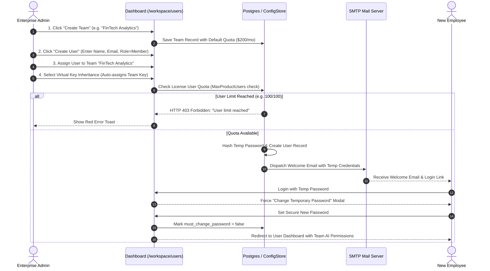
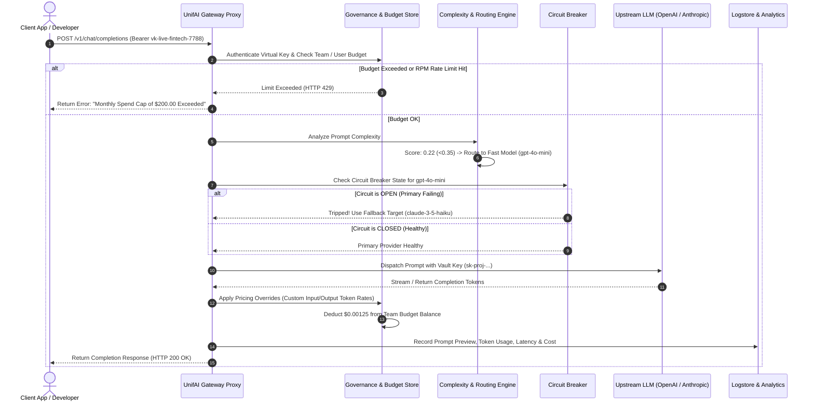
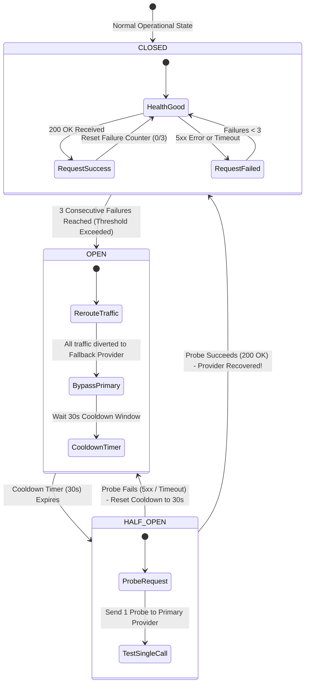
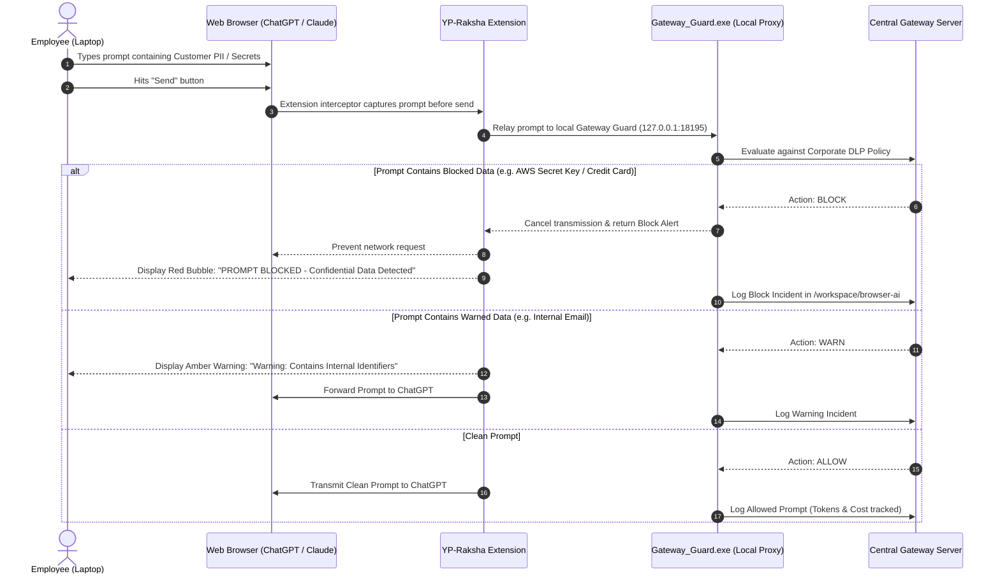

# UnifAI Enterprise Architecture & Connected System Flow Documentation
**Version:** v3.0 Enterprise Edition  
**Author:** YesPanchi Group of Companies / UnifAI Engineering  
**Scope:** Complete Architectural Topology, Entity Relationships, End-to-End Functional Pipelines & Dashboard Navigation Guide

---

## 1. Executive Summary & Architectural Overview

The **UnifAI Enterprise Platform** is a dual-engine AI Governance and Infrastructure system consisting of:
1. **The AI Gateway Control Plane (Server / Cloud API):** Secure proxy and routing engine that shields upstream LLM providers (OpenAI, Anthropic, Gemini, Groq, Ollama), enforces budget caps, applies complexity routing, maintains circuit breakers, and calculates granular token costs.
2. **Browser Guard & YP-Raksha (Client Endpoint DLP):** Desktop background service (`Gateway_Guard.exe`) and browser extension protecting employee laptops against unauthorized AI data exfiltration, secret leakage, and compliance violations on public AI services (ChatGPT, Claude, Gemini, Copilot).

### 1.1 Master Architectural Topology Diagram

```
+---------------------------------------------------------------------------------------------------------+
|                                    CUSTOMER / TENANT ORGANIZATION                                      |
|                                                                                                         |
|   +------------------------------------+             +----------------------------------------------+   |
|   |         TEAMS / DEPARTMENTS        |             |               USERS & IDENTITIES             |   |
|   |  - Engineering   - Finance         | <---------> |  - Admins      - Developers                  |   |
|   |  - Customer Care - Legal & HR      |  (Belongs)  |  - Managers    - Support Staff               |   |
|   +-----------------+------------------+             +----------------------+-----------------------+   |
|                     |                                                       |                           |
|                     | (Inherits or Issues)                                  | (Directly Issued)         |
|                     v                                                       v                           |
|   +-------------------------------------------------------------------------------------------------+   |
|   |                                     VIRTUAL KEYS (GATEWAY API)                                  |   |
|   |  - Proxy Key (vk-live-...) - Spend Cap ($) - Rate Limits (RPM/TPM) - Allowed Models Restriction |   |
|   +-------------------------------------------------+-----------------------------------------------+   |
|                                                     |                                                   |
|                                                     | Sends AI Prompts                                  |
|                                                     v                                                   |
|   +-------------------------------------------------------------------------------------------------+   |
|   |                                  UNIFAI AI GATEWAY CORE ENGINE                                  |   |
|   |                                                                                                 |   |
|   |   +-----------------------+     +-----------------------+     +-----------------------------+   |   |
|   |   |  1. BUDGETS & LIMITS  | --> | 2. COMPLEXITY ROUTER  | --> |    3. ROUTING & FAILOVER    |   |   |
|   |   |  Check Daily/Monthly  |     | Classify Prompt:      |     | Priority Fallback Chains    |   |   |
|   |   |  Caps & Token Buckets |     | Simple vs Complex     |     | Weighted Load Balancing     |   |   |
|   |   +-----------------------+     +-----------------------+     +--------------+--------------+   |   |
|   |                                                                              |                  |   |
|   |                                                                              v                  |   |
|   |   +-----------------------+     +-----------------------+     +-----------------------------+   |   |
|   |   |  6. AUDIT & LOGSTORE  | <-- | 5. PRICING OVERRIDES  | <-- |     4. CIRCUIT BREAKER      |   |   |
|   |   | Real-time prompt logs |     | Calculate exact token |     | Monitor upstream outages    |   |   |
|   |   | Cost & latency record |     | cost (custom rates)   |     | Auto-trip to OPEN if 5xx    |   |   |
|   |   +-----------------------+     +-----------------------+     +--------------+--------------+   |   |
|   |                                                                              |                  |   |
|   +------------------------------------------------------------------------------+------------------+   |
|                                                                                  |                      |
|                                                                                  | Outbound LLM Call    |
|                                                                                  v                      |
|   +-------------------------------------------------------------------------------------------------+   |
|   |                                   UPSTREAM MODEL PROVIDERS                                      |   |
|   |   [ OpenAI ]       [ Anthropic ]       [ Google Gemini ]       [ Groq ]       [ Local Ollama ]  |   |
|   +-------------------------------------------------------------------------------------------------+   |
|                                                                                                         |
|   +-------------------------------------------------------------------------------------------------+   |
|   |                      CLIENT ENDPOINTS (EMPLOYEE LAPTOPS - BROWSER GUARD)                        |   |
|   |  - Gateway_Guard.exe (Agent) <---> YP-Raksha Extension <---> Browser AI (ChatGPT, Claude, etc.)  |   |
|   |  - Real-time PII / Secrets DLP Scanning <---> Intercept & Audit Log pushed to Gateway Logstore  |   |
|   +-------------------------------------------------------------------------------------------------+   |
+---------------------------------------------------------------------------------------------------------+
```

---

## 2. Why Each Component Exists & What Purpose It Serves

Every entity in UnifAI is purpose-built to solve a specific enterprise operational, financial, or security challenge. The table below outlines the core purpose of each component:

| Component / Entity | Why It Exists (The Core Problem Solved) | What Happens If It Does Not Exist? | Where It Lives on Dashboard |
| :--- | :--- | :--- | :--- |
| **Customer / Tenant** | Represents the parent organization. Enforces strict multi-tenant database isolation and corporate policy boundary. | Data between companies would mix; no organizational-level root settings. | Platform Root / Tenant Settings |
| **Teams** | Groups users into business departments (e.g. Engineering, Sales, HR, Finance). Allows assigning shared budgets and team-wide virtual keys. | Admins would have to configure thousands of employees individually one-by-one. | `/workspace/users` ➔ **Teams** tab |
| **Users** | Individual staff accounts with role-based access control (Admin, Sub-Admin, Member, Viewer) and authentication audit trails. | No accountability; cannot trace who sent which prompt or who modified policies. | `/workspace/users` ➔ **Users** tab |
| **Virtual Keys** | Secure proxy API keys (`vk-live-...`). Shields real provider keys (OpenAI/Anthropic) from ever being exposed to developers. | Developers would possess master provider keys, resulting in stolen keys and unmonitored bills. | `/workspace/virtual-keys` |
| **Model Providers** | Secure vault for real upstream LLM credentials (API keys, Base URLs, Custom Headers). Monitors provider connectivity. | The gateway would not know where to forward requests or how to authenticate with AI vendors. | `/workspace/providers` |
| **Model Catalog** | Master inventory of all available AI models across all providers. Allows enabling/disabling models and viewing context windows. | Users could request non-existent or deprecated models, causing runtime errors. | `/workspace/model-catalog` |
| **Complexity Router** | Evaluates prompt difficulty. Automatically routes simple questions to cheap models and complex reasoning to flagship models. | Companies waste millions of dollars running simple queries on ultra-expensive models. | `/workspace/complexity-router` |
| **Routing Rules** | Defines failover chains (Primary ➔ Fallback 1 ➔ Fallback 2) and weighted load-balancing across multiple LLMs. | A single provider outage (e.g. OpenAI down) takes down the entire company's AI applications. | `/workspace/routing-rules` |
| **Circuit Breaker** | Automatically cuts off failing providers when 5xx errors spike. Bypasses dead APIs instantly without waiting for 60s timeouts. | End users experience hanging loading spinners and request timeouts during cloud outages. | `/workspace/circuit-breaker` |
| **Budgets & Limits** | Sets hard and soft spending limits ($ / INR) and rate limits (RPM / TPM) per team, user, or virtual key. | A single runaway script or infinite loop could drain an enterprise's entire AI budget overnight. | `/workspace/model-limits` |
| **Pricing Overrides** | Allows enterprise customers to input negotiated custom token prices ($/1M input & output tokens) instead of vendor list prices. | Cost analytics and internal chargeback reports will reflect incorrect public retail prices. | `/workspace/custom-pricing/overrides` |
| **Model Settings** | Sets global runtime defaults for temperature, max output tokens, top_p, and gateway connection timeouts. | Inconsistent model responses; developers must redundantly specify parameters on every request. | `/workspace/custom-pricing` |
| **Browser Guard (YP-Raksha)** | Desktop agent and extension intercepting ChatGPT, Claude, and Gemini in employee web browsers for real-time DLP. | Employees paste confidential source code, customer PII, and financial records into public AI tools. | `/workspace/browser-ai` |
| **Observability & Logs** | Full audit repository capturing every prompt, token count, cost, latency, risk score, and DLP violation. | Zero visibility into AI adoption, safety compliance, or departmental cost attribution. | `/workspace/logs` & `/workspace/browser-ai` |

---

## 3. The 4 Core End-to-End Functional Flows

### Flow 1: Identity, Teams & Access Provisioning Flow
*How a user is created, assigned to a department, and given AI access.*



---

### Flow 2: Live AI Request & Intelligent Routing Execution Flow
*How a prompt flows from an application or developer through the AI Gateway to upstream LLMs.*



---

### Flow 3: Circuit Breaker Resilience & Self-Healing Failover Flow
*How UnifAI prevents provider outages from breaking enterprise operations.*



---

### Flow 4: Employee Laptop DLP & Browser AI Guard Flow
*How YP-Raksha on employee laptops intercepts and protects corporate data on ChatGPT, Gemini, and Claude.*



---

## 4. Complete Dashboard Click-Map: Where to Click, Where It Leads & What It Shows

This reference table acts as an operator's manual for administrators navigating the UnifAI Web Dashboard:

| Goal / Operational Task | Where to Click on Navigation Sidebar | Action on the Page | What It Opens / What It Shows |
| :--- | :--- | :--- | :--- |
| **Add a new staff member** | **Identity & Access** ➔ `Users` (`/workspace/users`) | Click **"Add User"** button top-right. | Opens User Creation Sheet: Name, Email, Role (Admin, Member, Viewer), Team assignment, Virtual key inheritance. |
| **Group users by department** | **Identity & Access** ➔ `Users` (`/workspace/users`) | Click **"Teams"** tab at top of table. | Displays all Teams (Engineering, Finance, HR); allows creating new teams and setting team-level monthly spend caps. |
| **Create an API key for developers** | **Model Hub** ➔ `Virtual Keys` (`/workspace/virtual-keys`) | Click **"Create Virtual Key"** button. | Generates secure proxy key (`vk-live-...`); allows setting rate limits (RPM), spend budget, and allowed model restrictions. |
| **Connect OpenAI, Anthropic, or Ollama** | **Model Hub** ➔ `Model Providers` (`/workspace/providers`) | Click **"Add Provider"** dropdown or **"Add Custom Provider"**. | Opens Provider Configuration: Enter API Key, set Custom Base URL (e.g. for Ollama `http://localhost:11434`), test connection. |
| **Enable / disable an AI model** | **Model Hub** ➔ `Model Catalog` (`/workspace/model-catalog`) | Locate model in table and toggle the **Status Switch**. | Turns model ON or OFF across the entire company. Disabled models cannot be called by any virtual key. |
| **Set a monthly spend budget cap** | **Governance** ➔ `Budgets & Limits` (`/workspace/model-limits`) | Click **"Create Budget Policy"**. | Sets spend cap ($ / INR), time period (Daily, Monthly), and action on breach (**Soft Warning** vs **Hard Block**). |
| **Route simple prompts to cheap models** | **Routing** ➔ `Complexity Router` (`/workspace/complexity-router`) | Click **"Configure Tiers"**. | Sets complexity thresholds: Score < 0.35 ➔ `gpt-4o-mini`; Score > 0.70 ➔ `gpt-4o`. Displays real-time classifier graph. |
| **Set up automatic provider failover** | **Routing** ➔ `Routing Rules` (`/workspace/routing-rules`) | Click **"New Routing Rule"** ➔ Select **Fallback Chain**. | Visual rule builder: Primary Target (OpenAI) ➔ Fallback 1 (Anthropic) ➔ Fallback 2 (Gemini). |
| **Prevent provider downtime outages** | **Routing** ➔ `Circuit Breaker` (`/workspace/circuit-breaker`) | Click **"Create Policy"** or inspect status table. | Displays live circuit status: **CLOSED (Healthy)**, **OPEN (Tripped)**, or **HALF-OPEN (Testing recovery)**. Allows manual reset. |
| **Set custom token prices for billing** | **Cost & Pricing** ➔ `Custom Pricing` (`/workspace/custom-pricing/overrides`) | Click **"Add Pricing Override"**. | Sets custom Input Token Price and Output Token Price per 1M tokens ($ / INR). Overrides vendor retail prices in logs. |
| **Configure global model parameters** | **Cost & Pricing** ➔ `Model Settings` (`/workspace/custom-pricing`) | Edit global defaults and click **"Save Settings"**. | Sets global Temperature (e.g. 0.7), Max Output Tokens (e.g. 4096), Top-P, and Gateway request timeout (seconds). |
| **Check active laptop seats & license** | **Browser AI** ➔ `License & Fleet` (`/workspace/browser-ai`) | Inspect top **"Seat Capacity"** card. | Displays: `14 / 1000 Laptops in Use`, `986 seats available`, license expiry date, and allows uploading renewal keys. |
| **View employee prompts & DLP alerts** | **Browser AI** ➔ `Activity Logs` (`/workspace/browser-ai`) | Click on any log row to inspect prompt detail. | Displays full prompt text, intercepted AI tool (ChatGPT, Gemini), DLP rule triggered (Blocked/Allowed/Warned), and employee laptop ID. |
| **Inspect API request logs & token costs** | **Observability** ➔ `Logs` (`/workspace/logs`) | Click on request row in live streaming table. | Opens full execution inspector: Virtual key used, prompt tokens, completion tokens, latency (ms), exact cost ($), and routing path. |

---

## 5. Entity Relationship & Data Cardinality Matrix

```
Customer Organization (1)
       |
       +---> Teams (1 : N)
       |        |
       |        +---> Users (1 : N)
       |        |
       |        +---> Virtual Keys (1 : N) [Assigned to Team]
       |
       +---> Model Providers (1 : N)
       |        |
       |        +---> Model Catalog Items (1 : N)
       |                 |
       |                 +---> Routing Rules (N : M)
       |                 |
       |                 +---> Circuit Breaker Policies (1 : 1)
       |                 |
       |                 +---> Pricing Overrides (1 : 1)
       |
       +---> Browser Guard Agents / Laptops (1 : N) [Bounded by MaxSeats]
```

### Database Tables Cross-Reference:

| Entity Name | Primary Database Table | Key Attributes & Foreign Keys |
| :--- | :--- | :--- |
| **User** | `users` | `id`, `email`, `role`, `team_id`, `status`, `must_change_password` |
| **Team** | `teams` | `id`, `name`, `description`, `budget_id`, `created_at` |
| **Team Member** | `team_members` | `team_id` (FK), `user_id` (FK), `role` |
| **Virtual Key** | `virtual_keys` | `id`, `key_hash`, `name`, `budget_id`, `rate_limit_id`, `team_id` |
| **Provider** | `model_providers` | `id`, `name`, `provider_type`, `base_url`, `api_key_vault_ref` |
| **Model Pricing** | `model_pricings` | `id`, `model_name`, `input_token_price`, `output_token_price`, `is_override` |
| **Routing Policy** | `routing_policies` | `id`, `name`, `strategy` (fallback/weighted), `targets_json` |
| **Circuit Breaker** | `circuit_breaker_policies` | `id`, `name`, `primary_provider`, `failure_threshold`, `cooldown_seconds`, `state` |
| **Browser Guard Agent** | `browser_ai_agents` | `id`, `hostname`, `ip_address`, `mac_address`, `status` (active/offline/paused) |
| **Enterprise License** | `browser_ai_license` | `id`, `client_name`, `max_seats`, `server_ip`, `raw_envelope`, `signature`, `expires_at` |
| **Request Log** | `prompt_audit_logs` | `id`, `virtual_key_id`, `model`, `prompt_tokens`, `cost_cents`, `latency_ms` |

---

## 6. Verification & Operational Assurance

All flows documented above are natively implemented, validated against the Go backend engine (`gateway-http.exe`), the Postgres/ConfigStore relational layer, and the React/TanStack frontend dashboard. 

For questions, license upgrades, or custom provider integrations, contact:  
**YesPanchi Enterprise Support:** `support@yespanchi.com` | Portal: `https://unifai.yespanchi.com`
