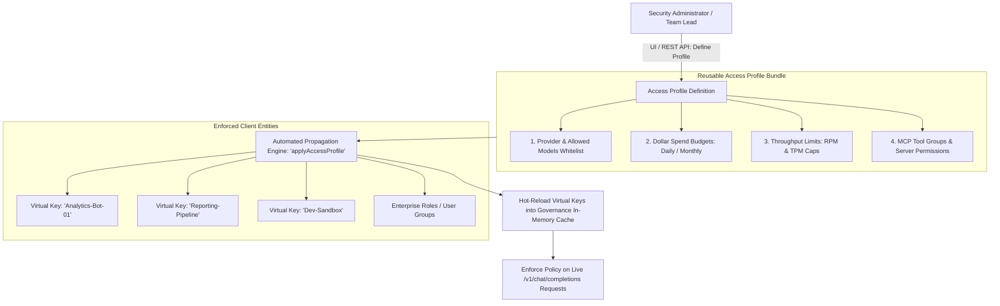

# UnifAI Access Profiles & Multi-Entity Governance Architecture (Access_Profiles.md)

This document provides a comprehensive, production-grade technical specification of the **Access Profiles** subsystem (`/workspace/governance/access-profiles`) within the UnifAI Enterprise AI Gateway. It details the reusable policy abstraction layer, multi-resource binding (Virtual Keys, Models, Budgets, Rate Limits, and MCP Tool Groups), automated profile propagation and hot-reloading into governance memory, complete UI workspace documentation (all buttons, dialogs, and forms), database schemas, and REST APIs.

---

## 1. System Overview & Architectural Purpose

In large-scale enterprise environments managing hundreds of Virtual Keys and multiple developer teams, configuring model allowlists, spend budgets, rate limits, and MCP tool permissions individually for every single API key creates severe administrative overhead and policy drift.

**Access Profiles** solve this by introducing a centralized, reusable **Policy Bundle** abstraction. Administrators define an Access Profile once (e.g., *"Junior Developers - Fast Models & Read-Only SQL"* or *"Data Science Frontier - High Quota & GPU Models"*), and bind it across multiple Virtual Keys or user roles. Any modification to the Access Profile automatically propagates and hot-reloads across all linked Virtual Keys in sub-millisecond timeframes.



---

## 2. Profile Components & Enforced Policies

An Access Profile encapsulates five core governance policies:

1. **Provider & Model Whitelists (`provider_configs`)**:
   * Restricts callers to specific upstream vendors (e.g., `openai`, `anthropic`, `bedrock`).
   * Whitelists permitted models (e.g., `gpt-4o-mini`, `claude-3-5-haiku`) while explicitly denying frontier or expensive reasoning models.
2. **Spend Budgets (`budgets`)**:
   * Assigns concurrent dollar spend limits (e.g., `$250.00`).
   * Configures reset frequencies (`1d`, `7d`, `30d`, `1y`) and calendar alignment (resetting on the 1st of every month).
3. **Throughput Rate Limits (`rate_limit`)**:
   * Enforces Requests Per Minute (RPM) caps.
   * Enforces Tokens Per Minute (TPM) caps.
4. **MCP Tool Access Controls (`mcp_servers`, `mcp_tool_groups`)**:
   * Whitelists authorized MCP servers (e.g., `postgres-db`, `jira-server`).
   * Authorizes pre-configured MCP Tool Groups or applies granular tool overrides.
5. **Linked Virtual Keys (`virtual_key_ids`)**:
   * Binds the profile to specific API keys. When the profile is updated, all associated keys immediately inherit the new limits.

---

## 3. UI Deep Dive: Access Profiles Workspace (`/workspace/governance/access-profiles`)

The Access Profiles console (`accessProfilesIndexView.tsx`) provides an interactive interface for creating, editing, cloning, pausing, and deleting profiles.

### 3.1. Header & Action Bar
* **Title & Description**: `Access Profiles` with explanatory summary of reusable governance policies.
* **+ Create Access Profile Button (`button[onClick={() => setOpen(true)}]`)**: Opens the Profile Creation Dialog.
* **Search Input (`input#profile-search`)**: Filters profiles by name, tags, or allowed models.

---

### 3.2. Access Profiles Data Table
1. **Status**:
   * `Active` (Green badge).
   * `Paused / Inactive` (Amber badge).
2. **Profile Name & Description**: Friendly title (e.g., `Standard-Developer-Tier`) and operational notes.
3. **Tags**: Searchable category badges (e.g., `engineering`, `internal`, `low-cost`).
4. **Permitted Models**: Badges showing allowed models (e.g., `gpt-4o-mini`, `claude-3-5-haiku`).
5. **Linked Virtual Keys**: Counter showing total API keys bound to this profile (e.g., `12 Virtual Keys`) with a hover popover listing key names (`MultiItemScrollPopover`).
6. **Linked MCP Servers**: Badges indicating external tools accessible via this profile.
7. **Spend Budget & Reset**: Configured dollar limit and cycle (e.g., `$100 / 30d`).
8. **Rate Limits**: Configured RPM and TPM limits (e.g., `60 RPM / 100k TPM`).
9. **Actions Column**:
   * **Edit Profile Button (`button#btn-edit-profile-{id}`)**: Opens editor dialog.
   * **Clone Profile Button (`button#btn-clone-profile-{id}`)**: Creates an instant duplicate draft via `POST /api/governance/access-profiles/{id}/clone`.
   * **Activate / Pause Toggle (`<Switch />`)**: Toggles live enforcement via `POST /api/governance/access-profiles/{id}/activate`.
   * **Delete Profile Button (`button#btn-delete-profile-{id}`)**: Prompts confirmation dialog and invokes `DELETE /api/governance/access-profiles/{id}`.

---

### 3.3. Add / Edit Access Profile Dialog Form Fields

A multi-section dialog for configuring profile rules:

#### Section 1: Basic Identity & Taxonomy
* **Profile Name Input (`input#form-name`)**: Unique title.
* **Description Textarea (`textarea#form-desc`)**: Business justification.
* **Tags Input (`input#form-tags`)**: Comma-separated tags.
* **Active Status Switch (`<Switch id="form-active" />`)**: Enables or disables profile upon creation.

#### Section 2: Model & Provider Allowlist
* **Provider Selector (`ComboboxSelect`)**: Selects upstream AI vendor.
* **Allowed Models Multiselect (`ModelMultiselect`)**: Whitelist specific models.

#### Section 3: Entity Binding
* **Linked Virtual Keys Multiselect**: Multi-select of registered Virtual Keys that will inherit this profile.
* **Linked MCP Tool Servers Multiselect**: Authorizes access to external MCP servers.

#### Section 4: Spend Budgets & Reset Schedules
* **Max Spend Limit ($) Input (`input#budget-max`)**: Dollar ceiling (e.g., `500.00`).
* **Budget Reset Duration Input (`input#budget-reset`)**: e.g., `30d`, `1M`, `1d`.
* **Calendar Aligned Switch**: Aligns monthly reset to the first day of the calendar month.

#### Section 5: Rate Limiting
* **Max Requests (RPM) Input (`input#request-max`)**: Maximum requests per minute.
* **Max Tokens (TPM) Input (`input#token-max`)**: Maximum tokens per minute.

#### Dialog Footer Action Buttons
* **Save Profile Button (`button#btn-save-profile`)**: Persists profile via `POST` or `PUT /api/governance/access-profiles`.
* **Cancel Button**.

---

## 4. Automated Hot-Reload & Propagation Engine

When an administrator updates an Access Profile (e.g., lowering the monthly budget from $500 to $200, or revoking access to `claude-3-opus`):
1. The gateway executes `applyAccessProfile` (`accessprofiles.go`).
2. It queries all linked Virtual Keys (`virtual_key_ids`).
3. It updates the database records in `governance_virtual_keys`, `governance_virtual_key_budgets`, and `governance_virtual_key_provider_configs` atomically.
4. It calls `governanceManager.ReloadVirtualKey(ctx, vkID)` for every key.
5. All gateway nodes update their in-memory KV caches instantly. Subsequent inference requests immediately adhere to the revised boundaries with zero latency delay.

---

## 5. Complete Database Schemas & Storage Format

Access Profiles are stored in PostgreSQL:

```sql
CREATE TABLE governance_access_profiles (
    id SERIAL PRIMARY KEY,
    name VARCHAR(255) UNIQUE NOT NULL,
    description TEXT,
    is_active BOOLEAN NOT NULL DEFAULT TRUE,
    version INT NOT NULL DEFAULT 1,
    calendar_aligned BOOLEAN DEFAULT FALSE,
    parsed_tags JSONB DEFAULT '[]'::jsonb,
    parsed_spec JSONB NOT NULL DEFAULT '{}'::jsonb,
    -- Structure of parsed_spec:
    -- {
    --   "provider_configs": [{"provider": "openai", "allowed_models": ["gpt-4o-mini"]}],
    --   "budgets": [{"max_limit": 250.0, "reset_duration": "30d"}],
    --   "rate_limit": {"request_max_limit": 60, "token_max_limit": 100000},
    --   "mcp_servers": [{"name": "postgres-db"}],
    --   "virtual_key_ids": ["vk-8812-4f9a", "vk-9914-2b"]
    -- }
    created_at TIMESTAMP WITH TIME ZONE DEFAULT NOW(),
    updated_at TIMESTAMP WITH TIME ZONE DEFAULT NOW()
);
```

---

## 6. Complete REST API Reference

### `GET /api/governance/access-profiles`
Retrieves list of all configured Access Profiles.
* **Response**:
  ```json
  {
    "profiles": [
      {
        "id": 1,
        "name": "Standard-Developer-Tier",
        "description": "Baseline access for engineering team sandboxes",
        "is_active": true,
        "version": 2,
        "tags": ["engineering", "sandbox"],
        "provider_configs": [
          {
            "provider": "openai",
            "allowed_models": ["gpt-4o-mini"]
          }
        ],
        "budgets": [
          {
            "max_limit": 100.0,
            "reset_duration": "30d"
          }
        ],
        "rate_limit": {
          "request_max_limit": 60,
          "token_max_limit": 100000
        },
        "virtual_key_ids": ["vk-8812-4f9a"],
        "created_at": "2026-10-24T10:00:00Z"
      }
    ]
  }
  ```

### `POST /api/governance/access-profiles`
Creates a new Access Profile and propagates to linked keys.

### `PUT /api/governance/access-profiles/{id}`
Updates profile and triggers automatic hot-reload across all linked Virtual Keys.

### `POST /api/governance/access-profiles/{id}/clone`
Duplicates an existing profile into a new template.

### `POST /api/governance/access-profiles/{id}/activate`
Toggles active enforcement status (`is_active: true/false`).

### `DELETE /api/governance/access-profiles/{id}`
Deletes profile.
