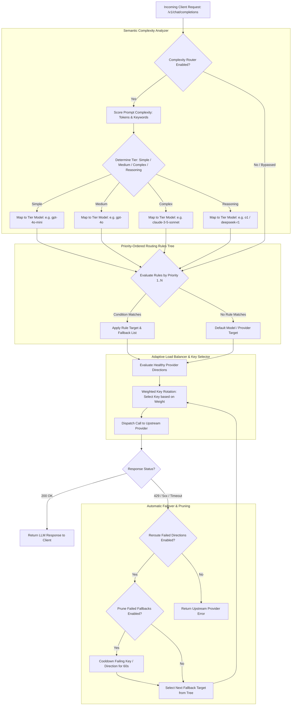

# UnifAI Adaptive Routing, Routing Rules & Complexity Router Architecture

This document provides a comprehensive, production-grade technical specification of the **Adaptive Routing, Dynamic Load Balancing, Routing Rules Tree, and Complexity Router** subsystem within the UnifAI Enterprise AI Gateway. It details the multi-provider routing algorithms, weighted key rotation, automatic failure rerouting, priority-ordered conditional routing rules, semantic complexity tier classification, complete UI workspace documentation (all buttons, sheets, and forms), database schemas, and REST APIs.

---

## 1. System Overview & Core Capabilities

The **Adaptive Routing** subsystem acts as the high-throughput traffic control plane of the UnifAI Gateway. It abstracts underlying LLM providers (e.g., OpenAI, Anthropic, Google Vertex AI, AWS Bedrock, Azure OpenAI, Groq, Mistral, Ollama) and automatically optimizes request dispatching for **cost**, **latency**, **reliability**, and **quota utilization**.

The subsystem comprises four tightly integrated capabilities:
1. **Adaptive Load Balancer (`/workspace/adaptive-routing`)**: Real-time scoring of provider directions and API key routes, weighted traffic distribution, and automatic health monitoring.
2. **Load Balancer Settings (`/workspace/adaptive-routing/settings`)**: Policy switches controlling direction selection, route selection, fallback pruning, and failure rerouting.
3. **Routing Rules Engine (`/workspace/routing-rules`)**: Priority-ordered decision trees allowing administrators to route traffic based on model aliases, Virtual Keys, user metadata, or prompt parameters.
4. **Complexity Router (`/workspace/complexity-router`)**: Semantic prompt analyzer that scores query difficulty (Simple, Medium, Complex, Reasoning) and routes queries to the most cost-effective model tier.



---

## 2. Workspace Routes & UI Module Breakdown

The routing subsystem is partitioned into four coordinated UI routes:

| Route Path | Sub-Module | Functional Purpose |
| :--- | :--- | :--- |
| `/workspace/adaptive-routing` | **Adaptive Routing Dashboard** | Live operational view of all provider directions, registered keys, weights, models, and real-time health indicators. |
| `/workspace/adaptive-routing/settings` | **Load Balancer Settings** | Global operational toggles: Direction Selection, Route Selection, Fallback Pruning, and Failure Rerouting. |
| `/workspace/routing-rules` | **Routing Rules Tree** | Priority-ordered rule management table, rule creation sheet, rule navigation slide-over, and model mapping conditions. |
| `/workspace/complexity-router` | **Complexity Router** | Visual tier boundary sliders (`simple_medium`, `medium_complex`, `complex_reasoning`), keyword tag managers, and threshold tuning. |

---

## 3. UI Deep Dive: Adaptive Routing Dashboard (`/workspace/adaptive-routing`)

The Adaptive Routing view provides a real-time topology of how traffic is balanced across providers and API keys.

### 3.1. Header & Global Controls
* **Live Polling**: Automatically polls `GET /api/load-balancer/routes` every 8,000ms. Polling pauses automatically if network errors occur.
* **Settings Navigation Button** (`button[asChild]`): Navigates directly to `/workspace/adaptive-routing/settings`.
* **RBAC View-Only Alert Banner**: Renders if the authenticated user lacks update permissions (`RbacResource.RoutingRules, RbacOperation.Update`), disabling modification switches.

### 3.2. Master Policy Control Cards (Top Row)
1. **Load Balancer Master Card**:
   * Header: `Load balancer` — *Master switch for adaptive selection*.
   * Control: `<Switch />` toggle bound to `data.config.enabled`. Persists instantly via `saveConfig({ enabled })`.
2. **Direction Selection Card**:
   * Header: `Direction selection` — *Route across healthy providers supporting the same model*.
   * Control: `<Switch />` toggle bound to `data.config.direction_selection_enabled`.
3. **Route Selection Card**:
   * Header: `Route selection` — *Distribute requests among multiple API keys using configured weights*.
   * Control: `<Switch />` toggle bound to `data.config.route_selection_enabled`.

### 3.3. Provider Directions Table
Summarizes all registered LLM providers, their key counts, and active readiness:
* **Provider**: Provider brand icon and display name (e.g., `OpenAI`, `Anthropic`, `Google Vertex AI`, `AWS Bedrock`, `Azure OpenAI`).
* **Active Keys**: Total number of enrolled API keys for this provider.
* **Direction Status**:
  * `healthy` (Green badge): At least one key is enabled and responding.
  * `disabled` (Amber badge): All registered keys for this provider are manually disabled.
  * `not_configured` (Gray badge): Provider is registered but contains 0 API keys.

### 3.4. Routes (API Keys & Weights) Table
Displays individual API keys participating in weighted load balancing:
* **Provider**: Upstream provider name.
* **Key Name & ID**: Friendly label and masked key ID.
* **Assigned Weight**: Integer weight value ($W_i \ge 1$) determining traffic proportion in the weighted round-robin ring.
* **Supported Models**: Badges showing models mapped to this key.
* **Status**: `healthy` vs. `disabled`.

---

## 4. UI Deep Dive: Load Balancer Settings (`/workspace/adaptive-routing/settings`)

Configures operational behavior when upstream providers fail or become saturated.

### 4.1. Configuration Switches & Policies
1. **Master Enable Switch** (`input#lb-enabled`): Activates or deactivates the load balancing engine globally.
2. **Direction Selection Switch** (`input#direction-selection`): When enabled, if a user requests a generic model alias (e.g., `llama-3.3-70b`), the gateway automatically selects the lowest-latency provider hosting that model (e.g., comparing Groq vs. Together AI vs. Bedrock).
3. **Route Selection Switch** (`input#route-selection`): When enabled, enables multi-key weighted round-robin distribution across accounts.
4. **Reroute Failed Directions Switch** (`input#reroute-failed`): When an upstream request encounters HTTP 429 (Rate Limit Exceeded), HTTP 500, HTTP 503, or socket timeout, the gateway catches the error before client delivery and transparently retries against designated fallback directions.
5. **Prune Failed Fallbacks Switch** (`input#prune-failed`): Automatically isolates failing keys or providers from the rotation ring for a cooldown window (default: 60s) to prevent cascading latency spikes.
6. **Save Settings Button** (`button#btn-save-lb-settings`): Persists configuration via `PUT /api/load-balancer`.

---

## 5. UI Deep Dive: Routing Rules Tree (`/workspace/routing-rules`)

Routing Rules provide deterministic, priority-ordered request transformation and routing trees.

### 5.1. Action Bar & Table Controls
* **Search Input** (`input#routing-rules-search`): Debounced search (300ms) across rule names, description, and target models.
* **+ Add Rule Button** (`button#btn-create-routing-rule`): Opens the comprehensive Rule Creation Sheet (`RoutingRuleSheet.tsx`).
* **Polling Interval**: Refreshes rules every 5,000ms via `GET /api/governance/routing-rules`.
* **Pagination**: 25 rules per page with automatic offset snapping.

### 5.2. Routing Rules Table Columns
1. **Priority**: Numeric order index (`1`, `2`, `3`...). Lower numbers evaluate first.
2. **Rule Name & Description**: Descriptive title explaining the business routing logic.
3. **Condition Summary**: Compact summary of trigger conditions (e.g., `Model == 'gpt-4'`, `Virtual Key in ['vk-marketing', 'vk-sales']`).
4. **Primary Target**: Designated provider and model combination (e.g., `Azure OpenAI -> gpt-4o-ptu`).
5. **Fallback Targets**: Sequential list of fallback targets invoked if the primary target fails.
6. **Status**: Enabled/Disabled toggle.
7. **Actions Column**:
   * **Edit Rule Button** (`button#edit-rule-{id}`): Opens editor sheet.
   * **Delete Rule Button** (`button#delete-rule-{id}`): Prompts confirmation dialog and invokes `DELETE /api/governance/routing-rules/{id}`.

### 5.3. Routing Rule Slide-Over Sheet (`RoutingRuleSheet.tsx`) Form Fields
* **Rule Name** (`input#rule-name`): Mandatory identifier.
* **Priority** (`input#rule-priority`): Integer determining execution rank.
* **Match Conditions**:
  * **Model Match**: Specific model name or wildcard (e.g., `gpt-3.5-turbo`, `claude-*`).
  * **Virtual Key Match**: Multi-select of specific Virtual Keys.
  * **Metadata Match**: Key-value pairs matching custom client request headers or metadata.
* **Primary Target Selector**:
  * **Target Provider Dropdown**: `openai`, `anthropic`, `vertex`, `bedrock`, `azure`, etc.
  * **Target Model Dropdown**: Model identifier on the destination provider.
* **Fallback Targets Builder**:
  * "+ Add Fallback" button.
  * Reorderable list of fallback targets (Provider + Model) with drag handles.
* **Sheet Footer**: Cancel button and Save Rule button.

### 5.4. Rule Inspection Drawer (`RoutingRuleInfoSheet.tsx`)
Clicking any row opens a slide-over details drawer showing:
* Visual condition-action flowchart.
* Live execution count and hit rate statistics.
* Next / Previous Rule navigation buttons (`button#btn-rule-prev`, `button#btn-rule-next`).

---

## 6. UI Deep Dive: Complexity Router (`/workspace/complexity-router`)

The Complexity Router analyzes incoming prompt payloads and automatically assigns them to one of four capability tiers, reducing enterprise model expenditure by up to 70% while maintaining intelligence quality.

### 6.1. Capability Tiers & Color Palette
The interface uses four progressive primary tints (`TIER_PALETTE`):
1. **SIMPLE (`P1`)**: Basic greetings, classification, formatting, or single-turn factual queries. Mapped to lightweight fast models (e.g., `gpt-4o-mini`, `claude-3-5-haiku`, `llama-3.2-3b`).
2. **MEDIUM (`P2`)**: Summarization, standard email generation, basic drafting, simple code snippets. Mapped to standard production models (e.g., `gpt-4o`, `claude-3-5-sonnet`, `gemini-1.5-flash`).
3. **COMPLEX (`P3`)**: Multi-step logic, full code refactoring, document synthesis, legal analysis. Mapped to frontier models (e.g., `claude-3-opus`, `gpt-4-turbo`).
4. **REASONING (`P4`)**: Advanced mathematics, algorithmic proofs, deep strategic planning, architecture design. Mapped to reasoning models (e.g., `o1`, `o3-mini`, `deepseek-r1`).

### 6.2. Visual Boundary Tuning Sliders (`BOUNDARY_FIELDS`)
Administrators tune transition boundaries between tiers using numeric sliders and inputs:
* **Simple $\to$ Medium Boundary** (`input#boundary-simple-medium`): Numeric complexity threshold transitioning simple queries to medium models.
* **Medium $\to$ Complex Boundary** (`input#boundary-medium-complex`): Threshold transitioning medium queries to frontier models.
* **Complex $\to$ Reasoning Boundary** (`input#boundary-complex-reasoning`): Threshold transitioning complex queries to reasoning engines.

### 6.3. Semantic Keyword Tag Inputs (`TagInput`)
Each tier maintains a list of indicative keywords and trigger phrases:
* Add Keyword input: Pressing `Enter` or `,` adds new keyword pills.
* Remove Keyword: Clicking `x` on a keyword pill removes it.
* "Show More / Collapse" button (`KEYWORD_COLLAPSED_LIMIT = 8`): Expands/collapses keyword views.

### 6.4. Action Buttons
* **Save Configuration Button** (`button#btn-save-complexity`): Invokes `useUpdateComplexityAnalyzerConfigMutation()` to commit updated boundaries and keywords.
* **Reset to Defaults Button** (`button#btn-reset-complexity`): Opens confirmation alert dialog (`AlertDialog`) to reset all boundaries to factory defaults via `useResetComplexityAnalyzerConfigMutation()`.

---

## 7. Mathematical Load Balancing & Selection Algorithms

### 7.1. Weighted Round-Robin (WRR) Route Selection
For a given provider with $N$ active API keys, each key $i$ has an assigned integer weight $W_i$. The probability $P_i$ that key $i$ is selected for an incoming request is:

$$P_i = \frac{W_i}{\sum_{j=1}^{N} W_j}$$

The gateway maintains an atomic rotation state ring in memory. If Key $A$ has weight 3 and Key $B$ has weight 1, the execution sequence will distribute as: $A, A, A, B, A, A, A, B$.

### 7.2. Dynamic Direction Selection (Lowest Latency & Error Scoring)
When `direction_selection_enabled` is active, the gateway continuously tracks an exponential moving average (EMA) of latency and error rates across all providers offering the requested model:

$$S_{\text{provider}} = \alpha \cdot \text{Latency}_{\text{EMA}} + \beta \cdot (\text{ErrorRate} \times 1000)$$

The gateway dynamically directs traffic to the provider with the lowest score $S$.

### 7.3. Automatic Fallback Pruning (Cooldown Penalty Ring)
When `prune_failed_fallbacks` is active and an upstream provider or key returns an unrecoverable failure:
1. The gateway registers a fault counter for that specific key.
2. If consecutive failures exceed the threshold (default: 3), the key is isolated to the "Penalty Box".
3. The key is excluded from the active WRR rotation ring for 60 seconds (`COOLDOWN_WINDOW`).
4. Once the cooldown expires, the key is placed in a "Half-Open / Probing" state, receiving 1 test request. If successful, it is restored to full rotation weight.

---

## 8. Complete Database Schemas & Storage Format

Routing configurations and rules are persisted across PostgreSQL tables:

```sql
-- 1. Workspace Load Balancer Master Configuration
-- Stored in workspace_settings under key: 'load_balancer'
-- {
--   "enabled": true,
--   "direction_selection_enabled": true,
--   "route_selection_enabled": true,
--   "reroute_failed_directions": true,
--   "prune_failed_fallbacks": true
-- }

-- 2. Priority-Ordered Routing Rules Table
CREATE TABLE governance_routing_rules (
    id VARCHAR(255) PRIMARY KEY,
    name VARCHAR(255) NOT NULL,
    description TEXT,
    priority INT NOT NULL DEFAULT 100,
    enabled BOOLEAN NOT NULL DEFAULT TRUE,
    match_conditions JSONB NOT NULL DEFAULT '{}'::jsonb,
    -- Structure of match_conditions:
    -- {
    --   "model": "gpt-4",
    --   "virtual_key_ids": ["vk-101", "vk-102"],
    --   "metadata": {"env": "prod"}
    -- }
    target_provider VARCHAR(100) NOT NULL,
    target_model VARCHAR(100) NOT NULL,
    fallback_targets JSONB NOT NULL DEFAULT '[]'::jsonb,
    -- Structure of fallback_targets:
    -- [
    --   {"provider": "azure", "model": "gpt-4o-eastus"},
    --   {"provider": "anthropic", "model": "claude-3-5-sonnet"}
    -- ]
    created_at TIMESTAMP WITH TIME ZONE DEFAULT NOW(),
    updated_at TIMESTAMP WITH TIME ZONE DEFAULT NOW()
);

-- 3. Complexity Router Configuration Table
CREATE TABLE governance_complexity_router (
    id SERIAL PRIMARY KEY,
    enabled BOOLEAN NOT NULL DEFAULT TRUE,
    boundaries JSONB NOT NULL,
    -- Structure:
    -- {
    --   "simple_medium": 0.25,
    --   "medium_complex": 0.65,
    --   "complex_reasoning": 0.88
    -- }
    keywords JSONB NOT NULL,
    -- Structure:
    -- {
    --   "simple": ["hello", "translate", "classify"],
    --   "medium": ["summarize", "draft", "rewrite"],
    --   "complex": ["refactor", "analyze", "synthesize"],
    --   "reasoning": ["proof", "theorem", "calculate", "optimize"]
    -- }
    tier_models JSONB NOT NULL,
    -- Structure:
    -- {
    --   "simple": {"provider": "openai", "model": "gpt-4o-mini"},
    --   "medium": {"provider": "openai", "model": "gpt-4o"},
    --   "complex": {"provider": "anthropic", "model": "claude-3-5-sonnet"},
    --   "reasoning": {"provider": "openai", "model": "o1"}
    -- }
    updated_at TIMESTAMP WITH TIME ZONE DEFAULT NOW()
);
```

---

## 9. Complete REST API Reference

### 9.1. Load Balancer APIs

#### `GET /api/load-balancer`
Retrieves the master load balancer configuration flags.
* **Response**:
  ```json
  {
    "enabled": true,
    "direction_selection_enabled": true,
    "route_selection_enabled": true,
    "reroute_failed_directions": true,
    "prune_failed_fallbacks": true
  }
  ```

#### `PUT /api/load-balancer`
Updates load balancer operational policies.
* **Request Payload**:
  ```json
  {
    "enabled": true,
    "direction_selection_enabled": true,
    "route_selection_enabled": true,
    "reroute_failed_directions": true,
    "prune_failed_fallbacks": true
  }
  ```

#### `GET /api/load-balancer/routes`
Returns live provider directions, active keys, rotation weights, and health statuses.
* **Response**:
  ```json
  {
    "config": {
      "enabled": true,
      "direction_selection_enabled": true,
      "route_selection_enabled": true,
      "reroute_failed_directions": true,
      "prune_failed_fallbacks": true
    },
    "directions": [
      {
        "provider": "openai",
        "key_count": 3,
        "status": "healthy"
      },
      {
        "provider": "anthropic",
        "key_count": 2,
        "status": "healthy"
      }
    ],
    "routes": [
      {
        "provider": "openai",
        "key_id": "key-prod-01",
        "key_name": "OpenAI Primary Enterprise",
        "weight": 80,
        "enabled": true,
        "status": "healthy",
        "models": ["gpt-4o", "gpt-4o-mini"]
      },
      {
        "provider": "openai",
        "key_id": "key-prod-02",
        "key_name": "OpenAI Secondary Overflow",
        "weight": 20,
        "enabled": true,
        "status": "healthy",
        "models": ["gpt-4o", "gpt-4o-mini"]
      }
    ]
  }
  ```

---

### 9.2. Routing Rules APIs

#### `GET /api/governance/routing-rules`
Returns paginated list of priority-ordered routing rules.
* **Query Parameters**: `limit` (default: 25), `offset` (default: 0), `search` (optional).
* **Response**:
  ```json
  {
    "rules": [
      {
        "id": "rule-prod-gpt4",
        "name": "Production GPT-4 Routing with Azure Failover",
        "description": "Routes production gpt-4 traffic to Azure PTU with OpenAI backup",
        "priority": 1,
        "enabled": true,
        "match_conditions": {
          "model": "gpt-4o",
          "virtual_key_ids": ["vk-8812-4f9a"]
        },
        "target_provider": "azure",
        "target_model": "gpt-4o-eastus",
        "fallback_targets": [
          {
            "provider": "openai",
            "model": "gpt-4o"
          }
        ],
        "created_at": "2026-10-24T10:00:00Z"
      }
    ],
    "total_count": 1
  }
  ```

#### `POST /api/governance/routing-rules`
Creates a new routing rule.

#### `PUT /api/governance/routing-rules/{rule_id}`
Updates an existing rule.

#### `DELETE /api/governance/routing-rules/{rule_id}`
Deletes rule by ID.

---

### 9.3. Complexity Router APIs

#### `GET /api/governance/complexity-router`
Retrieves tier boundaries, keyword token lists, and tier model mappings.

#### `PUT /api/governance/complexity-router`
Updates tier boundaries, keywords, or mapped models.
* **Request Payload**:
  ```json
  {
    "enabled": true,
    "boundaries": {
      "simple_medium": 0.25,
      "medium_complex": 0.65,
      "complex_reasoning": 0.88
    },
    "keywords": {
      "simple": ["hello", "ping", "translate", "format"],
      "medium": ["summarize", "draft", "explain"],
      "complex": ["architect", "debug", "refactor", "optimize"],
      "reasoning": ["prove", "theorem", "quantum", "calculate"]
    }
  }
  ```

#### `POST /api/governance/complexity-router/reset`
Resets all complexity boundaries and keyword definitions to factory defaults.

---

## 10. Operational Runbook & Edge Cases

1. **All Providers / Keys Saturated or Tripped**:
   * If all designated fallback targets fail or are pruned, the gateway returns HTTP 503 (`All upstream LLM routes depleted for model`).
   * An urgent alert is emitted immediately to configured Alert Channels (Slack/PagerDuty).
2. **Deterministic Model Alias Resolution**:
   * Client applications can request virtual model names (e.g., `model: "enterprise-smart"` or `model: "enterprise-fast"`).
   * Routing rules map `enterprise-smart` to `claude-3-5-sonnet` (with `gpt-4o` fallback) and `enterprise-fast` to `gpt-4o-mini`, decoupling client code from provider dependencies.
3. **Zero-Downtime Policy Updates**:
   * All load balancing and routing rule mutations take effect immediately in the gateway memory cache without connection drops or pod restarts.
