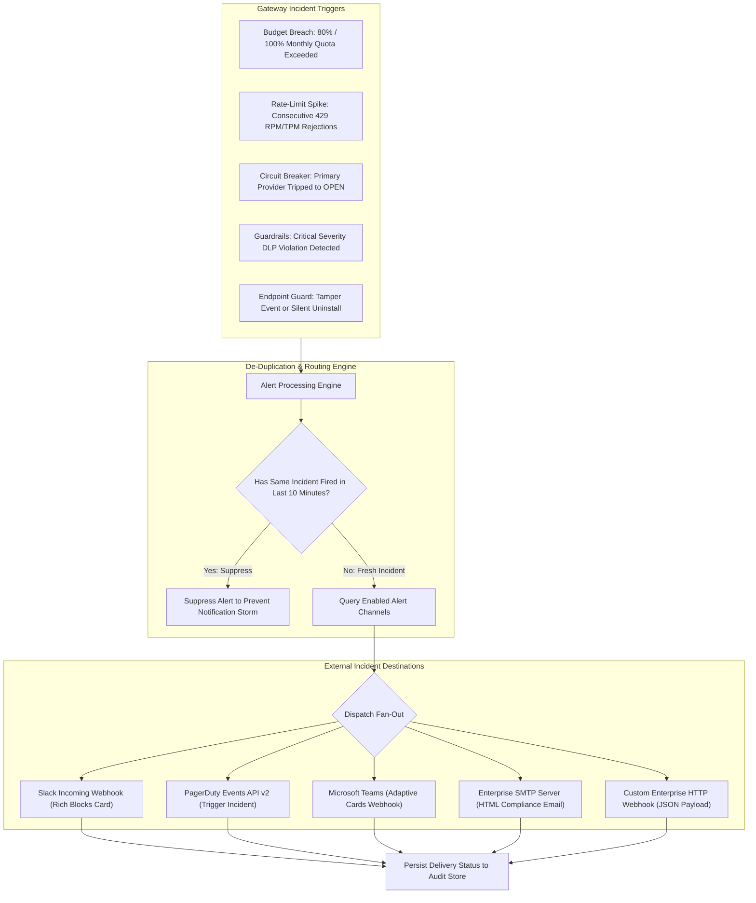

# UnifAI Alert Channels & Incident Notification Architecture

This document provides a comprehensive, production-grade technical specification of the **Alert Channels** subsystem within the UnifAI Enterprise AI Gateway. It details the incident dispatching pipeline, supported notification destinations (Slack, PagerDuty, Microsoft Teams, Email SMTP, Webhooks), automated alert trigger rules (spend budgets, rate-limit spikes, circuit breaker trips, guardrail DLP violations), incident de-duplication windows, complete UI workspace documentation (all buttons, dialogs, and forms), database schemas, and REST APIs.

---

## 1. System Overview & Incident Lifecycle

The **Alert Channels** subsystem provides real-time notifications to enterprise DevOps, SecOps, and FinOps teams when operational thresholds, security policies, or infrastructure health boundaries are breached.

To prevent alert fatigue during sustained outages or traffic spikes, the gateway enforces an **incident de-duplication window**: identical alert signatures are throttled to a maximum frequency of **once per 10 minutes per destination channel**.



---

## 2. Supported Channel Types & Configuration Schemas

The gateway supports 5 notification transport types:

| Channel Type | Protocol / Method | Required Configuration Fields | Payload Format |
| :--- | :--- | :--- | :--- |
| `slack` | HTTPS POST | `url` (Slack Incoming Webhook URL). | Slack Block Kit JSON with severity color bands. |
| `pagerduty` | HTTPS POST (Events API v2) | `routing_key` (32-character PagerDuty Integration Key). | PagerDuty CEF (Common Event Format) v2 JSON. |
| `email` | SMTP / SMTPS (TLS) | `smtp_host`, `smtp_port`, `to_emails`, `from_email`, `smtp_user`, `smtp_password`. | Multipart MIME with HTML formatting. |
| `webhook` | HTTPS POST | `url`, optional `auth_header_name`, `auth_header_value`. | Normalized UnifAI Incident Alert JSON. |
| `teams` | HTTPS POST | `url` (Office 365 / Power Automate Webhook URL). | Microsoft Teams Adaptive Card JSON. |

---

## 3. UI Deep Dive: Alert Channels Workspace (`/workspace/alert-channels`)

The Alert Channels console enables security and platform administrators to register, toggle, test, and remove notification endpoints.

### 3.1. Header & Action Bar
* **Title & Icon**: Bell icon with header `Alert Channels`.
* **Description Banner**: Explains supported destinations and clarifies the 10-minute incident throttle policy.
* **+ Add Channel Button** (`button[onClick={() => setOpen(true)}]`): Opens the Channel Creation Modal.

### 3.2. Alert Channels Table Columns
1. **Channel Name**: Display label (e.g., `#devops-security-alerts`, `PagerDuty AI On-Call`).
2. **Channel Type**: Badge indicating protocol:
   * `slack` (Purple badge).
   * `pagerduty` (Green badge).
   * `email` (Blue badge).
   * `webhook` (Amber badge).
3. **Status Toggle Switch** (`<Switch />`): Enables or disables the channel instantly without deleting configuration. Invokes `useUpdateAlertChannelMutation()`.
4. **Destination Summary**: Masked URL or destination target (sensitive tokens like webhook keys and passwords are automatically masked with `<redacted>`).
5. **Actions Column**:
   * **Send Test Notification Button** (`button#btn-test-channel-{id}`): Triggers an immediate synthetic notification via `POST /api/alert-channels/{id}/test`. Renders feedback toast: *"Test alert sent to #alerts successfully"*.
   * **Delete Channel Button** (`button#btn-delete-channel-{id}`): Prompts confirmation dialog and removes channel via `DELETE /api/alert-channels/{id}`.

### 3.3. Add / Edit Channel Modal Dialog Form Fields
* **Channel Name Input** (`input#channel-name`): Friendly identifier.
* **Channel Type Dropdown** (`select#channel-type`): `webhook`, `slack`, `email`, `pagerduty`.
* **Dynamic Configuration Fields (conditionally rendered by type)**:
  * For **Slack**:
    * **Webhook URL** (`input#slack-url`): e.g., `https://hooks.slack.com/services/T00/B00/XXXX`.
    * **Channel Override** (`input#slack-channel` - optional): e.g., `#alerts-critical`.
  * For **PagerDuty**:
    * **Routing / Integration Key** (`input#pd-routing-key`): 32-character hex key.
    * **Default Severity Dropdown** (`select#pd-severity`): `info`, `warning`, `error`, `critical`.
  * For **Email**:
    * **Recipient Emails** (`input#email-recipients`): Comma-separated email list (e.g., `devops-leads@corp.com, secops@corp.com`).
    * **SMTP Host** (`input#email-host`): e.g., `smtp.office365.com`.
    * **SMTP Port** (`input#email-port`): `587` (STARTTLS) or `465` (SSL).
    * **SMTP Username & Password**: Authenticated service credentials.
  * For **Custom Webhook**:
    * **Webhook URL** (`input#webhook-url`): Destination HTTPS URL.
    * **Custom Authorization Header** (`input#webhook-auth`): Optional secret header (e.g., `Bearer <token>` or `X-Webhook-Secret: <secret>`).
* **Modal Footer**: Cancel Button and Save Channel Button (`button#btn-save-channel`).

---

## 4. Automated Incident Alert Triggers & Payload Formats

When an event triggers, the gateway dispatches a standardized incident payload across active channels:

```json
{
  "event_id": "evt-alert-8921a-412f",
  "incident_type": "BUDGET_EXHAUSTED",
  "severity": "CRITICAL",
  "timestamp": "2026-10-24T11:40:00Z",
  "source_entity": {
    "type": "virtual_key",
    "id": "vk-8812-4f9a",
    "name": "Production-Customer-Bot",
    "team": "Engineering / Core Platform"
  },
  "metrics": {
    "current_spend": 250.42,
    "budget_limit": 250.00,
    "quota_period": "30d",
    "utilization_pct": 100.16
  },
  "summary": "Virtual Key 'Production-Customer-Bot' has exhausted its 30-day budget of $250.00. Subsequent calls are returning HTTP 429.",
  "dashboard_url": "https://gateway.enterprise.com/workspace/virtual-keys?search=Production-Customer-Bot"
}
```

---

## 5. Complete Database Schemas & Storage Format

Alert channels are stored in PostgreSQL:

```sql
-- Alert Channels Registry Table
CREATE TABLE alert_channels (
    id SERIAL PRIMARY KEY,
    name VARCHAR(255) NOT NULL,
    type VARCHAR(50) NOT NULL,                      -- 'slack', 'pagerduty', 'email', 'webhook', 'teams'
    enabled BOOLEAN NOT NULL DEFAULT TRUE,
    config JSONB NOT NULL DEFAULT '{}'::jsonb,      -- Encrypted webhook URLs, routing keys, SMTP credentials
    created_at TIMESTAMP WITH TIME ZONE DEFAULT NOW(),
    updated_at TIMESTAMP WITH TIME ZONE DEFAULT NOW()
);
```

---

## 6. Complete REST API Reference

### `GET /api/alert-channels`
Retrieves all configured alert channels with sensitive secret keys redacted.
* **Response**:
  ```json
  {
    "channels": [
      {
        "id": 1,
        "name": "#devops-ai-alerts",
        "type": "slack",
        "enabled": true,
        "config": {
          "url": "<redacted>"
        },
        "created_at": "2026-10-24T10:00:00Z"
      }
    ],
    "count": 1
  }
  ```

### `POST /api/alert-channels`
Creates a new notification channel.
* **Request Payload**:
  ```json
  {
    "name": "PagerDuty Severity 1 On-Call",
    "type": "pagerduty",
    "enabled": true,
    "config": {
      "routing_key": "pd-events-sec-8812904a0f",
      "severity": "critical"
    }
  }
  ```
* **Response**: HTTP 201 Created.

### `PUT /api/alert-channels/{id}`
Updates channel status, name, or configuration credentials.

### `DELETE /api/alert-channels/{id}`
Removes channel.

### `POST /api/alert-channels/{id}/test`
Dispatches a trial synthetic notification to verify webhook credentials and network firewall reachability.
* **Response**: HTTP 200 OK `{ "success": true, "message": "Test notification delivered successfully to PagerDuty" }`.

---

## 7. Operational Best Practices & Troubleshooting

1. **Firewall & Proxy Egress**:
   * For air-gapped or restricted data centers, ensure gateway nodes are permitted outbound HTTPS egress to `hooks.slack.com` and `events.pagerduty.com` (or route outbound traffic through an enterprise HTTP forward proxy configured in `HTTP_PROXY`).
2. **Preventing Alert Storms**:
   * The 10-minute incident throttle window guarantees that if an upstream model suffers continuous rate-limiting (e.g., 500 requests per second returning 429), the gateway emits **exactly 1 alert card** upon tripping rather than 30,000 notifications.
