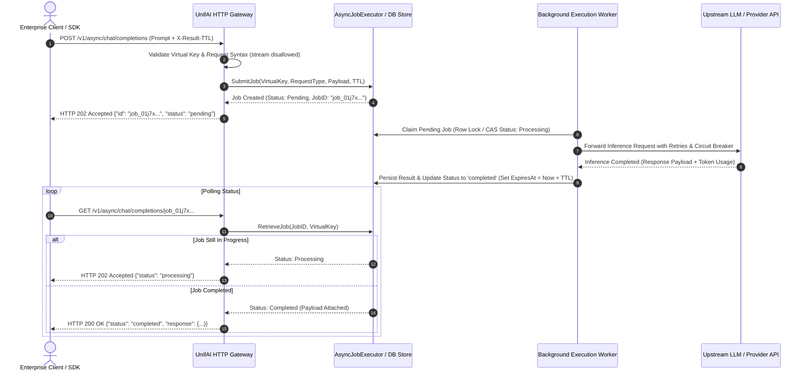
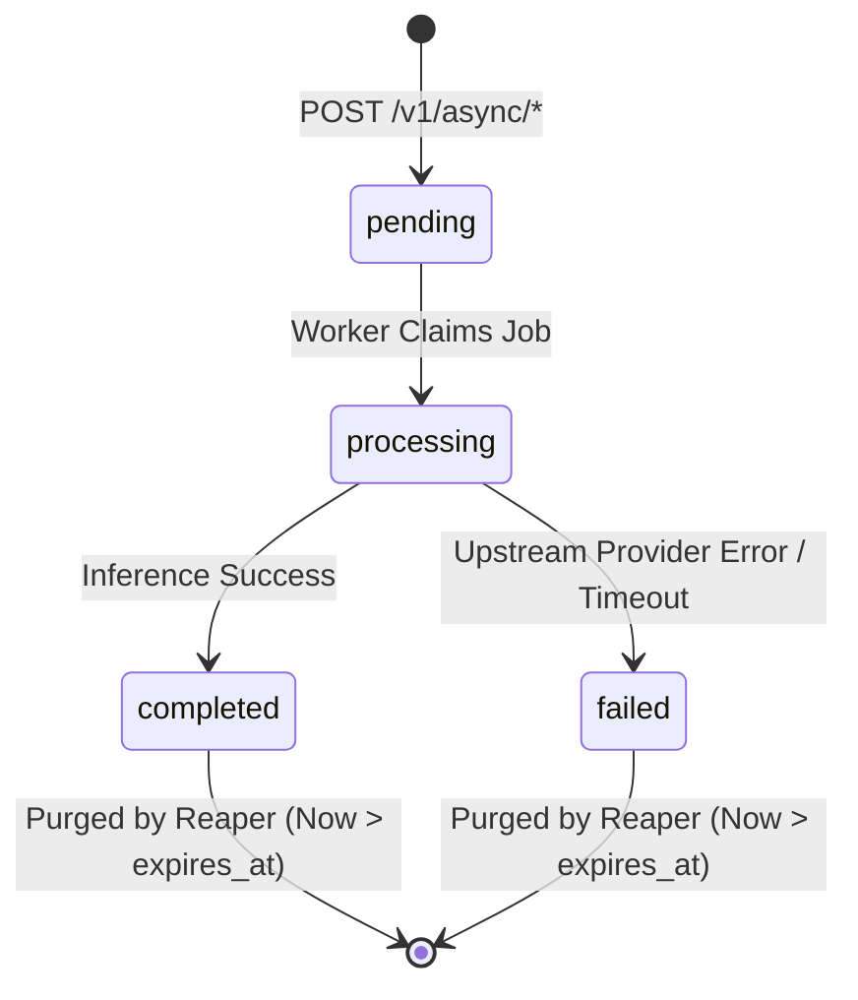

# UnifAI Platform — Asynchronous Batch Inference & Background Job Pipeline

## 1. Architectural Overview & System Design

The **UnifAI Asynchronous Batch Inference Engine** provides non-blocking, queued execution for long-running AI workloads across 11 distinct multi-modal operations. It resolves critical limitations of synchronous HTTP connections, such as TCP timeouts on complex reasoning models (e.g. OpenAI o1/o3-mini, DeepSeek-R1, Anthropic Extended Thinking), client disconnects during large image/video generation tasks, and massive token batch ingestion.

Clients submit prompts or payloads immediately receiving an HTTP `202 Accepted` response with an immutable `job_id`. Background worker pools execute the job under active Governance budgets, Rate Limits, and Guardrails. Downstream clients retrieve results via polling or automated webhook push delivery.



---

## 2. Supported Multi-Modal Request Operations

The Async Pipeline supports 11 operational request types, mapped explicitly in `handlers/asyncinference.go`:

| Request Type Identifier | Async Submission Route | Async Job Retrieval Route | Typical Latency Range |
| :--- | :--- | :--- | :--- |
| `ChatCompletionRequest` | `POST /v1/async/chat/completions` | `GET /v1/async/chat/completions/{job_id}` | $5\text{s} \dots 180\text{s}$ |
| `TextCompletionRequest` | `POST /v1/async/completions` | `GET /v1/async/completions/{job_id}` | $2\text{s} \dots 60\text{s}$ |
| `ResponsesRequest` | `POST /v1/async/responses` | `GET /v1/async/responses/{job_id}` | $5\text{s} \dots 120\text{s}$ |
| `EmbeddingRequest` | `POST /v1/async/embeddings` | `GET /v1/async/embeddings/{job_id}` | $1\text{s} \dots 30\text{s}$ |
| `SpeechRequest` | `POST /v1/async/audio/speech` | `GET /v1/async/audio/speech/{job_id}` | $3\text{s} \dots 45\text{s}$ |
| `TranscriptionRequest` | `POST /v1/async/audio/transcriptions` | `GET /v1/async/audio/transcriptions/{job_id}` | $10\text{s} \dots 300\text{s}$ |
| `ImageGenerationRequest`| `POST /v1/async/images/generations` | `GET /v1/async/images/generations/{job_id}` | $10\text{s} \dots 90\text{s}$ |
| `ImageEditRequest` | `POST /v1/async/images/edits` | `GET /v1/async/images/edits/{job_id}` | $10\text{s} \dots 90\text{s}$ |
| `ImageVariationRequest` | `POST /v1/async/images/variations` | `GET /v1/async/images/variations/{job_id}` | $10\text{s} \dots 90\text{s}$ |
| `RerankRequest` | `POST /v1/async/rerank` | `GET /v1/async/rerank/{job_id}` | $500\text{ms} \dots 15\text{s}$ |
| `OCRRequest` | `POST /v1/async/ocr` | `GET /v1/async/ocr/{job_id}` | $5\text{s} \dots 60\text{s}$ |

> [!IMPORTANT]
> **Streaming Constraint**: Requests specifying `"stream": true` are strictly rejected with `HTTP 400 Bad Request` ("stream is not supported for async completions"). Streaming requires a persistent open socket which defeats the purpose of disconnected async batch processing.

---

## 3. Database Schema & Storage Specifications

Async jobs are stored within Postgres / SQLite under the `async_jobs` table via the `logstore.AsyncJobExecutor`.

```sql
CREATE TABLE IF NOT EXISTS async_jobs (
    id                   VARCHAR(64) PRIMARY KEY,
    virtual_key_id       VARCHAR(64) REFERENCES virtual_keys(id) ON DELETE SET NULL,
    user_id              VARCHAR(64),
    team_id              VARCHAR(64),
    customer_id          VARCHAR(64),
    request_type         VARCHAR(32) NOT NULL,
    status               VARCHAR(20) NOT NULL DEFAULT 'pending',
    request_payload      JSONB NOT NULL,
    response_payload     JSONB,
    error_message        TEXT,
    result_ttl_seconds   INTEGER NOT NULL DEFAULT 86400,
    created_at           TIMESTAMP WITH TIME ZONE NOT NULL DEFAULT NOW(),
    started_at           TIMESTAMP WITH TIME ZONE,
    completed_at         TIMESTAMP WITH TIME ZONE,
    expires_at           TIMESTAMP WITH TIME ZONE NOT NULL,
    metadata             JSONB DEFAULT '{}'::jsonb
);

CREATE INDEX idx_async_jobs_lookup ON async_jobs(id, virtual_key_id, request_type);
CREATE INDEX idx_async_jobs_cleanup ON async_jobs(expires_at, status);
CREATE INDEX idx_async_jobs_status ON async_jobs(status, created_at);
```

### 3.1 Job Status State Machine


---

## 4. API Request & Response Contracts

### 4.1 Submitting an Async Chat Completion
- **URL**: `POST /v1/async/chat/completions`
- **Headers**:
  ```http
  Authorization: Bearer uf-live-893f4e2d...
  Content-Type: application/json
  X-Result-TTL: 172800
  ```
  *(Note: `X-Result-TTL` configures retention in seconds; default is 86,400s / 24 hours).*
- **Request Body**:
  ```json
  {
    "model": "deepseek-r1",
    "messages": [
      {
        "role": "user",
        "content": "Perform an exhaustive security audit of the following cryptographic signature validation algorithm..."
      }
    ],
    "temperature": 0.2
  }
  ```
- **Response (`202 Accepted`)**:
  ```json
  {
    "id": "job_01j8v6m4p2r7q9t0w1e3x5y7z9",
    "object": "async_job",
    "created_at": 1729774900,
    "status": "pending",
    "request_type": "chat_completion",
    "model": "deepseek-r1"
  }
  ```

---

### 4.2 Polling Async Job Status

- **URL**: `GET /v1/async/chat/completions/job_01j8v6m4p2r7q9t0w1e3x5y7z9`
- **Headers**:
  ```http
  Authorization: Bearer uf-live-893f4e2d...
  ```

#### Scenario A: Job Still In Progress (`202 Accepted`)
```json
{
  "id": "job_01j8v6m4p2r7q9t0w1e3x5y7z9",
  "object": "async_job",
  "created_at": 1729774900,
  "started_at": 1729774902,
  "status": "processing",
  "request_type": "chat_completion"
}
```

#### Scenario B: Job Finished Successfully (`200 OK`)
```json
{
  "id": "job_01j8v6m4p2r7q9t0w1e3x5y7z9",
  "object": "async_job",
  "created_at": 1729774900,
  "started_at": 1729774902,
  "completed_at": 1729774928,
  "status": "completed",
  "request_type": "chat_completion",
  "response": {
    "id": "chatcmpl-9x8f7d6s5",
    "object": "chat.completion",
    "created": 1729774928,
    "model": "deepseek-r1",
    "choices": [
      {
        "index": 0,
        "message": {
          "role": "assistant",
          "content": "### Cryptographic Audit Findings\n\n1. **Timing Attack Vulnerability**: Constant-time comparison is not enforced..."
        },
        "finish_reason": "stop"
      }
    ],
    "usage": {
      "prompt_tokens": 1420,
      "completion_tokens": 3890,
      "total_tokens": 5310
    }
  }
}
```

#### Scenario C: Job Execution Failed (`200 OK`)
```json
{
  "id": "job_01j8v6m4p2r7q9t0w1e3x5y7z9",
  "object": "async_job",
  "created_at": 1729774900,
  "completed_at": 1729774905,
  "status": "failed",
  "request_type": "chat_completion",
  "error": {
    "code": "upstream_timeout",
    "message": "Upstream model provider timed out after 3 retries (HTTP 504 Gateway Timeout)"
  }
}
```

---

## 5. UI Console & Job Management Interface

The Async Inference subsystem is integrated into the Workspace UI at `Workspace -> Inference -> Async Jobs`.

### 5.1 Filters Sidebar
- **Status Filter**: Multi-select pills (`All`, `Pending`, `Processing`, `Completed`, `Failed`).
- **Request Type Filter**: Dropdown (`Chat Completions`, `Images`, `Transcriptions`, `Embeddings`, `OCR`).
- **Date Range Picker**: Quick selectors (`Last 1 Hour`, `Today`, `Last 7 Days`, `Custom Range`).
- **Virtual Key Scope**: Dropdown filtered to current user's accessible virtual keys.

### 5.2 Table Controls & Action Buttons
| Control / Button | Target / Route | Description |
| :--- | :--- | :--- |
| **Search Input** | Client-side filter | Instant search by exact `job_id` or model name |
| **Auto-Refresh Toggle** | Client-side poller | Toggles automated polling (`Off`, `5s`, `10s`, `30s`) |
| **Inspect Result Button** (`Eye Icon`) | Slide-over Drawer | Renders formatted markdown completion, image preview, or raw JSON |
| **Download Output Button** (`Download Icon`) | Browser download | Downloads `job_{id}_result.json` |
| **Retry Job Button** (`Rotate Icon`) | `POST /v1/async/{type}` | Submits the exact same input payload as a fresh async job |
| **Purge Expired Jobs** | Background routine | Manually runs the `AsyncJobExecutor.PurgeExpired()` sweep |

---

## 6. Operational Security, Governance & Resource Isolation

1. **Virtual Key Ownership Isolation**:
   - The handler enforces that a job can only be retrieved by the Virtual Key (`VK`) that originated the submission.
   - If User B attempts to access `GET /v1/async/chat/completions/{job_id}` created by User A, the gateway responds with `HTTP 404 Not Found` to prevent job ID enumeration attacks.
2. **Pre-Flight Governance Check**:
   - Spend budgets and rate limits (RPM/TPM) are decremented or reserved at submission time.
   - If an account has exceeded its monthly budget cap, the async submission is immediately rejected with `HTTP 429 Too Many Requests`.
3. **Automated Result Eviction**:
   - High-throughput environments producing millions of async jobs rely on the `AsyncJobResultTTL` reaper.
   - Rows older than `expires_at` are swept in micro-batches of 1,000 every 5 minutes to prevent database bloat.
