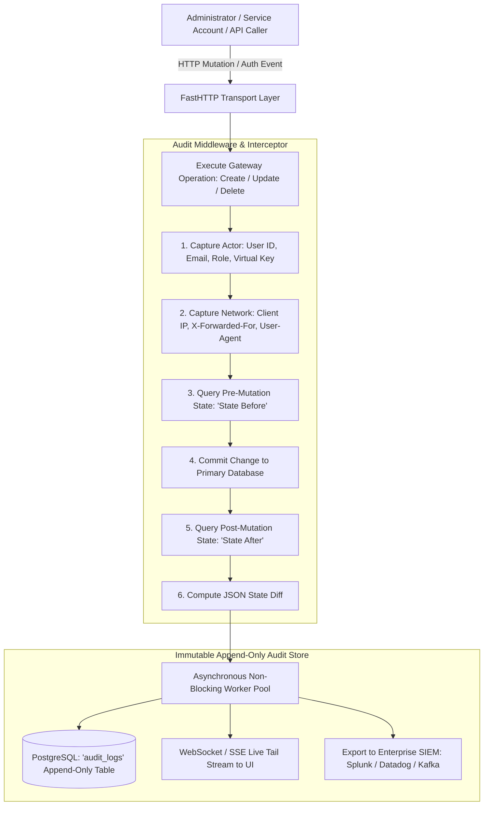

# UnifAI SOC-2 Administrative Audit Logs & State Diff Architecture

This document provides a comprehensive, production-grade technical specification of the **Audit Logs** subsystem within the UnifAI Enterprise AI Gateway. It details the immutable administrative audit trail, SOC-2 Type II compliance logging, actor attribution, IP address capture, before/after state diff snapshots, CSV/JSON export formats, live polling streams, complete UI workspace documentation (all buttons, dialogs, and controls), database schemas, and REST APIs.

---

## 1. System Overview & Compliance Architecture

The **Audit Logs** subsystem (`/workspace/audit-logs`) records every administrative mutation, configuration change, user authentication event, security policy edit, and credential access occurring within the gateway. Designed to satisfy enterprise compliance standards—including **SOC-2 Type II**, **ISO/IEC 27001**, **HIPAA**, and **PCI DSS Requirement 10**—the audit log operates as a tamper-evident, append-only ledger.



---

## 2. Captured Events, Actions & Resource Taxonomy

Every audit entry captures a discrete administrative action:

| Action Category | Action Badge | Event Description |
| :--- | :--- | :--- |
| `create` | Green Badge (`emerald`) | A new entity was provisioned (e.g., Virtual Key created, Guardrail Rule added, Provider enrolled). |
| `update` | Blue Badge (`blue`) | An existing entity configuration was modified (e.g., budget limit increased, rate-limit adjusted). |
| `delete` | Red Badge (`destructive`) | An entity was permanently deleted or revoked (e.g., Virtual Key deleted, Team removed). |
| `login` | Amber Badge (`amber`) | User successfully authenticated via password, SSO, or SCIM. |
| `logout` | Gray Badge (`outline`) | User terminated session or was logged out by administrator. |
| `email_sent` | Purple Badge (`purple`) | System dispatched a compliance advisory, invite, or security alert email. |

---

## 3. UI Deep Dive: Audit Logs Workspace (`/workspace/audit-logs`)

The Audit Logs console provides real-time visibility and investigative forensics into all workspace events.

### 3.1. Header & Live Stream Controls
* **Header Title & Description**: Displays `Audit Logs` with description of SOC-2 retention and actor tracking.
* **Search Input Field** (`input#audit-search`): Full-text search across actor emails, IP addresses, resource names, and target entity IDs.
* **Action Filter Dropdown** (`select#audit-action-filter`): Filters by `All Actions`, `create`, `update`, `delete`, `login`, `logout`, `email_sent`.
* **Outcome Filter Dropdown** (`select#audit-outcome-filter`): Filters by `All Outcomes`, `success`, `failure`.
* **Live Tail Switch** (`<Switch id="live-tail" />`):
  * When enabled, polls `GET /api/audit-logs` every 5,000ms and updates the table seamlessly.
  * When disabled, pauses auto-refresh to allow uninterrupted inspection of historical entries.
* **Export Dropdown Button** (`ExportFormatsDropdown`):
  * **Export as CSV**: Streams filtered audit records formatted for spreadsheet analysis.
  * **Export as JSON**: Streams RFC 8259 structured JSON formatted for SIEM ingestion.

---

### 3.2. Audit Logs Data Table Columns
1. **Timestamp**:
   * Formatted Local and UTC Date (`YYYY-MM-DD`).
   * Formatted Local Time with seconds (`HH:mm:ss`).
2. **Actor**:
   * User display name and email (e.g., `john.doe@enterprise.com`).
   * For programmatic actions, displays calling Virtual Key prefix (`uf-live-8a9f...`).
3. **Action**:
   * Color-coded badge (`create`, `update`, `delete`, `login`, `logout`, `email_sent`).
4. **Target Resource**:
   * High-level entity type and specific identifier (e.g., `Virtual Key: Prod-Customer-Chatbot`, `Team: Core Engineering`, `Rule: PCI-DSS-Masking`).
5. **Client IP Address**:
   * Remote IP address and geolocation hint (e.g., `192.168.10.45`).
6. **Outcome**:
   * `Success` (Green dot badge).
   * `Failure` (Red dot badge with error reason tooltip).
7. **Actions Column**:
   * **View Details Button** (`button#btn-view-audit-{id}`): Opens the Audit Log Details Dialog.

---

### 3.3. Audit Log Details & State Diff Dialog

Clicking any row opens a comprehensive inspection modal:
* **Event Metadata Grid**:
  * Event UUID and Nonce.
  * Execution Timestamp (ISO-8601 UTC).
  * Actor Email, User ID, and Active Role.
  * Target Entity Type and Primary Key.
  * Remote IP Address and HTTP User-Agent string.
* **State Diff Comparison Tabs**:
  * **State Before (Pre-Mutation)**: Syntax-highlighted JSON viewer displaying exact attributes prior to modification.
  * **State After (Post-Mutation)**: Syntax-highlighted JSON viewer displaying modified attributes.
  * **Unified Side-by-Side Diff**: Highlights added fields in green and deleted/modified fields in red.
* **Action Buttons**:
  * **Copy State Diff Button** (`button#btn-copy-diff`): Copies before/after JSON diff to clipboard.
  * **Close Button** (`button#btn-close-audit-detail`).

---

## 4. Complete Database Schemas & Storage Format

Audit logs are stored in PostgreSQL with indexed actor and timestamp columns:

```sql
-- Master Audit Logs Append-Only Table
CREATE TABLE audit_logs (
    id VARCHAR(255) PRIMARY KEY,
    actor_id VARCHAR(255) NOT NULL,                  -- User UUID or API Key ID
    actor_email VARCHAR(255),
    actor_role VARCHAR(100),
    action VARCHAR(50) NOT NULL,                     -- 'create', 'update', 'delete', 'login', 'logout'
    target_type VARCHAR(100) NOT NULL,               -- 'virtual_key', 'team', 'guardrail_rule', etc.
    target_id VARCHAR(255),
    target_name VARCHAR(255),
    ip_address VARCHAR(64) NOT NULL,
    user_agent TEXT,
    outcome VARCHAR(50) NOT NULL DEFAULT 'success',  -- 'success', 'failure'
    error_message TEXT,
    state_before JSONB,                              -- Snapshot before mutation
    state_after JSONB,                               -- Snapshot after mutation
    metadata JSONB DEFAULT '{}'::jsonb,
    created_at TIMESTAMP WITH TIME ZONE NOT NULL DEFAULT NOW()
);

-- Performance Indexes for SOC-2 Forensics
CREATE INDEX idx_audit_logs_created_at ON audit_logs(created_at DESC);
CREATE INDEX idx_audit_logs_actor ON audit_logs(actor_email);
CREATE INDEX idx_audit_logs_target ON audit_logs(target_type, target_id);
```

---

## 5. Complete REST API Reference

All audit endpoints require Administrative role.

### `GET /api/audit-logs`
Retrieves paginated audit events with multi-criteria filtering.
* **Query Parameters**:
  * `limit` (default: 50, max: 200)
  * `offset` (default: 0)
  * `search` (actor, IP, target)
  * `action` (`create`, `update`, `delete`, `login`)
  * `outcome` (`success`, `failure`)
  * `from` & `to` (ISO-8601 timestamps)
* **Response**:
  ```json
  {
    "logs": [
      {
        "id": "aud-89124-4f9a",
        "timestamp": "2026-10-24T11:41:00Z",
        "actor": {
          "id": "usr-10492",
          "email": "secops-admin@enterprise.com",
          "role": "admin"
        },
        "action": "update",
        "target": {
          "type": "virtual_key",
          "id": "vk-8812-4f9a",
          "name": "Production-Customer-Bot"
        },
        "ip_address": "10.14.2.80",
        "outcome": "success",
        "state_before": {
          "max_limit": 100.0,
          "rpm_limit": 60
        },
        "state_after": {
          "max_limit": 250.0,
          "rpm_limit": 120
        }
      }
    ],
    "total": 1420
  }
  ```

### `GET /api/audit-logs/export`
Streams raw export files.
* **Query Parameters**: `format=csv` or `format=json`, plus active filters.
* **Response**: Triggers file download stream with headers `Content-Disposition: attachment; filename="audit_logs_2026-10-24.csv"`.

---

## 6. Security Guarantees & Tamper Resistance

1. **Strictly Append-Only**:
   * No `UPDATE` or `DELETE` API routes exist for the `audit_logs` table.
   * Database-level triggers prevent rows from being modified once written.
2. **SOC-2 Retention Policy**:
   * Audit records are preserved for a minimum of 365 days (or forwarded continuously to enterprise cold storage / AWS S3 Glacier with Object Lock WORM compliance).
