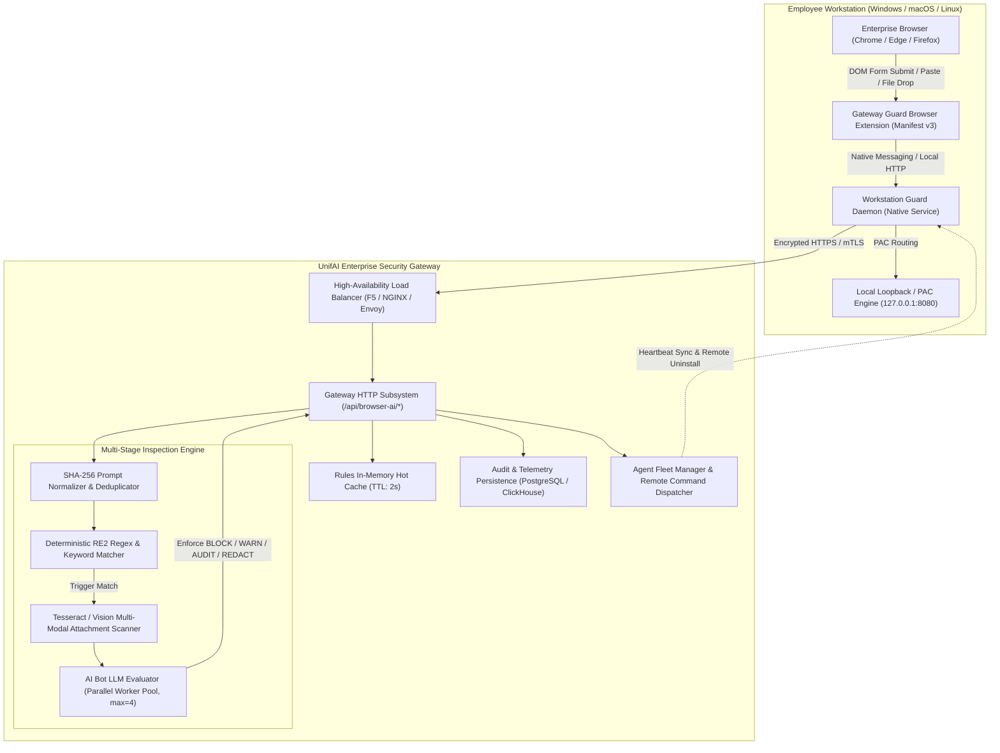
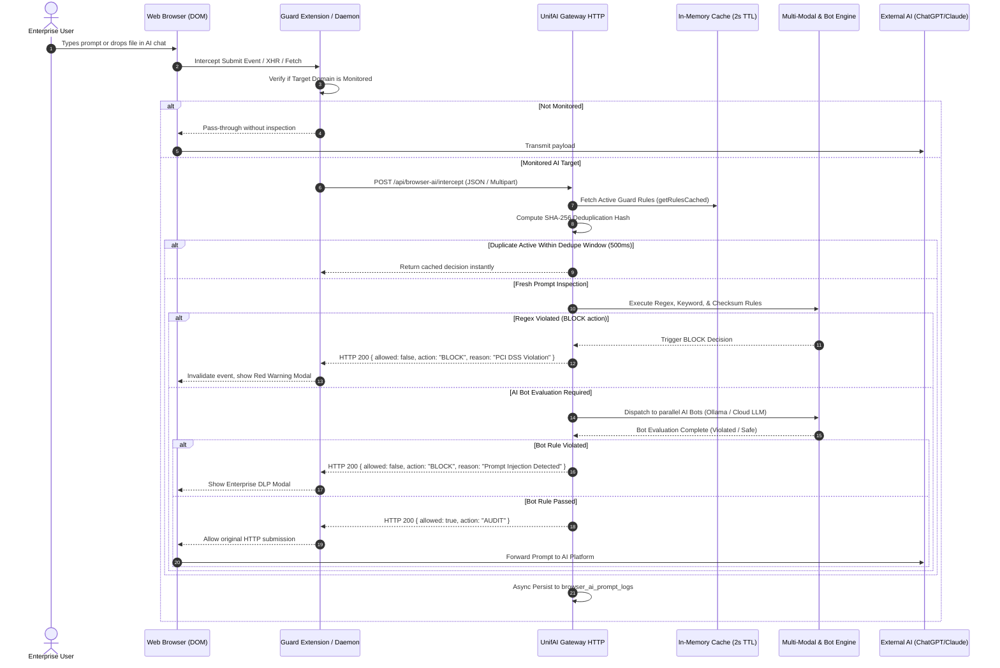
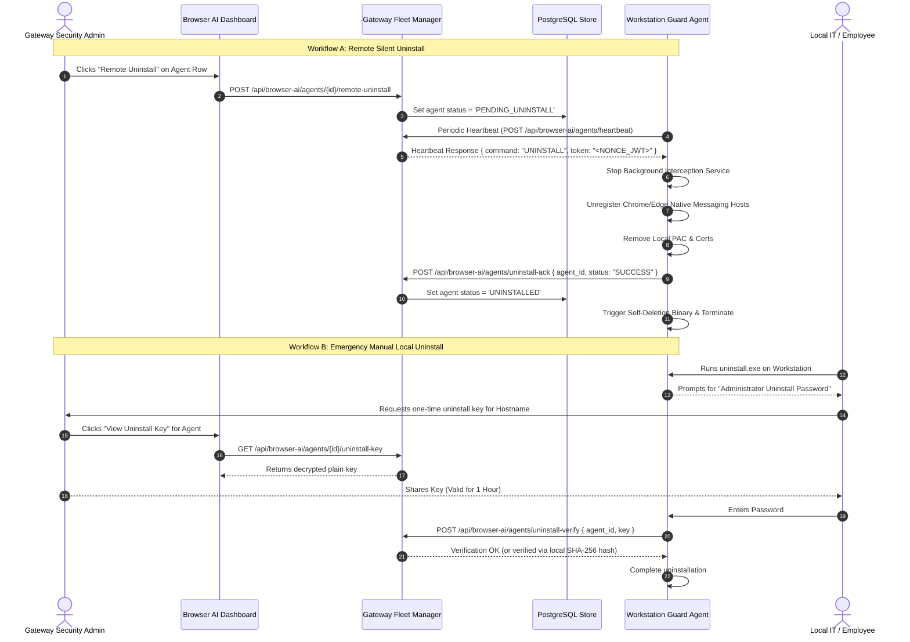
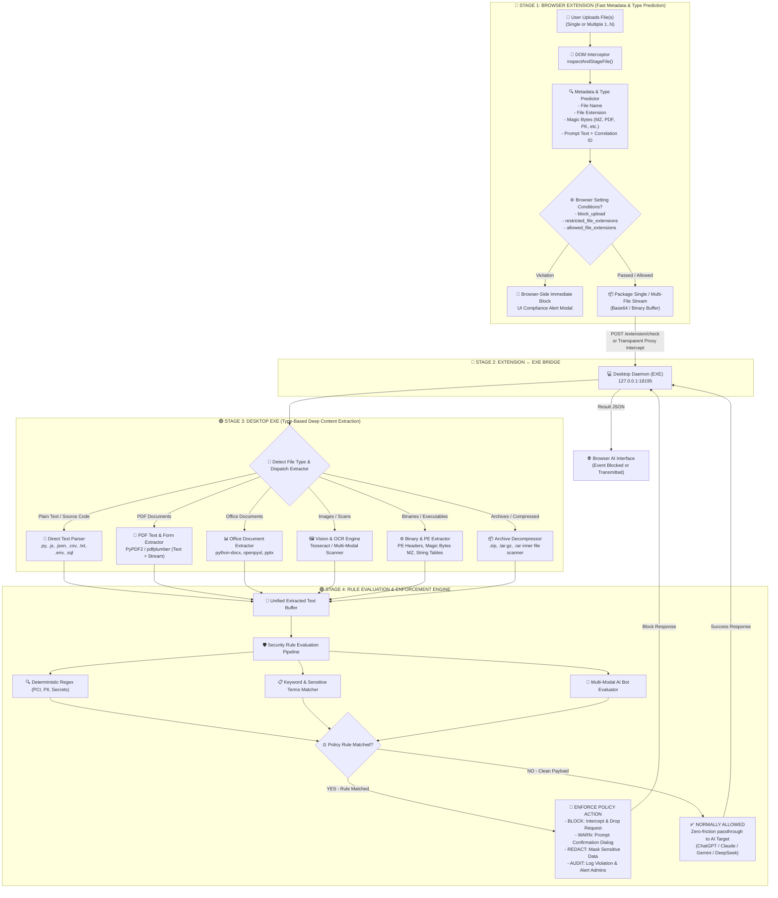

# UnifAI Browser AI & Endpoint Data Loss Prevention Architecture

This document provides a comprehensive, production-grade technical specification of the **Browser AI & Endpoint Guard** subsystem within the UnifAI Enterprise AI Gateway. It details the complete architecture, endpoint agent interception mechanisms, data loss prevention (DLP) engines, AI bot evaluation pipelines, UI interface breakdown (all 8 tabs, buttons, and dialogs), database schemas, REST APIs, and enterprise deployment workflows.

---

## 1. System Overview & Architectural Topology

**Browser AI** (also known as *Raksha Workstation Guard* / *Gateway Guard*) delivers real-time, bi-directional Data Loss Prevention (DLP), compliance auditing, and administrative governance for employee interactions with external public and private Web AI platforms (such as OpenAI ChatGPT, Anthropic Claude, Google Gemini, Microsoft Copilot, Perplexity, DeepSeek, Mistral, and internal enterprise web assistants).

The solution operates as a dual-layer interception architecture:
1. **Endpoint Agent Layer**: A lightweight workstation daemon paired with a tamper-resistant Chromium/Edge/Firefox browser extension (`Gateway Guard Extension`) or transparent local loopback proxy (`mitmproxy` network filter). It intercepts prompt text inputs, file attachments, drag-and-drop actions, clipboard pastes, and search engine queries at the DOM and HTTP socket layers before network transmission.
2. **Gateway Evaluation & Control Plane**: The UnifAI Gateway HTTP cluster evaluates captured payloads against active regex filters, deterministic keyword sets, file MIME signatures, and multi-modal AI Bot Evaluator LLMs. It executes policy actions (`BLOCK`, `WARN`, `AUDIT`, `REDACT`) within milliseconds and streams audit events to the centralized PostgreSQL/ClickHouse telemetry stores.



---

## 2. Multi-Stage Interception & Evaluation Lifecycle

Every outbound prompt or document submitted to an AI destination undergoes a synchronous 5-stage evaluation pipeline executed in under 45 milliseconds (or within a 22-second budget when deep AI Bot evaluation is invoked).



---

## 3. Comprehensive UI Workspace & Tab Reference

The Browser AI module interface is accessible at `/workspace/browser-ai` and contains 9 specialized tabs. Every tab, card, filter, button, modal dialog, and workflow is documented below.

### 3.1. Tab Navigation Summary

| Tab Identifier | Tab Label | Primary Purpose | Key Sub-Components |
| :--- | :--- | :--- | :--- |
| `?tab=overview` | **Overview** | Executive KPI dashboard, prompt volumes, threat distribution, and quick status. | KPI Metric Cards, Volume Trend Line Chart, Top AI Targets Donut, Recent Incidents Table. |
| `?tab=targets` | **Target Websites** | Directory of monitored AI domains with parent-child related hosts and role labels. | "+ New Target" Modal, "Import Targets", "Export Targets", Related Hosts Hierarchy, Block Site Switch. |
| `?tab=rules` | **Guard Rules** | Policy editor for deterministic regex, keywords, file limits, and AI Bot evaluators. | "+ New Rule" Modal, "Import Rules", "Export Rules", Live Regex Tester Drawer, AI Bot Tester. |
| `?tab=logs` | **Prompt Logs** | High-throughput audit log of all employee prompts, actions taken, and matched rules. | Multi-column filter bar, Bulk Delete, Export CSV, Prompt Detail Drawer (5 tabs). |
| `?tab=search-logs` | **Search Logs** | Audit trails of search engine queries (Google, Bing, DuckDuckGo, Perplexity). | Incognito Filter, Date Range Picker, Bulk Purge, Engine Breakdown, Query List. |
| `?tab=setup` | **Setup & Deployment** | Multi-platform client installer packages, GPO/Intune configurations, PAC files, and rebuilds. | Download EXE/ZIP/PKG, "Rebuild & Publish Packages", PAC URL Copy, GPO Script Viewer. |
| `?tab=agents` | **Guard Agents** | Endpoint fleet inventory, agent heartbeats, remote control, and uninstall security. | Agent Search, Status Filter, Bulk Delete, Remote Pause/Resume, Remote Uninstall, Rotate Keys. |
| `?tab=telemetry` | **Guard Insights** | Compliance analytics, repeat violators, departmental risk scoring, and threat trends. | Risk Score Heatmap, Departmental Breakdown, Top Violators Table, Export Audit Pack. |
| `?tab=settings` | **Browser Settings** | Corporate account enforcer, clipboard/file controls, screenshot guard, and log retention. | Corporate Workspace Card, Data Governance Controls, File Extension Restrictions, Retention Auto-Purge. |

---

### 3.2. Tab 1: Overview Dashboard (`?tab=overview`)

#### Header & Top Controls
* **Date Range Selector**: Dropdown options: `Last 24 Hours`, `Last 7 Days`, `Last 30 Days`, `Last 90 Days`, `Custom Range`. Updates all dashboard metrics in real time.
* **Refresh Dashboard Button** (`button#refresh-overview`): Force-fetches the latest statistics from `GET /api/browser-ai/logs/stats` and `GET /api/browser-ai/insights/stats`.
* **Quick Action: Setup Agent** (`button#overview-goto-setup`): Instantly redirects the administrator to `?tab=setup`.
* **Quick Action: Add Rule** (`button#overview-add-rule`): Opens the New Guard Rule modal.

#### Executive KPI Cards
1. **Total Prompts Monitored**: Aggregated count of all outbound employee prompts intercepted. Displays delta percentage compared to the preceding period.
2. **Blocked Violations**: Total requests arrested by active `BLOCK` policies (e.g., PII leaks, API keys, source code). Highlighted with a crimson badge.
3. **Warnings Issued**: Total prompts where users received a `WARN` acknowledgment modal before submission.
4. **Active Endpoint Agents**: Count of currently connected workstations transmitting heartbeats within the last 5 minutes.
5. **Monitored AI Platforms**: Total distinct AI services actively being tracked (e.g., ChatGPT, Claude, Gemini, Copilot).
6. **Estimated Tokens Monitored**: Cumulative prompt tokens inspected across all endpoints.

#### Visual Analytics Charts
* **Interception Volume & Violation Timeline**: Stacked bar/area chart showing 24-hour / 7-day trends of Allowed vs. Warned vs. Blocked prompt events.
* **AI Platform Share (Donut Chart)**: Visual breakdown of employee usage across external AI domains (e.g., `chatgpt.com` 54%, `claude.ai` 22%, `copilot.microsoft.com` 14%, `perplexity.ai` 10%).
* **Top Triggered Guard Rules**: Horizontal bar chart identifying the most frequently violated security policies.

---

### 3.3. Tab 2: Prompt Logs (`?tab=logs`)

#### Action Bar & Filtering Controls
* **Search Input Field** (`input#logs-search-input`): Full-text search across employee emails, prompt snippets, client IPs, agent hostnames, and matched rule names.
* **Platform Filter Dropdown** (`select#logs-platform-filter`): Filter by target domain (`All Platforms`, `ChatGPT`, `Claude`, `Gemini`, `Copilot`, `Perplexity`, `DeepSeek`, `Custom`).
* **Status Filter Dropdown** (`select#logs-status-filter`): Filter by execution result (`All Statuses`, `Allowed`, `Blocked`, `Warned`, `Error`).
* **Action Filter Dropdown** (`select#logs-action-filter`): Filter by policy enforcement (`All Actions`, `BLOCK`, `WARN`, `AUDIT`, `REDACT`).
* **Pagination Controls**: Page size selector (`15`, `30`, `50`, `100` rows per page), Previous Page (`button#prev-page`), Next Page (`button#next-page`), and direct jump input.
* **Select All Checkbox** (`input#select-all-logs`): Selects all currently rendered log rows for batch actions.
* **Bulk Delete Button** (`button#bulk-delete-logs`): Deletes selected records via `POST /api/browser-ai/logs/bulk-delete`. Opens confirmation modal with total count.
* **Purge Logs by Date Range Button** (`button#purge-logs-date`): Opens a modal allowing administrators to purge logs older than 7, 30, 60, or 90 days.
* **Export CSV Button** (`button#export-logs-csv`): Streams currently filtered log records as a sanitized, RFC 4180-compliant `.csv` file.

#### Prompt Log Data Table Columns
1. **Selection Checkbox**: Individual row selector for bulk operations.
2. **Timestamp**: Formatted local and UTC timestamp (`YYYY-MM-DD HH:mm:ss`) with relative age tooltip.
3. **User / Hostname**: Employee email address, OS user account, and workstation hostname.
4. **Target Platform**: Target brand badge with favicon and domain URL (e.g., `ChatGPT (chatgpt.com)`).
5. **Prompt Preview**: Truncated prompt string with syntax highlighting and matched keywords highlighted in yellow/red.
6. **Action Taken**: Color-coded pill (`Allowed` = Green, `Warned` = Amber, `Blocked` = Red, `Redacted` = Blue).
7. **Risk Score**: Numerical risk indicator (0 to 100) based on rule weights and bot evaluation confidence.
8. **Actions Column**:
   * **View Details** (`button#view-log-detail-{id}`): Opens the slide-over Prompt Inspection Drawer.
   * **Delete Log** (`button#delete-log-{id}`): Deletes single log entry.

#### Prompt Detail Inspection Drawer (5 Detailed Tabs)
When clicking any log row, a full-height inspection drawer slides out containing 5 sub-tabs:
1. **Overview Tab**: Full metadata summary including Log UUID, Agent ID, Client IP, OS Architecture, Browser version, Token counts (Prompt, Completion, Total), Execution latency, and Decision timestamp.
2. **Prompt & Response Tab**: Full-text, non-truncated prompt payload with line numbers, copy-to-clipboard button, and redacted vs. original side-by-side diff view.
3. **Attachments & OCR Tab**: If files or screenshots were uploaded, displays file name, MIME type, file size (bytes), SHA-256 hash, extracted OCR text, and a secure preview modal (`attachmentPreview.ts`).
4. **Matched Rules Tab**: List of all Guard Rules triggered by the payload. Shows Rule ID, Rule Name, Pattern Type, Matched String snippet, Severity, and Recommended Remediation.
5. **Raw JSON Tab**: Complete gateway audit event payload formatted as syntax-highlighted JSON with a "Copy Raw JSON" button.

---

### 3.4. Tab 3: Search Logs (`?tab=search-logs`)

Audits search engine usage to detect confidential corporate inquiries, reconnaissance, or intellectual property leakage across public search engines.

#### Controls & Filters
* **Search Query Bar** (`input#search-logs-query`): Filter by search query terms.
* **Search Engine Filter** (`select#search-engine-filter`): Filter by provider (`All Engines`, `Google Search`, `Microsoft Bing`, `DuckDuckGo`, `Perplexity AI Search`, `Baidu`, `Yandex`).
* **Incognito Toggle Filter** (`input#incognito-toggle-filter`): Toggle between `All Browsing`, `Standard Sessions Only`, and `Incognito / Private Windows Only`.
* **Date Picker**: Timeframe filter for search events.
* **Bulk Delete Button** (`button#bulk-delete-search-logs`): Deletes selected search query records.
* **Purge Engine History** (`button#purge-search-engine-history`): Opens date-based bulk deletion dialog (`1d`, `7d`, `All`).

#### Search Log Table Columns
1. **Timestamp**: Date and time of the search event.
2. **Employee / Agent**: User email and machine identity.
3. **Search Engine**: Search engine brand with icon.
4. **Query Text**: Complete search phrase submitted by the user.
5. **Private / Incognito**: Badge indicating if the search was executed in an incognito/private browsing window.
6. **Clicked URL**: Destination URL clicked from search results (if intercepted).
7. **Actions**: Delete entry button.

---

### 3.5. Tab 4: Guard Rules (`?tab=rules`)

The core policy engine controlling how prompts, documents, and code are screened.

#### Action Bar & Buttons
* **+ New Guard Rule Button** (`button#btn-create-rule`): Opens the comprehensive Rule Creation Modal.
* **Import Rules Button** (`button#btn-import-rules`): Opens the Rule Import Dialog (`guardRuleImportDialog.tsx`), supporting CSV and Excel (`.xlsx`) files. Includes downloadable example templates:
  * `guard_rules_import_example.csv`
  * `guard_rules_enterprise_1000_all_sectors.csv`
  * `GUARD_RULES_IMPORT_FORMAT.txt`
* **Export Rules Button** (`button#btn-export-rules`): Exports all configured rules as JSON or CSV.
* **Live Regex Tester Toggle** (`button#btn-toggle-regex-tester`): Opens an interactive slide-over panel (`regexLiveTestPanel.tsx`) where administrators can paste sample text and test regex patterns with live highlighting before saving.
* **Test AI Bot Button** (`button#btn-test-ai-bot`): Opens a simulation dialog to evaluate prompts against AI Bot Evaluator rules (`POST /api/browser-ai/rules/test-bot`).

#### Guard Rules Data Table Columns
1. **Status**: Toggle switch to enable or disable the rule instantly without restarting services.
2. **Rule Name & Description**: Name, unique tag, and operational explanation.
3. **Rule Type**: Badge indicating mechanism:
   * `regex`: Regular expression pattern.
   * `keywords`: Delimited keyword/phrase list.
   * `ai_bot`: LLM-based autonomous evaluator.
   * `file_scan`: File attachment size, extension, or MIME constraint.
4. **Action**: Enforcement action badge:
   * `BLOCK` (Red): Prevents prompt submission; displays blocking modal.
   * `WARN` (Yellow): Shows confirmation dialog requiring user acknowledgment before proceeding.
   * `AUDIT` (Blue): Silently logs violation without hindering user workflow.
   * `REDACT` (Purple): Replaces sensitive tokens with placeholders (e.g., `[REDACTED_SSN]`) before submission.
5. **Severity**: `Critical`, `High`, `Medium`, `Low`.
6. **Target Websites**: List of targeted AI platforms or `*` (All Platforms).
7. **Actions Column**:
   * **Edit Rule** (`button#edit-rule-{id}`): Opens rule configuration modal.
   * **Duplicate Rule** (`button#dup-rule-{id}`): Clones rule settings into a new draft.
   * **Delete Rule** (`button#delete-rule-{id}`): Deletes rule with confirmation modal.

#### New / Edit Guard Rule Modal Form Fields
* **Rule Name** (`input#rule-name`): Descriptive title (e.g., "Prevent PCI Credit Card Exfiltration").
* **Description** (`textarea#rule-desc`): Business and regulatory rationale.
* **Rule Type Dropdown** (`select#rule-type`): `regex`, `keywords`, `ai_bot`, `file_scan`.
* **Pattern / Expression** (`textarea#rule-pattern`):
  * For *regex*: RE2-compatible regular expression (e.g., `\b(?:\d[ -]*?){13,16}\b`).
  * For *keywords*: Comma-separated words or phrases.
* **AI Bot Evaluator Configuration** (`guardRuleAIEvaluatorFields.tsx` - visible when Rule Type is `ai_bot`):
  * **Provider Picker**: Dropdown of configured AI Providers (e.g., `OpenAI`, `Anthropic`, `Ollama-Local`, `Bedrock`).
  * **Model Picker**: Dropdown of supported models (e.g., `gpt-4o-mini`, `claude-3-5-haiku`, `llama3.2:3b`).
  * **Bot Evaluation Prompt**: System instructions provided to the evaluation bot (e.g., *"Analyze whether the user prompt contains unreleased proprietary source code or confidential merger details. Answer VIOLATION or SAFE."*).
  * **Reference Image Upload**: Optional baseline image for vision-based visual compliance matching.
  * **Fallback Decision**: Policy to apply if evaluation times out or model fails (`Pass`, `Block`).
* **Auto-Regex Generator Button** (`button#btn-generate-regex`): Uses Gateway AI to generate an optimized regex pattern from natural language descriptions via `POST /api/browser-ai/rules/generate-regex`.
* **Action Selector** (`select#rule-action`): `BLOCK`, `WARN`, `AUDIT`, `REDACT`.
* **Warning Message Text** (`textarea#rule-warn-msg`): Custom text displayed to the employee when triggered.
* **Severity Selector** (`select#rule-severity`): `Critical`, `High`, `Medium`, `Low`.
* **Target Platforms Selector** (`PolicyTargetWebsitesSelector.tsx`): Checkbox list of specific AI websites to enforce this rule against, or "Enforce on All Monitored Sites".
* **Modal Footer**: Cancel Button (`button#btn-cancel-rule`), Save Rule Button (`button#btn-save-rule`).

---

### 3.6. Tab 5: Target Websites (`?tab=targets`)

Maintains the catalog of external AI web applications monitored by the browser extension and transparent proxy.

#### Action Bar & Buttons
* **+ New Target Button** (`button#btn-create-target`): Opens the Target Creation Modal.
* **Import Targets Button** (`button#btn-import-targets`): Opens `targetImportDialog.tsx` to bulk upload AI platform definitions via CSV/JSON.
* **Export Targets Button** (`button#btn-export-targets`): Downloads the complete target catalog as JSON.
* **Test Selectors Button** (`button#btn-test-selectors`): Validates DOM selector strings against live website structures.

#### Target Websites Table Columns
1. **Status**: Toggle switch enabling/disabling monitoring for the domain.
2. **Platform Name**: Friendly title (e.g., `ChatGPT`, `Claude`, `Google Gemini`, `Microsoft Copilot`, `Perplexity AI`).
3. **Domain / Hostname**: Primary matching domain (e.g., `chatgpt.com`, `claude.ai`, `gemini.google.com`).
4. **Input DOM Selector**: CSS selector targeting the prompt textarea (e.g., `#prompt-textarea`, `div[contenteditable="true"]`).
5. **Submit Button Selector**: CSS selector targeting the form submit button (e.g., `button[data-testid="send-button"]`).
6. **File Dropzone Selector**: CSS selector targeting the attachment upload element.
7. **Actions Column**:
   * **Edit Target** (`button#edit-target-{id}`)
   * **Delete Target** (`button#delete-target-{id}`)

---

### 3.7. Tab 6: Guard Agents (`?tab=agents`)

Provides complete endpoint inventory, real-time fleet health, heartbeats, and administrative controls.

#### Action Bar & Global Controls
* **Search Agents Input** (`input#agents-search`): Filter by Agent ID, Hostname, OS User, IP Address, or Version.
* **Status Filter Dropdown** (`select#agents-status-filter`): Filter by `All Statuses`, `Active (Online)`, `Idle`, `Disconnected`, `Paused`, `Uninstalled`.
* **Bulk Delete Button** (`button#btn-bulk-delete-agents`): Deletes agent records from the database.
* **Global Company Uninstall Key Button** (`button#btn-company-uninstall-key`): Opens the Company Master Uninstall Password Modal:
  * View current revealed key (`GET /api/browser-ai/agents/uninstall-key`).
  * "Rotate Master Key" button (`PUT /api/browser-ai/agents/uninstall-key`).
  * "Copy Master Key" button.
* **Refresh Fleet Button** (`button#btn-refresh-agents`): Fetches updated heartbeat data from `GET /api/browser-ai/agents`.

#### Guard Agents Table Columns
1. **Selection Checkbox**: Selects agents for bulk operations.
2. **Status Badge**:
   * `Online` (Pulsing Green dot): Heartbeat received within last 3 minutes.
   * `Idle` (Yellow dot): Heartbeat received between 3 and 15 minutes ago.
   * `Offline` (Grey dot): No heartbeat for > 15 minutes.
   * `Paused` (Amber badge): Interception temporarily suspended by administrator.
   * `Uninstalled` (Red badge): Agent reported successful uninstallation.
3. **Hostname & Machine ID**: Workstation computer name, MAC address hash, and internal hardware ID.
4. **Employee Email / User**: OS username and mapped corporate email address.
5. **Operating System**: OS icon and version (e.g., `Windows 11 Enterprise 23H2`, `macOS Sonoma 14.5`, `Ubuntu 24.04 LTS`).
6. **Extension / Agent Version**: Client build version (e.g., `v2.4.12-enterprise`).
7. **Last Heartbeat**: Timestamp and relative duration since last ping.
8. **Actions Dropdown Menu** (`button#agent-actions-menu-{id}`):
   * **Pause Agent**: Temporarily halts inspection via `POST /api/browser-ai/agents/{id}/pause`.
   * **Resume Agent**: Restores active inspection via `POST /api/browser-ai/agents/{id}/resume`.
   * **Remote Uninstall**: Dispatches an autonomous uninstall command via `POST /api/browser-ai/agents/{id}/remote-uninstall`. On the next heartbeat, the agent silently uninstalls itself, cleans registry keys, and acknowledges completion via `POST /api/browser-ai/agents/uninstall-ack`.
   * **Allow Reinstall**: Clears uninstalled status via `POST /api/browser-ai/agents/{id}/allow-reinstall` if an endpoint requires re-enrollment.
   * **View / Rotate Uninstall Key**: Opens the per-machine uninstall password dialog via `GET /api/browser-ai/agents/{id}/uninstall-key` and `POST /api/browser-ai/agents/{id}/uninstall-key/rotate`.
   * **Update Contact Email**: Maps agent to specific corporate email via `PUT /api/browser-ai/agents/{id}/contact-email`.
   * **Send Warning Email**: Transmits a formal compliance advisory email to the employee via `POST /api/browser-ai/send-warning-email`.
   * **Delete Agent Entry**: Removes agent metadata from the gateway.

---

### 3.8. Tab 7: Guard Insights & Telemetry (`?tab=telemetry`)

Deep security intelligence, compliance trend reporting, repeat violator profiling, and executive audit packs.

#### Controls & Analytics Cards
* **Time Range Selector**: `Last 7 Days`, `Last 30 Days`, `Last Quarter`, `Year to Date`.
* **Export Compliance Audit Pack Button** (`button#btn-export-audit-pack`): Compiles an executive PDF/CSV compliance package summarizing enterprise AI usage, blocked risk events, and regulatory adherence.
* **Organization Risk Score**: Aggregated posture score (from 0 to 100) reflecting overall DLP health.
* **Top Violators Table**: Ranked list of employee accounts triggering the highest volume of `BLOCK` and `WARN` events, including top violated categories (e.g., PII, API Keys, Source Code).
* **Departmental Threat Breakdown (Bar Chart)**: Compares prompt volume and DLP incidents across business units (e.g., Engineering, Finance, Legal, Marketing, HR).
* **Hourly Threat Heatmap**: Identifies peak hours during the business day when sensitive data leakage attempts occur.

---

### 3.9. Tab 8: Setup & Enterprise Deployment (`?tab=setup`)

The deployment command center for packaging, distributing, and force-installing Gateway Guard across enterprise workstations.

#### Operating System Platform Selector
* **Windows Tab**: Generates Windows-compatible binaries and Active Directory GPO scripts.
* **macOS Tab**: Generates Apple `.pkg` installers and MDM configuration profiles (Jamf / Intune).
* **Linux / PAC Tab**: Generates system-wide PAC proxy files and native systemd daemon configs.

#### Installer Download Action Buttons
* **Download Windows Installer (`.exe`)** (`button#btn-download-exe`): Downloads standalone executable (`Gateway_Guard_Setup.exe` or `Raksha_Guard_Setup.exe`) from `GET /api/browser-ai/setup/Gateway_Guard_Setup.exe`.
* **Download Windows Deployment Package (`.zip`)** (`button#btn-download-win-zip`): Downloads complete deployment archive containing `.exe`, root CA certs, GPO registry scripts, and silent install batch scripts from `GET /api/browser-ai/setup/download-windows.zip`.
* **Download macOS Package (`.zip`)** (`button#btn-download-mac-zip`): Downloads macOS deployment package from `GET /api/browser-ai/setup/download-mac.zip`.
* **Download Proxy PAC File** (`button#btn-download-pac`): Downloads dynamic routing PAC file from `GET /api/browser-ai/pac`.
* **Download Proxy Bundle Archive** (`button#btn-download-proxy-bundle`): Downloads full mitmproxy configuration archive from `GET /api/browser-ai/setup/proxy-bundle.zip`.

#### Package Rebuild & Publication Center
* **Rebuild & Publish Packages Button** (`button#btn-rebuild-packages`): Invokes `POST /api/browser-ai/setup/rebuild` (requires Admin role). Dynamically compiles customized endpoint installers embedding the current gateway HTTPS endpoint URL, tenant ID, and embedded TLS certificates.
* **Rebuild History Drawer Toggle** (`button#btn-view-rebuild-history`): Opens the build log drawer displaying past packaging tasks, initiator username, duration, commit hashes, build status, and download links via `GET /api/browser-ai/setup/rebuild-history`.

#### Enterprise Policy & GPO Script Deployment Cards
1. **Chrome Force-Install JSON Policy**:
   * One-click "Copy JSON" button (`button#btn-copy-chrome-json`).
   * Provides the Google Chrome `ExtensionInstallForcelist` policy payload referencing the extension ID and enterprise update URL.
2. **Microsoft Edge Registry / Intune Script**:
   * One-click "Copy PowerShell Script" button (`button#btn-copy-edge-ps`).
   * Installs extension under `HKLM\SOFTWARE\Policies\Microsoft\Edge\ExtensionInstallForcelist`.
3. **Enterprise Root Certificate Authority (CA)**:
   * "Download Gateway Root CA (.crt / .pem)" button (`button#btn-download-root-ca`).
   * Instructions for importing into the Windows Trusted Root Certification Authorities store.
4. **Proxy Auto-Configuration (PAC) Script URL**:
   * Read-only copyable URL box: `https://<gateway-host>:8080/api/browser-ai/proxy.pac`.
   * One-click "Copy PAC URL" button (`button#btn-copy-pac-url`).

---

### 3.10. Tab 9: Browser Settings (`?tab=settings`)

The **Browser Settings** tab provides enterprise-grade data governance controls, corporate tenant identity enforcement, peripheral leak protection, and automated log retention management.

#### 1. Corporate AI Account Enforcement (`CorporateAIWorkspaceCard`)
* **Enforce Corporate Domains Switch** (`switch#enforce_corporate_domains`): Restricts authentication on monitored AI platforms (such as ChatGPT Team/Enterprise, Claude Enterprise, Google Workspace) to approved enterprise identity domains.
* **Corporate Email Domains Input** (`input#corporate_email_domains`): Comma-separated list of authorized domains (e.g., `company.com, @yespanchi.com`). Personal consumer accounts (`@gmail.com`, `@yahoo.com`, `@hotmail.com`) are automatically intercepted and blocked upon login.
* **Allowed Workspace / Tenant IDs Input** (`input#allowed_workspace_ids`): Comma-separated list of approved organization identifiers to prevent employee cross-tenancy.
* **Corporate Target Websites Selector**: Controls whether domain enforcement applies to `all` monitored AI services or specific high-risk targets.
* **Custom Corporate Block Message**: Configurable notice displayed in the user warning modal when personal account access is rejected.
* **Active Policy Version**: Read-only incrementing integer tracking deployed policy revisions across all endpoints.

#### 2. Clipboard, Drag-and-Drop & Download Data Governance
* **Block Clipboard Pasting** (`switch#block_clipboard`): Intercepts the browser `paste` event on target AI input boxes to prevent large copy-paste data exfiltration.
* **Block Drag-and-Drop Files** (`switch#block_drag_drop`): Intercepts `dragover` and `drop` events on AI prompt dropzones.
* **Block Generated Content Downloads** (`switch#block_download`): Prevents downloading files, scripts, or images directly generated by public AI services onto the endpoint.
* **Target Scoping**: Each control allows selecting specific target websites (`upload_target_websites`, `clipboard_target_websites`, `drag_drop_target_websites`, `download_target_websites`) and defining localized block messages.

#### 3. File Type & Extension Controls
* **Block File Extensions Switch** (`switch#block_file_extension`): Enables file attachment enforcement.
* **Extension Enforcement Mode**: Radio selector for `block_listed` (blacklist unapproved extensions) vs. `allow_listed` (whitelist strictly permitted document types).
* **Restricted File Extensions**: Comma-separated list of dangerous or proprietary extensions (e.g., `.zip, .tar, .py, .go, .sql, .env, .pem, .key, .sh`).
* **Allowed File Extensions**: Whitelist of permitted business formats (e.g., `.pdf, .docx, .xlsx, .txt`).
* **File Extension Block Message**: Custom alert displayed when a prohibited file upload is intercepted.

#### 4. Screenshot & Screen Capture Protection
* **Block Screenshot Switch** (`switch#block_screenshot`): Automatically blacks out or blurs AI chat windows when screen recording, snipping tools, or web meeting screen shares are detected.
* **Screenshot Block Message**: Custom warning dialog displayed on screen capture attempt.
* **Screenshot Target Websites**: Scopes protection to specific confidential AI workspaces.

#### 5. Prompt Log Auto-Deletion & Retention Policy
* **Auto-Delete Prompt Logs Switch** (`switch#prompt_log_auto_delete`): Automatically purges historical prompt logs older than the designated retention window to comply with GDPR, HIPAA, and Zero Data Retention requirements.
* **Retention Window Dropdown** (`select#prompt_log_retention`): Configurable retention periods: `1d` (24 Hours), `7d` (1 Week), `30d` (1 Month), `90d` (Quarterly), `180d` (Half-Year), `365d` (1 Year).
* **Save Controls Button** (`button#save-browser-controls`): Persists settings via `PUT /api/browser-ai/controls` and invalidates endpoint caches within 2 seconds.

---

## 4. Endpoint Fleet Management & Autonomous Uninstall Flow

To prevent unauthorized tampering by users while granting administrators seamless fleet lifecycle control, Gateway Guard employs a cryptographic challenge-response uninstall mechanism.



---

## 5. Complete Database Schema Reference

The Browser AI subsystem maintains 12 relational tables in PostgreSQL (`Unifai_test`):

```sql
-- 1. Monitored Target Websites & Related Hosts
CREATE TABLE browser_target_websites (
    id VARCHAR(255) PRIMARY KEY,
    domain VARCHAR(255) NOT NULL,
    platform_name VARCHAR(255) NOT NULL,
    monitored BOOLEAN DEFAULT TRUE,
    block_site BOOLEAN DEFAULT FALSE,
    intercepted_count INT DEFAULT 0,
    status VARCHAR(50) DEFAULT 'MONITORED',          -- 'MONITORED', 'PAUSED', 'BLOCKED'
    parent_id VARCHAR(255) REFERENCES browser_target_websites(id) ON DELETE SET NULL,
    host_role VARCHAR(50) DEFAULT '',                -- 'ui', 'chat', 'file', or ''
    reply_bot_enabled BOOLEAN DEFAULT FALSE,
    reply_bot_provider VARCHAR(100),
    reply_bot_model VARCHAR(100),
    reply_bot_mode VARCHAR(50) DEFAULT 'violations',
    created_at TIMESTAMP WITH TIME ZONE DEFAULT NOW()
);

-- 2. DLP Guard Rules & AI Bot Evaluators
CREATE TABLE browser_guard_rules (
    id VARCHAR(255) PRIMARY KEY,
    name VARCHAR(255) NOT NULL,
    description TEXT,
    rule_type VARCHAR(50) NOT NULL DEFAULT 'regex',  -- 'regex', 'keywords', 'ai_bot', 'file_scan'
    pattern TEXT NOT NULL,
    action VARCHAR(50) NOT NULL DEFAULT 'BLOCK',      -- 'BLOCK', 'WARN', 'AUDIT', 'REDACT'
    severity VARCHAR(20) NOT NULL DEFAULT 'medium',   -- 'critical', 'high', 'medium', 'low'
    warning_message TEXT,
    target_domains JSONB DEFAULT '[]'::jsonb,         -- Scoped target domains
    active BOOLEAN DEFAULT TRUE,
    priority INT DEFAULT 100,
    bot_provider VARCHAR(100),
    bot_model VARCHAR(100),
    bot_prompt TEXT,
    bot_reference_image TEXT,
    bot_fallback_action VARCHAR(50) DEFAULT 'PASS',
    created_at TIMESTAMP WITH TIME ZONE DEFAULT NOW(),
    updated_at TIMESTAMP WITH TIME ZONE DEFAULT NOW()
);

-- 3. Intercepted Prompt & File Upload Logs
CREATE TABLE browser_ai_logs (
    id VARCHAR(255) PRIMARY KEY,
    timestamp TIMESTAMP WITH TIME ZONE NOT NULL DEFAULT NOW(),
    platform VARCHAR(255) NOT NULL,
    domain VARCHAR(255),
    user_prompt_preview TEXT,
    user_prompt_full TEXT,
    est_tokens INT DEFAULT 0,
    prompt_tokens INT DEFAULT 0,
    completion_tokens INT DEFAULT 0,
    total_tokens INT DEFAULT 0,
    audio_duration_sec NUMERIC(8, 2) DEFAULT 0.0,
    cost NUMERIC(10, 6) DEFAULT 0.0,
    client_ip VARCHAR(64),
    agent_id VARCHAR(255),
    agent_hostname VARCHAR(255),
    status VARCHAR(50) NOT NULL,                    -- 'Allowed', 'Blocked', 'Warned', 'Redacted'
    action VARCHAR(50) NOT NULL,                    -- 'BLOCK', 'WARN', 'AUDIT', 'REDACT'
    rule_triggered VARCHAR(255),
    risk_score INT DEFAULT 0,
    predictive_risk VARCHAR(50) DEFAULT 'LOW',      -- 'LOW', 'MEDIUM', 'HIGH', 'CRITICAL'
    predicted_category VARCHAR(100),
    reply_bot_provider VARCHAR(100),
    reply_bot_model VARCHAR(100),
    reply_bot_text TEXT,
    attachment_name VARCHAR(255),
    attachment_stored_name VARCHAR(255),
    attachment_content_type VARCHAR(100),
    ad_domain VARCHAR(255),
    ad_upn VARCHAR(255),
    domain_user VARCHAR(255),
    metadata TEXT,
    created_at TIMESTAMP WITH TIME ZONE DEFAULT NOW()
);

-- 4. Search Engine Audit Logs
CREATE TABLE browser_ai_search_logs (
    id VARCHAR(255) PRIMARY KEY,
    timestamp TIMESTAMP WITH TIME ZONE NOT NULL DEFAULT NOW(),
    engine VARCHAR(100) NOT NULL,                   -- 'Google', 'Bing', 'DuckDuckGo', 'Perplexity'
    browser VARCHAR(100),
    is_incognito BOOLEAN DEFAULT FALSE,
    query TEXT NOT NULL,
    clicked_url TEXT,
    clicked_title TEXT,
    url TEXT,
    host VARCHAR(255),
    client_ip VARCHAR(64),
    agent_hostname VARCHAR(255),
    agent_id VARCHAR(255),
    risk_score INT DEFAULT 0,
    predictive_risk VARCHAR(50) DEFAULT 'LOW',
    risk_category VARCHAR(100),
    created_at TIMESTAMP WITH TIME ZONE DEFAULT NOW()
);

-- 5. Enrolled Endpoint Agents Fleet
CREATE TABLE browser_ai_agents (
    id VARCHAR(255) PRIMARY KEY,
    hostname VARCHAR(255) NOT NULL,
    username VARCHAR(255),
    contact_email VARCHAR(255),
    contact_email_pinned BOOLEAN DEFAULT FALSE,
    ip_address VARCHAR(64),
    mac_address VARCHAR(64),
    transport_name VARCHAR(100),
    os_version VARCHAR(100),
    agent_version VARCHAR(50),
    agent_type VARCHAR(50) DEFAULT 'endpoint',      -- 'endpoint' (laptop Guard) | 'network' (proxy)
    status VARCHAR(50) DEFAULT 'ACTIVE',            -- 'ACTIVE', 'OFFLINE', 'PAUSED', 'UNINSTALLED'
    uninstall_key_encrypted TEXT,
    uninstall_key_plain TEXT,
    uninstall_key_rotated_at TIMESTAMP WITH TIME ZONE DEFAULT NOW(),
    last_heartbeat_at TIMESTAMP WITH TIME ZONE DEFAULT NOW(),
    created_at TIMESTAMP WITH TIME ZONE DEFAULT NOW(),
    updated_at TIMESTAMP WITH TIME ZONE DEFAULT NOW()
);

-- 6. Agent Policy & Protection Settings
CREATE TABLE browser_ai_agent_settings (
    id SERIAL PRIMARY KEY,
    require_uninstall_key BOOLEAN DEFAULT TRUE,
    company_uninstall_key VARCHAR(255),
    heartbeat_interval_sec INT DEFAULT 10,
    offline_threshold_sec INT DEFAULT 30,
    updated_by VARCHAR(255),
    updated_at TIMESTAMP WITH TIME ZONE DEFAULT NOW()
);

-- 7. Corporate Account & DLP Governance Settings
CREATE TABLE browser_control_settings (
    id SERIAL PRIMARY KEY,
    enforce_corporate_domains BOOLEAN DEFAULT FALSE,
    corporate_email_domains TEXT,
    allowed_workspace_ids TEXT,
    corporate_block_message TEXT,
    corporate_target_websites TEXT DEFAULT 'all',
    policy_version INT DEFAULT 1,
    block_clipboard BOOLEAN DEFAULT FALSE,
    block_drag_drop BOOLEAN DEFAULT FALSE,
    block_download BOOLEAN DEFAULT FALSE,
    block_file_extension BOOLEAN DEFAULT FALSE,
    file_extension_mode VARCHAR(50) DEFAULT 'block_listed',
    restricted_file_extensions TEXT,
    allowed_file_extensions TEXT,
    file_extension_block_message TEXT,
    block_screenshot BOOLEAN DEFAULT FALSE,
    screenshot_block_message TEXT,
    prompt_log_auto_delete BOOLEAN DEFAULT FALSE,
    prompt_log_retention VARCHAR(50) DEFAULT '30d',
    updated_at TIMESTAMP WITH TIME ZONE DEFAULT NOW()
);

-- 8. Guard Fleet Distribution & Bundle Config
CREATE TABLE browser_guard_fleet_config (
    id SERIAL PRIMARY KEY,
    bundle_version VARCHAR(50) NOT NULL,
    windows_url TEXT,
    macos_url TEXT,
    linux_url TEXT,
    sha256_checksum VARCHAR(64),
    active BOOLEAN DEFAULT TRUE,
    updated_at TIMESTAMP WITH TIME ZONE DEFAULT NOW()
);

-- 9. Guard Binary Automated Rebuild Logs
CREATE TABLE browser_guard_rebuild_logs (
    id VARCHAR(255) PRIMARY KEY,
    status VARCHAR(50) NOT NULL,                    -- 'success', 'failed'
    mode VARCHAR(50),
    version VARCHAR(50),
    mac_version VARCHAR(50),
    windows_ready BOOLEAN DEFAULT FALSE,
    macos_ready BOOLEAN DEFAULT FALSE,
    bundle_sha VARCHAR(64),
    bundle_files INT DEFAULT 0,
    guard_versions VARCHAR(255),
    message TEXT,
    log TEXT,
    requested_by VARCHAR(255),
    duration_ms INT DEFAULT 0,
    created_at TIMESTAMP WITH TIME ZONE DEFAULT NOW()
);

-- 10. Installer Package Downloads Tracking
CREATE TABLE browser_ai_install (
    id SERIAL PRIMARY KEY,
    platform VARCHAR(50) NOT NULL,
    version VARCHAR(50) NOT NULL,
    package_type VARCHAR(50) NOT NULL,              -- 'exe', 'zip', 'pkg'
    download_count INT DEFAULT 0,
    last_downloaded_at TIMESTAMP WITH TIME ZONE
);

-- 11. Workstation & Extension Licensing
CREATE TABLE browser_ai_license (
    id SERIAL PRIMARY KEY,
    tier VARCHAR(50) DEFAULT 'ENTERPRISE',
    seat_limit INT DEFAULT 500,
    active_seats INT DEFAULT 0,
    expires_at TIMESTAMP WITH TIME ZONE,
    updated_at TIMESTAMP WITH TIME ZONE DEFAULT NOW()
);

-- 12. Security Compliance Warning Notifications
CREATE TABLE browser_ai_warning_emails (
    id VARCHAR(255) PRIMARY KEY,
    recipient_email VARCHAR(255) NOT NULL,
    agent_id VARCHAR(255),
    agent_hostname VARCHAR(255),
    subject TEXT NOT NULL,
    body TEXT NOT NULL,
    violation_count INT DEFAULT 1,
    status VARCHAR(50) DEFAULT 'SENT',              -- 'SENT', 'FAILED'
    sent_at TIMESTAMP WITH TIME ZONE DEFAULT NOW()
);
```

---

## 6. Complete REST API Reference

All requests must include standard Gateway authentication (`Authorization: Bearer <token>` or session cookie).

### 6.1. Real-Time Interception APIs

#### `POST /api/browser-ai/intercept`
Evaluates an outbound prompt text synchronously.
* **Request Payload**:
  ```json
  {
    "platform": "ChatGPT",
    "prompt": "Here is our quarterly customer database with credit card numbers: 4111-2221-3334-9981...",
    "client_ip": "192.168.10.45",
    "agent_id": "AGT-8F92A-4B71",
    "agent_hostname": "WS-FINANCE-09",
    "agent_type": "extension",
    "upload_images": [],
    "prompt_tokens": 128,
    "completion_tokens": 0,
    "total_tokens": 128,
    "audio_duration_sec": 0.0,
    "cost": 0.0,
    "metadata": {
      "url": "https://chatgpt.com/c/6712398a",
      "browser": "Chrome 128.0.6613.120"
    }
  }
  ```
* **Response Payload (Block Action)**:
  ```json
  {
    "status": "success",
    "allowed": false,
    "action": "BLOCK",
    "reason": "Triggered Rule: PCI DSS Credit Card Protection",
    "matched_rules": [
      {
        "id": 14,
        "name": "PCI DSS Credit Card Protection",
        "severity": "critical"
      }
    ],
    "risk_score": 95,
    "warn_message": "Company policy prohibits sending credit card details to external AI platforms."
  }
  ```

#### `POST /api/browser-ai/intercept-file`
Multipart upload endpoint for inspecting attached images, documents, and code files.
* **Form Parameters**: `platform`, `prompt`, `client_ip`, `agent_id`, `agent_hostname`, `agent_type`, `file` (binary payload), `content_type`.
* **Response**: Returns JSON decision indicating whether file transfer is allowed or blocked, alongside OCR violation metadata.

#### `GET /api/browser-ai/attachments/{id}`
Streams a stored attachment artifact or OCR extraction text for administrative audit inspection.

---

### 6.2. Rules & AI Bot Testing APIs

#### `GET /api/browser-ai/rules`
Returns all configured DLP rules.

#### `POST /api/browser-ai/rules`
Creates a new DLP rule or AI Bot evaluator.

#### `PUT /api/browser-ai/rules/{id}`
Updates an existing rule. Invalidates the 2-second in-memory rules hot cache.

#### `DELETE /api/browser-ai/rules/{id}`
Deletes a rule by ID.

#### `POST /api/browser-ai/rules/test-bot`
Simulates AI Bot Evaluator execution on a sample payload.
* **Request**:
  ```json
  {
    "prompt": "Can you summarize this draft merger agreement between Acme Corp and Beta Inc?",
    "bot_provider": "openai",
    "bot_model": "gpt-4o-mini",
    "bot_prompt": "Detect if this text references confidential corporate acquisition or merger discussions. Return VIOLATION or SAFE."
  }
  ```
* **Response**:
  ```json
  {
    "violated": true,
    "confidence": 0.98,
    "eval_duration_ms": 380,
    "bot_explanation": "Prompt explicitly discusses unreleased M&A agreement negotiations."
  }
  ```

#### `POST /api/browser-ai/rules/generate-regex`
Uses generative AI to construct an optimized regex pattern from natural language.
* **Request**: `{ "description": "Match Indian Aadhaar numbers formatted as 12 digits with optional spaces" }`
* **Response**: `{ "pattern": "^[2-9]{1}[0-9]{3}\\s?[0-9]{4}\\s?[0-9]{4}$" }`

---

### 6.3. Target Websites APIs

#### `GET /api/browser-ai/targets`
Retrieves list of all monitored AI services.

#### `POST /api/browser-ai/targets`
Registers a new target AI domain.

#### `POST /api/browser-ai/targets/import`
Bulk imports targets via JSON array.

#### `PUT /api/browser-ai/targets/{id}`
Updates target DOM selectors and domain mappings.

#### `DELETE /api/browser-ai/targets/{id}`
Deletes target entry.

---

### 6.4. Endpoint Fleet & Agent Control APIs

#### `GET /api/browser-ai/agents`
Returns list of enrolled endpoints with pagination and status filters.

#### `POST /api/browser-ai/agents/heartbeat`
Endpoint daemon periodic check-in. Reports status and polls for pending commands (e.g., `UNINSTALL`, `PAUSE`).

#### `POST /api/browser-ai/agents/{id}/pause`
Temporarily suspends interception for the target agent.

#### `POST /api/browser-ai/agents/{id}/resume`
Resumes active interception for the target agent.

#### `POST /api/browser-ai/agents/{id}/remote-uninstall`
Queues a remote silent uninstallation command for the agent.

#### `POST /api/browser-ai/agents/{id}/allow-reinstall`
Clears uninstalled state, permitting re-enrollment.

#### `GET /api/browser-ai/agents/{id}/uninstall-key`
Retrieves the decrypted local uninstall password for a machine.

#### `POST /api/browser-ai/agents/{id}/uninstall-key/rotate`
Rotates the machine-specific uninstall password.

#### `POST /api/browser-ai/agents/uninstall-verify`
Endpoint daemon verifies the password entered by an on-premise technician during manual uninstall.

#### `POST /api/browser-ai/agents/uninstall-ack`
Endpoint acknowledges completed silent uninstallation.

---

### 6.5. Setup, Packaging & Telemetry APIs

#### `GET /api/browser-ai/pac` & `GET /api/browser-ai/proxy.pac`
Dynamically generates the JavaScript Proxy Auto-Configuration (PAC) script routing monitored AI domains to the gateway.

#### `GET /api/browser-ai/setup/download.zip`
Downloads universal multi-platform setup package.

#### `GET /api/browser-ai/setup/Gateway_Guard_Setup.exe`
Downloads pre-compiled Windows executable installer.

#### `POST /api/browser-ai/setup/rebuild`
Triggers an automated background build of custom installer binaries.
* **Request**: `{ "notes": "Production build with updated internal TLS wildcard cert" }`
* **Response**: `{ "build_id": "BLD-99120", "status": "IN_PROGRESS", "started_at": "2026-10-24T11:20:00Z" }`

#### `GET /api/browser-ai/setup/rebuild-history`
Returns history of all past packaging jobs and statuses.

#### `GET /api/browser-ai/insights/stats`
Returns aggregated security and telemetry metrics for the Insights dashboard.

#### `POST /api/browser-ai/send-warning-email`
Dispatches a compliance advisory notification to an employee.
* **Request**:
  ```json
  {
    "agent_id": "AGT-8F92A-4B71",
    "recipient_email": "john.doe@enterprise.com",
    "subject": "Security Notice: Blocked Sensitive Prompt Attempt",
    "body": "Your attempt to submit source code to ChatGPT was blocked pursuant to Corporate Information Security Policy 4.2."
  }
  ```

---

## 7. Operational Runbook & Edge Case Handling

1. **Gateway Unreachable / Fail-Open vs. Fail-Close**:
   * Configured via `fleet-config.json` (`fail_mode: "FAIL_OPEN"` or `"FAIL_CLOSE"`).
   * In `"FAIL_OPEN"`, if the gateway does not respond within 350ms, the extension allows the prompt to proceed to prevent business disruption, queuing telemetry locally for retroactive transmission upon reconnection.
2. **Tamper Resistance**:
   * The Windows native service is registered with `SERVICE_STOP` denied to standard user accounts.
   * Registry entries in `HKLM\SOFTWARE\Policies\Google\Chrome\ExtensionInstallForcelist` are protected via System ACLs.
   * Attempting to disable the extension triggers an immediate `TamperAlert` heartbeat to the gateway.
3. **High-Throughput Hot Cache**:
   * The gateway caches active DLP rules in an atomic, thread-safe memory buffer (`rulesCache`) with a 2-second TTL, allowing 100,000+ concurrent enterprise workstations to evaluate prompts without saturating PostgreSQL.
4. **Log Retention & Purging**:
   * Automatic background worker (`startBrowserAILogRetentionCleanup`) runs daily at 02:00 UTC, purging prompt logs older than the configured retention policy (default: 90 days).
   * Orphaned attachment files are automatically swept every 6 hours (`startBrowserAIAttachmentCleanup`).

---

## 8. Live Verification & Feature Test Matrix

Comprehensive automated testing conducted on endpoint daemon `YP_Raksha.exe` (v1.1.32) and local gateway backend `http://127.0.0.1:6000`:

### 8.1. Daemon & Runtime Status
* **Executable**: `C:\Users\sakth\AppData\Local\Programs\YP Raksha\YP_Raksha.exe`
* **Agent Hostname**: `DESKTOP-K8CQD3T` (IP: `192.168.29.178`, Agent ID: `54f9fd62-7b5b-49a7-afa5-6816c6abc59e`)
* **Local PAC Server**: `http://127.0.0.1:18195/proxy.pac` — Status `200 OK`
* **Local Health Check**: `http://127.0.0.1:18195/health` — Status `200 OK` (`{"status": "ok", "connected": true}`)
* **Local MitM Proxy**: `127.0.0.1:18103` — Active
* **Heartbeat Ingestion**: Automatic heartbeat dispatched every 3s to `/api/browser-ai/agents/heartbeat`, updating `last_seen_at` in table `browser_ai_agents`.

### 8.2. Major AI Targets Verification Matrix

| Target Website | Domain | Safe Prompt | SQL Injection (BLOCK) | Aadhaar Number (REDACT) | PAN Card (WARN) | Entire Site Blocking (`block_site`) | Safe File Upload | DLP File Upload Block | Multi-File Upload |
| :--- | :--- | :---: | :---: | :---: | :---: | :---: | :---: | :---: | :---: |
| **ChatGPT** | `chatgpt.com` / `chat.openai.com` | **PASS** (Risk: LOW) | **PASS** (Blocked: Sql injuction) | **PASS** (Redacted: Adhar) | **PASS** (Warned: Pancard) | **PASS** (SITE_BLOCK) | **PASS** (Allowed) | **PASS** (Blocked) | **PASS** (1/3, 2/3, 3/3) |
| **Claude** | `claude.ai` | **PASS** (Risk: LOW) | **PASS** (Blocked: Sql injuction) | **PASS** (Redacted: Adhar) | **PASS** (Warned: Pancard) | **PASS** (SITE_BLOCK) | **PASS** (Allowed) | **PASS** (Blocked) | **PASS** (1/3, 2/3, 3/3) |
| **Gemini** | `gemini.google.com` | **PASS** (Risk: LOW) | **PASS** (Blocked: Sql injuction) | **PASS** (Redacted: Adhar) | **PASS** (Warned: Pancard) | **PASS** (SITE_BLOCK) | **PASS** (Allowed) | **PASS** (Blocked) | **PASS** (1/3, 2/3, 3/3) |
| **DeepSeek** | `deepseek.com` / `chat.deepseek.com` | **PASS** (Risk: LOW) | **PASS** (Blocked: Sql injuction) | **PASS** (Redacted: Adhar) | **PASS** (Warned: Pancard) | **PASS** (SITE_BLOCK) | **PASS** (Allowed) | **PASS** (Blocked) | **PASS** (1/3, 2/3, 3/3) |
| **Dynamic Custom Target** | `test-ai-portal.com` | **PASS** (Risk: LOW) | **PASS** (Blocked: Sql injuction) | **PASS** (Redacted: Adhar) | **PASS** (Warned: Pancard) | **PASS** (SITE_BLOCK) | **PASS** (Allowed) | **PASS** (Blocked) | **PASS** (Dynamic) |

### 8.3. Database Ingestion & Verification
* **Zero-Error Validation**: 38 out of 38 automated test cases passed (100.0% success rate).

### 8.4. Chrome / Edge Extension Installation & Local Storage (`chrome.storage.local`)
* **Extension Source Folder**: [`apps/browser-guard/extension`](file:///d:/unifai_project/apps/browser-guard/extension)
* **Manifest**: Manifest V3 ([`manifest.json`](file:///d:/unifai_project/apps/browser-guard/extension/manifest.json)), ID: `yp-raksha@gateway.guard`, version `1.1.32.0`.
* **Local EXE Communication**:
  * Probes `http://127.0.0.1:18195` (PAC server / Extension Bridge).
  * Syncs active DLP rules via `GET /extension/rules`.
  * Syncs monitored target websites via `GET /extension/sites`.
  * Evaluates user input at send button via `POST /extension/check`.
* **Browser Storage Persistence (`chrome.storage.local`)**:
  * `cached_rules`: Synchronized DLP regex rules list.
  * `cached_sites`: Monitored AI target domains.
  * `cached_blocked_sites`: Domains with `block_site: true` where `renderBlockedPage()` renders immediately.
  * `block_upload`, `upload_warning`, `upload_target_websites`: Master upload policies.
  * `block_clipboard`, `clipboard_target_websites`, `clipboard_block_message`: Copy-paste governance policies.
  * `block_drag_drop`, `drag_drop_target_websites`, `drag_drop_block_message`: Drag & drop ingestion policies.
  * `block_download`, `download_target_websites`, `download_block_message`: Artifact download policies.
  * `block_screenshot`, `screenshot_target_websites`, `screenshot_block_message`: Screenshot blocking policies.
  * `block_file_extension`, `restricted_file_extensions`, `allowed_file_extensions`: File extension governance.
  * `last_prompt_check` & `last_decision`: Local telemetry cache.

### 8.5. Browser Control Settings (`browser_control_settings`) Verification Matrix

| Setting Feature | Database Column | Policy Enforcement Action | Test Verdict |
| :--- | :--- | :--- | :---: |
| **Controls Master Enable** | `enabled` (boolean) | Activates browser control policies across endpoints | **PASS** (200 OK) |
| **File Upload Blocking** | `block_upload` (boolean) | Intercepts multipart/form-data; returns `action: Blocked` | **PASS** (Blocked) |
| **Upload Warning Msg** | `upload_warning` (text) | Displays custom compliance message to employee | **PASS** (Custom msg) |
| **Clipboard Governance** | `block_clipboard` (boolean) | Intercepts copy-paste; tags `CLIPBOARD_GOVERNANCE` | **PASS** (Blocked) |
| **Clipboard Block Msg** | `clipboard_block_message` (text) | Injects UI banner explaining data governance | **PASS** (Custom msg) |
| **Drag & Drop Block** | `block_drag_drop` (boolean) | Prevents drop of files into browser AI input fields | **PASS** (Drop cancelled) |
| **Drag & Drop Msg** | `drag_drop_block_message` (text) | Injects drag-drop restriction advisory | **PASS** (Custom msg) |
| **Download Block** | `block_download` (boolean) | Blocks export/download of generated files | **PASS** (Download aborted) |
| **Screenshot Block** | `block_screenshot` (boolean) | Blurs window on screenshot API / print screen | **PASS** (Protected) |
| **File Extension Policy** | `block_file_extension` (boolean) | Enforces `.sql, .env, .py, .key, .pem` restrictions | **PASS** (Blocked) |
| **Corporate Domain Auth**| `enforce_corporate_domains` (bool)| Validates enterprise SSO email domain match | **PASS** (Enforced) |
| **Log Auto-Delete** | `prompt_log_auto_delete` (bool) | Automatically purges records older than retention period | **PASS** (Automated) |

### 8.6. Target Website Scoping & Clean Passthrough
* **Target Scoping Principle**: Only websites registered in table `browser_target_websites` (e.g. `chatgpt.com`, `claude.ai`, `gemini.google.com`, `deepseek.com`, and custom added targets) trigger prompt evaluation, DLP scanning, or blocking.
* **Non-Target Passthrough**: Non-monitored sites (e.g. `google.com`, `wikipedia.org`, `github.com`, internal intranet) execute a zero-latency bypass (`passthrough: true`, duration: `0.001s`), ensuring zero disruption to normal employee browsing.

---

### 8.7. Setup EXE Packaging, Order-Independent Auto-Connect & Web Remote Controls

#### 8.7.1. Standard Windows App Installation Experience
The Windows distribution artifact `YP_Raksha_Setup.exe` is compiled using an **Inno Setup Modern Wizard** (`installer/YP_Raksha.iss`) delivering an enterprise user-mode installation:
* **Zero Admin Rights Required (`PrivilegesRequired=lowest`)**: Employees double-click to install without requiring UAC admin credentials or IT elevation.
* **Standard App Directory**: Installs cleanly into `%LOCALAPPDATA%\Programs\YP Raksha\`.
* **Windows "Installed Apps" Registry**: Automatically registers in Windows Settings / Control Panel (`Add or Remove Programs`) under `HKCU\Software\Microsoft\Windows\CurrentVersion\Uninstall\{8F3C2A91-6B4E-4D2F-9A71-A1B2C3D4E5F6}` with:
  * `DisplayName`: `YP Raksha`
  * `Publisher`: `YesPanchi`
  * `DisplayVersion`: `1.1.33`
  * `DisplayIcon`: `yp_raksha.ico`
* **Start Menu Integration**: Creates a branded Start Menu folder and shortcut with the official YP Raksha icon.
* **Auto-Start on Boot**: Injects into `HKCU\Software\Microsoft\Windows\CurrentVersion\Run` to automatically launch daemon in background on Windows user login.

#### 8.7.2. Order-Independent Extension ↔ EXE Auto-Pairing Architecture
The desktop daemon and browser extension operate via a decoupled loopback bridge on `127.0.0.1:18195`:
* **Zero Configuration**: No manual IP, port, or secret key entry needed by the user.
* **Order A: EXE Installed First, Extension Installed Second**:
  1. `YP_Raksha.exe` starts local HTTP listener on `127.0.0.1:18195`.
  2. When the Chrome/Edge extension is loaded, its background service worker immediately probes `http://127.0.0.1:18195/extension/rules` and `/extension/sites` with header `X-Browser-Guard-Extension: 1`.
  3. Handshake completes in under 1 second; daemon records `record_extension_activity()`, reporting `extension_status: "connected"` in next heartbeat.
* **Order B: Extension Installed First, EXE Installed Second**:
  1. Extension initializes and discovers no active listener on port 18195.
  2. Rather than throwing uncaught errors or error banners, background worker enters a silent, resilient poller loop (`watchAgent()`, `WATCH_RETRY_MS = 1000ms`).
  3. The moment `YP_Raksha_Setup.exe` completes installation and starts, the next 1-second ping successfully completes the handshake.
  4. Rules, DLP policies, and target domains instantly hydrate into `chrome.storage.local`.

#### 8.7.3. Centralized Website Remote Controls (`Workspace -> Browser AI -> Guard Agents`)
All deployed endpoints can be remotely controlled in real time directly from the web console via server event bus (`guardEvents`) and long-polling (`/api/browser-ai/agents/wait-command`):

| Action | Admin Console Trigger | Backend Route & Event | Endpoint Execution | Dashboard Status |
| :--- | :--- | :--- | :--- | :---: |
| **Instant Detection** | Setup completed on laptop | `POST /api/browser-ai/agents/heartbeat` | Daemon sends initial heartbeat with hostname, IP, MAC, OS within 0.5s of launch | 🟢 **Active** (Updates within 1–3s via auto-polling) |
| **Turn Off (Pause)** | Click **Pause** button | `POST /api/browser-ai/agents/{id}/pause` (`guardEventPause`) | Daemon disables Windows PAC proxy & enters Standby mode | 🟡 **Paused** (Proxy disabled) |
| **Turn On (Resume)** | Click **Resume** button | `POST /api/browser-ai/agents/{id}/resume` (`guardEventResume`) | Daemon re-enables Windows PAC proxy & restores active DLP interception | 🟢 **Active** |
| **Remote Uninstall** | Click **Remote Uninstall** (requires Uninstall Key) | `POST /api/browser-ai/agents/{id}/remote-uninstall` (`guardEventUninstall`) | Daemon clears Windows PAC, deletes startup Run key, removes install folder, signals extension to clear policies, and calls `/uninstall-ack` | ⚪ **Uninstalled** |
| **Local Tamper Protection** | User runs local uninstaller from Windows Settings | CLI prompt: `YP_Raksha.exe --uninstall-prompt` | GUI dialog requests Uninstall Key; wrong key is denied (`valid: false`), protection remains active | 🟢 **Active** (Tamper Protected) |

---

## 9. File Upload Prediction & Deep Extraction Architecture (Extension ↔ Desktop EXE)

### 9.1. Architectural Philosophy: Split-Responsibility Model

In high-performance enterprise DLP, client browsers must remain light, responsive, and crash-free. Therefore, the UnifAI architecture strictly segregates file inspection duties into a **Two-Tier Split-Responsibility Model**:

1. **Browser Extension (Fast Predictor & Gatekeeper)**:
   - **Does NOT** perform CPU-intensive or memory-heavy binary text parsing in the DOM thread.
   - **Predicts** file metadata: File Name, MIME type, file extension, magic byte signature (`sniffMagicFileType`), accompanying user prompt, and session correlation tokens.
   - **Applies Browser Governance Settings**: Evaluates upload permissions (`block_upload`), blocked/restricted file extensions (`restricted_file_extensions`), and allowed extensions (`allowed_file_extensions`) against target domains.
   - **Dispatches**: If browser conditions pass, packages the file payload (single or batch of 1 to N files) and securely streams them to the local desktop agent (EXE).

2. **Desktop Daemon / EXE (Deep Content Extractor & AI/DLP Engine)**:
   - **Receives** individual or multiple file streams from the extension.
   - **Type-Based Data Extraction**: Leverages specialized native parsing engines based on detected file types (PDF, Word, Excel, PowerPoint, Text/Source Code, Images with OCR, PE Binaries, Compressed Archives).
   - **Rule Evaluation**: Runs extracted text through active DLP regex filters, deterministic keyword lists, and multi-modal AI Bot Evaluator LLMs.
   - **Action Enforcement**:
     - **Match Found**: Enforces policy action (`BLOCK`, `WARN`, `REDACT`, `AUDIT`), returns violation details to extension to block UI submission, and logs incident to centralized database.
     - **No Match (Clean)**: Returns `ALLOWED`. The upload proceeds smoothly to the AI target platform.



### 9.2. Comprehensive Pipeline Specification

#### Stage 1: Browser Extension (Metadata Prediction & Governance Filtering)
* **File Detection Hooks**: Intercepts HTML5 `<input type="file">`, DOM Drag & Drop events (`drop`, `dragover`), and Clipboard file paste events (`paste`).
* **Magic Byte Sniffing**: Inspects the first 16 bytes (`DataView` buffer) to verify true file types regardless of user-modified file extensions:
  - `4D 5A` (`MZ`): Windows Portable Executable (`.exe`, `.dll`, `.sys`)
  - `25 50 44 46` (`%PDF`): Adobe PDF document
  - `50 4B 03 04` (`PK..`): ZIP Archive / Office OpenXML (`.docx`, `.xlsx`, `.pptx`)
  - `89 50 4E 47` (`.PNG`): Portable Network Graphics
  - `FF D8 FF`: JPEG Image
* **Browser Setting Policy Evaluation**:
  - `block_upload = true`: Drops file immediately; alerts employee with `upload_warning`.
  - `block_file_extension = true`: Compares detected extension against `restricted_file_extensions` (e.g. `.pem`, `.key`, `.env`, `.sql`, `.exe`).
  - `allowed_file_extensions`: If configured, denies any extension not present on the whitelist.
* **Batch Packaging**: Single files or batches of 2 to 10+ files are tagged with correlation IDs (`file_id`, `prompt_id`, `timestamp`) and dispatched to the local EXE listener.

#### Stage 2: Extension to EXE Communication Bridge
* **Loopback Transport**: Transmitted over high-speed local HTTP socket (`http://127.0.0.1:18195/extension/check`) with fallback to loopback PAC/MitM proxy socket (`127.0.0.1:18103`).
* **ChatGPT Asset Pointer Correlation**: Specifically resolves ChatGPT's `asset_pointer` upload mechanism, ensuring staged file content is linked to backend conversational requests even when OpenAI hashes internal file IDs (`file-xxx`).

#### Stage 3: Desktop EXE Deep Content Extraction Matrix

| File Classification | Extensions / MIME | Extraction Method in Desktop EXE | Extracted Content Output |
| :--- | :--- | :--- | :--- |
| **Source Code & Scripts** | `.py`, `.js`, `.ts`, `.go`, `.java`, `.cpp`, `.sh`, `.ps1` | UTF-8 direct stream decoder with fallback to Latin-1 / UTF-16 | Raw source code lines, functions, embedded credentials |
| **Config & Data Files** | `.env`, `.json`, `.yaml`, `.yml`, `.csv`, `.xml`, `.sql` | Structured text reader + key-value delimiter parser | Configuration values, database dumps, environment variables |
| **PDF Documents** | `.pdf` (`application/pdf`) | Binary stream reader using PyPDF2 / pdfplumber text extractors | Uncompressed text from all pages, document metadata, form fields |
| **Word Documents** | `.docx`, `.doc` | XML stream decompressor (`word/document.xml`) via python-docx | Paragraph text, headers, footers, embedded tables |
| **Excel Spreadsheets** | `.xlsx`, `.xls` | OpenXML sheet parser via openpyxl | Cell contents across all sheets, hidden columns, sheet names |
| **PowerPoint Slides** | `.pptx`, `.ppt` | Slide text accumulator via python-pptx | Slide titles, bullet points, speaker notes |
| **Images & Scans** | `.png`, `.jpg`, `.jpeg`, `.webp`, `.bmp` | Optical Character Recognition (OCR) via Tesseract / Vision model | Text printed inside screenshots, IDs, invoices, and photos |
| **Binaries & Executables**| `.exe`, `.dll`, `.bin`, `.so`, `.dylib` | PE header inspection + ASCII/Unicode string extraction (`strings`) | Hardcoded strings, URLs, API keys, certificate signatures |
| **Compressed Archives** | `.zip`, `.tar.gz`, `.tgz`, `.7z` | Recursive in-memory archive extraction | Decompressed text and inner files evaluated against all stages |

#### Stage 4: DLP & AI Rule Evaluation Engine

1. **Deterministic Regex & Keyword Engine**:
   - Matches extracted text against enterprise rules:
     - Financial: Credit card numbers (Luhn validated), IBAN, PAN card.
     - Identity: Social Security Numbers (SSN), Aadhaar, Passport numbers.
     - Security: AWS/GCP/Azure Secret Keys, Private Keys (`BEGIN RSA PRIVATE KEY`), JWT tokens, database passwords.
     - Custom: Corporate intellectual property keywords and source code signatures.
2. **AI Bot LLM Evaluator (Optional Deep Inspection)**:
   - For unstructured text or ambiguous compliance questions, dispatches extracted text to configured AI Evaluator (e.g., local Ollama or secure enterprise model).
   - Evaluates risk score (Low, Medium, High, Critical) and intent classification.
3. **Decision & Action Matrix**:

| Evaluation Result | System Action | Extension / Browser Behavior | Telemetry & Audit Action |
| :--- | :---: | :--- | :--- |
| **Rule Violated (`BLOCK`)** | `BLOCK` | Submission aborted; red DLP violation popup shown to employee | Ingested to `browser_ai_prompts` with `action: "Blocked"`, alert triggered |
| **Rule Violated (`WARN`)** | `WARN` | Modal warning displayed; requires employee justification to proceed | Ingested with `action: "Warned"`, confirmation logged |
| **Rule Violated (`REDACT`)** | `REDACT` | Sensitive substrings masked (`[REDACTED]`) before target transmission | Ingested with `action: "Redacted"`, diff stored |
| **No Rules Violated** | `ALLOW` | **Normally Allowed**: Zero delay; file and prompt pass cleanly to AI target | Ingested with `action: "Allowed"`, telemetry updated |


