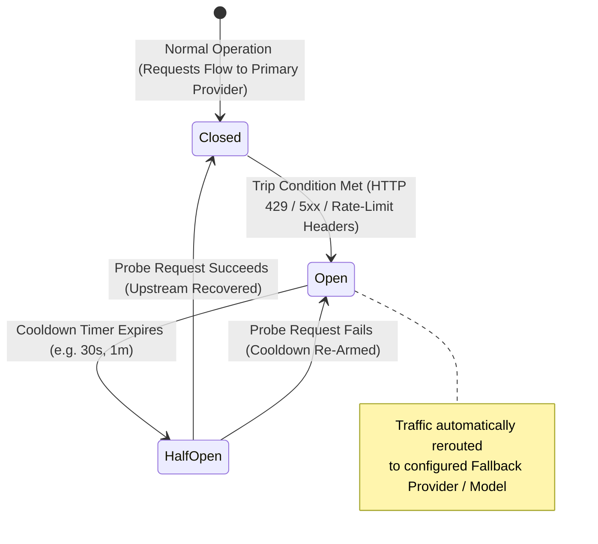

# UnifAI Circuit Breaker & Health Failover Architecture

**Route:** [`/workspace/circuit-breaker`](http://localhost:3100/workspace/circuit-breaker)  
**Backend Handlers:** [`transports/gateway-http/handlers/circuitbreaker.go`](file:///d:/unifai_project/transports/gateway-http/handlers/circuitbreaker.go), [`framework/circuitbreaker/circuitbreaker.go`](file:///d:/unifai_project/framework/circuitbreaker/circuitbreaker.go)  
**UI Component:** [`ui/app/_fallbacks/enterprise/components/circuit-breaker/circuitBreakerView.tsx`](file:///d:/unifai_project/ui/app/_fallbacks/enterprise/components/circuit-breaker/circuitBreakerView.tsx)  
**Database Table:** `circuit_breaker_policies` in PostgreSQL database `Unifai_test`

---

## 1. Overview & Purpose

The **Circuit Breaker** module is an enterprise-grade high-availability and fault-tolerance protection system for LLM inference. In multi-provider AI environments, upstream outages, quota exhaustion, HTTP 429 rate limits, and latency spikes from providers (OpenAI, Anthropic, Bedrock, Vertex AI) can cripple client applications.

The UnifAI Circuit Breaker monitors real-time upstream responses, detects failure signals or rate-limit saturation headers, automatically **trips** the circuit into an **OPEN** state, and seamlessly reroutes traffic to a healthy fallback provider/model without bubbling 5xx or 429 errors back to the caller.



---

## 2. Circuit Breaker State Machine & Lifecycle

The runtime engine tracks the status of each circuit breaker policy using a 3-state state machine:

1. **CLOSED (Normal Mode)**:
   - Inference requests pass directly to the **Primary Provider** and **Primary Model**.
   - Upstream response headers (e.g., `x-ratelimit-remaining-tokens`, `retry-after`) and HTTP status codes are inspected in real time by the gateway middleware.
   - If a signal triggers the policy condition, the circuit immediately transitions to **OPEN**.

2. **OPEN (Tripped / Failover Mode)**:
   - All inbound traffic destined for the primary provider is transparently rerouted to the **Fallback Provider** and **Fallback Model**.
   - The gateway injects the `x-gateway-circuit-breaker: <policy_name>` response header into the client response to maintain transparency.
   - The primary provider is placed in a **cooldown quarantine** (default: `30s`, configurable up to hours).
   - No calls are sent to the primary provider until the cooldown expires.

3. **HALF-OPEN (Recovery Probe Mode)**:
   - When the cooldown period expires, the circuit enters **HALF-OPEN**.
   - A single canary/probe request is dispatched to the primary provider:
     - **Probe Succeeded**: The circuit resets to **CLOSED**, and normal primary routing resumes.
     - **Probe Failed**: The circuit immediately trips back to **OPEN**, and the cooldown timer restarts.

---

## 3. Database Schema: `circuit_breaker_policies`

Circuit breaker policies are persisted in the PostgreSQL table `circuit_breaker_policies` and loaded into the fast in-memory runtime engine on gateway boot.

| Column Name | Data Type | Nullable | Description |
| :--- | :--- | :---: | :--- |
| `name` | `VARCHAR` | **No** (PK) | Unique human-readable policy identifier (e.g., `openai-prod-fallback`). |
| `enabled` | `BOOLEAN` | **No** | Whether the policy is actively evaluated (`true`) or bypassed (`false`). |
| `primary_provider` | `VARCHAR` | **No** | Monitored primary provider (e.g., `openai`, `anthropic`, `bedrock`). |
| `primary_model` | `VARCHAR` | **No** | Specific model (e.g., `gpt-4o`) or `*` / empty for all provider models. |
| `fallback_provider`| `VARCHAR` | **No** | Reroute destination provider (e.g., `anthropic`, `vertex_ai`). |
| `fallback_model` | `VARCHAR` | **No** | Reroute destination model (e.g., `claude-3-5-sonnet`). |
| `default_cooldown` | `VARCHAR` | **No** | Quarantine duration format (e.g., `30s`, `1m`, `5m`). |
| `cooldown_header` | `VARCHAR` | Yes | Custom header to extract dynamic cooldown (e.g., `retry-after`). |
| `condition_json` | `TEXT` | **No** | Serialized JSON containing boolean operator (`OR`/`AND`) and trigger signals. |
| `primary_key_ids_json` | `TEXT` | Yes | Optional list of specific provider API key IDs to restrict this policy to. |
| `created_at` | `TIMESTAMPTZ` | **No** | Record creation timestamp. |
| `updated_at` | `TIMESTAMPTZ` | **No** | Last modification timestamp. |

### Live DB Record Example
```sql
SELECT name, enabled, primary_provider, primary_model, fallback_provider, fallback_model, default_cooldown, condition_json 
FROM circuit_breaker_policies;
```
```json
{
  "name": "TestCB_d2ff09f2",
  "enabled": true,
  "primary_provider": "openai",
  "primary_model": "gpt-4",
  "fallback_provider": "anthropic",
  "fallback_model": "claude-3-sonnet",
  "default_cooldown": "30s",
  "condition_json": "{\"operator\":\"OR\",\"signals\":[{\"source\":\"response_header\",\"header_name\":\"retry-after\"}]}"
}
```

---

## 4. Trigger Signals & Supported Headers

The condition engine evaluates upstream headers returned by AI providers. Common supported signals:

| Signal Header | Typical Provider | Trigger Logic |
| :--- | :--- | :--- |
| `retry-after` | OpenAI, Anthropic, Mistral | Tripped when header exists (provider returned HTTP 429). Dynamic cooldown uses header value. |
| `x-ratelimit-remaining-requests` | OpenAI, Cohere | Tripped when remaining request quota falls below configured threshold. |
| `x-ratelimit-remaining-tokens` | OpenAI | Tripped when remaining token quota is exhausted or near zero. |
| `x-ratelimit-remaining-req-minute` | Mistral AI, Kong Gateway | Minute-level request rate limit exhaustion. |
| `x-ratelimit-remaining-tokens-minute` | Mistral AI | Minute-level token rate limit exhaustion. |

---

## 5. REST API Reference

All requests require authentication with session cookie (`Cookie: token=...`) or bearer token (`Authorization: Bearer <token>`).

### 5.1 List All Circuit Breaker Policies
- **Method:** `GET`
- **Path:** `/api/circuit-breaker/policies`
- **Response `200 OK`:**
```json
{
  "count": 1,
  "policies": [
    {
      "name": "TestCB_d2ff09f2",
      "enabled": true,
      "primary_provider": "openai",
      "primary_model": "gpt-4",
      "fallback_provider": "anthropic",
      "fallback_model": "claude-3-sonnet",
      "default_cooldown": "30s",
      "condition": {
        "operator": "OR",
        "signals": [
          {
            "source": "response_header",
            "header_name": "retry-after"
          }
        ]
      }
    }
  ]
}
```

### 5.2 Get Real-Time Circuit Breaker Runtime States
- **Method:** `GET`
- **Path:** `/api/circuit-breaker/state`
- **Response `200 OK`:**
```json
{
  "circuits": {
    "TestCB_d2ff09f2": {
      "state": "closed",
      "tripped_at": null,
      "cooldown_until": null,
      "trip_count": 0,
      "last_error": ""
    }
  }
}
```

### 5.3 Create a New Circuit Breaker Policy
- **Method:** `POST`
- **Path:** `/api/circuit-breaker/policies`
- **Payload:**
```json
{
  "name": "openai-to-anthropic-failover",
  "enabled": true,
  "primary_provider": "openai",
  "primary_model": "gpt-4o",
  "fallback_provider": "anthropic",
  "fallback_model": "claude-3-5-sonnet",
  "default_cooldown": "45s",
  "condition": {
    "operator": "OR",
    "signals": [
      {
        "source": "response_header",
        "header_name": "retry-after"
      },
      {
        "source": "response_header",
        "header_name": "x-ratelimit-remaining-tokens",
        "header_value": "0"
      }
    ]
  }
}
```

### 5.4 Update a Policy
- **Method:** `PUT`
- **Path:** `/api/circuit-breaker/policies/{name}`

### 5.5 Delete a Policy
- **Method:** `DELETE`
- **Path:** `/api/circuit-breaker/policies/{name}`

### 5.6 Force Reset a Tripped Circuit
- **Method:** `POST`
- **Path:** `/api/circuit-breaker/policies/{name}/reset`
- **Description:** Instantly resets an **OPEN** or **HALF-OPEN** circuit back to **CLOSED**, clearing any active cooldown quarantine.

---

## 6. UI Operations Guide (`/workspace/circuit-breaker`)

1. **View Active Policies**: Open [`/workspace/circuit-breaker`](http://localhost:3100/workspace/circuit-breaker). The table lists all policies, their primary $\to$ fallback mappings, condition signals, and real-time operational status (**Closed / Healthy** or **Open / Tripped**).
2. **Add a Policy**:
   - Click **+ Add Policy**.
   - Enter **Policy Name** (e.g., `prod-gpt4-breaker`).
   - Select **Primary Provider** and **Primary Model**.
   - Select **Fallback Provider** and **Fallback Model**.
   - Add one or more trigger signals from the dropdown (e.g., `retry-after`).
   - Specify **Cooldown Duration** (e.g., `30s` or `1m`).
   - Click **Create Policy**.
3. **Manual Reset**: If a circuit is OPEN and you have confirmed the upstream provider has recovered, click the **Reset** button in the policy actions menu.

---

## 7. Error Handling & Troubleshooting Matrix

| Error Symptom / Message | Root Cause | Solution |
| :--- | :--- | :--- |
| `primary_provider and primary_model are required` | The primary provider or model field was left empty during policy creation. | Select valid primary provider and model from the dropdown. |
| `fallback_provider and fallback_model are required` | The fallback destination was not specified. | Select valid fallback provider and model. |
| `default_cooldown must be a duration such as "30s", "5m"` | An invalid time string was entered (e.g., `30` without units). | Enter a valid Go duration string: `30s`, `1m`, `2m30s`. |
| `Circuit is OPEN: failover active` | The primary provider tripped due to 429 rate limit or retry-after header. | Normal expected behavior during failover. Check `/workspace/circuit-breaker` state. Click **Reset** if upstream is restored. |
