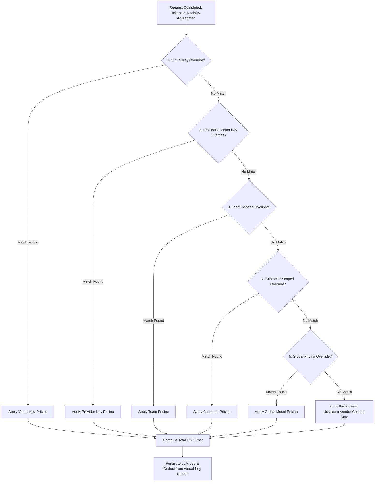

# UnifAI Custom Pricing & Financial Governance Architecture

This document provides a comprehensive, production-grade technical specification of the **Custom Pricing & Rate Overrides** subsystem within the UnifAI Enterprise AI Gateway. It details the 6-tier hierarchical pricing resolution engine, token cost calculations (prompt, completion, cached read, cached write, batch, priority), multi-modal unit pricing (Image, Video, Audio, OCR), scoped margin markups/discounts, complete UI workspace documentation (all buttons, sheets, and forms), database schemas, and REST APIs.

---

## 1. System Overview & Multi-Tier Resolution Model

The **Custom Pricing** engine governs financial accounting, chargeback reporting, and invoice reconciliation across the UnifAI Gateway. Upstream AI providers maintain divergent, dynamic pricing schedules across models and modalities. UnifAI normalizes these costs into a deterministic calculation engine and enables enterprise administrators to apply scoped custom pricing overrides.

### 1.1. The 6-Tier Hierarchical Pricing Resolution Engine
When calculating the USD cost of a completed LLM inference request, the gateway resolves token rates by evaluating pricing configurations from the most specific scope down to global defaults:



---

## 2. Request Modality Groups & Pricing Fields

UnifAI supports granular per-token, per-second, and per-item pricing across 7 distinct request modality groups:

| Modality Group | Request Types (`request_type`) | Supported Cost Fields |
| :--- | :--- | :--- |
| **Chat / Text** | `chat_completion`, `text_completion`, `responses` | `input_cost_per_token`, `output_cost_per_token`, `input_cost_per_token_batches`, `output_cost_per_token_batches`, `input_cost_per_token_priority`, `output_cost_per_token_priority`, `cache_read_input_token_cost`, `cache_creation_input_token_cost`. |
| **Embedding** | `embedding` | `input_cost_per_token`, `input_cost_per_token_batches`. |
| **Rerank** | `rerank` | `input_cost_per_token`, `output_cost_per_token`, `cost_per_search_unit`. |
| **Audio** | `speech`, `transcription` | `cost_per_second`, `cost_per_minute`, `input_cost_per_character`. |
| **Image** | `image_generation`, `image_variation`, `image_edit` | `cost_per_image`, resolution tiers (`1024x1024`, `512x512`, `1024x1792`), quality tiers (`standard`, `hd`). |
| **Video** | `video_generation`, `video_remix` | `cost_per_second`, resolution tiers (`720p`, `1080p`). |
| **OCR** | `ocr` | `cost_per_page`, `cost_per_document`. |

---

## 3. Mathematical Cost Computation Formula

For standard conversational requests featuring prompt caching (e.g., Anthropic Claude Prompt Caching or OpenAI Cached Input Tokens), the total request cost $C_{\text{total}}$ is computed as:

$$C_{\text{total}} = (T_{\text{input}} - T_{\text{cache\_hit}}) \times R_{\text{input}} + T_{\text{cache\_hit}} \times R_{\text{cache\_read}} + T_{\text{cache\_write}} \times R_{\text{cache\_creation}} + T_{\text{output}} \times R_{\text{output}}$$

Where:
* $T_{\text{input}}$: Total input tokens in prompt.
* $T_{\text{cache\_hit}}$: Number of input tokens served from upstream KV cache.
* $R_{\text{input}}$: Price per uncached input token.
* $R_{\text{cache\_read}}$: Discounted rate for cached input tokens (typically 10% to 50% of standard rate).
* $T_{\text{output}}$: Number of generated completion tokens.
* $R_{\text{output}}$: Price per output token.

---

## 4. UI Deep Dive: Custom Pricing Workspace (`/workspace/custom-pricing`)

The pricing workspace is partitioned into two views: **Model Pricing Catalog** (`/workspace/custom-pricing`) and **Pricing Overrides** (`/workspace/custom-pricing/overrides`).

### 4.1. Pricing Overrides View (`scopedPricingOverridesView.tsx`)
* **Header & Action Bar**:
  * **Search Input** (`input#pricing-search`): Debounced search across model names, providers, and scope labels.
  * **Provider Filter Dropdown** (`select#pricing-provider-filter`): Filters by `OpenAI`, `Anthropic`, `Bedrock`, `Azure`, etc.
  * **Scope Filter Dropdown** (`select#pricing-scope-filter`): Filters by `Global`, `Customer`, `Team`, `Virtual Key`, `Provider Key`.
  * **+ Add Override Button** (`button#btn-create-override`): Opens `pricingOverrideSheet.tsx`.
* **Data Table Columns**:
  1. **Provider**: Provider brand icon and display label.
  2. **Model Identifier**: Specific model string (e.g., `gpt-4o`, `claude-3-5-sonnet`) or wildcard `*`.
  3. **Scope Level**: Badge indicating resolution tier:
     * `Global` (Blue badge).
     * `Customer: Acme Corp` (Teal badge).
     * `Team: Core Engineering` (Purple badge).
     * `Virtual Key: Prod-Bot` (Amber badge).
  4. **Input Token Rate**: Cost per 1,000 or 1,000,000 tokens (e.g., `$2.50 / 1M`).
  5. **Output Token Rate**: Cost per 1,000 or 1,000,000 tokens (e.g., `$10.00 / 1M`).
  6. **Cached Read Rate**: Discounted prompt cache rate.
  7. **Actions Dropdown Menu** (`button#pricing-override-actions-btn-{id}`):
     * **Edit**: Opens editor sheet.
     * **Delete**: Opens confirmation dialog and invokes `useDeletePricingOverrideMutation()`.

---

### 4.2. Pricing Override Sheet (`pricingOverrideSheet.tsx`) Form Fields

A comprehensive slide-over drawer for defining granular financial rules:

#### Step 1: Target Provider & Model
* **Provider Dropdown** (`ComboboxSelect`): Selects the target AI vendor.
* **Model Dropdown / Input**: Selects an enrolled model from the catalog or allows typing a custom model alias.
* **Match Type**:
  * `Exact Match`: Applies only to the exact model string (e.g., `gpt-4o-2024-08-06`).
  * `Prefix Match`: Applies to all model variants starting with string (e.g., `gpt-4o*`).
  * `Wildcard Match`: Applies globally across all models from this provider.

#### Step 2: Override Scope Target
* **Scope Kind Radio**:
  * `Global`: Applies system-wide across all clients.
  * `Customer`: Restricts override to a specific Customer tenant.
  * `Team`: Restricts override to an internal Team.
  * `Virtual Key`: Restricts override to a specific calling API key.
  * `Provider Account Key`: Applies when a specific upstream provider key is used.
* **Target Entity Selector**: Populates dropdown of available entities matching the chosen scope kind.

#### Step 3: Modality & Rate Field Configuration (`PricingFieldSelector`)
* **Request Type Selector**: `Chat / Text`, `Embedding`, `Image`, `Audio`, `Video`, `OCR`.
* **Input Token Cost ($)** (`input#rate-input`): Raw floating-point cost per token (e.g., `0.0000025` for $2.50/1M).
* **Output Token Cost ($)** (`input#rate-output`): Raw cost per token (e.g., `0.0000100` for $10.00/1M).
* **Cached Read Cost ($)** (`input#rate-cache-read`): Discounted cache read rate.
* **Batch Input / Output Cost ($)**: Discounted rates for batch asynchronous processing.
* **Priority Tier Markup ($)**: Elevated rates for low-latency PTU / Provisioned Throughput.

#### Step 4: Margin Markup & Discount Modifiers
* **Markup Percentage Slider** (`input#margin-pct`): Optional enterprise margin (e.g., `+15%` markup for internal chargeback profit center).
* **Discount Percentage**: Volume discount deducted from provider catalog rates.

#### Sheet Footer
* **Save Override Button** (`button#btn-save-override`): Commits via `POST /api/governance/pricing-overrides` or `PUT /api/governance/pricing-overrides/{id}`.
* **Cancel Button**.

---

## 5. Complete Database Schemas & Storage Format

Pricing configurations and overrides are stored in PostgreSQL:

```sql
-- Pricing Overrides Master Table
CREATE TABLE governance_pricing_overrides (
    id VARCHAR(255) PRIMARY KEY,
    name VARCHAR(255),
    provider VARCHAR(100) NOT NULL,                  -- 'openai', 'anthropic', 'vertex', etc.
    model VARCHAR(255) NOT NULL,                     -- e.g., 'gpt-4o', '*'
    match_type VARCHAR(50) NOT NULL DEFAULT 'exact', -- 'exact', 'prefix', 'wildcard'
    scope_kind VARCHAR(50) NOT NULL,                 -- 'global', 'customer', 'team', 'virtual_key', 'provider_key'
    scope_id VARCHAR(255),                           -- Target UUID or NULL for global
    request_type VARCHAR(50) NOT NULL DEFAULT 'chat_completion',
    rates JSONB NOT NULL DEFAULT '{}'::jsonb,
    -- Structure of rates:
    -- {
    --   "input_cost_per_token": 0.0000025,
    --   "output_cost_per_token": 0.0000100,
    --   "cache_read_input_token_cost": 0.00000125,
    --   "cost_per_image": 0.040
    -- }
    margin_pct NUMERIC(5, 2) DEFAULT 0.0,
    created_at TIMESTAMP WITH TIME ZONE DEFAULT NOW(),
    updated_at TIMESTAMP WITH TIME ZONE DEFAULT NOW()
);
```

---

## 6. Complete REST API Reference

### `GET /api/governance/pricing-overrides`
Retrieves configured pricing overrides with pagination and scope filtering.
* **Response**:
  ```json
  {
    "overrides": [
      {
        "id": "po-9912a",
        "name": "Acme Corp Preferred GPT-4o Rate",
        "provider": "openai",
        "model": "gpt-4o",
        "match_type": "exact",
        "scope_kind": "customer",
        "scope_id": "cust-acme-corp",
        "request_type": "chat_completion",
        "rates": {
          "input_cost_per_token": 0.0000020,
          "output_cost_per_token": 0.0000080
        },
        "created_at": "2026-10-24T10:00:00Z"
      }
    ],
    "total": 1
  }
  ```

### `POST /api/governance/pricing-overrides`
Creates a new pricing override rule.

### `PUT /api/governance/pricing-overrides/{id}`
Updates an existing override.

### `DELETE /api/governance/pricing-overrides/{id}`
Deletes override, reverting matching requests to the next lower tier in the resolution hierarchy.

---

## 7. Operational Best Practices & Troubleshooting

1. **Zero-Latency In-Memory Price Table**:
   * Pricing rules are compiled into a thread-safe Radix tree in gateway memory.
   * Resolving token costs takes less than 5 microseconds per completed inference call, adding zero overhead to client response times.
2. **Audit Verification**:
   * Every request log persisted in Observability (`/workspace/observability/llm-logs`) stores the exact pricing tier used (e.g., `applied_pricing_scope: "team:team-eng-core"`), ensuring complete auditability for enterprise accounting teams.
