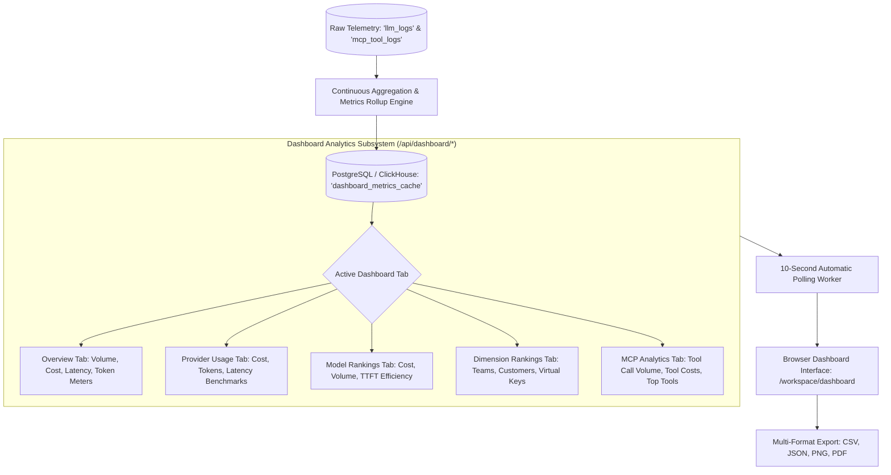
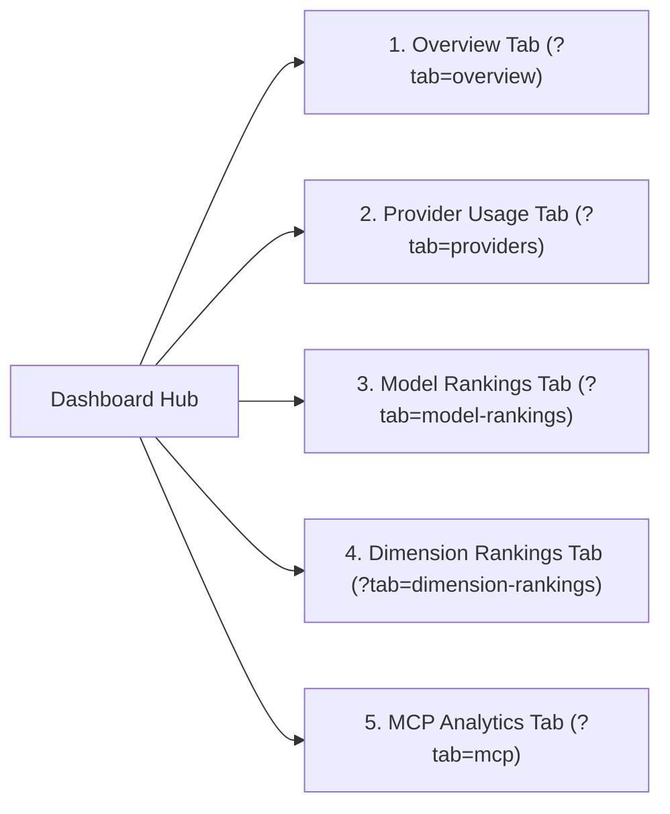

# UnifAI Executive Analytics Dashboard Architecture (Dashboard.md)

This document provides a comprehensive, production-grade technical specification of the **Executive Analytics Dashboard** (`/workspace/dashboard`) within the UnifAI Enterprise AI Gateway. It details the complete analytical dashboard interface (all 5 tabs, 13 interactive charts, export popover engines), time-range controls, multi-dimensional filter sidebars, database metrics caching, and REST APIs.

---

## 1. System Overview & Dashboard Architecture

The **Executive Analytics Dashboard** aggregates real-time and historical telemetry across all inference calls, models, upstream providers, enterprise teams, and autonomous MCP tools. It transforms raw log events into actionable business intelligence, cost allocation matrices, latency benchmarking, and cache efficiency metrics.



---

## 2. Global Filter Sidebar & State Management (`LogsFilterSidebar`)

The Dashboard is driven by an interactive filter sidebar with real-time URL synchronization (`nuqs`):

### 2.1. Time-Range & Timezone Controls
* **Time Range Selector (`DateTimePickerWithRange`)**:
  * Quick Periods: `1h` (Last 1 hour), `24h` (Last 24 hours), `7d` (Last 7 days), `30d` (Last 30 days).
  * Custom Range: Precise Unix timestamp boundaries (`start_time`, `end_time`) selectable via a graphical calendar widget.
* **Timezone Preference Combobox (`useTimezonePreference`)**:
  * `Local Browser Time`: Displays timestamps and chart X-axes in client's local timezone.
  * `UTC`: Displays metrics in standardized UTC for cross-regional enterprise reporting.

### 2.2. Multidimensional Filter Selectors
* **Virtual Keys Multiselect**: Restricts dashboard data to specific client API keys.
* **Providers Multiselect**: Filters across providers (`OpenAI`, `Anthropic`, `Bedrock`, `Azure`, `Vertex`, `Groq`, `Ollama`).
* **Models Multiselect**: Isolates specific model strings (e.g., `gpt-4o`, `claude-3-5-sonnet`).
* **Objects / Modality Multiselect**: Filters by request type (`chat.completion`, `embedding`, `image`, `speech`, `transcription`, `video`, `ocr`).
* **HTTP Status Multiselect**: Filters by status codes (`200 OK`, `400 Bad Request`, `429 Rate Limit`, `500 Server Error`).
* **Routing Rules & Routing Engine Multiselect**: Tracks traffic routed via specific decision trees or Complexity Router.
* **Stop Reasons Multiselect**: `stop`, `length`, `content_filter`, `tool_calls`.
* **Missing Cost Only Switch**: Highlights requests with unconfigured pricing overrides.
* **Metadata JSON Filter Textarea**: Full-text JSON search over custom client metadata tags.

### 2.3. Live Polling & Auto-Retention Controls
* **Live Polling Toggle Switch (`<Switch id="dashboard-polling" />`)**:
  * Renders a pulsing green radio indicator icon (`Radio`).
  * Automatically refetches active tab charts every 10,000ms.
* **Manual Refresh Button (`button#btn-refresh-dashboard`)**: Spins `RefreshCw` icon and refetches data immediately.
* **Automated Log Deletion Control (`LogsAutoDeleteControl`)**: Configures scheduled background log purging (e.g., 30, 60, 90 days retention).

---

## 3. UI Deep Dive: The 5 Dashboard Tabs



### 3.1. Tab 1: Overview Tab (`overviewTabView.tsx`)

#### Top Executive KPI Cards
1. **Total Requests**: Cumulative inference volume with percentage growth delta compared to preceding period.
2. **Total Tokens Processed**: Cumulative sum of uncached prompt, cached read, and completion tokens.
3. **Total Expenditure ($)**: Cumulative USD spend computed via the 6-tier custom pricing engine.
4. **Average Latency**: Global average round-trip latency in milliseconds.
5. **Cache Hit Rate**: Percentage of prompt tokens served from cache ($T_{\text{cached}} / T_{\text{total\_input}}$).

#### Interactive Visual Charts
* **Log Volume Chart (`logVolumeChart.tsx`)**:
  * Type Toggle (`chartTypeToggle.tsx`): Switch between **Area Chart**, **Bar Chart**, or **Line Chart**.
  * Displays request throughput per minute or hour.
* **Token Usage Chart (`tokenUsageChart.tsx`)**:
  * Stacked visual comparison of:
    - *Prompt Tokens (Uncached)*
    - *Cached Read Tokens*
    - *Cache Creation Tokens*
    - *Completion Output Tokens*
    - *Reasoning Tokens* (for `o1` / `deepseek-r1` models)
* **Cost Accumulation Chart (`costChart.tsx`)**:
  * Tracks cumulative financial expenditure over time.
  * Model Filter Dropdown (`modelFilterSelect.tsx`): Filter cost curve to specific models.
* **Latency Distribution Chart (`latencyChart.tsx`)**:
  * Visualizes **P50 (Median)**, **P90**, and **P99** percentiles to detect upstream latency spikes.
* **Model Usage Breakdown Chart (`modelUsageChart.tsx`)**:
  * Donut chart showing market share of individual models across the organization.
* **Cache Token Radial Meters (`localCacheTokenMeterChart.tsx`, `externalCacheTokenMeterChart.tsx`)**:
  * Visual gauges comparing tokens saved via Gateway Semantic In-Memory Caching vs. Upstream Provider Prompt Caching.

---

### 3.2. Tab 2: Provider Usage Tab (`providerUsageTabView.tsx`)
* **Provider Cost Comparison Chart (`providerCostChart.tsx`)**: Compares total expenditure across providers (e.g., Azure OpenAI vs. AWS Bedrock vs. OpenAI Direct).
* **Provider Token Volume Chart (`providerTokenChart.tsx`)**: Volume of tokens ingested and generated per vendor.
* **Provider Latency Benchmarking Chart (`providerLatencyChart.tsx`)**: Head-to-head Time to First Token (TTFT) and total response time.
* **Provider Health & Error Matrix**:
  * Tabular breakdown of HTTP 200 success percentage, HTTP 429 rate-limit counts, 5xx server errors, and active circuit breaker states per provider.

---

### 3.3. Tab 3: Model Rankings Tab (`modelRankingsTabView.tsx`)
* Ranked tabular lists highlighting:
  * **Top Models by Spend ($)**: Highlights most expensive models across the enterprise.
  * **Top Models by Request Volume**: Highlights highest-throughput models.
  * **Top Models by Token Consumption**.
  * **Fastest Models by TTFT**: Low-latency model leaderboard.
* **Model Efficiency Index**: Calculates output tokens delivered per dollar spent ($T_{\text{out}} / \text{Cost}_{\text{USD}}$) to identify cost-optimization migration candidates.

---

### 3.4. Tab 4: Dimension Rankings Tab (`dimensionRankingsTabView.tsx`)
Multi-tenant enterprise attribution rankings:
* **Rankings by Team**: Compares spend and token volume across internal engineering, product, and data science teams.
* **Rankings by Customer**: B2B customer spend and API quota consumption.
* **Rankings by Virtual Key**: Identifies top automated services and developer keys.
* **Rankings by End User**: Profiles top individual prompt submitters.

---

### 3.5. Tab 5: MCP Analytics Tab (`mcpTabView.tsx`)
* **MCP Tool Call Volume Chart (`mcpVolumeChart.tsx`)**: Total execution volume across registered MCP servers over time.
* **MCP Execution Cost Chart (`mcpCostChart.tsx`)**: Upstream LLM token costs specifically incurred during autonomous tool-calling turns.
* **Top Invoked Tools Chart (`mcpTopToolsChart.tsx`)**: Bar chart ranking external tools (e.g., `execute_sql`, `search_github_issues`, `read_file`, `send_slack_message`).

---

## 4. Multi-Format Export Engine (`ExportPopover`)

The Dashboard features a dedicated export popover (`ExportPopover.tsx`) accessible in the top-right header:
1. **Export CSV (`exportUtils.ts`)**: Generates an RFC 4180-compliant `.csv` file containing time-bucketed metrics (timestamp, request volume, prompt tokens, completion tokens, cached tokens, USD cost, P50 latency, P90 latency, P99 latency).
2. **Export JSON**: Delivers full raw metric aggregation tree formatted as JSON.
3. **Export High-Resolution PNG**: Uses HTML5 Canvas rendering to export active dashboard charts as presentation-ready PNG images.
4. **Export Executive PDF Report**: Compiles a multi-page executive summary PDF with branded header, KPI cards, and chart graphics.

---

## 5. Complete REST API Reference

### `GET /api/dashboard/stats`
Retrieves aggregated executive KPI metrics for the specified filters and time range.
* **Query Parameters**:
  * `start_time` (Unix seconds)
  * `end_time` (Unix seconds)
  * `virtual_key_ids` (array)
  * `providers` (array)
  * `models` (array)
* **Response**:
  ```json
  {
    "total_requests": 1420500,
    "total_tokens": 894200000,
    "total_cost_usd": 3420.58,
    "avg_latency_ms": 420.5,
    "cache_hit_rate_pct": 38.4,
    "error_rate_pct": 0.12
  }
  ```

### `GET /api/dashboard/charts/volume`
Returns time-series request volume buckets.
* **Response**:
  ```json
  {
    "buckets": [
      { "timestamp": "2026-10-24T10:00:00Z", "requests": 14200, "errors": 12 },
      { "timestamp": "2026-10-24T11:00:00Z", "requests": 18950, "errors": 4 }
    ]
  }
  ```

### `GET /api/dashboard/charts/cost`
Returns time-series cost accumulation buckets.

### `GET /api/dashboard/charts/latency`
Returns P50, P90, P99 latency percentiles over time.

### `GET /api/dashboard/rankings/models`
Returns leaderboard rankings of models by cost, volume, and latency.

### `GET /api/dashboard/rankings/dimensions`
Returns breakdown rankings by Team, Customer, Virtual Key, or User.
