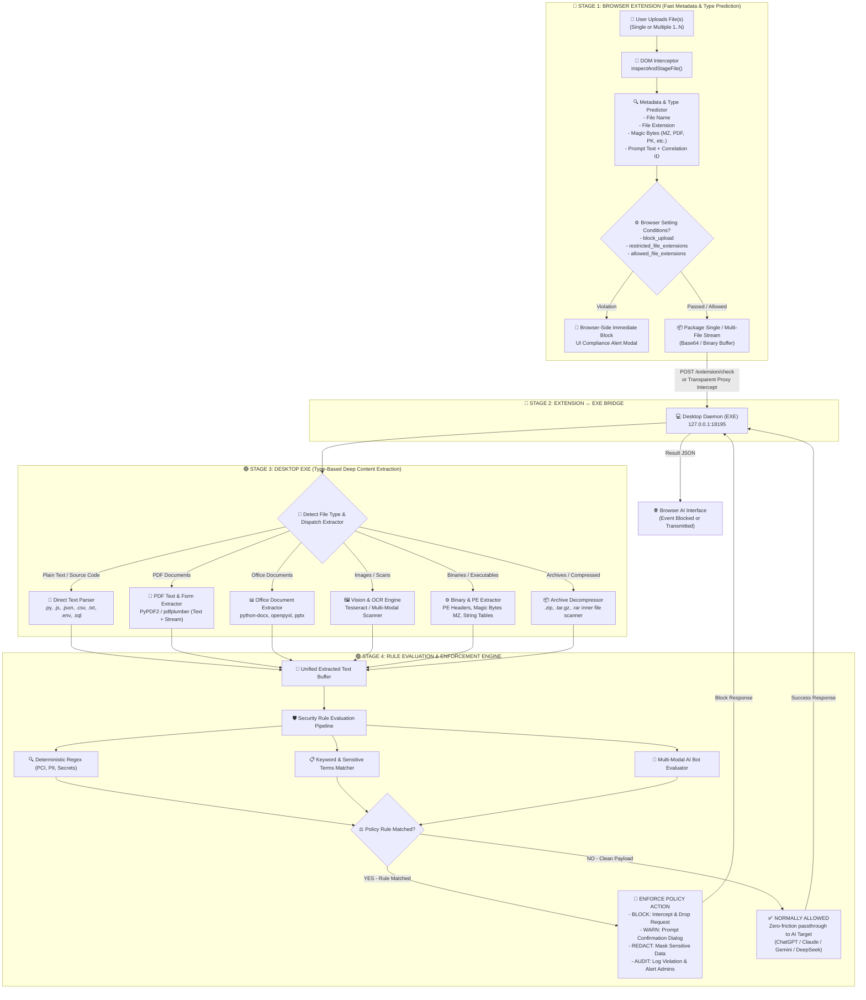

# File Prediction & Deep Extraction Architecture (Extension ↔ Desktop EXE)

This document specifies the end-to-end architecture, lifecycle, and data flow for file upload prediction, browser governance filtering, and deep content extraction across the **UnifAI Browser AI & Endpoint Guard** subsystem.

---

## 1. Architectural Philosophy: Split-Responsibility Model

To ensure browser performance, stability, and zero DOM freeze, the UnifAI file protection pipeline enforces a strict **Two-Tier Split-Responsibility Architecture**:

1. **Browser Extension (Fast Predictor & Gatekeeper)**:
   - **Does NOT** perform heavy CPU-bound binary decoding or large file text extraction inside the browser DOM process.
   - **Predicts** file metadata: File Name, MIME type, file extension, magic byte signature (`sniffMagicFileType`), accompanying user prompt, and session correlation tokens.
   - **Applies Browser Governance Settings**: Evaluates upload permissions (`block_upload`), blocked/restricted file extensions (`restricted_file_extensions`), and allowed extensions (`allowed_file_extensions`) against target domains.
   - **Dispatches**: If browser conditions pass, packages the file payload (single or batch of 1 to N files) and securely streams them to the local desktop agent (EXE).

2. **Desktop Daemon / EXE (Deep Content Extractor & AI/DLP Engine)**:
   - **Receives** individual or multiple file streams from the extension.
   - **Type-Based Data Extraction**: Leverages specialized native parsing engines based on detected file types (PDF, Word, Excel, PowerPoint, Text/Source Code, Images with OCR, PE Binaries, Compressed Archives).
   - **Rule Evaluation**: Runs extracted text through active DLP regex filters, deterministic keyword lists, and multi-modal AI Bot Evaluator LLMs.
   - **Action Enforcement**:
     - **Match Found**: Enforces policy action (`BLOCK`, `WARN`, `REDACT`, `AUDIT`), returns violation details to extension to block UI submission, and logs incident to centralized database.
     - **No Match (Clean)**: Returns `ALLOWED`. The upload proceeds smoothly to the AI target platform.

---

## 2. End-to-End Mind Map & Flow Diagram

---

## 3. Four-Stage Detailed Lifecycle

### Stage 1: Browser Extension (Metadata Prediction & Governance Filtering)

* **Interception Triggers**:
  - HTML5 `<input type="file">` file picker selections.
  - DOM Drag-and-Drop file drops into chat textareas or dropzones.
  - Clipboard file or image paste events.
* **Metadata & Signature Sniffing**:
  - Accurately captures file name, file size, and MIME type.
  - Reads leading 16 bytes via `DataView` to sniff **Magic Bytes** (detecting file type spoofing):
    - `4D 5A` (`MZ`): Windows Executable (`.exe`, `.dll`, `.sys`)
    - `25 50 44 46` (`%PDF`): Adobe PDF document
    - `50 4B 03 04` (`PK..`): ZIP Archive / Office OpenXML (`.docx`, `.xlsx`, `.pptx`)
    - `89 50 4E 47` (`.PNG`): Portable Network Graphics
    - `FF D8 FF`: JPEG Image
* **Browser Setting Conditions Evaluation**:
  - `block_upload = true`: Aborts upload immediately; shows custom `upload_warning` modal.
  - `block_file_extension = true`: Checks detected extension against `restricted_file_extensions` (e.g. `.sql`, `.env`, `.py`, `.key`, `.pem`, `.exe`).
  - `allowed_file_extensions`: If configured, denies any extension not explicitly whitelisted.
* **Batch Handling**: Supports both single-file and multi-file uploads (e.g., 5 or 10 files uploaded simultaneously). Each file is staged with unique correlation metadata.

### Stage 2: Extension ↔ Desktop EXE Communication Bridge

* **Local High-Speed Transport**: Dispatched to `http://127.0.0.1:18195/extension/check` via loopback HTTP.
* **ChatGPT Asset Pointer Correlation**: Solves ChatGPT's asynchronous upload architecture where OpenAI uploads files first as `asset_pointer` objects (`file-xxxx`) and references them during prompt submission. The extension enriches the payload by linking cached staged files to the outgoing prompt request.

### Stage 3: Desktop EXE Type-Based Deep Content Extraction

| File Classification | Extensions / MIME | Extraction Method in Desktop EXE | Extracted Content Output |
| :--- | :--- | :--- | :--- |
| **Source Code & Scripts** | `.py`, `.js`, `.ts`, `.go`, `.java`, `.cpp`, `.sh`, `.ps1` | UTF-8 direct stream decoder with fallback to Latin-1 / UTF-16 | Raw source code lines, functions, embedded credentials |
| **Config & Data Files** | `.env`, `.json`, `.yaml`, `.yml`, `.csv`, `.xml`, `.sql` | Structured text reader + key-value delimiter parser | Configuration values, database dumps, environment variables |
| **PDF Documents** | `.pdf` (`application/pdf`) | Binary stream reader using PyPDF2 / pdfplumber text extractors | Uncompressed text from all pages, document metadata, form fields |
| **Word Documents** | `.docx`, `.doc` | XML stream decompressor (`word/document.xml`) via python-docx | Paragraph text, headers, footers, embedded tables |
| **Excel Spreadsheets** | `.xlsx`, `.xls` | OpenXML sheet parser via openpyxl | Cell contents across all sheets, hidden columns, sheet names |
| **PowerPoint Slides** | `.pptx`, `.ppt` | Slide text accumulator via python-pptx | Slide titles, bullet points, speaker notes |
| **Images & Scans** | `.png`, `.jpg`, `.jpeg`, `.webp`, `.bmp` | Optical Character Recognition (OCR) via Tesseract / Vision model | Text printed inside screenshots, IDs, invoices, and photos |
| **Binaries & Executables**| `.exe`, `.dll`, `.bin`, `.so`, `.dylib` | PE header inspection + ASCII/Unicode string extraction (`strings`) | Hardcoded strings, URLs, API keys, certificate signatures |
| **Compressed Archives** | `.zip`, `.tar.gz`, `.tgz`, `.7z` | Recursive in-memory archive extraction | Decompressed text and inner files evaluated against all stages |

### Stage 4: Rule Evaluation & Decision Enforcement

* **Inspection Engines**:
  1. **Deterministic Regex Engine**: Evaluates high-confidence patterns (PCI-DSS credit cards with Luhn check, SSN, Aadhaar, PAN card, AWS/GCP access tokens, private keys).
  2. **Keyword & Sensitive Terms Matcher**: Scans for internal project code names, NDA phrases, confidential marks.
  3. **Multi-Modal AI Bot Evaluator**: Dispatches complex or context-dependent content to AI Bot models for intent analysis and risk scoring.
* **Decision Enforcement Matrix**:

| Evaluation Result | System Action | Extension / Browser Behavior | Telemetry & Audit Action |
| :--- | :---: | :--- | :--- |
| **Rule Violated (`BLOCK`)** | `BLOCK` | Submission aborted; red DLP violation popup shown to employee | Ingested to `browser_ai_prompts` with `action: "Blocked"`, alert triggered |
| **Rule Violated (`WARN`)** | `WARN` | Modal warning displayed; requires employee justification to proceed | Ingested with `action: "Warned"`, confirmation logged |
| **Rule Violated (`REDACT`)** | `REDACT` | Sensitive substrings masked (`[REDACTED]`) before target transmission | Ingested with `action: "Redacted"`, diff stored |
| **No Rules Violated** | `ALLOW` | **Normally Allowed**: Zero delay; file and prompt pass cleanly to AI target | Ingested with `action: "Allowed"`, telemetry updated |

---

## 4. Single vs Multi-File Execution Example

### Case A: Single File Upload (`confidential_finances.xlsx`)
1. User drops `confidential_finances.xlsx` into ChatGPT.
2. Extension intercepts drop: detects name `confidential_finances.xlsx`, type `application/vnd.openxmlformats...`, magic bytes `PK..`.
3. Extension checks browser settings: `block_upload: false`, `.xlsx` not in `restricted_file_extensions`. Condition passes.
4. Extension sends file payload to EXE on port 18195.
5. EXE identifies Excel file -> parses workbook using `openpyxl` -> extracts balance sheet cells.
6. Rule checking: Regex matches `PAN Card` and `Credit Card` numbers. Action configured: `BLOCK`.
7. EXE returns `{ allowed: false, action: "BLOCK", reason: "PCI-DSS Credit Card detected in spreadsheet" }`.
8. Extension blocks the send button and renders red compliance dialog.

### Case B: Multiple Files Upload (3 files: `script.py`, `readme.txt`, `license.md`)
1. User selects 3 files simultaneously.
2. Extension stages all 3 files (`1/3`, `2/3`, `3/3`) with respective names and types.
3. Extension checks browser settings for all 3 files. All pass.
4. Extension bundles all 3 files with the prompt and dispatches to EXE.
5. EXE loops through each file: extracts text from `script.py`, `readme.txt`, and `license.md`.
6. EXE checks rules on all extracted contents. No sensitive regex or keywords matched.
7. EXE returns `{ allowed: true, action: "ALLOW" }`.
8. Extension allows the request. ChatGPT transmits all 3 files normally.
