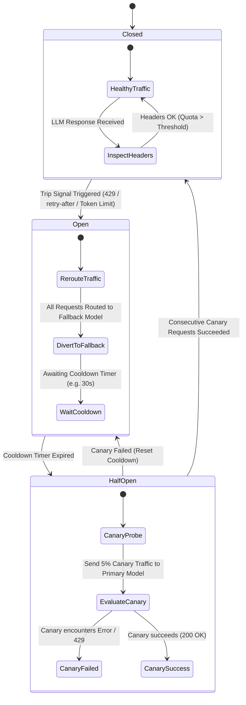
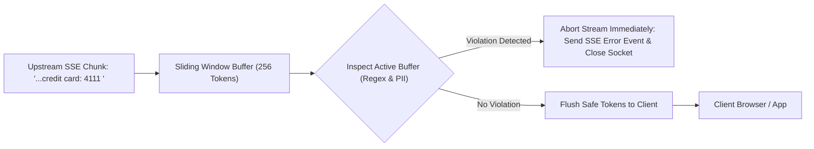

# UnifAI Guardrails & Circuit Breaker Architecture

This document provides a comprehensive, production-grade technical specification of the **Guardrails & Circuit Breaker** subsystem within the UnifAI Enterprise AI Gateway. It details the multi-stage inspection lifecycle, Google Common Expression Language (CEL) rule evaluation, deterministic pattern matching, PII/PCI arithmetic checksums, streaming token sliding-window inspection, automated circuit breaker failover policies, complete UI workspace documentation (all buttons, forms, and dialogs), database schemas, and REST APIs.

---

## 1. System Overview & Multi-Stage Architecture

The **Guardrails** engine enforces security, compliance, safety, and data loss prevention (DLP) across all artificial intelligence workloads flowing through the UnifAI Gateway. Operating at the transport and orchestration layers, it evaluates incoming user prompts (*PreLLMHook*) and generated model completions (*PostLLMHook*) in real time.

```mermaid
flowchart TD
    Client[Enterprise Client / Agent / SDK] -->|HTTP POST /v1/chat/completions| Gateway[UnifAI Gateway HTTP]
    
    subgraph PreHook["PreLLMHook (Input Guardrails Pipeline)"]
        PreCEL{Evaluate Rule CEL Condition}
        PreCEL -->|No Match| PrePass[Bypass Input Inspection]
        PreCEL -->|Match| PreDispatch[Dispatch to Active Providers]
        
        subgraph InputProviders["Input Moderation Providers"]
            RegexEngine["Deterministic RE2 Regex (PII / PCI / Secrets)"]
            ChecksumCheck["Arithmetic Checksums: Luhn (PCI) & Verhoeff (Aadhaar)"]
            CloudMod["AI Safety Engines: OpenAI / Azure / Bedrock"]
            InjectionShield["Prompt Injection & Jailbreak Classifier"]
        end
        
        PreDispatch --> RegexEngine & ChecksumCheck & CloudMod & InjectionShield
        RegexEngine & ChecksumCheck & CloudMod & InjectionShield --> PreVerdict{Violation Detected?}
        PreVerdict -->|Yes: Action = BLOCK| PreBlock[Reject Request: HTTP 400 Bad Request]
        PreVerdict -->|Yes: Action = REDACT| PreRedact[Mask Sensitive Tokens in Request Context]
        PreVerdict -->|No / Clean| PrePass
    end

    Gateway --> PreCEL
    PreBlock -->|Violation JSON| Client
    PrePass --> CircuitCheck{Circuit Breaker Status?}
    PreRedact --> CircuitCheck

    subgraph LLMExecution["Model Inference & Circuit Breaker"]
        CircuitCheck -->|Closed / Healthy| PrimaryLLM[Execute Primary Model / Provider]
        CircuitCheck -->|Open / Tripped| FallbackLLM[Route to Fallback Model / Provider]
        PrimaryLLM -->|Provider 429 / Trip Signal| TripCB[Trip Circuit Breaker to OPEN]
        TripCB --> FallbackLLM
    end

    PrimaryLLM --> PostCEL
    FallbackLLM --> PostCEL

    subgraph PostHook["PostLLMHook (Output Guardrails & Streaming Inspector)"]
        PostCEL{Evaluate Output CEL Condition}
        PostCEL -->|No Match| PostDeliver[Deliver Clean Response]
        PostCEL -->|Match| StreamWindow["Sliding Token Buffer (Window: 256 tokens)"]
        StreamWindow --> OutputRegex["Output PII / Toxicity / Secret Scanner"]
        OutputRegex --> PostVerdict{Unsafe Content Detected?}
        PostVerdict -->|Yes: Action = BLOCK| PostAbort[Terminate Stream & Send Compliance Warning]
        PostVerdict -->|Yes: Action = REDACT| PostMask[Mask Tokens: [REDACTED_DATA]]
        PostVerdict -->|Clean| PostDeliver
        PostMask --> PostDeliver
    end

    PostDeliver -->|HTTP 200 Stream / JSON| Client
```

---

## 2. Workspace Routes & UI Module Breakdown

The Guardrails and Resilience subsystem is organized across three primary UI routes in the UnifAI console:

| Route Path | Sub-Module | Functional Purpose |
| :--- | :--- | :--- |
| `/workspace/guardrails/configuration` | **Guardrail Rules** | Manage input/output inspection rules, CEL matching logic, prompt scope binding, sampling rates, and provider links. |
| `/workspace/guardrails/providers` | **Rule Providers** | Register detection engines (Deterministic Regex, OpenAI Moderation, Azure Content Safety, Custom Webhooks). |
| `/workspace/circuit-breaker` | **Circuit Breakers** | Configure automatic failover policies, rate-limit response header trip signals, cooldown intervals, and reset tripped circuits. |

---

## 3. UI Deep Dive: Guardrail Rules (`/workspace/guardrails/configuration`)

The Guardrail Rules workspace enables security administrators to construct fine-grained inspection policies targeting specific Virtual Keys, models, or Prompt Repository templates.

### 3.1. Action Bar & Global Controls
* **Status Banner**: Displays global guardrails status (`Active` if at least one enabled rule exists; `Disabled` otherwise).
* **+ New Guardrail Rule Button** (`button[data-testid="create-guardrail-rule-btn"]`): Opens the Rule Creation Modal.
* **Pagination Controls**: Rows per page selector (`10`, `25`, `50`), Previous Page button, and Next Page button via `<DataTablePagination />`.

### 3.2. Guardrail Rules Table Columns
1. **Status**: Toggle switch (`<Switch />`) enabling or disabling the rule in real time. Invokes `useUpdateGuardrailRulesMutation()` immediately without gateway restart.
2. **Rule Name & Description**: Descriptive title and operational rationale.
3. **Execution Stage (`Apply To`)**: Badge indicating enforcement point:
   * `Input Only` (Blue badge): Inspects incoming user prompts before LLM dispatch.
   * `Output Only` (Purple badge): Inspects model responses or SSE token streams.
   * `Both (Input & Output)` (Teal badge): Inspects bi-directionally.
4. **Trigger Conditions (CEL / Scope)**: Summary of matching criteria (e.g., `All Prompts`, `Specific Prompts (3 linked)`, or `Custom CEL Expression`).
5. **Linked Providers**: Badges displaying linked inspection providers (e.g., `PCI DSS Regex (#1)`, `OpenAI Moderation (#3)`).
6. **Sampling Rate**: Integer percentage (1% to 100%) indicating the proportion of matching requests subjected to inspection (used for high-throughput cost reduction).
7. **Timeout**: Maximum execution latency allocated for inspection in milliseconds (default: `1000ms`).
8. **Actions Column**:
   * **Edit Rule Button** (`button#edit-rule-{id}`): Opens rule configuration modal populated with current settings.
   * **Delete Rule Button** (`button#delete-rule-{id}`): Opens confirmation dialog to delete rule.

### 3.3. New / Edit Rule Modal Form Fields
* **Rule Name** (`input#rule-name`): Mandatory identifier (e.g., `Enforce-PCI-DSS-Customer-Chat`).
* **Description** (`textarea#rule-desc`): Optional notes explaining compliance requirements.
* **Execution Stage Dropdown** (`select#rule-apply-to`):
  * `input`: Inspects user prompt before sending to LLM.
  * `output`: Inspects model completion before sending to client.
  * `both`: Inspects both user prompt and model completion.
* **Prompt Scope Radio Group**:
  * `All Prompts` (`promptScope = "all"`): Generates wildcard match `true`.
  * `Select Prompts from Repository` (`promptScope = "prompts"`): Renders a multi-select dropdown listing prompts from `/api/prompts`. Generates CEL: `request.prompt_id in ['p-101', 'p-102']`.
  * `Custom CEL Expression` (`promptScope = "custom"`): Unlocks the raw CEL expression textarea.
* **CEL Expression Input** (`textarea#rule-cel`): Evaluated against incoming request context.
* **Linked Providers Multi-Select** (`MultiSelect#rule-providers`): Selects one or more active providers from `/workspace/guardrails/providers`.
* **Target Virtual Keys Multi-Select** (`MultiSelect#rule-virtual-keys`): Restricts rule execution to requests authenticated with specific Virtual Keys. If left empty, applies globally to all keys.
* **Sampling Rate Slider & Input** (`input#rule-sampling-rate`): 1% to 100% (default: `100%`).
* **Execution Timeout (ms)** (`input#rule-timeout`): Timeout budget for provider execution (default: `1000ms`).
* **Modal Footer Buttons**:
  * `Cancel` (`button#btn-cancel-rule`)
  * `Save Rule` (`button#btn-save-rule`): Validates form inputs via `validateRuleForm()` and persists updates via `PUT /api/guardrails/rules`.

---

## 4. UI Deep Dive: Rule Providers (`/workspace/guardrails/providers`)

Rule Providers represent the underlying detection and classification engines invoked by Guardrail Rules.

### 4.1. Action Bar & Table Controls
* **+ Add Provider Button** (`button[data-testid="add-provider-btn"]`): Opens the Provider Creation Modal.
* **Pagination Controls**: Rows per page selector and page navigation controls.

### 4.2. Providers Table Columns
1. **Provider ID**: Internal integer identifier (e.g., `1`, `2`, `3`).
2. **Policy Name**: Friendly name (e.g., `Enterprise PII & Secrets Detector`).
3. **Provider Engine**: Engine type badge:
   * `regex`: High-speed compiled deterministic RE2 regular expressions.
   * `openai`: OpenAI Moderation API endpoint (`omni-moderation-latest`).
   * `azure`: Azure AI Content Safety API.
   * `bedrock`: Amazon Bedrock Guardrails.
   * `webhook`: Custom external enterprise compliance HTTP webhook.
4. **Patterns / Rules Count**: Number of compiled regex patterns configured in the provider.
5. **Status**: Enabled/Disabled switch.
6. **Actions Column**:
   * **Edit Provider Button** (`button#edit-provider-{id}`): Opens editor modal.
   * **Delete Provider Button** (`button#delete-provider-{id}`): Verifies provider is not linked to any active rule before deletion; displays error alert if linked.

### 4.3. New / Edit Provider Modal Form Fields
* **Policy Name** (`input#provider-policy-name`): Mandatory name.
* **Provider Type Dropdown** (`select#provider-type`): `regex`, `openai`, `azure`, `bedrock`, `webhook`.
* **Timeout (ms)** (`input#provider-timeout`): Execution deadline (default: `500ms`).
* **Regex Patterns Textarea** (`textarea#provider-patterns` - visible when type is `regex`):
  * Accepts line-delimited regex patterns.
  * Supports inline case-insensitive flag `(?i)`.
  * Supports individual pattern descriptions and severity labels.
* **External Provider Credentials** (visible for cloud providers):
  * API Key / Secret Token input.
  * Endpoint URL / Region selector.
  * Category Threshold Sliders: Hate Speech, Sexual, Self-Harm, Violence (`Low`, `Medium`, `High`).
* **Modal Footer**: Cancel Button and Save Provider Button (`button#btn-save-provider`).

---

## 5. UI Deep Dive: Circuit Breakers (`/workspace/circuit-breaker`)

Circuit Breakers protect downstream applications from provider outages, rate limits (HTTP 429), server crashes (HTTP 500/503), and latency spikes by automatically redirecting traffic to healthy fallback models.

### 5.1. Action Bar & Fleet State
* **State Polling Rate**: Automatically polls `GET /api/circuit-breaker/state` every 8,000ms.
* **+ Add Policy Button** (`button[data-testid="add-circuit-breaker-btn"]`): Opens Policy Creation Modal.
* **Global Metrics Summary**: Total Policies, Tripped Circuits Count, and Active Recoveries.

### 5.2. Circuit Breaker Policies Table Columns
1. **Status Switch**: Enables/disables the circuit breaker policy.
2. **Policy Name**: Descriptive name (e.g., `OpenAI-429-to-Anthropic-Spillover`).
3. **Current Circuit State**: Real-time state badge:
   * `Closed / Healthy` (Green badge): Traffic flows normally to the Primary model.
   * `Open / Tripped` (Red badge): Primary model is tripped; all traffic is actively diverted to the Fallback model. Displays countdown timer until next probe.
   * `Half-Open / Probing` (Amber badge): Gateway is testing the Primary model with a limited percentage of canary traffic.
4. **Primary Model & Provider**: Provider icon and model name (e.g., `OpenAI / gpt-4o`).
5. **Fallback Model & Provider**: Provider icon and fallback model name (e.g., `Anthropic / claude-3-5-sonnet`).
6. **Trip Signal / Header**: Upstream response header condition triggering the trip (e.g., `x-ratelimit-remaining-tokens <= 1000` or `retry-after exists`).
7. **Default Cooldown**: Cooldown duration before attempting Half-Open recovery (e.g., `30s`, `5m`).
8. **Actions Column**:
   * **Reset Policy Button** (`button#btn-reset-policy-{name}`): Manually forces an Open circuit back to `Closed` via `POST /api/circuit-breaker/policies/{name}/reset`.
   * **Edit Policy Button** (`button#btn-edit-policy-{name}`)
   * **Delete Policy Button** (`button#btn-delete-policy-{name}`): Opens alert dialog.

### 5.3. Common Circuit Breaker Response Headers

The UI provides pre-configured suggestions (`COMMON_CIRCUIT_BREAKER_HEADERS`) for standard upstream provider headers:

| Header Name | Provider / Source | Meaning & Trip Threshold |
| :--- | :--- | :--- |
| `x-ratelimit-remaining-requests` | OpenAI / Anthropic | Remaining RPM quota. Trip when value reaches `0`. |
| `x-ratelimit-remaining-tokens` | OpenAI / Anthropic | Remaining TPM quota. Trip when value drops below minimum threshold. |
| `x-ratelimit-remaining-req-minute` | Mistral / Kong Gateway | Remaining requests per minute. |
| `x-ratelimit-remaining-tokens-minute` | Mistral / Cohere | Remaining tokens per minute. |
| `retry-after` | RFC 7231 / HTTP 429 | Upstream requested backoff duration in seconds. |
| `x-ms-is-spilled-over` | Azure OpenAI Service | Indicates Azure PTU capacity exhausted; spillover triggered. |
| `ratelimit-remaining` | IETF RateLimit Standard | Standardized remaining request capacity. |

---

## 6. Circuit Breaker State Machine & Automatic Recovery

The Circuit Breaker follows the canonical finite state machine (FSM) pattern:



---

## 7. Google Common Expression Language (CEL) Engine Reference

UnifAI evaluates CEL expressions compiled into native Go bytecode using `google/cel-go`. Expressions execute in sub-millisecond timeframes.

### 7.1. Available Context Variables

| Variable Name | Type | Description | Example Value |
| :--- | :--- | :--- | :--- |
| `request.model` | `string` | Requested model identifier. | `"gpt-4o"`, `"claude-3-5-sonnet"` |
| `request.provider` | `string` | Provider name. | `"openai"`, `"anthropic"`, `"bedrock"` |
| `request.prompt_id` | `string` | Prompt Repository template ID. | `"prompt-acme-onboarding"` |
| `request.virtual_key_id` | `string` | Calling Virtual Key UUID. | `"vk-8812-4f9a"` |
| `request.virtual_key_name` | `string` | Display name of the Virtual Key. | `"production-customer-bot"` |
| `request.input_text` | `string` | Concatenated user prompt string. | `"Summarize account 4111-2221..."` |
| `request.stream` | `bool` | Whether request requested SSE streaming. | `true`, `false` |
| `request.metadata` | `map[string]any` | Custom metadata passed in request. | `{"env": "prod", "dept": "finance"}` |
| `response.output_text` | `string` | Full model completion (PostLLM only). | `"Here is the summary of..."` |

### 7.2. Production CEL Expression Examples

#### Example 1: Enforce Strict Guardrails on Production Customer-Facing Keys
```cel
request.virtual_key_name.startsWith("prod-customer-") || request.metadata["environment"] == "production"
```

#### Example 2: Target OpenAI Model Family Excluding Embeddings
```cel
request.model.startsWith("gpt-") && !request.model.contains("embedding")
```

#### Example 3: Enforce Output PII Checks on Specific Prompt Templates
```cel
request.prompt_id in ["customer-support-v1", "agent-refund-processor"]
```

---

## 8. Deterministic Regex & Arithmetic Checksum Algorithms

Unlike probabilistic LLM classifiers that can hallucinate or miss obfuscated numbers, UnifAI combines regular expressions with exact mathematical modulo checksums.

### 8.1. PCI DSS Credit Card Validation (Luhn Modulo-10 Checksum)
The gateway extracts potential credit card number candidates via RE2 regex (`\b(?:\d[ -]*?){13,19}\b`) and strips whitespace/dashes before running the Luhn algorithm in Go:

```go
func ValidateLuhn(number string) bool {
    var sum int
    alternate := false
    for i := len(number) - 1; i >= 0; i-- {
        n := int(number[i] - '0')
        if n < 0 || n > 9 {
            return false
        }
        if alternate {
            n *= 2
            if n > 9 {
                n = (n % 10) + 1
            }
        }
        sum += n
        alternate = !alternate
    }
    return (sum % 10 == 0)
}
```

### 8.2. Indian Aadhaar Number Validation (Verhoeff Modulo-10 Checksum)
Aadhaar numbers are 12 digits where the final digit is a Verhoeff checksum. The gateway evaluates candidates using permutation tables ($d$ and $p$) to eliminate false positives:

```go
// Verhoeff multiplication and permutation tables
var verhoeffD = [10][10]int{...}
var verhoeffP = [8][10]int{...}

func ValidateVerhoeff(num string) bool {
    var c int
    ll := len(num)
    for i := 0; i < ll; i++ {
        val := int(num[ll-i-1] - '0')
        c = verhoeffD[c][verhoeffP[i%8][val]]
    }
    return c == 0
}
```

---

## 9. Streaming Token Sliding-Window Inspection

When clients request Server-Sent Events (`stream: true`), inspecting only the completed response defeats the purpose of low-latency token streaming. UnifAI utilizes a FIFO ring buffer to inspect tokens in flight.



* **Window Size**: 256 tokens (configurable via `GUARDRAILS_STREAM_WINDOW_SIZE`).
* **Overlap**: Ensures multi-token PII patterns (such as credit card numbers split across 4 consecutive SSE chunks) are caught before reaching the client.
* **Stream Cut-off**: If a violation triggers, the gateway immediately halts the upstream socket and emits a final SSE data chunk:
  ```json
  data: {"error": {"message": "Stream terminated: Guardrail policy violation detected in model response", "type": "guardrail_violation"}}
  data: [DONE]
  ```

---

## 10. Complete Database Schemas & Storage Format

Guardrail configurations and Circuit Breaker policies are persisted in the relational database:

```sql
-- 1. Guardrail Configuration Master Table
CREATE TABLE guardrails_config (
    id SERIAL PRIMARY KEY,
    guardrail_rules JSONB NOT NULL DEFAULT '[]'::jsonb,
    guardrail_providers JSONB NOT NULL DEFAULT '[]'::jsonb,
    updated_at TIMESTAMP WITH TIME ZONE DEFAULT NOW()
);

-- 2. Circuit Breaker Policies Table
CREATE TABLE circuit_breaker_policies (
    name VARCHAR(255) PRIMARY KEY,
    enabled BOOLEAN NOT NULL DEFAULT TRUE,
    primary_provider VARCHAR(100) NOT NULL,
    primary_model VARCHAR(100) NOT NULL,
    fallback_provider VARCHAR(100) NOT NULL,
    fallback_model VARCHAR(100) NOT NULL,
    condition JSONB NOT NULL,
    default_cooldown VARCHAR(50) DEFAULT '30s',
    cooldown_header VARCHAR(100),
    parsed_primary_key_ids JSONB DEFAULT '[]'::jsonb,
    created_at TIMESTAMP WITH TIME ZONE DEFAULT NOW(),
    updated_at TIMESTAMP WITH TIME ZONE DEFAULT NOW()
);

-- 3. Circuit Breaker Real-Time State (In-Memory or Cache-Backed)
CREATE TABLE circuit_breaker_state (
    policy_name VARCHAR(255) PRIMARY KEY REFERENCES circuit_breaker_policies(name) ON DELETE CASCADE,
    state VARCHAR(50) NOT NULL DEFAULT 'CLOSED', -- 'CLOSED', 'OPEN', 'HALF_OPEN'
    tripped_at TIMESTAMP WITH TIME ZONE,
    cooldown_until TIMESTAMP WITH TIME ZONE,
    trip_reason TEXT,
    canary_success_count INT DEFAULT 0
);
```

---

## 11. Complete REST API Reference

### 11.1. Guardrails APIs

#### `GET /api/guardrails/config`
Retrieves active guardrail rules and provider definitions.
* **Response**:
  ```json
  {
    "guardrail_rules": [
      {
        "id": 1,
        "name": "Enforce-PCI-DSS",
        "description": "Redact credit card numbers in customer interactions",
        "enabled": true,
        "cel_expression": "true",
        "apply_to": "both",
        "sampling_rate": 100,
        "timeout": 500,
        "provider_config_ids": [1],
        "virtual_key_ids": []
      }
    ],
    "guardrail_providers": [
      {
        "id": 1,
        "provider_name": "regex",
        "policy_name": "PCI-DSS-Provider",
        "enabled": true,
        "timeout": 200,
        "config": {
          "patterns": [
            {
              "pattern": "\\b(?:\\d[ -]*?){13,16}\\b",
              "description": "Credit Card Candidate",
              "flags": "i"
            }
          ]
        }
      }
    ]
  }
  ```

#### `PUT /api/guardrails/rules`
Updates only the rules array, preserving existing provider definitions.
* **Payload**: `{ "guardrail_rules": [...] }`

#### `PUT /api/guardrails/providers`
Updates only the providers array, preserving existing rule definitions.
* **Payload**: `{ "guardrail_providers": [...] }`

---

### 11.2. Circuit Breaker APIs

#### `GET /api/circuit-breaker/policies`
Returns list of all configured circuit breaker policies.

#### `POST /api/circuit-breaker/policies`
Creates a new circuit breaker failover policy.
* **Request Payload**:
  ```json
  {
    "name": "OpenAI-to-Anthropic-Spillover",
    "enabled": true,
    "primary_provider": "openai",
    "primary_model": "gpt-4o",
    "fallback_provider": "anthropic",
    "fallback_model": "claude-3-5-sonnet",
    "condition": {
      "operator": "OR",
      "signals": [
        {
          "source": "response_header",
          "header_name": "retry-after"
        },
        {
          "source": "response_header",
          "header_name": "x-ratelimit-remaining-requests",
          "header_value": "0"
        }
      ]
    },
    "default_cooldown": "45s",
    "cooldown_header": "retry-after"
  }
  ```

#### `PUT /api/circuit-breaker/policies/{name}`
Updates an existing circuit breaker policy by name.

#### `DELETE /api/circuit-breaker/policies/{name}`
Deletes policy by name.

#### `GET /api/circuit-breaker/state`
Returns the real-time operational state of all policies.
* **Response**:
  ```json
  {
    "states": [
      {
        "policy_name": "OpenAI-to-Anthropic-Spillover",
        "state": "OPEN",
        "tripped_at": "2026-10-24T11:25:00Z",
        "cooldown_until": "2026-10-24T11:25:45Z",
        "trip_reason": "Header 'retry-after' received with value '45'"
      }
    ]
  }
  ```

#### `POST /api/circuit-breaker/policies/{name}/reset`
Forces the circuit breaker from `OPEN` or `HALF_OPEN` back to `CLOSED`.
* **Response**: `{ "status": "success", "message": "Circuit breaker policy 'OpenAI-to-Anthropic-Spillover' reset to CLOSED" }`

---

## 12. Operational Best Practices & Troubleshooting

1. **Rule Performance & Provider Deadlines**:
   * Set provider `timeout` conservatively (e.g., `200ms` for regex, `800ms` for cloud moderation APIs) to prevent slow external networks from delaying LLM responses.
   * If a provider exceeds its deadline, the gateway logs a `ProviderTimeout` audit event and enforces the configured fallback policy (`Fail-Open` vs. `Fail-Close`).
2. **Preventing Circuit Thrashing**:
   * Use an adequate `default_cooldown` (minimum `30s`) to ensure transient upstream outages subside before canary probing begins.
3. **High-Load Sampling**:
   * For non-critical internal developer chatbots generating thousands of requests per minute, set `sampling_rate` to `20%` or `50%` to reduce CPU and provider API overhead.
