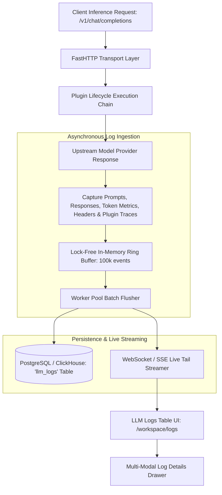

# UnifAI High-Throughput LLM Logs & Multi-Modal Inspector Architecture (LLM_Logs.md)

This document provides a comprehensive, production-grade technical specification of the **High-Throughput LLM Logs & Multi-Modal Inspector** subsystem (`/workspace/logs`) within the UnifAI Enterprise AI Gateway. It details the virtualized data table (draggable column reordering, column pinning, visibility toggles), real-time volume histograms, live tailing streaming, the slide-over inspection drawer (Chat, Image, Audio, Transcription, Video, OCR, Plugin traces), token economics, conversation session threads, database schemas, and REST APIs.

---

## 1. System Overview & Telemetry Capture Lifecycle

The **LLM Logs** module captures every inference transaction processed by the gateway across all modalities (Text, Image, Audio, Video, Embeddings, OCR). To deliver sub-millisecond gateway latency while processing millions of daily requests, log ingestion uses an asynchronous, non-blocking lock-free ring buffer that decouples the HTTP serving thread from disk persistence.



---

## 2. UI Deep Dive: LLM Logs Table (`/workspace/logs`)

The LLM Logs interface (`logsTable.tsx`) is built with `@tanstack/react-table` featuring row virtualization to handle high-throughput log inspection without browser slowdown.

### 2.1. Action Bar & Top Controls (`logsHeaderView.tsx`)
* **Mini Volume Histogram Chart (`logsVolumeChart.tsx`)**:
  * An interactive timeline histogram displayed at the top of the table.
  * Displays request volume, error spikes (4xx/5xx), and allows dragging a selection box to filter the table to a specific time window.
* **Full-Text Content Search Input (`input#logs-search`)**:
  * Real-time search across prompt text, model completions, user emails, IP addresses, and metadata tags.
* **Live Tail Toggle Switch (`<Switch id="logs-live-tail" />`)**:
  * Connects to the gateway WebSocket/SSE live tail stream.
  * When active, new incoming inference calls prepend automatically to the top of the table.
* **Multi-Format Export Button (`logsExportButton.tsx`)**:
  * Streams currently filtered log records as **CSV** or **JSON**.
* **Column Visibility Dropdown**:
  * Checkbox dropdown allowing users to show or hide any of the 12 table columns.
* **Draggable Column Headers (`DraggableColumnHeader`)**:
  * Reorder columns horizontally across the table with visual drag indicators.
* **Column Pinning (`usePinOffsets`, `PIN_SHADOW_LEFT`, `PIN_SHADOW_RIGHT`)**:
  * Pin critical columns (e.g., Status Badge and Model Name) to the left side of the screen.
  * Pin action buttons (`View Details`) to the right side of the screen with smooth shadow dividers.

---

### 2.2. LLM Logs Data Table Columns
1. **Status Code**: Color-coded HTTP status pill:
   * `200 OK` (Green badge).
   * `400 Bad Request` (Amber badge).
   * `429 Rate Limit / Quota Exceeded` (Orange badge).
   * `500 / 503 Upstream Provider Error` (Red badge).
2. **Timestamp**: Local and UTC formatted timestamp (`YYYY-MM-DD HH:mm:ss.SSS`) with relative age tooltip.
3. **Model**:
   * Displays the requested model alias (e.g., `gpt-4o`) and, if routed or modified by a routing rule, shows the destination model (e.g., `azure/gpt-4o-eastus`).
4. **Provider**: Provider brand icon and display label (e.g., `OpenAI`, `Anthropic`, `AWS Bedrock`, `Azure OpenAI`).
5. **Virtual Key**: Key name and masked token prefix (e.g., `Prod-Chatbot (uf-live-8a...)`).
6. **Modality / Request Type**: Badge indicating nature of request:
   * `chat.completion`
   * `text.completion`
   * `embedding`
   * `image.generation`
   * `speech.tts`
   * `audio.transcription`
   * `video.generation`
   * `ocr`
7. **Latency**:
   * Time to First Token (TTFT) in milliseconds (e.g., `140ms`).
   * Total Request Latency (e.g., `1,250ms`).
8. **Tokens**:
   * Prompt Tokens (with cached read indicator).
   * Completion Tokens (with reasoning token breakdown).
   * Total Tokens.
9. **USD Cost**: Computed dollar cost (e.g., `$0.004218`) based on the 6-tier custom pricing engine.
10. **User / Team**: Enterprise identity attribution and assigned team.
11. **Routing Rule / Engine**: Identifies if the request was routed via `Complexity Router` or specific `Routing Rule`.
12. **Actions Column**:
    * **View Details Button (`button#btn-view-log-details-{id}`)**: Slides out the Log Inspection Drawer.

---

## 3. The Slide-Over Inspection Drawer (`logDetailsSheet.tsx`, `logDetailView.tsx`)

Clicking any row opens a comprehensive multi-modal inspection drawer with specialized sub-views:

### 3.1. Sub-View 1: Chat Completion Message Viewer (`logChatMessageView.tsx`)
* Renders the complete, turn-by-turn conversation tree with role badges:
  * `system` (Gray badge): Foundational instructions and injected Skill markdown.
  * `user` (Blue badge): User input prompts.
  * `assistant` (Purple badge): Model completion response with markdown formatting, syntax-highlighted code blocks, and copy-code buttons.
  * `tool` / `function` (Orange badge): Tool call invocations showing function name, JSON arguments, and collapsible tool output payloads (`CollapsibleBox.tsx`).
* **Multi-Modal File Attachments (`LogChatFileBlockView`)**:
  * Detects base64 file payloads, PDFs, and images attached to chat messages.
  * Displays file title, MIME type, decoded file size (Bytes, KB, MB).
  * **Download File Button (`downloadFileData`)**: One-click download of the exact uploaded artifact.

---

### 3.2. Sub-View 2: Image Generation & Edit Viewer (`imageView.tsx`)
* Renders generated or edited images for DALL-E, Stable Diffusion, and Imagen.
* Displays resolution (`1024x1024`, `1024x1792`), format (`png`, `webp`), quality (`standard`, `hd`), original prompt, and revised prompt.
* Includes one-click image download button.

---

### 3.3. Sub-View 3: Audio TTS Player (`audioPlayer.tsx`, `speechView.tsx`)
* Built-in interactive waveform audio player for Text-to-Speech (TTS) models (e.g., OpenAI `tts-1`, ElevenLabs).
* Displays voice identifier (e.g., `alloy`, `echo`, `shimmer`), audio format (`mp3`, `opus`, `aac`), duration, and speed modifier.

---

### 3.4. Sub-View 4: Speech-to-Text Transcription Viewer (`transcriptionView.tsx`)
* Displays STT transcribed text from audio files (e.g., Whisper).
* Includes word-level timestamps, language detection confidence, and audio duration metadata.

---

### 3.5. Sub-View 5: Video Player (`videoView.tsx`)
* Embedded video player for video generation models (e.g., Sora, Runway Gen-3).
* Displays frame rate (FPS), duration, resolution (`720p`, `1080p`), and seed.

---

### 3.6. Sub-View 6: OCR Document Viewer (`ocrView.tsx`)
* Displays extracted OCR text alongside document layout coordinates and confidence scores.

---

### 3.7. Sub-View 7: Plugin Execution Traces (`pluginLogsView.tsx`)
* Displays a sequential trace of every plugin executed in the gateway chain:
  * Plugin Name (e.g., `governance`, `guardrails`, `prompts`, `custom_siem`).
  * Execution Phase (`PreHook`, `PostHook`, `StreamHook`).
  * Execution Latency in microseconds.
  * Context modifications (e.g., tokens redacted, headers injected).

---

### 3.8. Additional Drawer Tabs
* **Token Economics Tab**: Detailed mathematical breakdown:
  * Uncached Input Tokens ($\times R_{\text{input}}$).
  * Cached Read Tokens ($\times R_{\text{cache\_read}}$).
  * Cache Creation Tokens ($\times R_{\text{cache\_write}}$).
  * Output Completion Tokens ($\times R_{\text{output}}$).
  * Margin Markup Percentage applied.
* **HTTP Headers Tab**: Raw client request headers vs. upstream provider headers (`cf-ray`, `x-ratelimit-remaining-tokens`, `openai-organization`).
* **Session Thread Viewer (`sessionDetailsSheet.tsx`)**: Reconstructs the entire multi-turn session history chronologically.
* **Observability Settings (`observabilityConfigSheet.tsx`, `observabilitySettingsSheet.tsx`)**: Configures payload retention policies, data masking rules, and sampling rates.

---

## 4. Complete Database Schemas & Storage Format

LLM interaction logs are stored in PostgreSQL:

```sql
CREATE TABLE llm_logs (
    id VARCHAR(255) PRIMARY KEY,
    timestamp TIMESTAMP WITH TIME ZONE NOT NULL DEFAULT NOW(),
    virtual_key_id VARCHAR(255),
    virtual_key_prefix VARCHAR(16),
    user_id VARCHAR(255),
    team_id VARCHAR(255),
    customer_id VARCHAR(255),
    provider VARCHAR(100) NOT NULL,
    requested_model VARCHAR(255) NOT NULL,
    routed_model VARCHAR(255) NOT NULL,
    request_type VARCHAR(50) NOT NULL DEFAULT 'chat_completion',
    status_code INT NOT NULL DEFAULT 200,
    ttft_ms INT,                                     -- Time to First Token
    total_latency_ms INT NOT NULL,
    prompt_tokens INT DEFAULT 0,
    completion_tokens INT DEFAULT 0,
    cached_tokens INT DEFAULT 0,
    reasoning_tokens INT DEFAULT 0,
    total_tokens INT DEFAULT 0,
    cost_usd NUMERIC(12, 6) DEFAULT 0.0,
    finish_reason VARCHAR(50),
    request_payload JSONB,                           -- Prompt messages, parameters
    response_payload JSONB,                          -- Completion text, tool calls
    client_ip VARCHAR(64),
    user_agent TEXT,
    routing_rule_id VARCHAR(255),
    routing_engine VARCHAR(100),
    applied_pricing_scope VARCHAR(100),
    metadata JSONB DEFAULT '{}'::jsonb
);

-- Performance Indexes
CREATE INDEX idx_llm_logs_ts ON llm_logs(timestamp DESC);
CREATE INDEX idx_llm_logs_vk ON llm_logs(virtual_key_id);
CREATE INDEX idx_llm_logs_provider_model ON llm_logs(provider, routed_model);
```

---

## 5. Complete REST API Reference

### `GET /api/logs`
Retrieves paginated LLM inference logs with multi-column filtering.
* **Query Parameters**: `limit`, `offset`, `search`, `start_time`, `end_time`, `providers`, `models`, `status`.
* **Response**:
  ```json
  {
    "logs": [
      {
        "id": "log-99120-4a",
        "timestamp": "2026-10-24T11:45:00Z",
        "provider": "openai",
        "requested_model": "gpt-4o",
        "routed_model": "gpt-4o",
        "status_code": 200,
        "total_latency_ms": 680,
        "prompt_tokens": 140,
        "completion_tokens": 85,
        "total_tokens": 225,
        "cost_usd": 0.001225,
        "virtual_key": {
          "id": "vk-8812-4f9a",
          "name": "Prod-Customer-Chatbot"
        }
      }
    ],
    "total": 1420500
  }
  ```

### `GET /api/logs/{id}`
Retrieves full non-truncated details of a specific log entry, including prompt messages, response completions, tool calls, and HTTP headers.

### `DELETE /api/logs`
Purges logs within a designated date range.

### `GET /api/logs/export`
Streams filtered logs as a downloadable CSV or JSON file.
