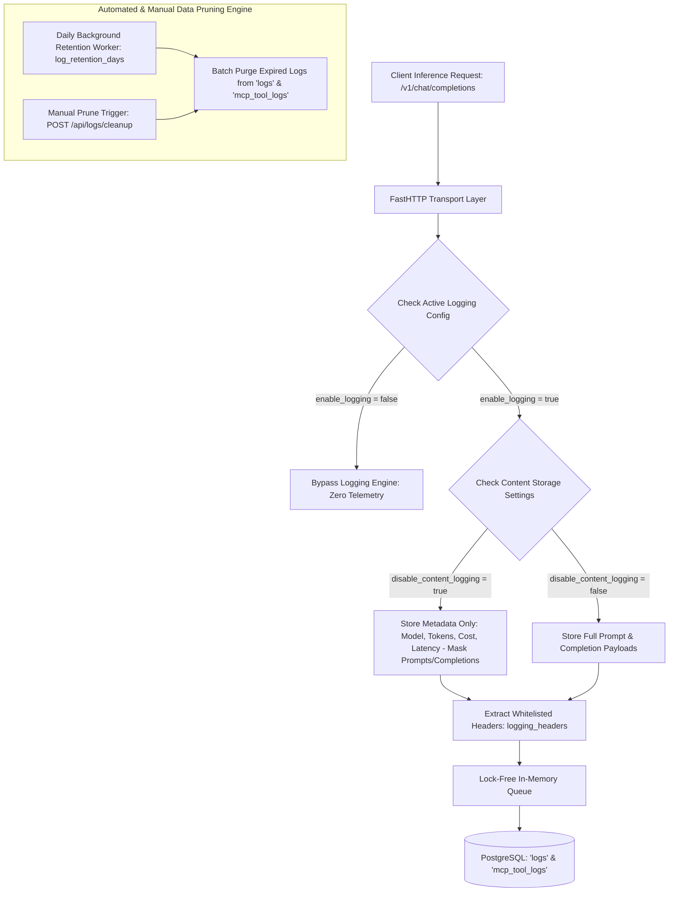

# UnifAI Logs Settings & Data Retention Governance Architecture (Logs_Settings.md)

This document provides a comprehensive, production-grade technical specification of the **Logs Settings & Data Retention Governance** subsystem (`/workspace/config/logging`) within the UnifAI Enterprise AI Gateway. It details the complete logging configuration engine, privacy and compliance controls (Zero Data Retention, payload redaction), per-request storage overrides, automated database log pruning, custom header capture, database schemas, and REST APIs.

---

## 1. System Overview & Logging Architecture

The **Logs Settings** module governs how inference telemetry, prompts, completions, and metadata are captured, sanitized, stored, and pruned across the enterprise gateway. It empowers compliance, security, and infrastructure administrators to balance observability needs with stringent regulatory standards (such as GDPR, HIPAA, SOC 2 Type II, and PCI-DSS).



---

## 2. UI Deep Dive: Logs Settings Interface (`/workspace/config/logging`)

The Logs Settings interface (`loggingView.tsx`) provides enterprise administrators with control over log persistence and data privacy.

### 2.1. Master Logging & Privacy Controls

| Control Name | UI Component | Description | Default | Impact |
| :--- | :--- | :--- | :--- | :--- |
| **Enable Logging** | `Switch id="enable-logging"` | Master switch for telemetry ingestion. When disabled, the gateway skips logging entirely. | `true` | Requires gateway restart if switching from completely unconfigured log store. |
| **Zero Data Retention (Disable Content Logging)** | `Switch id="disable-content-logging"` | When enabled, prompts, user messages, completions, tool call arguments, and images are stripped before saving to the database. Metadata (model, provider, latency, token count, cost, status) is retained for analytics. | `false` | Essential for HIPAA, GDPR, and PCI-DSS compliance. Protects sensitive customer data from being stored on gateway disks. |
| **Allow Per-Request Content Override** | `Switch id="allow-content-override"` | Allows individual client requests to override content logging policy via the `X-Gateway-Log-Content: true/false` HTTP header. | `false` | Gives developers flexibility to debug specific requests while maintaining organizational privacy defaults. |
| **Allow Per-Request Raw Payload Override** | `Switch id="allow-raw-override"` | Allows clients to opt in or out of raw unparsed HTTP request and response payload storage via `X-Gateway-Log-Raw: true/false`. | `false` | Controls raw byte storage for debugging non-standard multi-modal or streaming payloads. |
| **Hide Deleted Virtual Keys in Filters** | `Switch id="hide-deleted-keys"` | When enabled, virtual keys that have been deleted will not appear in the logs filter dropdowns across LLM Logs, MCP Logs, and Dashboard. | `true` | Keeps filter dropdowns uncluttered by historical or temporary keys. |

---

### 2.2. Automated Log Retention & Scheduled Pruning

* **Log Retention Period (Days) (`Input id="log-retention-days"`)**:
  * Configures the maximum age (in days) for logs stored in PostgreSQL.
  * **`0`**: Retain indefinitely (no automatic deletion).
  * **`7`, `30`, `60`, `90`, `180`, `365`**: Background cleanup workers automatically delete records older than the specified retention window.
* **Manual Immediate Pruning (`Button: Clean up now`)**:
  * Triggers an on-demand batch cleanup job calling `POST /api/logs/cleanup`.
  * Prunes both LLM logs (`logs`) and MCP tool logs (`mcp_tool_logs`).
  * Displays immediate feedback toast with the total number of pruned records (e.g., `Logging configuration updated (30 days retention, 1,240 older logs pruned)`).

---

### 2.3. Custom Header Capture Whitelist (`logging_headers`)

* **Custom Logging Headers Input (`Textarea id="logging-headers"`)**:
  * Comma-separated list of HTTP request and response headers to capture and store with each log entry.
  * *Example Whitelist:*
    ```text
    X-Request-ID, X-Correlation-ID, X-Client-Version, X-User-Department, X-Trace-ID, End-User-ID
    ```
  * Captured headers are stored within the `request_headers` and `response_headers` JSON fields in the database and displayed inside the Log Details inspection drawer.

---

## 3. Database Storage & Configuration Model

Logs settings are stored in PostgreSQL within the gateway core configuration model:

### 3.1. Database Schema (`client_configs` / `core_config`)

```sql
-- Client Configuration Table storing Logging Policies
CREATE TABLE client_configs (
    id VARCHAR(255) PRIMARY KEY DEFAULT 'default',
    enable_logging BOOLEAN NOT NULL DEFAULT TRUE,
    disable_content_logging BOOLEAN NOT NULL DEFAULT FALSE,
    allow_per_request_content_storage_override BOOLEAN NOT NULL DEFAULT FALSE,
    allow_per_request_raw_override BOOLEAN NOT NULL DEFAULT FALSE,
    log_retention_days INT NOT NULL DEFAULT 30,
    hide_deleted_virtual_keys_in_filters BOOLEAN NOT NULL DEFAULT TRUE,
    logging_headers TEXT[] DEFAULT ARRAY['x-request-id', 'x-correlation-id']::TEXT[],
    updated_at TIMESTAMP WITH TIME ZONE NOT NULL DEFAULT NOW(),
    updated_by VARCHAR(255)
);
```

### 3.2. Background Auto-Cleanup SQL Execution

When the automated retention worker runs or an admin triggers cleanup:
```sql
-- 1. Prune expired LLM interaction logs
DELETE FROM logs 
WHERE timestamp < NOW() - INTERVAL '30 days';

-- 2. Prune expired MCP tool invocation logs
DELETE FROM mcp_tool_logs 
WHERE timestamp < NOW() - INTERVAL '30 days';
```

---

## 4. Complete REST API Reference

All requests require administrative session authentication (`Cookie: token=...` or `Authorization: Bearer <token>`).

### 4.1. `GET /api/config`
Retrieves current gateway system configuration, including logging policies.
* **Response**:
  ```json
  {
    "client_config": {
      "enable_logging": true,
      "disable_content_logging": false,
      "allow_per_request_content_storage_override": true,
      "allow_per_request_raw_override": false,
      "log_retention_days": 30,
      "hide_deleted_virtual_keys_in_filters": true,
      "logging_headers": ["X-Request-ID", "X-Department-Code", "X-Trace-ID"]
    },
    "is_db_connected": true,
    "is_logs_connected": true
  }
  ```

### 4.2. `POST /api/config` / `PUT /api/config`
Updates gateway client configuration.
* **Request Body**:
  ```json
  {
    "client_config": {
      "enable_logging": true,
      "disable_content_logging": true,
      "allow_per_request_content_storage_override": false,
      "allow_per_request_raw_override": false,
      "log_retention_days": 60,
      "hide_deleted_virtual_keys_in_filters": true,
      "logging_headers": ["X-Request-ID", "X-Correlation-ID"]
    }
  }
  ```
* **Response (HTTP 200)**:
  ```json
  {
    "message": "Configuration updated successfully",
    "restart_required": false
  }
  ```

### 4.3. `POST /api/logs/cleanup`
Manually triggers an immediate batch log deletion based on the specified retention days.
* **Request Body**:
  ```json
  {
    "retention_days": 30
  }
  ```
* **Response (HTTP 200)**:
  ```json
  {
    "status": "success",
    "retention_days": 30,
    "deleted_logs": 1240,
    "deleted_mcp_logs": 312,
    "message": "Log cleanup completed successfully"
  }
  ```

### 4.4. `POST /api/logs/recalculate-cost`
Scans stored logs that have missing or zero costs (e.g., after enrolling custom pricing models or updating provider tokens rates) and recalculates costs in batches.
* **Request Body**:
  ```json
  {
    "batch_size": 500,
    "only_zero_costs": true
  }
  ```
* **Response (HTTP 200)**:
  ```json
  {
    "status": "success",
    "updated_count": 482,
    "message": "Cost recalculation completed"
  }
  ```

---

## 5. Security & Regulatory Compliance Guide

1. **Healthcare (HIPAA Compliance)**:
   * Turn **ON** `Zero Data Retention (Disable Content Logging)`.
   * Prompts containing Protected Health Information (PHI) are never written to database tables.
   * Model latency, token usage, and costs are preserved for billing without PHI exposure.
2. **Financial Services (PCI-DSS & SOC 2)**:
   * Set `Log Retention Period` to **90 Days** or your enterprise compliance window.
   * Configure `logging_headers` to capture `X-Audit-Session-ID` and `X-Correlation-ID` for cross-system trace reconstruction.
   * Disable `Allow Per-Request Content Storage Override` so individual applications cannot bypass organizational masking rules.
3. **Data Sovereignty & European Union (GDPR)**:
   * Utilize `POST /api/logs/cleanup` to ensure immediate hard-deletion of historical logs when data retention limits are reached.
   * Leverage `hide_deleted_virtual_keys_in_filters` to honor the "Right to be Forgotten" across reporting views.
