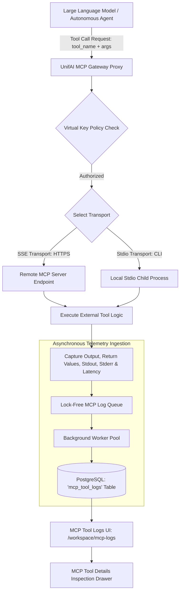

# UnifAI Model Context Protocol (MCP) Tool Logs Architecture (MCP_Logs.md)

This document provides a comprehensive, production-grade technical specification of the **Model Context Protocol (MCP) Tool Logs** subsystem (`/workspace/mcp-logs`) within the UnifAI Enterprise AI Gateway. It details the tool execution logging pipeline, real-time volume histograms, filter sidebars, the interactive data table, slide-over tool call inspection drawer (arguments JSON, output JSON, stdout/stderr, execution latency), database schemas, and REST APIs.

---

## 1. System Overview & Tool Execution Capture

When autonomous AI agents or Large Language Models invoke external tools via the **Model Context Protocol (MCP)**, the gateway operates as a stateful proxy. It records the complete lifecycle of each tool execution: the calling client context, the parent LLM inference trace, input parameters, execution duration, and tool responses.



---

## 2. UI Deep Dive: MCP Tool Logs Workspace (`/workspace/mcp-logs`)

The MCP Tool Logs console provides an interface for inspecting tool execution health, debugging agent workflows, and verifying security permissions.

### 2.1. Header & Filter Sidebar (`MCPFilterSidebar`)
* **Time Range Selector (`DateTimePickerWithRange`)**:
  * Quick Periods: `1h`, `24h`, `7d`, `30d`.
  * Custom Range: Unix timestamp boundaries with calendar selector.
* **Mini Volume Histogram Chart (`LogsVolumeChart`)**:
  * Visualizes tool execution rate and error bursts over time.
* **MCP Server Labels Multiselect**: Filters by registered MCP server (e.g., `postgres-db`, `github-tools`, `filesystem-server`, `slack-bot`).
* **Tool Names Multiselect**: Filters by specific tool function (e.g., `execute_sql`, `create_pull_request`, `read_file`, `send_message`).
* **Execution Status Multiselect**: Filters by:
  * `Success`
  * `Failed`
  * `Processing`
  * `Timeout`
  * `Denied by Policy`
* **Virtual Key & User Multiselect**: Filters tool calls triggered by specific API keys or enterprise users.
* **Content Search Input (`content_search`)**:
  * Full-text search across tool input arguments and output responses.
* **Export Button (`McpLogsExportButton`)**:
  * Streams currently filtered tool logs as **CSV** or **JSON**.

---

### 2.2. MCP Tool Logs Data Table (`mcpLogsTable.tsx`)
1. **Status**:
   * `Success` (Green checkmark icon).
   * `Failed` (Red alert circle icon).
   * `Processing` (Spinning loader icon).
2. **Timestamp**: Local and UTC execution timestamp (`YYYY-MM-DD HH:mm:ss.SSS`).
3. **MCP Server**: Display name of the upstream MCP server (e.g., `GitHub MCP Server`).
4. **Tool Name**: Name of the tool invoked (e.g., `get_issue_comments`).
5. **Duration (ms)**: Round-trip execution latency of the tool call.
6. **Calling Virtual Key**: Client key that triggered the parent inference call.
7. **User / Team**: Enterprise identity attribution.
8. **Actions Column**:
   * **View Tool Call Details Button (`button#btn-view-mcp-log-{id}`)**: Slides out the Tool Details Sheet.

---

### 2.3. Tool Call Details Slide-Over Sheet (`mcpLogDetailsSheet.tsx`)

Clicking any row opens a forensic inspection drawer:

#### Header & Navigation Controls
* **Header Bar**: Server Name, Tool Name, and Status Badge.
* **Sheet Navigation Buttons (`SheetNavigationButtons`)**:
  * **Previous Tool Call Button (`hasPrev`)**: Jumps to the preceding tool call in the table.
  * **Next Tool Call Button (`hasNext`)**: Jumps to the next tool call in the table without closing the drawer.

#### Execution Metadata
* **Tool Call UUID**: Unique execution identifier.
* **Parent Inference Log Link**: Clickable link navigating directly to the parent LLM prompt and response in `/workspace/logs`.
* **Timestamps & Latency**: Exact start time, completion time, and execution duration in milliseconds.
* **Transport Mechanism**: Badge indicating `SSE` (Remote HTTP) or `Stdio` (Local Child Process).
* **Identity Attribution**: Calling Virtual Key ID, User Email, and Team Name.

#### Tool Invocation Arguments
* Syntax-highlighted Monaco/Ace JSON editor (`CodeEditor`) displaying the exact parameter payload generated by the LLM:
  ```json
  {
    "query": "SELECT id, name, email FROM customers WHERE country = 'IN' LIMIT 10;",
    "timeout_ms": 3000
  }
  ```

#### Tool Execution Output
* Formatted JSON/Text viewer displaying the data returned by the external tool.
* Captured standard output (`stdout`) and standard error (`stderr`).
* **Truncation Indicator**: Displays a warning alert if the tool response exceeded the configured gateway buffer limit (`MAX_TOOL_OUTPUT_BYTES = 5MB`).

#### Drawer Footer Action Buttons
* **Download JSON Button (`downloadAsJson`)**: Downloads complete tool call trace as an RFC 8259 JSON file.
* **Delete Tool Log Button (`button#btn-delete-mcp-log`)**: Permanently removes the log entry (requires `RbacResource.MCPLogs, RbacOperation.Delete`).

---

## 3. Complete Database Schemas & Storage Format

MCP tool logs are stored in PostgreSQL with cascading references to parent LLM logs:

```sql
CREATE TABLE mcp_tool_logs (
    id VARCHAR(255) PRIMARY KEY,
    timestamp TIMESTAMP WITH TIME ZONE NOT NULL DEFAULT NOW(),
    parent_log_id VARCHAR(255) REFERENCES llm_logs(id) ON DELETE CASCADE,
    server_name VARCHAR(255) NOT NULL,
    server_transport VARCHAR(50) NOT NULL,           -- 'sse', 'stdio'
    tool_name VARCHAR(255) NOT NULL,
    duration_ms INT NOT NULL,
    status VARCHAR(50) NOT NULL DEFAULT 'success',   -- 'success', 'failed', 'timeout'
    error_message TEXT,
    arguments JSONB DEFAULT '{}'::jsonb,
    output_result JSONB DEFAULT '{}'::jsonb,
    virtual_key_id VARCHAR(255),
    user_id VARCHAR(255),
    team_id VARCHAR(255)
);

-- Performance Indexes
CREATE INDEX idx_mcp_logs_ts ON mcp_tool_logs(timestamp DESC);
CREATE INDEX idx_mcp_logs_tool ON mcp_tool_logs(tool_name);
CREATE INDEX idx_mcp_logs_server ON mcp_tool_logs(server_name);
CREATE INDEX idx_mcp_logs_parent ON mcp_tool_logs(parent_log_id);
```

---

## 4. Complete REST API Reference

All requests require administrative or team-manager bearer authentication.

### `GET /api/mcp/logs`
Retrieves paginated MCP tool invocation logs.
* **Query Parameters**:
  * `limit` (default: 50)
  * `offset` (default: 0)
  * `server_labels` (array)
  * `tool_names` (array)
  * `status` (array: `success`, `failed`, `timeout`)
  * `virtual_key_ids` (array)
  * `content_search` (string)
  * `start_time` & `end_time` (Unix seconds)
* **Response**:
  ```json
  {
    "logs": [
      {
        "id": "mcp-log-8812-4a",
        "timestamp": "2026-10-24T11:45:10Z",
        "parent_log_id": "log-99120-4a",
        "server_name": "postgres-db",
        "server_transport": "stdio",
        "tool_name": "execute_sql",
        "duration_ms": 48,
        "status": "success",
        "arguments": {
          "query": "SELECT count(*) FROM users;"
        },
        "output_result": {
          "count": 1420
        },
        "virtual_key": {
          "id": "vk-8812-4f9a",
          "name": "Prod-Customer-Chatbot"
        }
      }
    ],
    "total": 48120
  }
  ```

### `GET /api/mcp/logs/{id}`
Retrieves full details of a specific tool invocation, including raw stdout and stderr.

### `DELETE /api/mcp/logs/{id}`
Deletes a specific MCP tool log entry.

### `GET /api/mcp/logs/export`
Exports filtered tool logs as CSV or JSON.

---

## 5. Operational Runbook & Common Tool Errors

1. **Tool Execution Timeout**:
   * If an external MCP server exceeds its execution budget (default: 30s), the gateway terminates the connection, returns status `timeout`, and logs error: `"Tool execution exceeded deadline of 30000ms"`.
2. **Buffer Truncation Safeguard**:
   * If a tool returns a massive payload (e.g., querying 100,000 rows without `LIMIT`), the gateway truncates output at `5MB` to prevent memory exhaustion and flags the record with `is_truncated: true`.
