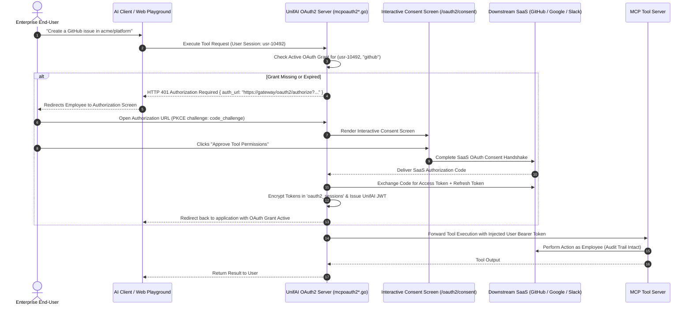

# UnifAI MCP OAuth 2.0 PKCE Security & User Grants Architecture (MCP_OAuth2_Security.md)

This document provides a comprehensive, production-grade technical specification of the **Model Context Protocol (MCP) OAuth 2.0 PKCE & User Grants** subsystem (`/workspace/mcp-auth-config` and `/workspace/oauth-grants`) within the UnifAI Enterprise AI Gateway. It details the downstream credential isolation architecture, the interactive user consent screen, OAuth2 discovery (`.well-known`), PKCE challenge verification, JWT token issuance and rotation, the OAuth Grants management console, database schemas, and REST APIs.

---

## 1. System Overview & Downstream Credential Isolation

When an autonomous AI agent or Large Language Model invokes external enterprise SaaS tools (e.g., creating a GitHub pull request, querying a private Google Drive document, or sending a Slack message), sharing a single global API key creates massive security vulnerabilities: all actions appear under the same machine identity, and individual user permissions cannot be enforced.

The UnifAI Gateway implements **Per-User Downstream OAuth 2.0 Credential Isolation**:
1. Every end-user interacting with an MCP tool authenticates using their personal SaaS credentials via standard **OAuth 2.0 Authorization Code Flow with PKCE (Proof Key for Code Exchange - RFC 7636)**.
2. The gateway acts as a secure OAuth 2.0 Authorization Server and Token Vault: tokens are encrypted in the gateway vault and injected into upstream MCP server requests on the fly.
3. The LLM never sees or stores the user's raw OAuth access tokens or refresh tokens.



---

## 2. OAuth 2.0 PKCE Handshake & Discovery (`.well-known`)

The gateway provides standard RFC 8414 discovery endpoints:
* **Discovery URI**: `GET /.well-known/oauth-authorization-server`
* **Supported Capabilities**:
  * Response Types: `code`
  * Code Challenge Methods: `S256` (SHA-256 mandatory)
  * Token Endpoint Auth: `client_secret_post`, `none` (public PKCE clients)
  * Grant Types: `authorization_code`, `refresh_token`

---

## 3. UI Deep Dive: OAuth Grants Console (`/workspace/oauth-grants`)

The OAuth Grants management interface (`oauth-grants/page.tsx`, `grantsTable.tsx`) enables security administrators to audit, search, and revoke active user authorizations.

### 3.1. Header & Search Filter Bar (`GrantsFilterBar.tsx`)
* **Search Input Field (`input#grants-search`)**: Debounced search across user emails, client names, and scope strings.
* **Auth Mode Filter (`uf_mode`)**: Filters by `personal_oauth`, `enterprise_sso`, `service_account`.
* **Total Active Grants Count**: Header counter showing total live sessions.

---

### 3.2. OAuth Grants Data Table (`grantsTable.tsx`)
1. **User Identity**: Enterprise user email and avatar.
2. **MCP Client / Tool Service**: Brand icon and provider name (e.g., `GitHub MCP`, `Google Workspace`, `Slack`).
3. **Authorized Scopes**: Pills displaying granted OAuth scopes (e.g., `repo:status`, `read:user`, `drive.readonly`).
4. **Token Expiry**: Date/time when access token expires, with automatic refresh status indicator.
5. **Last Used**: Timestamp of the most recent tool execution using this grant.
6. **Actions Column**:
   * **Revoke Grant Button (`button#btn-revoke-grant-{id}`)**: Opens `RevokeGrantDialog.tsx`.

---

### 3.3. Revoke Grant Dialog (`revokeGrantDialog.tsx`)
* Prompts confirmation: *"Revoking this grant will immediately invalidate access tokens and disconnect {user} from {client}. Any agent tool calls requiring this credential will fail until re-authorized."*
* Invokes `useRevokeOAuth2GrantMutation()`:
  * Revokes tokens at the upstream SaaS provider (RFC 7009 token revocation).
  * Purges tokens from the gateway database.
  * Emits an administrative SOC-2 audit event.

---

## 4. UI Deep Dive: MCP Auth Config (`/workspace/mcp-auth-config`)

The MCP Auth Config interface (`mcpAuthConfigView.tsx`) allows administrators to configure OAuth client credentials for external SaaS integrations:
* **Client ID Input (`input#auth-client-id`)**: Downstream application client ID.
* **Client Secret Input (`input#auth-client-secret`)**: Downstream client secret (encrypted in storage).
* **Authorize URL Input (`input#auth-authorize-url`)**: Upstream provider authorization endpoint (e.g., `https://github.com/login/oauth/authorize`).
* **Token URL Input (`input#auth-token-url`)**: Upstream token exchange endpoint (e.g., `https://github.com/login/oauth/access_token`).
* **Redirect URI Box**: Displays the gateway callback URL (`https://<gateway>/api/mcp/oauth/callback`) with a copy button for pasting into SaaS developer consoles.
* **Default Scopes Input**: Comma-separated list of minimal required OAuth scopes.

---

## 5. Complete Database Schemas & Storage Format

OAuth sessions and grants are stored in PostgreSQL:

```sql
CREATE TABLE oauth2_sessions (
    id VARCHAR(255) PRIMARY KEY,
    user_id VARCHAR(255) NOT NULL REFERENCES users(id) ON DELETE CASCADE,
    client_id VARCHAR(255) NOT NULL,
    provider VARCHAR(100) NOT NULL,                  -- 'github', 'google', 'slack'
    access_token_encrypted TEXT NOT NULL,
    refresh_token_encrypted TEXT,
    scopes JSONB NOT NULL DEFAULT '[]'::jsonb,
    expires_at TIMESTAMP WITH TIME ZONE NOT NULL,
    last_used_at TIMESTAMP WITH TIME ZONE DEFAULT NOW(),
    created_at TIMESTAMP WITH TIME ZONE DEFAULT NOW(),
    updated_at TIMESTAMP WITH TIME ZONE DEFAULT NOW(),
    CONSTRAINT uix_user_provider UNIQUE (user_id, provider)
);

CREATE INDEX idx_oauth2_sessions_user ON oauth2_sessions(user_id);
```

---

## 6. Complete REST API Reference

### `GET /api/oauth2/grants`
Retrieves paginated list of active user OAuth grants.
* **Query Parameters**: `q` (search), `limit`, `offset`.
* **Response**:
  ```json
  {
    "sessions": [
      {
        "id": "oa-session-9912",
        "user_id": "usr-10492",
        "user_email": "john.doe@enterprise.com",
        "provider": "github",
        "scopes": ["repo", "read:user"],
        "expires_at": "2026-10-24T18:00:00Z",
        "last_used_at": "2026-10-24T11:30:00Z"
      }
    ],
    "total_count": 1
  }
  ```

### `POST /api/oauth2/grants/{id}/revoke`
Revokes active grant and deletes tokens.
* **Response**: HTTP 200 OK `{ "status": "success", "message": "Grant revoked" }`.

### `GET /api/mcp/oauth/config` & `PUT /api/mcp/oauth/config`
Gets or updates downstream SaaS OAuth client registrations.
