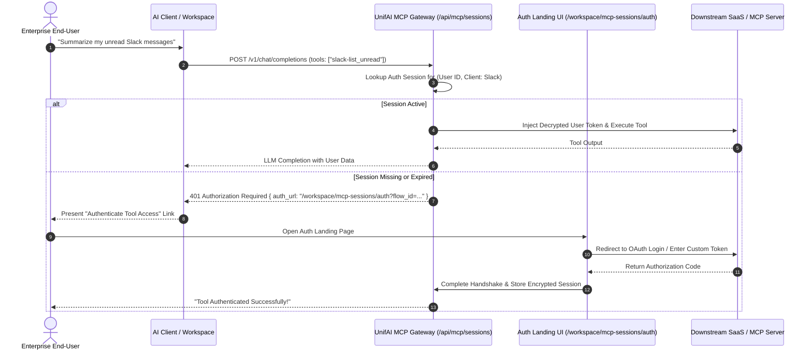

# UnifAI MCP Auth Sessions Architecture & Operations Guide

**Route:** [`/workspace/mcp-sessions`](http://localhost:3100/workspace/mcp-sessions)  
**Auth Landing Route:** [`/workspace/mcp-sessions/auth`](http://localhost:3100/workspace/mcp-sessions/auth)  
**Backend Handler:** [`transports/gateway-http/handlers/mcpsessions.go`](file:///d:/unifai_project/transports/gateway-http/handlers/mcpsessions.go)  
**UI Components:** [`ui/app/workspace/mcp-sessions/page.tsx`](file:///d:/unifai_project/ui/app/workspace/mcp-sessions/page.tsx), [`ui/app/workspace/mcp-sessions/auth/page.tsx`](file:///d:/unifai_project/ui/app/workspace/mcp-sessions/auth/page.tsx)  
**Database Tables:** `oauth_user_tokens`, `oauth_user_sessions`, `mcp_per_user_header_credentials`, `mcp_per_user_header_flows` in PostgreSQL database `Unifai_test`

---

## 1. Overview & Purpose

The **MCP Auth Sessions** subsystem provides multi-tenant, identity-isolated authentication for stateful and user-authorized MCP tools.

When an LLM agent needs to perform an action on behalf of an enterprise user (e.g. querying a private Slack channel, accessing internal Google Docs, or creating a Jira ticket), sharing a single static machine key compromises auditability and security.

UnifAI supports two distinct per-user auth strategies:
1. **Per-User Downstream OAuth2 (PKCE)**: The end-user logs into the downstream SaaS platform directly. The gateway stores encrypted OAuth tokens and automatically refreshes them.
2. **Per-User Custom Headers**: The user or agent provides personalized authentication headers (such as personal access tokens or bearer tokens) stored securely in the gateway token vault.



---

## 2. Identity Isolation Modes (`uf_mode`)

The gateway guarantees strict identity isolation using 3 runtime modes:

| Mode | Identifier Column (`uf_sub`) | Description | Use Case |
| :--- | :--- | :--- | :--- |
| `user` | Enterprise User ID (SCIM / Email) | Token belongs to a single physical human user. | Multi-user chat playgrounds, enterprise portals. |
| `vk` | Virtual Key ID (`virtual_key_id`) | Token is bound to an entire API key / department. | Automated background pipelines, microservice agents. |
| `session` | Ephemeral Session ID | Token is bound to a single temporary browser session. | Anonymous evaluations, temporary demo widgets. |

---

## 3. Database Schema

The MCP Auth Sessions subsystem stores active credentials and pending authentication flows across four PostgreSQL tables:

### 3.1 `oauth_user_tokens` (Active Downstream OAuth Tokens)

| Column | Data Type | Nullable | Description |
| :--- | :--- | :---: | :--- |
| `id` | `VARCHAR(255)` | **No** (PK) | Unique token row ID. |
| `session_id` | `VARCHAR(255)` | Yes | Ephemeral session ID (if `auth_mode = 'session'`). |
| `virtual_key_id` | `VARCHAR(255)` | Yes | Bound Virtual Key ID (if `auth_mode = 'vk'`). |
| `user_id` | `VARCHAR(255)` | Yes | Bound Enterprise User ID (if `auth_mode = 'user'`). |
| `mcp_client_id` | `VARCHAR(255)` | **No** | Associated MCP client identifier. |
| `auth_mode` | `VARCHAR(50)` | **No** | `user`, `vk`, or `session`. |
| `status` | `VARCHAR(50)` | **No** | `active`, `expired`, `revoked`. |
| `access_token` | `TEXT` | **No** | AES-256 encrypted access token. |
| `refresh_token`| `TEXT` | Yes | AES-256 encrypted refresh token. |
| `expires_at` | `TIMESTAMPTZ` | Yes | Token expiry timestamp. |
| `scopes` | `TEXT` | Yes | Comma-separated OAuth scopes granted. |
| `last_refreshed_at` | `TIMESTAMPTZ` | Yes | Last successful refresh operation timestamp. |

### 3.2 `mcp_per_user_header_credentials` (Custom Header Tokens)

| Column | Data Type | Nullable | Description |
| :--- | :--- | :---: | :--- |
| `id` | `VARCHAR(255)` | **No** (PK) | Unique credential row ID. |
| `mcp_client_id` | `VARCHAR(255)` | **No** | Target MCP server. |
| `auth_mode` | `VARCHAR(50)` | **No** | `user`, `vk`, or `session`. |
| `headers_json` | `TEXT` | **No** | Encrypted JSON map of custom HTTP headers (e.g. `{"Authorization": "Bearer pat-..."}`). |
| `status` | `VARCHAR(50)` | **No** | `active`, `revoked`. |

---

## 4. REST API Reference

All requests require session cookie (`Cookie: token=...`) or bearer token (`Authorization: Bearer <token>`).

### 4.1 List All Auth Sessions
- **Method:** `GET`
- **Path:** `/api/mcp/sessions`
- **Query Parameters:**
  - `limit`: Page size (default: 50).
  - `offset`: Offset number.
  - `q`: Search substring across client name or user identity.
  - `kind`: `oauth` or `headers`.
  - `status`: `active`, `expired`, `revoked`.
  - `auth_mode`: `user`, `vk`, `session`.
- **Response `200 OK`:**
```json
{
  "count": 1,
  "total_count": 1,
  "limit": 50,
  "offset": 0,
  "sessions": [
    {
      "id": "tok-9281a-bb4",
      "kind": "oauth",
      "status": "active",
      "auth_mode": "user",
      "mcp_client": {
        "client_id": "mcp-slack-prod",
        "name": "Slack MCP Server"
      },
      "user": {
        "id": "usr-prasanth",
        "name": "Prasanth Rajendran"
      },
      "scopes": ["channels:read", "chat:write"],
      "expires_at": "2026-11-01T10:00:00Z",
      "created_at": "2026-10-25T12:00:00Z"
    }
  ]
}
```

### 4.2 Trigger Re-Authentication
- **Method:** `POST`
- **Path:** `/api/mcp/sessions/{id}/reauth`
- **Description:** Generates a new OAuth authorization URL for the specified session row so the user can re-grant permissions or update expired tokens.
- **Response `200 OK`:**
```json
{
  "authorize_url": "https://slack.com/oauth/v2/authorize?client_id=...&state=..."
}
```

### 4.3 Revoke and Terminate an Auth Session
- **Method:** `DELETE`
- **Path:** `/api/mcp/sessions/{id}`
- **Description:** Performs best-effort upstream token revocation at the SaaS provider and hard-deletes the credentials from the gateway database.

---

## 5. UI Operations Guide ([`/workspace/mcp-sessions`](http://localhost:3100/workspace/mcp-sessions))

1. **View Active Sessions**: Open [`/workspace/mcp-sessions`](http://localhost:3100/workspace/mcp-sessions). The table displays all live sessions, including client name, user/VK identity, granted scopes, expiry timestamps, and status badges (**Active**, **Expired**, **Needs Re-Auth**).
2. **Filter Sessions**: Use the top filter bar to filter by **Auth Type** (OAuth vs Headers), **Mode** (User, Virtual Key, Session), or search by client name.
3. **Re-Authenticate**: If a session displays **Expired**, click the **Re-Auth** button to open the OAuth landing page and refresh token grants.
4. **Revoke Session**: Click the trash icon to revoke a compromised or decommissioned session.

---

## 6. Troubleshooting & Error Handling

| Error Message / Symptom | Root Cause | Solution |
| :--- | :--- | :--- |
| `Token has expired and refresh token is invalid` | The upstream SaaS provider revoked or expired the long-lived refresh token. | Click **Re-Auth** on the session row in `/workspace/mcp-sessions` to log in again. |
| `Decryption failed for session token` | The `GATEWAY_ENCRYPTION_KEY` changed or is missing. | Verify encryption key in `.env` matches the key used when the session was created. |
| `No active session found for user` | The model called a tool requiring user credentials, but no auth session exists yet. | Follow the generated auth link to complete initial consent. |
