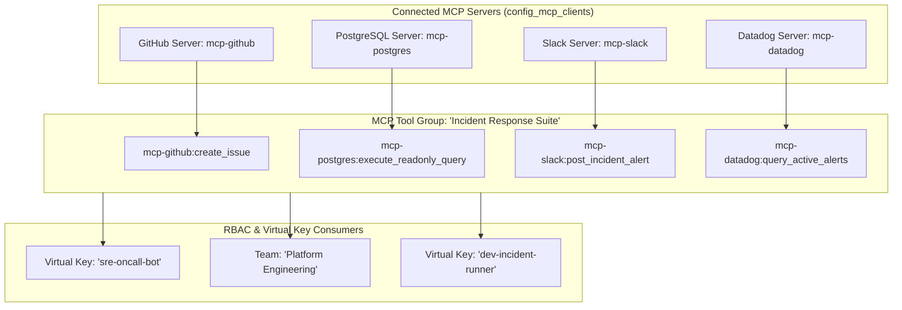

# UnifAI MCP Tool Groups Architecture & Operations Guide

**Route:** [`/workspace/mcp-tool-groups`](http://localhost:3100/workspace/mcp-tool-groups)  
**Backend Handler:** [`transports/gateway-http/handlers/mcptoolgroups.go`](file:///d:/unifai_project/transports/gateway-http/handlers/mcptoolgroups.go)  
**UI Component:** [`ui/app/_fallbacks/enterprise/components/mcp-tool-groups/mcpToolGroups.tsx`](file:///d:/unifai_project/ui/app/_fallbacks/enterprise/components/mcp-tool-groups/mcpToolGroups.tsx)  
**Database Table:** `mcp_tool_groups` in PostgreSQL database `Unifai_test`

---

## 1. Overview & Purpose

As enterprise organizations scale their AI initiatives, dozens of Model Context Protocol (MCP) servers are deployed—spanning GitHub, PostgreSQL, Jira, Salesforce, Slack, Datadog, AWS, and local file systems. Managing tool permissions on a per-tool or per-server basis across thousands of Virtual Keys and developer teams quickly leads to permission sprawl, administrative bottleneck, and accidental over-privilege.

**MCP Tool Groups** provide composite, multi-server tool abstraction:
- Group multiple tools from disparate MCP servers into a single cohesive functional role (e.g., *"DevOps Incident Response"*, *"Customer Support Specialist"*, *"Data Analyst Read-Only"*).
- Associate tool groups directly with **Virtual Keys**, **Teams**, **Customers**, or **Users**.
- Expose runtime wildcards (e.g., `github-*` or `slack-post_message`).



---

## 2. Configuration Parameters & Data Types

An MCP Tool Group definition combines tool specifications with governance scope bindings:

| Field Name | Type | Required | Description |
| :--- | :--- | :---: | :--- |
| `id` | `uint` | Auto | Unique sequential integer ID (Primary Key). |
| `name` | `string` | **Yes** | Human-readable unique group name (e.g., `devops-triage-tools`). |
| `description` | `string` | No | Operational purpose and audience summary. |
| `enabled` | `boolean` | **Yes** | Active flag (default: `true`). When `false`, all tools in this group are blocked from execution. |
| `tools` | `array` | **Yes** | Array of target tool descriptors. |
| `tools[].mcp_client_id` | `string` | **Yes** | Unique ID of the parent MCP client. |
| `tools[].mcp_client_name`| `string` | **Yes** | Name prefix of the client. |
| `tools[].name` | `string` | **Yes** | Canonical runtime tool pattern (`<client_name>-<tool_name>` or `<client_name>-*`). |
| `tools[].tool_names` | `string[]` | No | Explicit list of function names from the server. |
| `virtual_key_ids` | `string[]` | No | List of Virtual Key IDs bound to this tool group. |
| `team_ids` | `string[]` | No | Team identifiers granted access to this tool group. |
| `user_ids` | `string[]` | No | Individual user IDs allowed to invoke tools in this group. |

---

## 3. Database Schema: `mcp_tool_groups`

Persisted in the PostgreSQL database `Unifai_test`:

| Column | Data Type | Nullable | Description |
| :--- | :--- | :---: | :--- |
| `id` | `BIGINT` | **No** (PK) | Auto-incrementing identifier. |
| `name` | `VARCHAR(255)` | **No** | Unique tool group name. |
| `description` | `TEXT` | Yes | Human-readable notes and documentation. |
| `enabled` | `BOOLEAN` | **No** | Whether the tool group is currently active. |
| `spec_json` | `TEXT` | **No** | Serialized JSON containing `tools`, `virtual_key_ids`, `team_ids`, `user_ids`. |
| `created_at` | `TIMESTAMPTZ` | **No** | Row creation timestamp. |
| `updated_at` | `TIMESTAMPTZ` | **No** | Last modification timestamp. |

---

## 4. REST API Reference

All requests require authentication via cookie (`Cookie: token=...`) or bearer token (`Authorization: Bearer <token>`).

### 4.1 List All Tool Groups
- **Method:** `GET`
- **Path:** `/api/mcp/tool-groups`
- **Response `200 OK`:**
```json
{
  "count": 1,
  "total_count": 1,
  "tool_groups": [
    {
      "id": 1,
      "name": "DevOps Incident Response",
      "description": "Tools required during system outages",
      "enabled": true,
      "tools": [
        {
          "mcp_client_id": "client-github-prod",
          "mcp_client_name": "github",
          "name": "github-create_issue",
          "tool_names": ["create_issue"]
        },
        {
          "mcp_client_id": "client-postgres-ro",
          "mcp_client_name": "postgres",
          "name": "postgres-query_tables",
          "tool_names": ["query_tables"]
        }
      ],
      "virtual_key_ids": ["vk-sre-team"],
      "created_at": "2026-10-25T14:20:00Z",
      "updated_at": "2026-10-25T14:20:00Z"
    }
  ]
}
```

### 4.2 Create a Tool Group
- **Method:** `POST`
- **Path:** `/api/mcp/tool-groups`
- **Payload:**
```json
{
  "name": "Data Analyst Tools",
  "description": "Read-only database and CSV querying tools",
  "enabled": true,
  "tools": [
    {
      "mcp_client_id": "client-postgres-prod",
      "mcp_client_name": "postgres",
      "name": "postgres-*",
      "tool_names": []
    }
  ],
  "virtual_key_ids": ["vk-bi-analytics"]
}
```

### 4.3 Update a Tool Group
- **Method:** `PUT`
- **Path:** `/api/mcp/tool-groups/{id}`

### 4.4 Delete a Tool Group
- **Method:** `DELETE`
- **Path:** `/api/mcp/tool-groups/{id}`

---

## 5. UI Operations Guide ([`/workspace/mcp-tool-groups`](http://localhost:3100/workspace/mcp-tool-groups))

1. **View Tool Groups**: Navigate to [`/workspace/mcp-tool-groups`](http://localhost:3100/workspace/mcp-tool-groups). The table displays all active tool groups, their enabled status, associated MCP servers, tool counts, and bound Virtual Keys.
2. **Create a Tool Group**:
   - Click **+ Create Tool Group**.
   - Enter **Group Name** (e.g. `engineering-core-tools`).
   - Select an **MCP Server** from the dropdown.
   - Enter tool names separated by commas (e.g. `list_files, read_file`), or leave empty for all tools (`*`).
   - Select one or more **Virtual Keys** to automatically inherit this tool group.
   - Click **Save Tool Group**.
3. **Edit / Add Tools**:
   - Click the pencil icon on any row to open the editing dialog.
   - Add additional tools or adjust Virtual Key assignments.
4. **Delete**:
   - Click the trash icon to remove the tool group. Bound Virtual Keys immediately lose access to tools in that group.

---

## 6. Troubleshooting & Error Handling

| Error Message / Symptom | Root Cause | Solution |
| :--- | :--- | :--- |
| `name is required` | The tool group name was left empty during creation. | Provide a descriptive name for the group. |
| `tools array cannot be empty` | No tools or servers were selected. | Select at least one MCP client server. |
| `Virtual Key cannot execute tool` | The Virtual Key is not assigned to the tool group or the tool group is disabled. | Verify the tool group is `enabled: true` and that the Virtual Key ID is in `virtual_key_ids`. |
