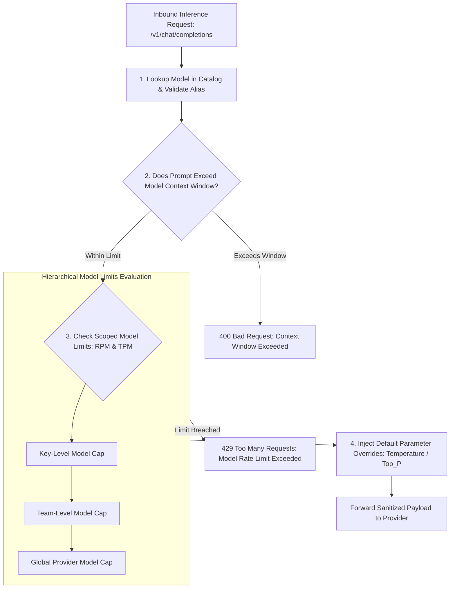

# UnifAI Model Catalog & Scoped Model Limits Architecture (Model_Catalog_Limits.md)

This document provides a comprehensive, production-grade technical specification of the **Model Catalog & Scoped Model Limits** subsystems (`/workspace/model-catalog` and `/workspace/model-limits`) within the UnifAI Enterprise AI Gateway. It details the centralized model registry, multi-modal capability attributes, default hyperparameter overrides (temperature, top_p, frequency penalty), context window boundaries, scoped per-model throughput limits (RPM/TPM), complete UI workspace documentation, database schemas, and REST APIs.

---

## 1. System Overview & Model Governance Framework

The **Model Catalog & Limits** subsystem standardizes the governance, discovery, and resource boundaries of all generative AI models available across enterprise applications. 

Rather than allowing client applications to send arbitrary or unvetted parameters directly to upstream LLM APIs, the UnifAI Gateway enforces:
1. **Model Catalog (`/workspace/model-catalog`)**: A unified registry of all enterprise-approved models across all enrolled providers (OpenAI, Anthropic, Bedrock, Vertex AI, Azure OpenAI, Groq, Ollama), detailing their context window boundaries, multi-modal capabilities, and default parameters.
2. **Model Attributes (`/workspace/model-catalog?tab=attributes`)**: An interactive catalog mapping model features (Vision, Function Calling, Streaming, JSON Mode, Reasoning, System Messages) and input/output cost profiles.
3. **Model Limits (`/workspace/model-limits`)**: Granular, scoped rate-limiters enforcing maximum Requests Per Minute (RPM) and Tokens Per Minute (TPM) on a **per-model** basis, preventing a single runaway application from monopolizing shared provider quotas.



---

## 2. UI Deep Dive: Model Catalog (`/workspace/model-catalog`)

The Model Catalog interface features two tabs: **Overview** and **Attributes**.

### 2.1. Tab 1: Catalog Overview (`OverviewTab.tsx`)
* **Header & Controls**:
  * **Provider Filter Dropdown**: Filters catalog by AI provider.
  * **Search Input Field**: Filters models by alias or full model name.
* **Model Cards Grid**:
  * Displays each enrolled model with:
    - Provider Brand Icon & Name (e.g., `Anthropic / Claude 3.5 Sonnet`).
    - Standard Model Identifier (e.g., `claude-3-5-sonnet-20241022`).
    - Context Window Size (e.g., `200,000 tokens`).
    - Max Completion Tokens (e.g., `8,192 tokens`).
    - Modality Badges: `Text`, `Vision`, `Tools / Function Calling`, `JSON Mode`, `Reasoning`.
    - Pricing Summary: Input rate per 1M tokens vs. Output rate per 1M tokens.

---

### 2.2. Tab 2: Model Attributes Matrix (`AttributesTab.tsx`)
A comparative tabular matrix mapping enterprise capabilities across models:
* **Table Columns**:
  1. **Model Name & Provider**: Unified name.
  2. **Context Window (Tokens)**: Maximum prompt + completion tokens permitted.
  3. **Max Output Tokens**: Upstream generation ceiling.
  4. **Multi-Modal Capabilities**:
     * `Vision` (Image input support).
     * `Audio Input / Output` (Voice speech).
     * `Function Calling / Tools` (MCP compatibility).
     * `JSON Schema / Structured Output`.
     * `Reasoning / Thinking` (Internal chain-of-thought, e.g., `o1`, `deepseek-r1`).
  5. **Default Hyperparameters**:
     * Default Temperature ($0.0 \dots 2.0$).
     * Default Top P ($0.0 \dots 1.0$).
     * Frequency Penalty / Presence Penalty.
     * System Message Support (Yes/No).

---

## 3. UI Deep Dive: Scoped Model Limits (`/workspace/model-limits`)

The Model Limits workspace (`modelLimitsView.tsx`, `modelLimitsTable.tsx`) controls throughput allocations to protect enterprise accounts from rate-limit saturation.

### 3.1. Header & Table Controls
* **Search Input (`input#model-limits-search`)**: Debounced search (300ms) across model names and scope entities.
* **Scope Filter Dropdown (`select#model-limits-scope`)**: Filters by `Global`, `Customer`, `Team`, `Virtual Key`.
* **Provider Filter Dropdown (`select#model-limits-provider`)**: Filters by provider.
* **+ Add Model Limit Button (`button#btn-create-model-limit`)**: Opens the Limit Creation Modal.
* **Polling Interval**: Automatically refreshes table every 5,000ms via `useGetModelConfigsQuery()`.

---

### 3.2. Model Limits Data Table Columns
1. **Status**: `<Switch />` toggle enabling/disabling the limit policy in real time.
2. **Model Identifier**: Target model name (e.g., `gpt-4o`, `claude-3-5-sonnet`) or prefix wildcard `*`.
3. **Provider**: Associated upstream provider.
4. **Scope Level**:
   * `Global` (Enforced across all clients).
   * `Customer: Acme Corp`.
   * `Team: Core Data Science`.
   * `Virtual Key: Prod-Chatbot`.
5. **Requests Per Minute (RPM) Limit**: Maximum request ceiling per 60-second sliding window.
6. **Tokens Per Minute (TPM) Limit**: Maximum token consumption ceiling per 60-second sliding window.
7. **Actions Column**:
   * **Edit Limit Button (`button#btn-edit-model-limit-{id}`)**.
   * **Delete Limit Button (`button#btn-delete-model-limit-{id}`)**: Prompts confirmation dialog.

---

### 3.3. Add / Edit Model Limit Modal Form Fields
* **Target Model Dropdown / Input (`input#limit-model`)**: Specific model or wildcard.
* **Provider Dropdown (`select#limit-provider`)**: Target AI vendor.
* **Scope Kind Selector**: `Global`, `Customer`, `Team`, `Virtual Key`.
* **Target Scope Entity**: Selects target Customer, Team, or Virtual Key ID.
* **Max Requests (RPM) Input (`input#limit-rpm`)**: e.g., `120 RPM`.
* **Max Tokens (TPM) Input (`input#limit-tpm`)**: e.g., `250,000 TPM`.
* **Enforcement Behavior**:
  * `Reject with HTTP 429`: Instantly returns rate-limit error.
  * `Queue & Backpressure`: Delays execution within a 5-second buffer before rejecting.
* **Modal Footer**: Cancel Button and Save Limit Button (`button#btn-save-model-limit`).

---

## 4. Complete Database Schemas & Storage Format

Model catalog entries and scoped model limits are stored in PostgreSQL:

```sql
-- 1. Master Model Catalog Table
CREATE TABLE model_catalog (
    id VARCHAR(255) PRIMARY KEY,
    provider VARCHAR(100) NOT NULL,
    model_name VARCHAR(255) NOT NULL,
    display_name VARCHAR(255),
    context_window INT NOT NULL,
    max_output_tokens INT NOT NULL,
    supports_vision BOOLEAN DEFAULT FALSE,
    supports_tools BOOLEAN DEFAULT TRUE,
    supports_json_mode BOOLEAN DEFAULT TRUE,
    supports_reasoning BOOLEAN DEFAULT FALSE,
    default_temperature NUMERIC(3, 2) DEFAULT 0.7,
    default_top_p NUMERIC(3, 2) DEFAULT 1.0,
    created_at TIMESTAMP WITH TIME ZONE DEFAULT NOW(),
    updated_at TIMESTAMP WITH TIME ZONE DEFAULT NOW(),
    CONSTRAINT uix_provider_model UNIQUE (provider, model_name)
);

-- 2. Scoped Model Limits Table
CREATE TABLE governance_model_limits (
    id SERIAL PRIMARY KEY,
    model VARCHAR(255) NOT NULL,
    provider VARCHAR(100) NOT NULL,
    scope_kind VARCHAR(50) NOT NULL,                 -- 'global', 'customer', 'team', 'virtual_key'
    scope_id VARCHAR(255),                           -- Target UUID or NULL for global
    enabled BOOLEAN NOT NULL DEFAULT TRUE,
    rpm_limit INT,
    tpm_limit INT,
    enforcement_action VARCHAR(50) DEFAULT 'reject', -- 'reject', 'queue'
    created_at TIMESTAMP WITH TIME ZONE DEFAULT NOW(),
    updated_at TIMESTAMP WITH TIME ZONE DEFAULT NOW()
);
```

---

## 5. Complete REST API Reference

### `GET /api/models`
Retrieves normalized list of all available models across registered providers.

### `GET /api/model-catalog/attributes`
Returns full capability attributes matrix (context windows, tools, vision, reasoning).

### `GET /api/model-configs`
Retrieves paginated list of scoped per-model RPM and TPM limits.
* **Query Parameters**: `limit`, `offset`, `search`, `scope`, `provider`.
* **Response**:
  ```json
  {
    "configs": [
      {
        "id": 14,
        "model": "gpt-4o",
        "provider": "openai",
        "scope_kind": "team",
        "scope_id": "team-eng-core",
        "enabled": true,
        "rpm_limit": 60,
        "tpm_limit": 150000,
        "enforcement_action": "reject"
      }
    ],
    "total_count": 1
  }
  ```

### `POST /api/model-configs`
Creates a new scoped model throughput limit.

### `PUT /api/model-configs/{id}`
Updates an existing model limit.

### `DELETE /api/model-configs/{id}`
Removes limit.
