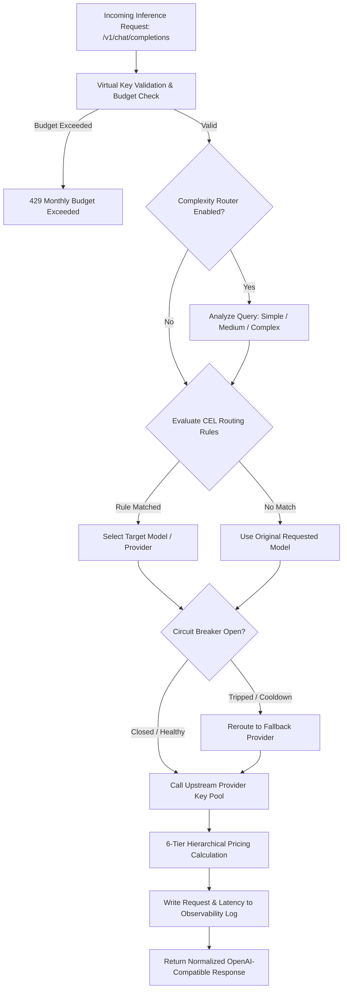
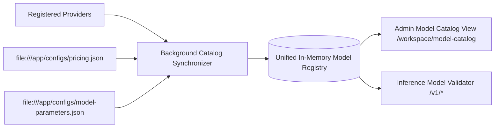
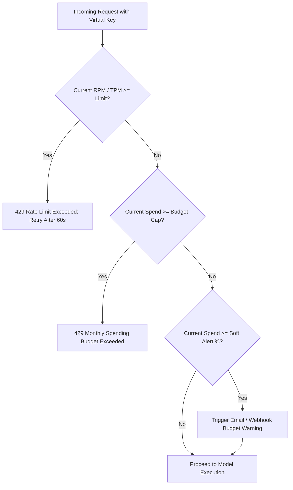
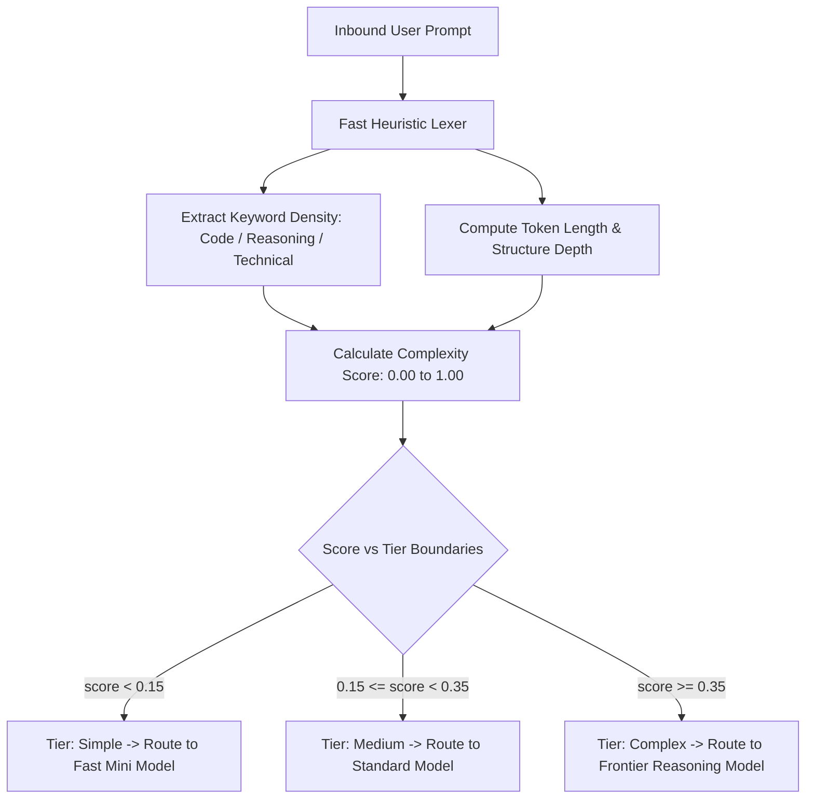
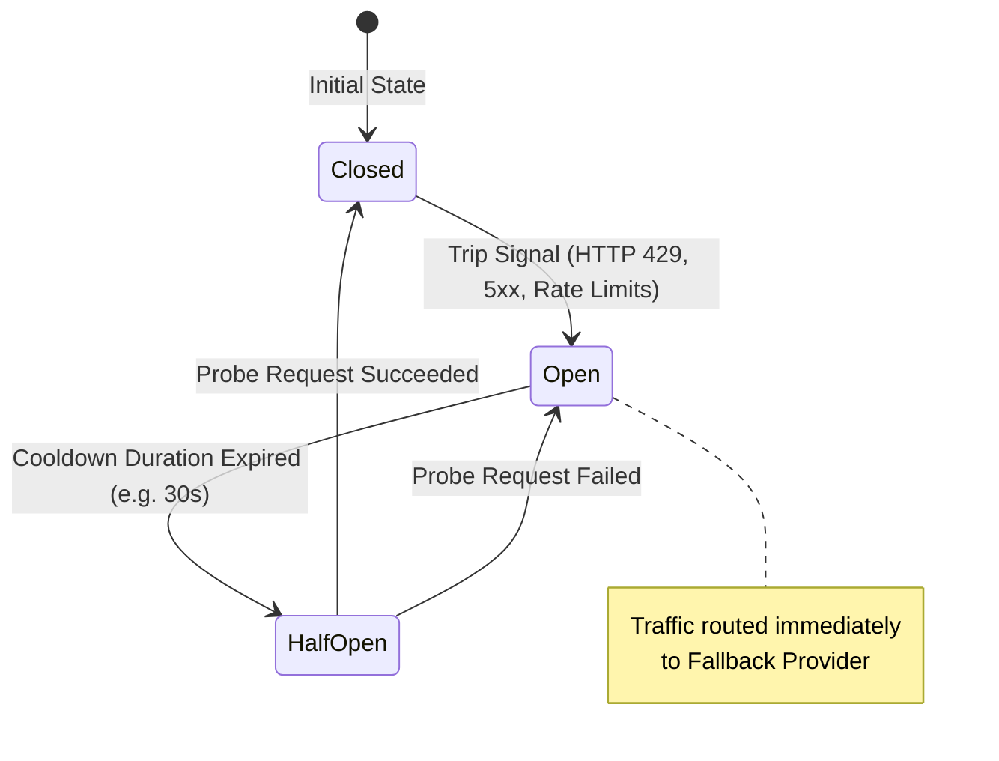
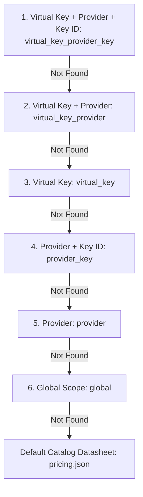

# UnifAI Models & Intelligent Routing Architecture — Complete Reference Guide

This document is the **definitive, production-grade guide** for all sub-modules under the **Models** section in the UnifAI Gateway:
1. **Model Providers** (`/workspace/providers`)
2. **Model Catalog** (`/workspace/model-catalog`)
3. **Budgets & Limits** (`/workspace/model-limits`)
4. **Complexity Router** (`/workspace/complexity-router`)
5. **Routing Rules** (`/workspace/routing-rules`)
6. **Circuit Breaker** (`/workspace/circuit-breaker`)
7. **Pricing Overrides** (`/workspace/custom-pricing/overrides`)
8. **Model Settings** (`/workspace/custom-pricing`)

Every section covers:
- **Architecture & System Flow**
- **Complete Parameters & Data Types**
- **Step-by-Step UI & API Operations**
- **Production cURL Commands & JSON Payloads**
- **Exhaustive Error Handling & Resolution Matrix**
- **Audit & Governance Compliance Tracking**

### Dedicated In-Depth Technical Guides
- 🛡️ **[Circuit Breaker Reference Guide](file:///d:/unifai_project/md/Circuit_Breaker.md)**
- 🧠 **[Complexity Router Reference Guide](file:///d:/unifai_project/md/Complexity_Router.md)**
- 🔀 **[Adaptive Routing & CEL Rules Guide](file:///d:/unifai_project/md/Adaptive_Routing.md)**
- 📊 **[Model Catalog & Limits Guide](file:///d:/unifai_project/md/Model_Catalog_Limits.md)**
- 💰 **[Custom Pricing & Overrides Guide](file:///d:/unifai_project/md/Custom_Pricing.md)**

---

## PostgreSQL Database Schema Mapping

| Sub-Module | UI Route | Database Table(s) | Primary Keys / Identifying Columns |
| :--- | :--- | :--- | :--- |
| **Model Providers** | `/workspace/providers` | `config_providers`, `config_keys` | `id`, `name`, `provider_id`, `key_id` |
| **Model Catalog** | `/workspace/model-catalog` | `governance_model_parameters`, `governance_model_pricing`, `config_models` | `model`, `provider`, `base_model` |
| **Budgets & Limits** | `/workspace/model-limits` | `governance_model_configs`, `governance_rate_limits` | `id`, `model_name`, `provider`, `rate_limit_id`, `budget_id` |
| **Complexity Router** | `/workspace/complexity-router` | `governance_config` | `key = 'complexity_analyzer_config'` |
| **Routing Rules** | `/workspace/routing-rules` | `routing_rules`, `routing_targets` | `id`, `rule_id`, `cel_expression`, `priority` |
| **Circuit Breaker** | `/workspace/circuit-breaker` | `circuit_breaker_policies` | `name` (PK), `primary_provider`, `fallback_provider` |
| **Pricing Overrides** | `/workspace/custom-pricing/overrides` | `governance_pricing_overrides` | `id`, `name`, `scope_kind`, `pattern` |
| **Model Settings** | `/workspace/custom-pricing` | `framework_configs`, `config_client` | `id`, `pricing_url`, `pricing_sync_interval` |

---

## Table of Contents

1. [High-Level Models & Routing Pipeline](#1-high-level-models--routing-pipeline)
2. [Section 1: Model Providers (`/workspace/providers`)](#2-section-1-model-providers)
3. [Section 2: Model Catalog (`/workspace/model-catalog`)](#3-section-2-model-catalog)
4. [Section 3: Budgets & Limits (`/workspace/model-limits`)](#4-section-3-budgets--limits)
5. [Section 4: Complexity Router (`/workspace/complexity-router`)](#5-section-4-complexity-router)
6. [Section 5: Routing Rules (`/workspace/routing-rules`)](#6-section-5-routing-rules)
7. [Section 6: Circuit Breaker & Health Failover (`/workspace/circuit-breaker`)](#7-section-6-circuit-breaker--health-failover)
8. [Section 7: Pricing Overrides (`/workspace/custom-pricing/overrides`)](#8-section-7-pricing-overrides)
9. [Section 8: Model Settings & Pricing Catalog (`/workspace/custom-pricing`)](#9-section-8-model-settings--pricing-catalog)
10. [SOC-2 Compliance & Audit Logs Reference](#10-soc-2-compliance--audit-logs-reference)

---

## 1. High-Level Models & Routing Pipeline

The Models subsystem in UnifAI provides multi-provider abstraction, unified model governance, dynamic cost calculation, rate-limiting, and intelligent request rerouting (via Google CEL expressions and Complexity Routing).



---

## 2. Section 1: Model Providers

**Route:** `/workspace/providers`  
**API Endpoints:** `GET /api/providers`, `GET /api/providers/{provider}`, `POST /api/providers`, `PUT /api/providers/{provider}`, `DELETE /api/providers/{provider}`

### 2.1 Purpose & Architecture
The **Model Providers** module manages upstream LLM API connections, provider credentials (API Keys, OAuth tokens, IAM Service Accounts), network transport settings, and concurrency worker pools.

UnifAI natively supports over 15 major AI providers:
* **Standard Cloud Providers**: OpenAI, Anthropic, AWS Bedrock, Google Vertex AI, Azure OpenAI, Groq, Mistral, Cohere, DeepSeek, Together AI, Perplexity, OpenRouter, Databricks.
* **Self-Hosted & Local**: Ollama, vLLM, LocalAI.
* **Custom Providers**: Any OpenAI-compatible or Anthropic-compatible custom inference server.

### 2.2 Provider Configuration Parameters

| Parameter | Type | Required | Description |
| :--- | :--- | :---: | :--- |
| `name` | `string` | **Yes** | Standard identifier (e.g. `openai`, `anthropic`, `bedrock`, `vertex_ai`, `azure`) or unique custom provider name. |
| `keys` | `array` | **Yes** | Pool of upstream API keys with optional weights, model restrictions, and key aliases. |
| `keys[].key` | `string` | **Yes** | Raw API key or environment reference (e.g. `env.OPENAI_API_KEY`). Encrypted at rest. |
| `keys[].weight` | `float` | No | Weight for probabilistic load balancing across keys (default: `1.0`). |
| `keys[].models` | `string[]` | No | List of models restricted to this specific key. Empty = all models. |
| `network_config.timeout` | `string` | No | HTTP request timeout for upstream calls (e.g. `60s`, `120s`). |
| `network_config.max_retries` | `integer` | No | Number of automatic retries on upstream network failures (default: `3`). |
| `network_config.retry_backoff` | `string` | No | Delay between retries (e.g. `500ms`, `2s`). |
| `concurrency_and_buffer_size.max_concurrency` | `integer` | No | Max parallel outbound connections to this provider. |
| `proxy_config` | `object` | No | Dedicated outbound HTTP/HTTPS/SOCKS5 proxy overriding global gateway proxy. |
| `custom_provider_config.base_url` | `string` | Conditional | Base API URL for custom providers (e.g. `http://localhost:11434/v1` or `https://internal-llm.corp.net`). |
| `custom_provider_config.base_provider_type` | `string` | Conditional | Compatibility protocol: `openai` or `anthropic`. |

### 2.3 Provider-Specific Credentials
* **AWS Bedrock**: Requires `region`, `access_key_id`, `secret_access_key`, and optional `session_token`.
* **Google Vertex AI**: Requires `project_id`, `region` (e.g. `us-central1`), and service account JSON credentials.
* **Azure OpenAI**: Requires `endpoint` (e.g. `https://my-resource.openai.azure.com/`), `api_version`, and deployment mapping.

### 2.4 Step-by-Step Operations Guide

#### Adding a Known Provider (e.g. Anthropic)
1. Navigate to `/workspace/providers`.
2. In the left sidebar, click **Add Provider** and select **Anthropic**.
3. Under **API Keys**, click **Add Key**.
4. Enter your Anthropic API Key (`sk-ant-api03-...`) or click **Use Environment Variable** (`env.ANTHROPIC_API_KEY`).
5. (Optional) Adjust **Network & Timeout** settings (default: 60s).
6. Click **Save Provider Configuration**.
7. The status changes to **Active** with a green badge.

#### Adding a Custom Provider (e.g. Local vLLM / Ollama)
1. Under **Add Provider**, click **Add Custom Provider**.
2. Enter **Provider Name** (e.g. `vllm-llama3`).
3. Set **Base Provider Type** to `openai`.
4. Enter **Base URL** (e.g. `http://192.168.1.50:8000/v1`).
5. Enter optional API Key (if authenticated) or leave blank for local setups.
6. Click **Save Provider**.

### 2.5 Practical Examples & Payloads

```bash
# Register an Anthropic provider with a weighted API key
curl --location --request POST 'http://localhost:3100/api/providers' \
  --header 'Content-Type: application/json' \
  --cookie cookies.txt \
  --data '{
    "provider": "anthropic",
    "keys": [
      {
        "key": "env.ANTHROPIC_API_KEY",
        "weight": 1.0,
        "models": ["claude-3-5-sonnet", "claude-3-haiku"]
      }
    ],
    "network_config": {
      "timeout": "60s",
      "max_retries": 3
    }
  }'
```

### 2.6 Error Handling & Troubleshooting

| Error Message | Exact Cause | How to Fix |
| :--- | :--- | :--- |
| `Provider already exists` | Attempted to create a provider that has already been registered. | Edit the existing provider in the sidebar or change the custom provider name. |
| `Provider model discovery failed: 401 Unauthorized` | The supplied API key is invalid, revoked, or lacks required permissions. | Check the API key in the provider's developer console and update it in `/workspace/providers`. |
| `Invalid provider type` | The provider name does not match known providers or custom specifications. | Choose from supported provider list or use Add Custom Provider. |
| `dial tcp ...: connect: connection refused` | Custom provider base URL is unreachable from the gateway host. | Verify the IP/port of the local model server (vLLM/Ollama) and ensure firewall allows inbound connections. |

---

## 3. Section 2: Model Catalog

**Route:** `/workspace/model-catalog`  
**API Endpoints:** `GET /api/models`, `GET /api/models/framework`, `PUT /api/models/catalog`

### 3.1 Purpose & Synchronization
The **Model Catalog** is the centralized registry of all AI models available through registered providers. It aggregates:
* Model identifiers and display names.
* Context window token capacity and max generation tokens.
* Model capability tags:
  * 🛠️ **Tools / Function Calling** (`supports_tools`)
  * 👁️ **Vision / Multimodal Image Input** (`supports_vision`)
  * 🧠 **Reasoning / Chain-of-Thought Tokens** (`supports_reasoning`)
  * 📋 **Structured Outputs (JSON Schema)** (`supports_structured_output`)



### 3.2 Model Attributes

| Field | Type | Description |
| :--- | :--- | :--- |
| `model` | `string` | Canonical model identifier (e.g. `gpt-4o`, `claude-3-5-sonnet`, `gemini-1.5-pro`). |
| `provider` | `string` | Target provider (e.g. `openai`, `anthropic`, `vertex_ai`). |
| `display_name` | `string` | Human-readable name. |
| `context_window` | `integer` | Total maximum tokens (Prompt + Completion). |
| `max_output_tokens` | `integer` | Maximum completion tokens allowed per single generation. |
| `supports_tools` | `boolean` | Allows OpenAI/Anthropic tool calling schemas. |
| `supports_vision` | `boolean` | Accepts image URLs and base64 images in user message parts. |
| `supports_reasoning`| `boolean` | Supports reasoning effort parameters (e.g. OpenAI o1/o3-mini). |

### 3.3 Practical Example: Querying the Catalog via cURL

```bash
curl --location 'http://localhost:3100/api/models' \
  --cookie cookies.txt
```

### 3.4 Error Handling & Troubleshooting

| Error Message | Exact Cause | How to Fix |
| :--- | :--- | :--- |
| `Model not found in catalog: xyz` | The model requested in `/v1/chat/completions` is not registered under any active provider. | Add the provider key that supports the model or configure an alias in Routing Rules. |
| `Model does not support vision: [image payload provided]` | A multimodal image was sent to a text-only model. | Route the request to a model with the vision badge (e.g. `gpt-4o`, `claude-3-5-sonnet`). |
| `Requested max_tokens exceeds model capacity` | Completion tokens parameter exceeds `max_output_tokens`. | Reduce `max_tokens` in client prompt payload to fit within model bounds. |

---

## 4. Section 3: Budgets & Limits

**Route:** `/workspace/model-limits`  
**API Endpoints:** `GET /api/governance/model-configs`, `POST /api/governance/model-configs`, `GET /api/governance/budgets`, `POST /api/governance/budgets`, `GET /api/governance/rate-limits`, `POST /api/governance/rate-limits`

### 4.1 Architecture & Enforcement
UnifAI provides granular spend and throughput protection:
* **Rate Limits**:
  * **RPM (Requests Per Minute)**: Sliding 60-second window limiting simultaneous calls.
  * **TPM (Tokens Per Minute)**: Sliding 60-second window limiting aggregate prompt and completion tokens.
* **Spending Budgets**:
  * **Spend Caps ($ USD)**: Real-time cost accumulation based on exact token usage.
  * **Reset Cadence**: `daily`, `weekly`, `monthly`, or `total` (lifetime hard cap).
  * **Calendar-Aligned vs. Sliding**: Option to align resets with calendar month boundaries (1st of every month at 00:00 UTC).
  * **Soft Alert vs. Hard Block**: Configurable percentage thresholds triggering alert notifications before reaching 100% hard block.



### 4.2 Configuration Parameters

| Parameter | Type | Default | Description |
| :--- | :--- | :--- | :--- |
| `model` | `string` | `null` | Target model name or `*` for all models under provider. |
| `provider` | `string` | `null` | Target provider name or `*` for all providers. |
| `max_budget` | `float` | `null` | Maximum allowed spend in USD. |
| `budget_duration` | `string` | `monthly` | Reset period: `daily`, `weekly`, `monthly`, `total`. |
| `calendar_aligned` | `boolean` | `true` | Resets on the first calendar day of the cycle. |
| `soft_limit_percent`| `float` | `80.0` | Alert threshold triggering notifications without blocking traffic. |
| `tpm_limit` | `integer` | `null` | Tokens per minute ceiling. |
| `rpm_limit` | `integer` | `null` | Requests per minute ceiling. |

### 4.3 Setting a Budget via cURL

```bash
curl --location --request POST 'http://localhost:3100/api/governance/budgets' \
  --header 'Content-Type: application/json' \
  --cookie cookies.txt \
  --data '{
    "max_budget": 500.00,
    "budget_duration": "monthly",
    "calendar_aligned": true,
    "soft_limit_percent": 85.0
  }'
```

### 4.4 Error Handling & Troubleshooting

| Error Message | Exact Cause | How to Fix |
| :--- | :--- | :--- |
| `429 Rate limit exceeded: TPM limit reached` | Client generated tokens faster than the configured Tokens-Per-Minute limit. | Implement exponential backoff in client application or increase TPM limit in `/workspace/model-limits`. |
| `429 Budget exceeded: Monthly spend cap reached` | Aggregate inference spend reached 100% of the allocated budget. | Increase `max_budget` in `/workspace/model-limits` or call `POST /api/governance/budgets/{id}/reset` to reset spend counter. |
| `Budget cannot be negative` | A negative dollar amount was entered in the budget field. | Enter a positive floating-point number (e.g. `250.00`). |

---

## 5. Section 4: Complexity Router

**Route:** `/workspace/complexity-router`  
**API Endpoints:** `GET /api/governance/complexity-analyzer-config`, `PUT /api/governance/complexity-analyzer-config`, `POST /api/governance/complexity-analyzer-config/reset`

### 5.1 Architecture & Token Cost Optimization
The **Complexity Router** evaluates user prompts in real time (within 1-2 milliseconds) to determine intellectual difficulty, domain specificity, and reasoning intensity.

It maps incoming queries into 3 discrete tiers:
1. **Simple** (Score $< 0.15$): Greetings, basic factual questions, short summaries, spell checking.
   * *Target Model*: Small, fast, inexpensive models (e.g. `gpt-4o-mini`, `claude-3-haiku`, `llama-3-8b`). Cost reduction: ~90%.
2. **Medium** (Score $0.15 \le s < 0.35$): Standard coding questions, text translations, content drafting, routine data extraction.
   * *Target Model*: Balanced models (e.g. `gpt-4o`, `claude-3-5-sonnet`).
3. **Complex** (Score $\ge 0.35$): Multi-file system architecture, distributed consensus, math proofs, deep debugging, root-cause postmortems.
   * *Target Model*: Frontier reasoning models (e.g. `o1`, `o3-mini`, `claude-3-opus`).



### 5.2 Configuration Parameters

| Category | Parameter | Default | Description |
| :--- | :--- | :--- | :--- |
| **Tier Boundaries** | `simple_medium` | `0.15` | Cutoff score separating Simple from Medium. |
| **Tier Boundaries** | `medium_complex` | `0.35` | Cutoff score separating Medium from Complex. |
| **Tier Boundaries** | `complex_reasoning` | `0.60` | Frontier threshold triggering heavy reasoning engines. |
| **Keywords** | `code_keywords` | 50+ items | Terms indicating software development (e.g. `function`, `api`, `database`, `docker`, `sql`, `refactor`). |
| **Keywords** | `reasoning_keywords`| 15+ items | Terms indicating analytical reasoning (e.g. `step by step`, `think through`, `tradeoffs`, `root cause`). |
| **Keywords** | `technical_keywords`| 60+ items | Terms indicating complex systems (e.g. `distributed`, `kubernetes`, `concurrency`, `consensus`, `soc 2`). |
| **Keywords** | `simple_keywords` | 20+ items | Terms indicating lightweight tasks (e.g. `what is`, `hello`, `define`, `translate`, `brief`). |

### 5.3 Step-by-Step Operations Guide
1. Navigate to `/workspace/complexity-router`.
2. Inspect the **Tier Boundaries** sliders.
3. If your organization handles technical code that is being categorized as complex too eagerly, raise `medium_complex` to `0.45`.
4. To add custom proprietary terminology (e.g. your internal SDK name `unifai-client`), click **Add Keyword** under `technical_keywords`.
5. Click **Save Complexity Configuration**.
6. (Optional) Click **Reset to Defaults** at any time to restore factory weights.

### 5.4 Error Handling & Troubleshooting

| Error Message | Exact Cause | How to Fix |
| :--- | :--- | :--- |
| `Tier boundary order invalid` | `simple_medium` was configured greater than or equal to `medium_complex`. | Ensure thresholds follow strict inequality: `simple_medium < medium_complex < complex_reasoning`. |
| `Keywords array cannot be empty` | All keywords were deleted from a category. | Maintain at least one keyword per category or click **Reset to Defaults**. |

---

## 6. Section 5: Routing Rules

**Route:** `/workspace/routing-rules`  
**API Endpoints:** `GET /api/governance/routing-rules`, `POST /api/governance/routing-rules`, `PUT /api/governance/routing-rules/{id}`, `DELETE /api/governance/routing-rules/{id}`

### 6.1 Google CEL Engine & Rule Evaluation
Routing Rules in UnifAI use **Google Common Expression Language (CEL)**. Rules are compiled into bytecode and evaluated in microseconds before each inference call.

### 6.2 CEL Context Variables

| Variable | Type | Example | Description |
| :--- | :--- | :--- | :--- |
| `model` | `string` | `"gpt-4o"` | The model requested by the client application. |
| `provider` | `string` | `"openai"` | Upstream provider identifier. |
| `request_type` | `string` | `"chat_completion"` | Operation type: `chat_completion` or `embedding`. |
| `headers["<name>"]` | `string` | `headers["x-department"]` | Lowercase incoming HTTP header value. |
| `complexity_tier` | `string` | `"complex"` | Output from Complexity Router: `simple`, `medium`, `complex`. |
| `budget_used` | `float` | `82.5` | Percentage of budget consumed for this key/team. |
| `virtual_key_name` | `string` | `"mobile-app-prod"` | Calling Virtual Key name. |

### 6.3 Rule Targets: Single vs. Weighted Load Balancing
A routing rule can direct traffic to:
1. **Direct Model/Provider Override**: Replace `gpt-4o` with `claude-3-5-sonnet`.
2. **Weighted Load Balancing**: Distribute calls across multiple targets (e.g., 70% `openai/gpt-4o` and 30% `anthropic/claude-3-5-sonnet`).
3. **Fallback Priority Chain**: If Target 1 fails or returns 429, seamlessly failover to Target 2.

### 6.4 Practical CEL Examples

```cel
// Example 1: Route heavy analytical queries to frontier reasoning model
complexity_tier == "complex" && request_type == "chat_completion"

// Example 2: Client header-based routing for Enterprise VIP tenants
headers["x-client-tier"] == "enterprise-vip"

// Example 3: Budget preservation failover when spend exceeds 80%
budget_used > 80.0 && model == "gpt-4o"
```

### 6.5 Adding a Routing Rule via cURL

```bash
curl --location --request POST 'http://localhost:3100/api/governance/routing-rules' \
  --header 'Content-Type: application/json' \
  --cookie cookies.txt \
  --data '{
    "name": "Enterprise High-Priority Routing",
    "description": "Route enterprise tenants to Claude 3.5 Sonnet",
    "cel_expression": "headers[\"x-tenant-type\"] == \"enterprise\"",
    "enabled": true,
    "priority": 1,
    "targets": [
      {
        "provider": "anthropic",
        "model": "claude-3-5-sonnet",
        "weight": 1.0
      }
    ]
  }'
```

### 6.6 Error Handling & Troubleshooting

| Error Message | Exact Cause | How to Fix |
| :--- | :--- | :--- |
| `CEL expression compilation error: undeclared reference to 'xyz'` | The expression uses a variable that does not exist in the CEL context. | Check variable spelling against the CEL Context Variables table (e.g. use `headers["x-custom"]`, not `custom_header`). |
| `Target provider is not active` | The rule directs traffic to a provider that has not been configured in `/workspace/providers`. | Configure and activate the target provider before enabling the routing rule. |
| `Rule priorities must be unique positive integers` | Two rules share the same priority order number. | Assign distinct sequential priority numbers (1, 2, 3...). |

---

## 7. Section 6: Circuit Breaker & Health Failover

**Route:** `/workspace/circuit-breaker`  
**API Endpoints:** `GET /api/circuit-breaker/policies`, `POST /api/circuit-breaker/policies`, `PUT /api/circuit-breaker/policies/{name}`, `DELETE /api/circuit-breaker/policies/{name}`, `GET /api/circuit-breaker/state`, `POST /api/circuit-breaker/policies/{name}/reset`

### 7.1 Architecture & State Machine
The **Circuit Breaker** continuously tracks upstream provider health to eliminate client-facing cascading failures.



### 7.2 Configuration Parameters

| Parameter | Type | Required | Description |
| :--- | :--- | :---: | :--- |
| `name` | `string` | **Yes** | Unique policy name (e.g. `openai-gpt4o-fallback`). |
| `enabled` | `boolean` | **Yes** | Policy status. |
| `primary_provider` | `string` | **Yes** | Monitored primary provider (e.g. `openai`). |
| `primary_model` | `string` | No | Specific model or empty for all provider models. |
| `fallback_provider`| `string` | **Yes** | Destination provider during trips (e.g. `anthropic`). |
| `fallback_model` | `string` | No | Destination model (e.g. `claude-3-5-sonnet`). |
| `condition.operator` | `string` | **Yes** | `AND` or `OR` logic across signals. |
| `condition.signals` | `array` | **Yes** | Header signals monitored (e.g. `x-ratelimit-remaining-tokens`, `retry-after`). |
| `default_cooldown` | `string` | **Yes** | Cooldown time before attempting recovery (e.g. `30s`, `1m`, `5m`). |

### 7.3 Error Handling & Troubleshooting

| Error Message | Exact Cause | How to Fix |
| :--- | :--- | :--- |
| `Primary and Fallback providers cannot be identical` | Fallback provider was configured to be the same as primary. | Select an alternative provider (e.g. if Primary is OpenAI, set Fallback to Anthropic or Vertex AI). |
| `Invalid cooldown duration format` | Cooldown entered with invalid unit (e.g. `30` instead of `30s`). | Use valid Go duration strings: `30s`, `1m`, `2m30s`. |
| `Circuit is OPEN: failover active` | Upstream provider tripped the circuit policy. | Inspect `/workspace/circuit-breaker` for real-time state. To force immediate recovery, click **Reset Circuit**. |

---

## 8. Section 7: Pricing Overrides

**Route:** `/workspace/custom-pricing/overrides`  
**API Endpoints:** `GET /api/governance/pricing-overrides`, `POST /api/governance/pricing-overrides`, `PUT /api/governance/pricing-overrides/{id}`, `DELETE /api/governance/pricing-overrides/{id}`

### 8.1 6-Tier Scoped Pricing Hierarchy
Token pricing calculation strictly respects the following resolution order:



### 8.2 Configuration Parameters

| Parameter | Type | Required | Description |
| :--- | :--- | :---: | :--- |
| `model` | `string` | **Yes** | Model identifier or wildcard pattern (e.g. `gpt-*`, `claude-*`). |
| `match_type` | `string` | **Yes** | `exact` (matches specific model) or `wildcard` (prefix match). |
| `input_price_per_million` | `float` | **Yes** | Cost per 1,000,000 prompt tokens ($ USD). |
| `output_price_per_million`| `float` | **Yes** | Cost per 1,000,000 completion tokens ($ USD). |
| `cache_read_input_token_price` | `float` | No | Discounted cost per 1M prompt tokens served from cache. |
| `fixed_request_fee` | `float` | No | Surcharge fee added per individual HTTP request. |

### 8.3 Creating a Wildcard Pricing Override via cURL

```bash
curl --location --request POST 'http://localhost:3100/api/governance/pricing-overrides' \
  --header 'Content-Type: application/json' \
  --cookie cookies.txt \
  --data '{
    "model": "gpt-4o*",
    "match_type": "wildcard",
    "input_price_per_million": 2.50,
    "output_price_per_million": 10.00,
    "cache_read_input_token_price": 1.25,
    "fixed_request_fee": 0.001
  }'
```

### 8.4 Error Handling & Troubleshooting

| Error Message | Exact Cause | How to Fix |
| :--- | :--- | :--- |
| `Price values cannot be negative` | A negative cost was entered for prompt or completion tokens. | Enter positive numeric values $\ge 0.0$. |
| `Duplicate pricing override collision` | An override already exists for the identical scope, model, and match type. | Edit the existing override row instead of creating a duplicate. |

---

## 9. Section 8: Model Settings & Pricing Catalog

**Route:** `/workspace/custom-pricing`  
**API Endpoints:** `GET /api/pricing/models`, `POST /api/pricing/force-sync`, `PUT /api/models/catalog`

### 9.1 Overview & Catalog Sync
The **Model Settings** page maintains base pricing datasheets, regional currency multipliers, and automated synchronization with upstream pricing index files (`file:///app/configs/pricing.json`).

### 9.2 Operations
* **Force Sync**: Click **Force Pricing Sync** to pull the latest official upstream pricing records immediately.
* **Batch Update Attributes**: Modify contextual tags, regional cost multipliers, or vendor discounts in bulk.

---

## 10. SOC-2 Compliance & Audit Logs Reference

All administrative operations across the Models module automatically write structured records to the **Governance Audit Logs** (`/workspace/audit-logs`):

| Action | Event Type | Target Entity | Audit Payload Details |
| :--- | :--- | :--- | :--- |
| Create / Update Provider | `provider.update` | Provider name | Encrypted key hashes, timeout settings. |
| Add / Delete Budget | `governance.budget_change` | Budget ID | Max dollar cap, duration, calendar alignment. |
| Update Complexity Weights | `complexity_router.update` | Config | Boundary cutoffs and keyword adjustments. |
| Mutate Routing Rule | `routing_rule.mutate` | Rule ID | CEL expression string, priority, and target weights. |
| Trip / Reset Circuit Breaker | `circuit_breaker.state_change` | Circuit name | Transition (`closed` $\to$ `open`), cooldown duration. |
| Upsert Pricing Override | `pricing_override.upsert` | Override ID | Scopes, token rates per million. |

*(End of Models Reference Guide)*
