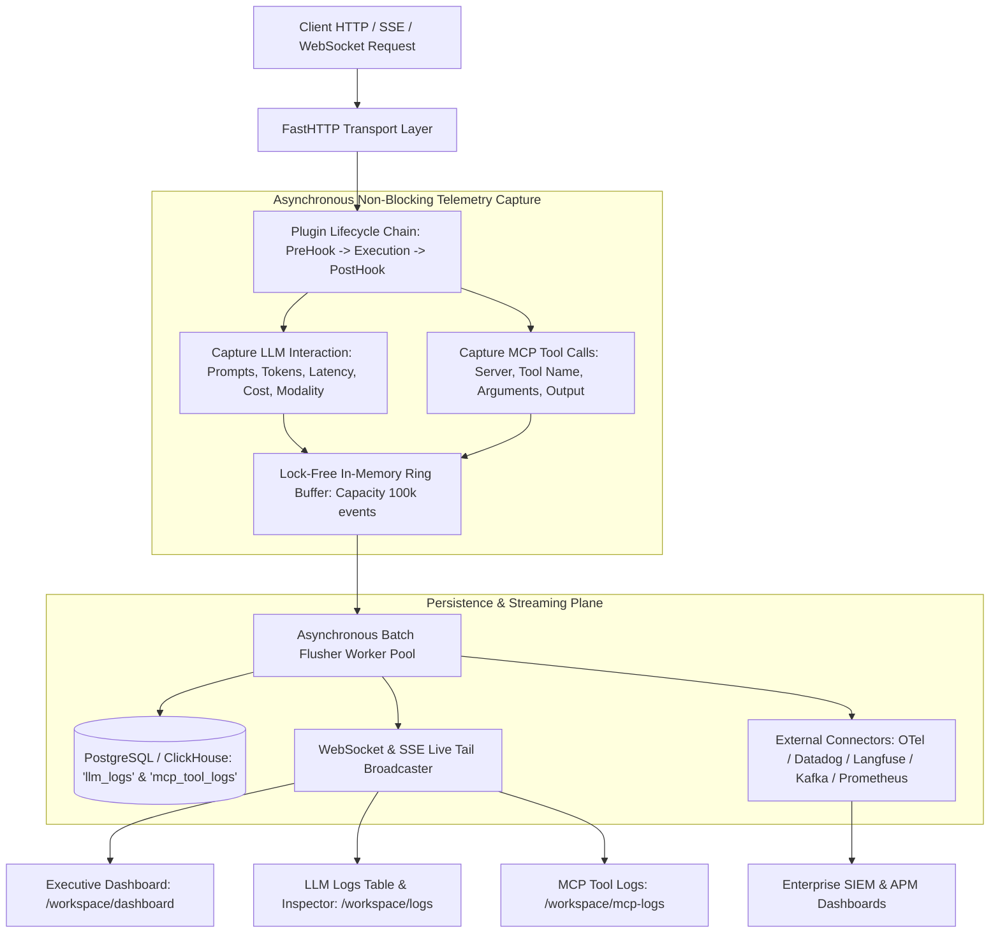
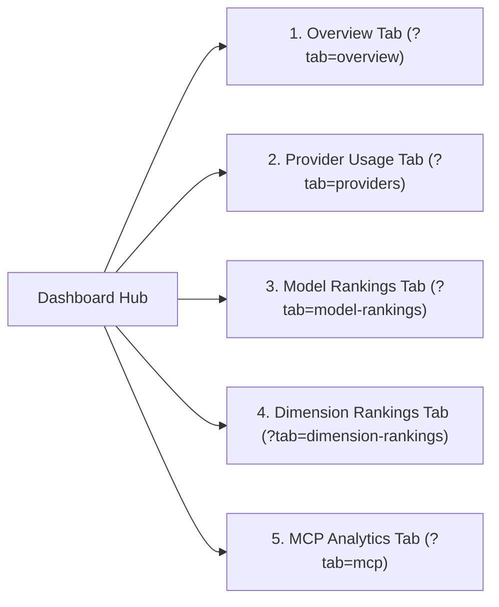
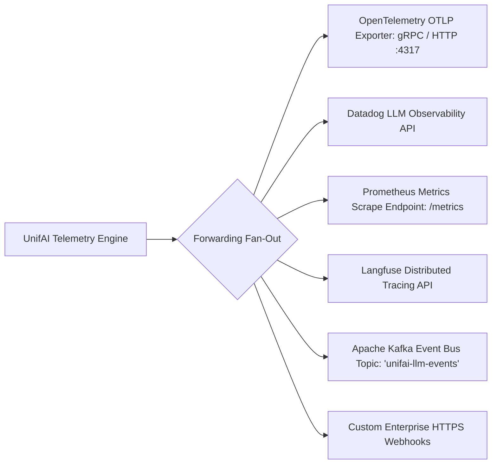

# UnifAI Observability, Dashboard, LLM Logs & MCP Tool Logs Architecture

This document provides a comprehensive, production-grade technical specification of the **Observability, Executive Dashboard, LLM Request Logs, and Model Context Protocol (MCP) Tool Logs** subsystems within the UnifAI Enterprise AI Gateway. It details the complete analytical dashboard (all 5 tabs, 13 charts, and export engines), the high-throughput virtualized LLM log table, multi-modal payload inspection drawers (Chat, Image, Audio, Transcription, Video, OCR, Plugin traces), MCP tool execution tracking, enterprise telemetry connectors (OTel, Datadog, Prometheus, Langfuse, Kafka), complete UI workspace documentation (all buttons, sheets, and filters), database schemas, and REST APIs.

---

## 1. System Overview & Telemetry Pipeline

The UnifAI Observability subsystem provides sub-millisecond, non-blocking telemetry ingestion, distributed trace tracking, real-time analytics, and forensic auditing across every artificial intelligence interaction flowing through the gateway.



---

## 2. UI Deep Dive: Executive Analytics Dashboard (`/workspace/dashboard`)

The Executive Dashboard provides aggregated business intelligence, financial tracking, latency distributions, and usage analytics across all models, providers, teams, and MCP servers.

### 2.1. Global Filter Sidebar & Live Polling Controls (`LogsFilterSidebar`)
The left filter sidebar operates across all 5 dashboard tabs with instant query state updates (`nuqs` URL synchronization):
* **Time Range Selector (`DateTimePickerWithRange`)**:
  * Quick Periods: `1h` (Last Hour), `24h` (Last 24 Hours), `7d` (Last 7 Days), `30d` (Last 30 Days).
  * Custom Range: Start timestamp and end timestamp pickers with calendar widget.
* **Timezone Preference Combobox (`useTimezonePreference`)**: Displays metrics in `Local Browser Time` or `UTC`.
* **Live Polling Toggle Switch (`<Switch id="dashboard-polling" />`)**:
  * Renders a pulsing green radio dot icon (`Radio`) when active.
  * Polls aggregated metrics every 10 seconds automatically.
* **Manual Refresh Button (`button#btn-refresh-dashboard`)**: Spins `RefreshCw` icon and refetches data.
* **Filter Controls**:
  * **Virtual Keys Multiselect**: Filters dashboard to specific client API keys.
  * **Providers Multiselect**: Filters by `OpenAI`, `Anthropic`, `Google Vertex AI`, `AWS Bedrock`, `Azure OpenAI`, `Groq`, `Ollama`, etc.
  * **Models Multiselect**: Filters by specific model identifiers.
  * **Objects / Modality Multiselect**: Filters by `chat.completion`, `embedding`, `image`, `speech`, `transcription`, `video`, `ocr`.
  * **Status Multiselect**: Filters by HTTP codes (`200 OK`, `400 Bad Request`, `429 Rate Limit`, `500 Server Error`).
  * **Routing Rules & Routing Engine Multiselect**: Isolates traffic routed through specific rule trees or Complexity Router.
  * **Stop Reasons Multiselect**: `stop`, `length`, `content_filter`, `tool_calls`.
  * **Missing Cost Only Toggle Switch**: Isolates unbilled or custom models needing price configuration.
  * **Metadata JSON Filter Textarea**: Queries custom enterprise metadata tags.
* **Automated Log Deletion Control (`LogsAutoDeleteControl`)**: Configures auto-retention cleanup schedules (e.g., auto-purge raw payloads older than 30, 60, or 90 days).
* **Export Popover (`ExportPopover`)**:
  * **Export CSV**: Downloads raw time-series metrics formatted for Excel.
  * **Export JSON**: Downloads structured RFC 8259 metric payloads.
  * **Export High-Res PNG**: Generates high-definition image of active charts.
  * **Export PDF Report**: Compiles executive PDF presentation pack.

---

### 2.2. The 5 Executive Dashboard Tabs



#### Tab 1: Overview Tab (`overviewTabView.tsx`)
1. **Top KPI Metric Cards**:
   * **Total Requests**: Cumulative volume of inference calls (e.g., `1.42M`) with percentage growth delta compared to preceding timeframe.
   * **Total Tokens Processed**: Sum of prompt, completion, and cached tokens (e.g., `894.2M Tokens`).
   * **Total Expenditure ($)**: Cumulative USD spend calculated via the 6-tier pricing engine (e.g., `$3,420.58`).
   * **Average Latency**: Average round-trip time in milliseconds (e.g., `420ms`).
   * **Cache Hit Rate**: Percentage of input tokens served from memory or upstream prompt cache (e.g., `38.4%`).
2. **Interactive Visual Charts**:
   * **Log Volume Chart (`logVolumeChart.tsx`)**: Area / Bar / Line toggle (`chartTypeToggle.tsx`). Tracks request throughput over time.
   * **Token Usage Chart (`tokenUsageChart.tsx`)**: Stacked chart comparing Uncached Prompt Tokens, Cached Read Tokens, Cache Creation Tokens, Completion Tokens, and Reasoning Tokens.
   * **Cost Accumulation Chart (`costChart.tsx`)**: Tracks hourly/daily dollar spend trajectory with model filter dropdown (`modelFilterSelect.tsx`).
   * **Latency Distribution Chart (`latencyChart.tsx`)**: Visualizes P50 (Median), P90, and P99 latency percentiles to identify upstream provider degradations.
   * **Model Usage Breakdown Chart (`modelUsageChart.tsx`)**: Donut/bar chart illustrating market share of individual models.
   * **Cache Token Meters (`localCacheTokenMeterChart.tsx`, `externalCacheTokenMeterChart.tsx`)**: Radial gauge meters showing tokens saved via local semantic caching vs. provider-side prompt caching.

#### Tab 2: Provider Usage Tab (`providerUsageTabView.tsx`)
* **Provider Cost Comparison Chart (`providerCostChart.tsx`)**: Compares enterprise expenditure across vendors (e.g., Azure vs. OpenAI direct vs. AWS Bedrock).
* **Provider Token Volume Chart (`providerTokenChart.tsx`)**: Ingested and generated tokens per vendor.
* **Provider Latency Benchmarking Chart (`providerLatencyChart.tsx`)**: Head-to-head TTFT (Time to First Token) and total latency comparison.
* **Provider Health & Error Matrix**: Tabular breakdown of HTTP 200 success rates, 429 rate-limit counts, 5xx server errors, and active circuit breaker states per provider.

#### Tab 3: Model Rankings Tab (`modelRankingsTabView.tsx`)
* Ranks enrolled models by:
  * **Top Models by Spend ($)**.
  * **Top Models by Request Volume**.
  * **Top Models by Token Consumption**.
  * **Fastest Models by TTFT**.
* **Model Efficiency Score**: Computes output tokens per dollar spent to guide model migration decisions.

#### Tab 4: Dimension Rankings Tab (`dimensionRankingsTabView.tsx`)
* Multidimensional enterprise attribution tables:
  * **Rankings by Team**: Identifies highest spending internal business units and teams.
  * **Rankings by Customer**: B2B customer spend and API quota consumption.
  * **Rankings by Virtual Key**: Pinpoints top automated microservices and developer keys.
  * **Rankings by End User**: Profiles top individual prompt submitters.

#### Tab 5: MCP Analytics Tab (`mcpTabView.tsx`)
* **MCP Tool Call Volume Chart (`mcpVolumeChart.tsx`)**: Overall tool execution rate across all registered MCP servers.
* **MCP Execution Cost Chart (`mcpCostChart.tsx`)**: Upstream LLM token costs specifically incurred during autonomous tool execution turns.
* **Top Invoked Tools Chart (`mcpTopToolsChart.tsx`)**: Bar chart ranking external tools (e.g., `execute_sql`, `search_github_issues`, `read_file`, `send_slack_message`).

---

## 3. UI Deep Dive: High-Throughput LLM Logs (`/workspace/logs`)

The LLM Logs console (`/workspace/logs`) provides a high-density, real-time investigative table capable of rendering millions of inference events with instant search, multi-modal payload inspection, and token economics breakdowns.

### 3.1. Action Bar & Table Controls (`logsHeaderView.tsx`)
* **Mini Volume Histogram Chart (`logsVolumeChart.tsx`)**: Renders a time-series histogram at the top of the screen showing traffic volume and error spikes.
* **Full-Text Content Search Input (`input#logs-search`)**: Searches across prompts, model responses, user emails, IP addresses, and metadata.
* **Live Tail Toggle Switch (`<Switch id="logs-live-tail" />`)**: Enables streaming real-time log ingestion via WebSocket/SSE.
* **Export Button (`logsExportButton.tsx`)**: Exports currently filtered log rows as CSV or JSON.
* **Column Visibility Dropdown**: Allows toggling visibility of any column.
* **Draggable Column Headers (`DraggableColumnHeader`)**: Users can drag and reorder columns across the table.
* **Column Pinning (`usePinOffsets`, `PIN_SHADOW_LEFT`, `PIN_SHADOW_RIGHT`)**: Pin critical columns (e.g., Status and Model) to the left, and action buttons to the right.

---

### 3.2. LLM Logs Data Table Columns (`logsTable.tsx`)
1. **Status Code**: Color-coded status badge:
   * `200 OK` (Green badge).
   * `400 Bad Request` (Amber badge).
   * `429 Rate Limited / Budget Exceeded` (Orange badge).
   * `500 / 503 Upstream Failure` (Red badge).
2. **Timestamp**: Local and UTC formatted timestamp (`YYYY-MM-DD HH:mm:ss.SSS`) with relative age tooltip.
3. **Model**:
   * Displays the requested model alias (e.g., `gpt-4o`) and, if routed or modified by a routing rule, shows the actual destination model (e.g., `azure/gpt-4o-eastus`).
4. **Provider**: Upstream provider icon and name (e.g., `OpenAI`, `Anthropic`, `Bedrock`).
5. **Virtual Key**: Key name and masked prefix (e.g., `Prod-Chatbot (uf-live-8a...)`).
6. **Modality / Request Type**: Badge indicating nature of request:
   * `chat.completion`
   * `text.completion`
   * `embedding`
   * `image.generation`
   * `speech.tts`
   * `audio.transcription`
   * `video.generation`
   * `ocr`
7. **Latency**:
   * Time to First Token (TTFT) in milliseconds (e.g., `140ms`).
   * Total Request Latency (e.g., `1,250ms`).
8. **Tokens**:
   * Prompt Tokens (with cached read indicator).
   * Completion Tokens (with reasoning token breakdown).
   * Total Tokens.
9. **USD Cost**: Computed dollar cost (e.g., `$0.004218`).
10. **User / Team**: Corporate email address and assigned enterprise team.
11. **Routing Rule / Engine**: Identifies if the request was routed via `Complexity Router` or specific `Routing Rule`.
12. **Actions Column**:
    * **View Full Details Button (`button#btn-view-log-details-{id}`)**: Slides out the Log Inspection Drawer.

---

### 3.3. Multi-Modal Log Inspection Drawer (`logDetailsSheet.tsx`, `logDetailView.tsx`)

Clicking any row opens a full-height inspection drawer with specialized sub-views based on request modality:

#### Sub-View 1: Chat Completion Message Viewer (`logChatMessageView.tsx`)
* Renders the complete, turn-by-turn conversation tree with role badges:
  * `system` (Gray badge): Foundational instructions and injected Skill markdown.
  * `user` (Blue badge): User input prompts.
  * `assistant` (Purple badge): Model completion response with markdown formatting, syntax-highlighted code blocks, and copy-code buttons.
  * `tool` / `function` (Orange badge): Tool call invocations showing function name, JSON arguments, and collapsible tool output payloads (`CollapsibleBox.tsx`).
* **Multi-Modal File Attachments (`LogChatFileBlockView`)**:
  * Detects base64 file payloads, PDFs, and images attached to chat messages.
  * Displays file title, MIME type, decoded file size (Bytes, KB, MB).
  * **Download File Button (`downloadFileData`)**: One-click download of the exact uploaded artifact.

#### Sub-View 2: Image Generation & Edit Viewer (`imageView.tsx`)
* Renders generated or edited images for DALL-E, Stable Diffusion, and Imagen.
* Displays resolution (`1024x1024`, `1024x1792`), format (`png`, `webp`), quality (`standard`, `hd`), original prompt, and revised prompt.
* Includes one-click image download button.

#### Sub-View 3: Audio TTS Player (`audioPlayer.tsx`, `speechView.tsx`)
* Built-in interactive waveform audio player for Text-to-Speech (TTS) models (e.g., OpenAI `tts-1`, ElevenLabs).
* Displays voice identifier (e.g., `alloy`, `echo`, `shimmer`), audio format (`mp3`, `opus`, `aac`), duration, and speed modifier.

#### Sub-View 4: Speech-to-Text Transcription Viewer (`transcriptionView.tsx`)
* Displays STT transcribed text from audio files (e.g., Whisper).
* Includes word-level timestamps, language detection confidence, and audio duration metadata.

#### Sub-View 5: Video Player (`videoView.tsx`)
* Embedded video player for video generation models (e.g., Sora, Runway Gen-3).
* Displays frame rate (FPS), duration, resolution (`720p`, `1080p`), and seed.

#### Sub-View 6: OCR Document Viewer (`ocrView.tsx`)
* Displays extracted OCR text alongside document layout coordinates and confidence scores.

#### Sub-View 7: Plugin Execution Traces (`pluginLogsView.tsx`)
* Displays a sequential trace of every plugin executed in the gateway chain:
  * Plugin Name (e.g., `governance`, `guardrails`, `prompts`, `custom_siem`).
  * Execution Phase (`PreHook`, `PostHook`, `StreamHook`).
  * Execution Latency in microseconds.
  * Context modifications (e.g., tokens redacted, headers injected).

#### Additional Drawer Tabs
* **Token Economics Tab**: Detailed mathematical breakdown:
  * Uncached Input Tokens ($\times R_{\text{input}}$).
  * Cached Read Tokens ($\times R_{\text{cache\_read}}$).
  * Cache Creation Tokens ($\times R_{\text{cache\_write}}$).
  * Output Completion Tokens ($\times R_{\text{output}}$).
  * Margin Markup Percentage applied.
* **HTTP Headers Tab**: Raw client request headers vs. upstream provider headers (`cf-ray`, `x-ratelimit-remaining-tokens`, `openai-organization`).
* **Session Thread Viewer (`sessionDetailsSheet.tsx`)**: Reconstructs the entire multi-turn session history chronologically.
* **Observability Settings (`observabilityConfigSheet.tsx`, `observabilitySettingsSheet.tsx`)**: Configures payload retention policies, data masking rules, and sampling rates.

---

## 4. UI Deep Dive: MCP Tool Logs (`/workspace/mcp-logs`)

The MCP Tool Logs console tracks every tool execution invoked by autonomous AI agents and LLMs communicating through the Model Context Protocol Gateway.

### 4.1. Header & Filter Sidebar (`MCPFilterSidebar`)
* **Time Range Selector**: Quick timeframes and custom dates.
* **MCP Server Labels Multiselect**: Filters by registered MCP server (e.g., `postgres-db`, `github-tools`, `filesystem-server`).
* **Tool Names Multiselect**: Filters by tool function (e.g., `execute_sql`, `create_pull_request`).
* **Execution Status Multiselect**: Filters by `Success`, `Failed`, `Timeout`, `Denied by Policy`.
* **Virtual Key & User Multiselect**: Attribution filters.
* **Content Search Input (`content_search`)**: Searches within tool arguments and output responses.
* **Mini Volume Histogram Chart (`LogsVolumeChart`)**: Tracks tool invocation frequency and error bursts.
* **Export Button (`McpLogsExportButton`)**: Exports tool execution logs as CSV/JSON.

---

### 4.2. MCP Tool Logs Data Table (`mcpLogsTable.tsx`)
1. **Status**:
   * `Success` (Green checkmark icon).
   * `Failed` (Red alert circle icon).
   * `Processing` (Spinning loader icon).
2. **Timestamp**: Local and UTC execution time.
3. **MCP Server**: Display name of the upstream MCP server (e.g., `GitHub MCP Server`).
4. **Tool Name**: Specific tool invoked (e.g., `get_issue_comments`).
5. **Duration (ms)**: Execution latency of the tool call.
6. **Calling Virtual Key**: Client key that triggered the parent inference call.
7. **User / Team**: Enterprise identity attribution.
8. **Actions Column**:
   * **View Tool Call Details Button (`button#btn-view-mcp-log-{id}`)**: Opens `mcpLogDetailsSheet.tsx`.

---

### 4.3. MCP Tool Call Details Sheet (`mcpLogDetailsSheet.tsx`)

A slide-over drawer providing forensic inspection into tool execution:
* **Header**: Server Name, Tool Name, Status Badge, and Previous/Next Navigation Buttons (`SheetNavigationButtons`).
* **Execution Metadata**:
  * Tool Call UUID and Session ID.
  * Start Time, End Time, and Duration in milliseconds.
  * Transport Type (`SSE` vs. `Stdio Child Process`).
  * Calling Virtual Key and User identity.
* **Tool Invocation Arguments**:
  * Syntax-highlighted JSON editor (`CodeEditor`) showing the exact parameters passed by the LLM (e.g., `{"repo": "acme/backend", "issue_id": 42}`).
* **Tool Execution Output**:
  * Formatted output returned by the external tool.
  * Captured standard output (`stdout`) and standard error (`stderr`).
  * Truncation warning indicator if payload exceeded max buffer size.
* **Action Buttons**:
  * **Download JSON Button (`downloadAsJson`)**: Downloads full tool execution trace.
  * **Delete Log Button (`button#btn-delete-mcp-log`)**: Removes entry (requires `RbacResource.MCPLogs, RbacOperation.Delete`).

---

## 5. External Enterprise Telemetry Connectors

The gateway features a modular forwarding pipeline (`/workspace/observability/connectors`) streaming telemetry to external enterprise observability platforms:



1. **OpenTelemetry (OTel)**: Emits W3C Trace Context, distributed trace spans (`parent_span_id`, `trace_id`), and GenAI semantic conventions.
2. **Datadog LLM Observability**: Streams token counts, prompt/response pairs, latency distributions, and cost tags.
3. **Prometheus Metrics (`/metrics`)**: Exposes native metrics for Prometheus/Grafana:
   * `unifai_requests_total{model, provider, status}`
   * `unifai_tokens_total{model, provider, type}`
   * `unifai_latency_seconds_bucket{model, provider}`
   * `unifai_spend_usd_total{team, virtual_key}`
4. **Langfuse**: Detailed prompt engineering traces, user feedback scoring, and evaluation datasets.
5. **Apache Kafka**: High-throughput distributed event streaming for enterprise data lakes and SIEM.

---

## 6. Complete Database Schemas & Storage Format

Observability logs are stored in PostgreSQL with indexed columns for high-throughput queries:

```sql
-- 1. Master LLM Interaction Logs Table
CREATE TABLE llm_logs (
    id VARCHAR(255) PRIMARY KEY,
    timestamp TIMESTAMP WITH TIME ZONE NOT NULL DEFAULT NOW(),
    virtual_key_id VARCHAR(255),
    virtual_key_prefix VARCHAR(16),
    user_id VARCHAR(255),
    team_id VARCHAR(255),
    customer_id VARCHAR(255),
    provider VARCHAR(100) NOT NULL,
    requested_model VARCHAR(255) NOT NULL,
    routed_model VARCHAR(255) NOT NULL,
    request_type VARCHAR(50) NOT NULL DEFAULT 'chat_completion',
    status_code INT NOT NULL DEFAULT 200,
    ttft_ms INT,                                     -- Time to First Token
    total_latency_ms INT NOT NULL,
    prompt_tokens INT DEFAULT 0,
    completion_tokens INT DEFAULT 0,
    cached_tokens INT DEFAULT 0,
    reasoning_tokens INT DEFAULT 0,
    total_tokens INT DEFAULT 0,
    cost_usd NUMERIC(12, 6) DEFAULT 0.0,
    finish_reason VARCHAR(50),
    request_payload JSONB,                           -- Prompt messages, parameters
    response_payload JSONB,                          -- Completion text, tool calls
    client_ip VARCHAR(64),
    user_agent TEXT,
    routing_rule_id VARCHAR(255),
    routing_engine VARCHAR(100),
    applied_pricing_scope VARCHAR(100),
    metadata JSONB DEFAULT '{}'::jsonb
);

-- 2. Master MCP Tool Execution Logs Table
CREATE TABLE mcp_tool_logs (
    id VARCHAR(255) PRIMARY KEY,
    timestamp TIMESTAMP WITH TIME ZONE NOT NULL DEFAULT NOW(),
    parent_log_id VARCHAR(255) REFERENCES llm_logs(id) ON DELETE CASCADE,
    server_name VARCHAR(255) NOT NULL,
    server_transport VARCHAR(50) NOT NULL,           -- 'sse', 'stdio'
    tool_name VARCHAR(255) NOT NULL,
    duration_ms INT NOT NULL,
    status VARCHAR(50) NOT NULL DEFAULT 'success',   -- 'success', 'failed', 'timeout'
    error_message TEXT,
    arguments JSONB DEFAULT '{}'::jsonb,
    output_result JSONB DEFAULT '{}'::jsonb,
    virtual_key_id VARCHAR(255),
    user_id VARCHAR(255),
    team_id VARCHAR(255)
);

-- Performance Indexes
CREATE INDEX idx_llm_logs_ts ON llm_logs(timestamp DESC);
CREATE INDEX idx_llm_logs_vk ON llm_logs(virtual_key_id);
CREATE INDEX idx_llm_logs_provider_model ON llm_logs(provider, routed_model);
CREATE INDEX idx_mcp_logs_ts ON mcp_tool_logs(timestamp DESC);
CREATE INDEX idx_mcp_logs_tool ON mcp_tool_logs(tool_name);
```

---

## 7. Complete REST API Reference

All requests require administrative or team-manager bearer authentication.

### 7.1. Dashboard Metrics APIs

#### `GET /api/dashboard/stats`
Retrieves aggregated executive KPI metrics.
* **Query Parameters**: `start_time`, `end_time`, `virtual_key_ids`, `providers`, `models`.
* **Response**:
  ```json
  {
    "total_requests": 1420500,
    "total_tokens": 894200000,
    "total_cost_usd": 3420.58,
    "avg_latency_ms": 420.5,
    "cache_hit_rate_pct": 38.4,
    "error_rate_pct": 0.12
  }
  ```

#### `GET /api/dashboard/charts/volume`
Returns time-series request volume buckets.

#### `GET /api/dashboard/charts/cost`
Returns time-series expenditure buckets.

#### `GET /api/dashboard/charts/latency`
Returns P50, P90, P99 latency percentiles over time.

---

### 7.2. LLM Logs APIs

#### `GET /api/logs`
Retrieves paginated LLM inference logs with multi-column filtering.
* **Query Parameters**: `limit`, `offset`, `search`, `start_time`, `end_time`, `providers`, `models`, `status`.
* **Response**:
  ```json
  {
    "logs": [
      {
        "id": "log-99120-4a",
        "timestamp": "2026-10-24T11:45:00Z",
        "provider": "openai",
        "requested_model": "gpt-4o",
        "routed_model": "gpt-4o",
        "status_code": 200,
        "total_latency_ms": 680,
        "prompt_tokens": 140,
        "completion_tokens": 85,
        "total_tokens": 225,
        "cost_usd": 0.001225,
        "virtual_key": {
          "id": "vk-8812-4f9a",
          "name": "Prod-Customer-Chatbot"
        }
      }
    ],
    "total": 1420500
  }
  ```

#### `GET /api/logs/{id}`
Retrieves full details of a specific log entry, including non-truncated prompt messages, response completions, tool calls, and HTTP headers.

#### `DELETE /api/logs`
Purges logs within a designated date range.

#### `GET /api/logs/export`
Streams filtered logs as a downloadable CSV or JSON file.

---

### 7.3. MCP Tool Logs APIs

#### `GET /api/mcp/logs`
Retrieves paginated MCP tool invocation logs.
* **Query Parameters**: `limit`, `offset`, `server_labels`, `tool_names`, `status`, `content_search`.

#### `GET /api/mcp/logs/{id}`
Retrieves full tool invocation trace, input arguments, and captured output stdout/stderr.

#### `DELETE /api/mcp/logs/{id}`
Deletes a specific MCP tool log entry.

#### `GET /api/mcp/logs/export`
Exports MCP tool logs as CSV or JSON.

---

## 8. Operational Best Practices & Troubleshooting

1. **High-Throughput Buffer Tuning**:
   * For enterprise clusters processing over 10,000 requests per second, configure `LOG_BUFFER_CAPACITY=200000` and `LOG_FLUSH_INTERVAL_MS=250` in `.env` to prevent buffer overflow drops.
2. **Sensitive Data Masking**:
   * Ensure data masking policies (`observabilitySettingsSheet.tsx`) are enabled to redact passwords, authorization headers, and personal identifying information (PII) before writing raw payloads to disk.
3. **Partitioning & Retention**:
   * For production deployments, partition `llm_logs` by month or week using PostgreSQL table partitioning or ClickHouse MergeTree engines to maintain sub-second query performance across billions of rows.
