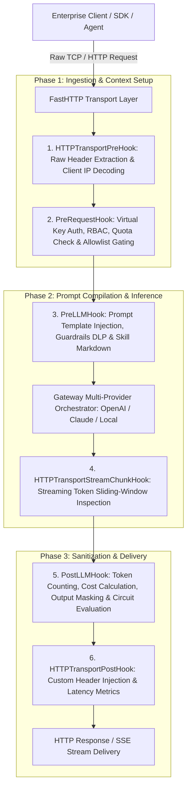
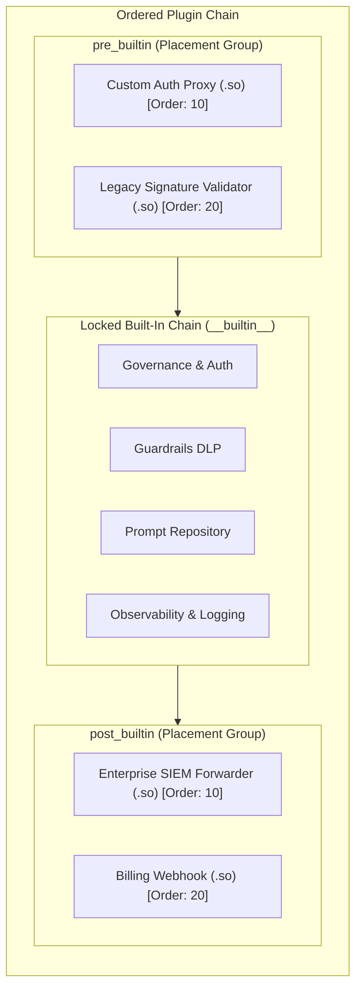

# UnifAI Plugin Architecture & Dynamic Extensibility Specification

This document provides a comprehensive, production-grade technical specification of the **Plugin Subsystem** within the UnifAI Enterprise AI Gateway. It details the execution lifecycle hooks, native Go built-in plugins, dynamic shared object (`.so`) runtime loading, sequence reordering via drag-and-drop, complete UI workspace documentation (all buttons, sheets, and modals), database schemas, and REST APIs.

---

## 1. Architectural Overview & Extensibility Framework

The UnifAI Gateway employs an event-driven, interception-based plugin architecture. Every inbound request processed by the gateway traverses an ordered pipeline of plugins that execute custom business logic, security screenings, observability captures, and model transformations at strictly defined lifecycle phases.



---

## 2. Plugin Lifecycle Hooks & Interface Contracts

Every plugin in UnifAI implements one or more interface contracts defined in `core/schemas`:

| Hook Name | Lifecycle Trigger Point | Core Responsibilities & Use Cases |
| :--- | :--- | :--- |
| `HTTPTransportPreHook` | Prior to request payload decoding. | Captures raw HTTP headers, extracts client IP addresses, validates external proxy signatures. |
| `PreRequestHook` | Immediately after `GatewayContext` initialization. | Resolves Virtual Key identities, validates team quotas, enforces rate-limits, checks IP allowlists. |
| `PreLLMHook` | Immediately before dispatching payload to upstream LLM. | Compiles Prompt Repository templates, injects Skill markdown, executes input Guardrails (PII/PCI masking). |
| `HTTPTransportStreamChunkHook` | During active SSE token streaming. | Inspects token chunks in a sliding ring buffer, aborts stream immediately if a policy violation occurs. |
| `PostLLMHook` | After upstream model finishes generation. | Aggregates token usage (prompt, completion, total), calculates USD cost, runs output moderation, updates circuit breakers. |
| `HTTPTransportPostHook` | Right before the HTTP response is written to the wire. | Injects enterprise tracking headers, traces request latency, emits OpenTelemetry spans. |

---

## 3. Core Built-In Plugins Directory

The UnifAI binary ships with native, compiled Go plugins providing enterprise capabilities:

1. **`governance`**: Enforces Virtual Key authentication, team/customer scoping, budget limits, rate-limits (RPM/TPM), and CEL routing rules.
2. **`guardrails`**: In-memory inspection engine executing deterministic regex, Luhn/Verhoeff checksums, and cloud safety moderation APIs.
3. **`prompts`**: Compiles Prompt Repository templates, variables, versioning, and Skill markdown injection.
4. **`logging`**: Captures asynchronous request/response audit logs, token metrics, and payload metadata to PostgreSQL and ClickHouse.
5. **`model-catalog-resolver`**: Normalizes model identifiers (e.g., mapping `openai/gpt-4o` vs. `gpt-4o`) across heterogeneous upstream providers.
6. **`connectors` & `compat`**: Compatibility layers translating proprietary API schemas and third-party observability exporters (Datadog, Langfuse, Kafka).
7. **`semantic_cache`**: High-speed vector embedding cache that short-circuits identical or semantically similar prompts.
8. **`otel` & `telemetry`**: Emits OpenTelemetry traces, distributed span IDs, and Prometheus metric counters.

---

## 4. Custom Plugins & Dynamic Shared Library (`.so`) Loading

Enterprises can extend gateway capabilities by developing custom plugins compiled as Go shared libraries (`.so` on Linux, `.dll` on Windows) loaded at runtime via the `SharedObjectPluginLoader`.



### 4.1. Placement Model
* **`pre_builtin`**: Runs **before** the native built-in plugins. Used for external auth proxies, custom enterprise header decryption, or firewall gating.
* **`post_builtin`**: Runs **after** the native built-in plugins. Used for enterprise SIEM forwarders, custom billing webhooks, or downstream data lakes.

### 4.2. Drag-and-Drop Sequence Reordering
Administrators visually adjust execution order using the Plugin Sequence Sheet (`pluginSequenceSheet.tsx`), dragging custom plugins above or below the locked built-in block. The gateway updates the integer `order` field accordingly.

---

## 5. UI Deep Dive: Plugins Workspace (`/workspace/plugins`)

The Plugins console provides a master-detail split layout for inspecting, configuring, reordering, and deleting plugins.

### 5.1. Left Navigation Sidebar
* **Search Input Field**: Real-time filtering of plugins by name.
* **Plugins List**: Displays all loaded plugins with:
  * Plugin Display Name.
  * Category Badge (`llm`, `mcp`, `http`, `governance`, `logging`).
  * Status Indicator (Green active dot vs. Gray disabled dot).
  * Lock Icon for core built-in plugins.
* **Action Buttons in Sidebar Footer**:
  * **+ Add Plugin Button** (`button#btn-open-add-plugin`): Opens `AddNewPluginSheet.tsx`.
  * **Reorder Execution Sequence Button** (`button#btn-open-sequence`): Opens `pluginSequenceSheet.tsx`.

### 5.2. Main Plugin Configuration View (`pluginsView.tsx`)
When a plugin is selected from the sidebar:
1. **Header Section**:
   * Plugin Name with Type Badge (e.g., `llm`, `http`).
   * **Runtime Locked Badge**: For core built-ins, shows a locked banner explaining: *"This core plugin is compiled into the gateway and cannot be removed."*
   * **Enable / Disable Toggle Switch** (`<Switch />`): Bound to `enabled`.
2. **Form Fields**:
   * **Plugin Name** (`input#plugin-name`): Read-only for existing plugins.
   * **Binary Path / URL** (`input#plugin-path` - custom plugins only): Displays the filesystem path (`/opt/plugins/custom.so` or `C:\plugins\custom.dll`) or remote HTTP/HTTPS download URL.
   * **Enable Custom Configuration Switch** (`<Switch id="has-config" />`): Unlocks the JSON configuration editor.
   * **Configuration JSON Editor** (`<CodeEditor />`): Syntax-highlighted Monaco/Ace JSON editor with real-time JSON validation.
3. **Action Buttons**:
   * **Save Changes Button** (`button#btn-save-plugin`): Persists changes via `PUT /api/plugins/{name}`. Disabled unless form is dirty.
   * **Delete Plugin Button** (`button#btn-delete-plugin` - custom plugins only): Opens `confirmDeletePluginDialog.tsx`.

### 5.3. Add New Plugin Sheet (`addNewPluginSheet.tsx`)
A slide-over drawer enabling administrators to enroll custom plugins:
* **Plugin Name** (`input#new-plugin-name`): Mandatory. Regex validated: `^[A-Za-z0-9-_]+$`.
* **Plugin Path / URL** (`input#new-plugin-path`):
  * Accepts absolute filesystem paths (e.g., `/opt/plugins/audit_forwarder.so` or `C:\gateway\plugins\validator.dll`).
  * Accepts HTTP/HTTPS URLs for remote distribution.
* **Enabled by Default Switch** (`<Switch />`).
* **Placement Radio Group**: `pre_builtin` vs. `post_builtin`.
* **Configuration JSON Editor**: Optional initial config payload.
* **Drawer Footer**: Cancel Button and Create Plugin Button (`button#btn-submit-create-plugin`).

### 5.4. Plugin Sequence Reordering Sheet (`pluginSequenceSheet.tsx`)
A visual drag-and-drop modal powered by `@dnd-kit/react`:
* **Locked Built-in Block**: Represented as a dashed, locked card (`__builtin__`) indicating the core gateway pipeline.
* **Draggable Custom Cards**:
  * Grip handle (`GripVertical` icon) for reordering.
  * Custom cards positioned above `__builtin__` automatically receive `placement = "pre_builtin"`.
  * Custom cards positioned below `__builtin__` automatically receive `placement = "post_builtin"`.
* **Save Order Button**: Persists the reordered sequence via batch `PUT /api/plugins/{name}` updates.

### 5.5. Delete Plugin Confirmation Modal (`confirmDeletePluginDialog.tsx`)
* Prompts confirmation: *"Are you sure you want to remove plugin '{name}'? This action cannot be undone."*
* Invokes `DELETE /api/plugins/{name}` and automatically unloads the library from memory.

---

## 6. Go Developer Interface Specifications

Custom plugin developers must implement the `Plugin` interface and export a constructor symbol `NewPlugin(logger Logger, config map[string]any) (Plugin, error)`.

```go
package main

import (
    "context"
    "github.com/gateway/gateway/core/schemas"
)

// BasePlugin defines standard lifecycle methods
type BasePlugin interface {
    Name() string
    Init(ctx context.Context, config map[string]any) error
    Close() error
}

// LLMPlugin defines pre/post inference hooks
type LLMPlugin interface {
    BasePlugin
    PreLLMHook(ctx *schemas.GatewayContext, req *schemas.GatewayRequest) error
    PostLLMHook(ctx *schemas.GatewayContext, req *schemas.GatewayRequest, resp *schemas.GatewayResponse) error
}

// StreamPlugin defines streaming token chunk inspection
type StreamPlugin interface {
    BasePlugin
    StreamChunkHook(ctx *schemas.GatewayContext, chunk []byte) ([]byte, error)
}

// ConfigMarshallerPlugin provides custom DB serialization
type ConfigMarshallerPlugin interface {
    MarshalConfigForStorage(config map[string]any) (map[string]any, error)
    ExpandConfigForAPI(config map[string]any) (map[string]any, error)
}
```

---

## 7. Database Schemas & Storage Format

Custom plugins and configuration states are persisted in PostgreSQL:

```sql
-- Custom Plugins Registry Table
CREATE TABLE gateway_plugins (
    name VARCHAR(255) PRIMARY KEY,
    enabled BOOLEAN NOT NULL DEFAULT TRUE,
    path TEXT,                                      -- Filesystem path or download URL
    config JSONB DEFAULT '{}'::jsonb,               -- Arbitrary plugin configuration map
    placement VARCHAR(50) DEFAULT 'post_builtin',   -- 'pre_builtin', 'post_builtin'
    execution_order INT DEFAULT 100,               -- Numeric order within placement group
    is_custom BOOLEAN DEFAULT TRUE,
    created_at TIMESTAMP WITH TIME ZONE DEFAULT NOW(),
    updated_at TIMESTAMP WITH TIME ZONE DEFAULT NOW()
);
```

---

## 8. Complete REST API Reference

All plugin endpoints require Administrative privileges.

### 8.1. Discovery & Status APIs

#### `GET /api/plugins/builtins`
Returns all native built-in plugins compiled into the binary.
* **Response**:
  ```json
  {
    "builtins": [
      "governance",
      "guardrails",
      "prompts",
      "logging",
      "model-catalog-resolver",
      "connectors",
      "semantic_cache",
      "otel"
    ]
  }
  ```

#### `GET /api/plugins/loaded`
Returns names of all plugins currently initialized and running in the memory pipeline.
* **Response**:
  ```json
  {
    "plugins": ["governance", "guardrails", "custom_siem_forwarder", "logging"]
  }
  ```

#### `GET /api/plugins`
Returns full catalog of configured plugins, statuses, and execution metadata.
* **Response**:
  ```json
  {
    "plugins": [
      {
        "name": "governance",
        "enabled": true,
        "isCustom": false,
        "status": {
          "loaded": true,
          "error": null
        }
      },
      {
        "name": "custom_siem_forwarder",
        "enabled": true,
        "path": "/opt/plugins/siem_forwarder.so",
        "placement": "post_builtin",
        "order": 10,
        "isCustom": true,
        "config": {
          "endpoint": "https://siem.enterprise.internal/ingest",
          "batch_size": 50
        },
        "status": {
          "loaded": true,
          "error": null
        }
      }
    ]
  }
  ```

---

### 8.2. Management APIs

#### `POST /api/plugins`
Registers and initializes a new custom plugin.
* **Request Payload**:
  ```json
  {
    "name": "custom_siem_forwarder",
    "enabled": true,
    "path": "/opt/plugins/siem_forwarder.so",
    "placement": "post_builtin",
    "order": 10,
    "config": {
      "endpoint": "https://siem.enterprise.internal/ingest",
      "batch_size": 50
    }
  }
  ```
* **Response**: HTTP 201 Created.

#### `GET /api/plugins/{name}`
Returns configuration for a specific plugin.

#### `PUT /api/plugins/{name}`
Updates plugin status, binary path, configuration, or sequence order.
* **Request Payload**:
  ```json
  {
    "enabled": true,
    "path": "/opt/plugins/siem_forwarder_v2.so",
    "placement": "post_builtin",
    "order": 15,
    "config": {
      "endpoint": "https://siem-v2.enterprise.internal/ingest",
      "batch_size": 100
    }
  }
  ```

#### `DELETE /api/plugins/{name}`
Unloads the plugin from memory and removes it from the database.
* **Response**: HTTP 200 OK `{ "status": "success", "message": "Plugin custom_siem_forwarder deleted" }`.

---

## 9. Operational Runbook & Error Handling

1. **Shared Object Loading Failure**:
   * If a custom `.so` fails to load (e.g., missing CGO dynamic dependencies or version mismatch with gateway Go runtime), the gateway marks the plugin status as `error: "incompatible Go runtime version or missing symbol NewPlugin"`.
   * The gateway continues serving traffic cleanly, isolating the failure without crashing the server.
2. **Crash Resilience (Panic Recovery)**:
   * Each plugin execution hook is wrapped in a `defer recover()` handler.
   * If a third-party plugin panics during request processing, the gateway catches the panic, logs a critical error trace, increments the plugin fault metric, and gracefully continues processing the remaining plugin chain.
3. **Hot Reloading**:
   * Updating a plugin via `PUT /api/plugins/{name}` immediately re-executes the constructor with updated parameters and hot-swaps the memory pointer atomically.
