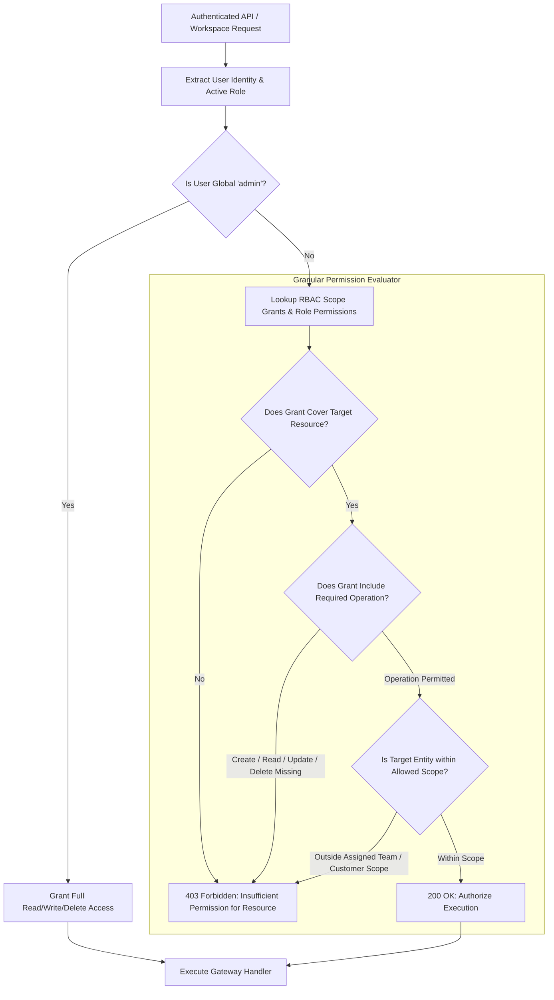

# UnifAI Role-Based Access Control (RBAC) & Scope Grants Architecture

This document provides a comprehensive, production-grade technical specification of the **Role-Based Access Control (RBAC)** subsystem within the UnifAI Enterprise AI Gateway. It details the permission matrix across all 35+ gateway resources, built-in vs. custom roles, fine-grained operation types (`Create`, `Read`, `Update`, `Delete`), scope grants hierarchy (Global, Team, Customer, User), complete UI workspace documentation (all buttons, forms, and dialogs), database schemas, and REST APIs.

---

## 1. System Overview & Security Model

The UnifAI RBAC subsystem delivers granular administrative governance across multi-tenant enterprise environments. It enforces least-privilege security by decoupling user identities from static privilege assignments. Every HTTP request reaching administrative or governance endpoints is intercepted and evaluated against the user's active role, assigned scope grants, and team memberships.



---

## 2. Resource & Sidebar Mapping Catalog

Permissions directly control the visibility and interactive capability of the UnifAI Workspace sidebar sections. A parent section is granted only when all necessary child capabilities are authorized:

| Module Domain | RBAC Resource Name | Controlled UI Sidebar Paths | Supported Operations |
| :--- | :--- | :--- | :--- |
| **Observability** | `Dashboard` | `/workspace/observability/dashboard` | `Read` |
| | `Logs` | `/workspace/observability/llm-logs` | `Read`, `Delete` |
| | `MCPLogs` | `/workspace/observability/mcp-logs` | `Read`, `Delete` |
| | `Observability` | `/workspace/observability/connectors` | `Read`, `Create`, `Update`, `Delete` |
| | `LogsSettings` | `/workspace/observability/logs-settings` | `Read`, `Update` |
| **Browser AI** | `BrowserAIOverview` | `/workspace/browser-ai?tab=overview` | `Read` |
| | `BrowserAITargets` | `/workspace/browser-ai?tab=targets` | `Read`, `Create`, `Update`, `Delete` |
| | `BrowserAIRules` | `/workspace/browser-ai?tab=rules` | `Read`, `Create`, `Update`, `Delete` |
| | `BrowserAILogs` | `/workspace/browser-ai?tab=logs` | `Read`, `Delete` |
| | `BrowserAISearchLogs` | `/workspace/browser-ai?tab=search-logs`| `Read`, `Delete` |
| | `BrowserAISetup` | `/workspace/browser-ai?tab=setup` | `Read`, `Create`, `Update` |
| | `BrowserAIAgents` | `/workspace/browser-ai?tab=agents` | `Read`, `Update`, `Delete` |
| | `BrowserAIInsights` | `/workspace/browser-ai?tab=telemetry` | `Read` |
| **Models** | `ModelProvider` | `/workspace/providers` | `Read`, `Create`, `Update`, `Delete` |
| | `ModelCatalog` | `/workspace/model-catalog` | `Read`, `Update` |
| | `BudgetsLimits` | `/workspace/model-limits` | `Read`, `Create`, `Update`, `Delete` |
| | `ComplexityRouter` | `/workspace/complexity-router` | `Read`, `Update` |
| | `RoutingRules` | `/workspace/routing-rules` | `Read`, `Create`, `Update`, `Delete` |
| | `CircuitBreaker` | `/workspace/circuit-breaker` | `Read`, `Create`, `Update`, `Delete` |
| | `PricingOverrides` | `/workspace/custom-pricing/overrides` | `Read`, `Create`, `Update`, `Delete` |
| | `ModelSettings` | `/workspace/custom-pricing` | `Read`, `Update` |
| **MCP Gateway** | `MCPCatalog` | `/workspace/mcp-registry` | `Read`, `Create`, `Update`, `Delete` |
| | `MCPLibrary` | `/workspace/mcp-registry/library` | `Read` |
| | `MCPToolGroups` | `/workspace/mcp-tool-groups` | `Read`, `Create`, `Update`, `Delete` |
| | `MCPAuthSessions` | `/workspace/mcp-sessions` | `Read`, `Delete` |
| | `MCPOAuthGrants` | `/workspace/oauth-grants` | `Read`, `Delete` |
| | `MCPSettings` | `/workspace/mcp-settings` | `Read`, `Update` |
| **Governance** | `VirtualKeys` | `/workspace/virtual-keys` | `Read`, `Create`, `Update`, `Delete` |
| | `Customers` | `/workspace/governance/customers` | `Read`, `Create`, `Update`, `Delete` |
| | `BusinessUnits` | `/workspace/governance/business-units`| `Read`, `Create`, `Update`, `Delete` |
| | `Teams` | `/workspace/governance/teams` | `Read`, `Create`, `Update`, `Delete` |
| | `Users` | `/workspace/governance/users` | `Read`, `Create`, `Update`, `Delete` |
| | `SCIM` | `/workspace/scim` | `Read`, `Update` |
| **Platform** | `Guardrails` | `/workspace/guardrails` | `Read`, `Create`, `Update`, `Delete` |
| | `Plugins` | `/workspace/plugins` | `Read`, `Create`, `Update`, `Delete` |
| | `SkillsRepo` | `/workspace/skills-repo` | `Read`, `Create`, `Update`, `Delete` |
| | `ClusterConfig` | `/workspace/cluster` | `Read`, `Update` |
| | `Config` | `/workspace/config` | `Read`, `Update` |

---

## 3. Scope Grants Model & Hierarchy

UnifAI supports five distinct Target Scopes (`SelectionTarget`) for delegating access:

1. **Global Roles (`role`)**: Baseline permissions inherited by all users holding a specific role (`admin`, `sub_admin`, `user`, or custom enterprise roles).
2. **All Admins / All Sub-Admins (`all_admins`, `all_sub_admins`)**: Blanket privilege overrides across administrative tiers.
3. **All Teams (`all_teams`) / Specific Team (`team`)**: Restricts access so users can view and manage resources (e.g., Virtual Keys, Prompts, Logs) only within their assigned team.
4. **All Customers (`all_customers`) / Specific Customer (`customer`)**: Multitenant boundary restricting customer portal administrators to their company assets.
5. **Specific User (`user`)**: Individual user exceptions or elevated privileges.

---

## 4. UI Deep Dive: RBAC Console (`/workspace/governance/rbac`)

The RBAC management interface features an interactive, visual permission matrix grid.

### 4.1. Left Target Selector Sidebar
* **Search Targets Input** (`input#rbac-target-search`): Filters roles, teams, and users.
* **Target Categories Accordion**:
  * **System & Custom Roles**: `Admin` (Locked), `Sub-Admin`, `User`, `+ New Role` button.
  * **Teams**: Collapsible tree of enterprise teams.
  * **Customers**: Registered enterprise client organizations.
  * **Individual Users**: Searchable user directory.
* **+ Add Custom Role Button** (`button#btn-create-custom-role`): Opens the Create Role Modal.

### 4.2. Main Permission Matrix Grid
When a role or scope target is selected:
1. **Target Header**:
   * Displays Selected Target Name, Type Badge (e.g., `Role`, `Team`, `User`), and Total Active Grants count.
   * **Delete Role Button** (`button#btn-delete-role` - custom roles only): Deletes role via `DELETE /api/roles/{id}`.
2. **Domain Sections Accordion**:
   * Divided by domain: `Observability`, `Browser AI`, `Models & Routing`, `MCP Gateway`, `Governance`, `Platform Security`.
3. **Resource Permission Row**:
   * Resource Title & Description.
   * Four Operation Checkboxes:
     * **Create** (`input#perm-{resource}-create`)
     * **Read** (`input#perm-{resource}-read`)
     * **Update** (`input#perm-{resource}-update`)
     * **Delete** (`input#perm-{resource}-delete`)
   * **Select All / Clear All Toggle Button**: Bulk toggles all 4 operations for the row.
4. **Action Footer**:
   * **Save Permissions Button** (`button#btn-save-rbac`): Commits changes via `PUT /api/rbac/scope-grants` or `PUT /api/roles/{id}/permissions`. Displays feedback toast.
   * **Revert Changes Button** (`button#btn-revert-rbac`).

### 4.3. Create Custom Role Modal Form Fields
* **Role Name Input** (`input#role-name`): Unique identifier (e.g., `FinOps-Auditor`, `SecOps-Engineer`).
* **Description Textarea** (`textarea#role-desc`): Explains functional responsibilities.
* **Base Role Template Dropdown**: Allows cloning permissions from `User` or `Sub-Admin`.
* **Save Role Button** (`button#btn-confirm-create-role`).

---

## 5. Complete Database Schemas & Storage Format

RBAC roles, permissions, and scope grants are stored in PostgreSQL:

```sql
-- 1. Roles Table
CREATE TABLE rbac_roles (
    id VARCHAR(255) PRIMARY KEY,
    name VARCHAR(255) UNIQUE NOT NULL,
    description TEXT,
    is_system BOOLEAN NOT NULL DEFAULT FALSE,        -- True for admin, sub_admin, user
    created_at TIMESTAMP WITH TIME ZONE DEFAULT NOW(),
    updated_at TIMESTAMP WITH TIME ZONE DEFAULT NOW()
);

-- 2. Master Permissions Catalog
CREATE TABLE rbac_permissions (
    id VARCHAR(255) PRIMARY KEY,
    resource VARCHAR(100) NOT NULL,                 -- e.g., 'VirtualKeys', 'Logs', 'Guardrails'
    operation VARCHAR(50) NOT NULL,                  -- 'Create', 'Read', 'Update', 'Delete'
    description TEXT,
    CONSTRAINT uix_resource_operation UNIQUE (resource, operation)
);

-- 3. Role-Permission Mappings
CREATE TABLE rbac_role_permissions (
    role_id VARCHAR(255) NOT NULL REFERENCES rbac_roles(id) ON DELETE CASCADE,
    permission_id VARCHAR(255) NOT NULL REFERENCES rbac_permissions(id) ON DELETE CASCADE,
    PRIMARY KEY (role_id, permission_id)
);

-- 4. Granular Scope Grants Table
CREATE TABLE rbac_scope_grants (
    id SERIAL PRIMARY KEY,
    scope_type VARCHAR(50) NOT NULL,                -- 'role', 'team', 'customer', 'user', 'all_teams'
    scope_id VARCHAR(255),                          -- Target ID (NULL for 'all_teams' or 'all_users')
    permission_ids JSONB NOT NULL DEFAULT '[]'::jsonb,
    created_at TIMESTAMP WITH TIME ZONE DEFAULT NOW(),
    updated_at TIMESTAMP WITH TIME ZONE DEFAULT NOW(),
    CONSTRAINT uix_scope UNIQUE (scope_type, scope_id)
);
```

---

## 6. Complete REST API Reference

### 6.1. Permissions & Roles APIs

#### `GET /api/rbac/me/permissions`
Returns the aggregated list of permissions and allowed sidebar sections for the currently logged-in user.
* **Response**:
  ```json
  {
    "role": "sub_admin",
    "permissions": [
      { "resource": "VirtualKeys", "operation": "Read" },
      { "resource": "VirtualKeys", "operation": "Create" },
      { "resource": "Logs", "operation": "Read" }
    ],
    "allowed_sections": [
      "governance/virtual-keys",
      "observability/llm-logs"
    ]
  }
  ```

#### `GET /api/roles`
Returns all system and custom enterprise roles.

#### `POST /api/roles`
Creates a new custom role.
* **Request Payload**:
  ```json
  {
    "name": "SecOps-Analyst",
    "description": "Read-only access to audit logs, guardrail rules, and browser AI alerts"
  }
  ```

#### `DELETE /api/roles/{id}`
Deletes custom role.

---

### 6.2. Scope Grants APIs

#### `GET /api/rbac/scope-grants`
Retrieves configured scope grants across roles, teams, and customers.

#### `PUT /api/rbac/scope-grants`
Commits updated permission lists for a specific scope target.
* **Request Payload**:
  ```json
  {
    "scope_type": "team",
    "scope_id": "team-eng-core",
    "permission_ids": [
      "perm-vk-create",
      "perm-vk-read",
      "perm-vk-update",
      "perm-logs-read"
    ]
  }
  ```
* **Response**: HTTP 200 OK `{ "status": "success", "message": "Scope grants updated" }`.

---

## 7. Operational Best Practices & Least-Privilege Runbook

1. **Immutable Admin Role**:
   * The global `admin` role is system-locked. Its permissions cannot be stripped or disabled to guarantee administrators never lock themselves out of the system.
2. **Immediate Session Sync**:
   * Permission updates committed via `PUT /api/rbac/scope-grants` take effect immediately on active user web sessions via WebSocket/SSE notification without requiring users to log out.
