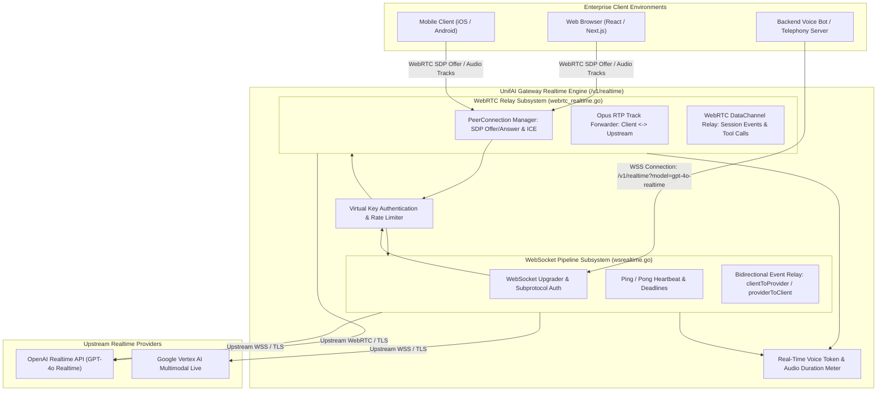
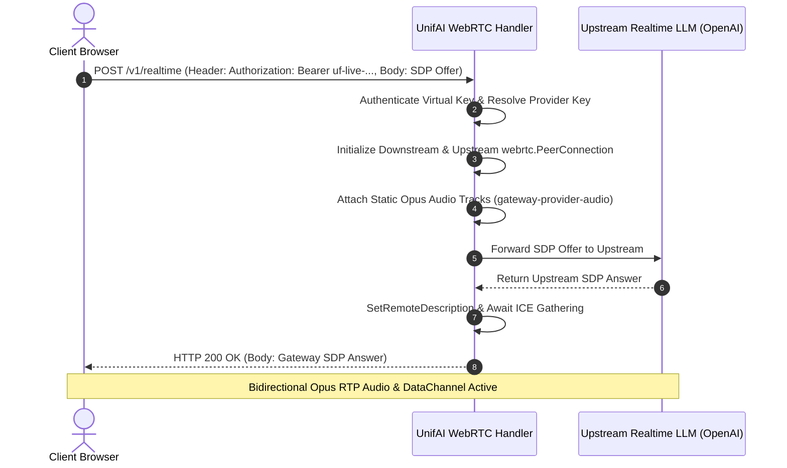

# UnifAI Real-Time Voice, WebRTC & WebSocket Streaming Architecture (Realtime_WebRTC_Voice.md)

This document provides a comprehensive, production-grade technical specification of the **Real-Time Voice, WebRTC & WebSocket Streaming** subsystem (`/v1/realtime`) within the UnifAI Enterprise AI Gateway. It details the bidirectional audio relay architecture, OpenAI Realtime API emulation, WebRTC PeerConnection SDP negotiation, Opus RTP audio forwarding, WebSocket turn pipelines, voice activity detection (VAD), audio duration token billing, and client integration SDKs.

---

## 1. System Overview & Dual-Transport Architecture

The **Realtime Voice** subsystem enables ultra-low-latency, conversational voice interactions between enterprise end-users and multimodal LLMs (such as OpenAI GPT-4o Realtime, Gemini Multimodal Live, and self-hosted speech models). 

To accommodate diverse client topologies (web browsers, mobile apps, telephony SIP trunks, and server-side agents), UnifAI provides a **Dual-Transport Streaming Architecture**:
1. **WebRTC Transport (`webrtc_realtime.go`)**: Ultra-low-latency direct media transport utilizing UDP/SRTP, Session Description Protocol (SDP) negotiation, and ICE candidate exchange. Ideal for web browsers and mobile apps where sub-300ms speech round-trips are required.
2. **WebSocket Transport (`wsrealtime.go`)**: Stateful, bi-directional TCP stream for server-to-server microservices, desktop clients, and environments where UDP traffic is restricted by corporate firewalls.



---

## 2. WebRTC Relay Engine Deep Dive (`webrtc_realtime.go`)

WebRTC provides peer-to-peer media transport semantics relayed through the gateway to preserve credential security and enterprise compliance monitoring.

### 2.1. Handshake & SDP Offer/Answer Negotiation
1. The client browser creates a local `RTCPeerConnection` with an Opus audio track and generates an **SDP Offer**.
2. The browser transmits the SDP Offer via `POST /v1/realtime` with `Content-Type: application/sdp` and `Authorization: Bearer uf-live-...`.
3. The gateway creates two managed peer connections:
   * **Downstream PeerConnection**: Connected to the client browser.
   * **Upstream PeerConnection**: Connected to the upstream model provider.
4. The gateway generates an **SDP Answer** from the upstream response and delivers it back to the client browser with HTTP 200 OK.



### 2.2. Media Tracks & DataChannel Forwarding
* **Audio Codec**: Opus (48kHz sample rate, stereo/mono, dynamically adjusted bitrate).
* **Track Labels**:
  * `gateway-browser-audio`: Inbound microphone stream from employee/user to model.
  * `gateway-provider-audio`: Outbound synthetic voice stream from model to employee/user.
* **DataChannel Relay**:
  * Relays session control events, dynamic system prompt overrides, text transcriptions, and function-calling/MCP tool executions over a low-latency WebRTC DataChannel.

---

## 3. WebSocket Turn Pipeline Deep Dive (`wsrealtime.go`)

For server-side agents, telephony bots, and non-WebRTC clients, the WebSocket interface provides full protocol compatibility with the OpenAI Realtime standard.

### 3.1. Handshake & Authentication
* **Endpoint URL**: `wss://<gateway-host>/v1/realtime?model=gpt-4o-realtime-preview`
* **Subprotocol Authentication**:
  * Clients pass authentication via standard header: `Authorization: Bearer uf-live-...`
  * Or via WebSocket subprotocol header: `Sec-WebSocket-Protocol: realtime, openai-insecure-api-key.uf-live-8a9f...`

### 3.2. Heartbeats & Connection Reliability
* **Ping Interval**: 15 seconds (`realtimeWSPingInterval`).
* **Pong Timeout**: 10 seconds (`realtimeWSPongTimeout`).
* **Graceful Relays**: `relayClientToRealtimeProvider` and `relayRealtimeProviderToClient` execute in isolated goroutines, synchronizing error channels to cleanly tear down sockets upon client termination.

---

## 4. Voice Activity Detection (VAD) & Real-Time Billing

### 4.1. Server-Side Turn Detection
The gateway monitors audio chunks to track conversation turns:
* **`server_vad` Mode**: The model provider automatically detects when the user finishes speaking and generates speech.
* **Interruption Handling**: If the user begins speaking while the model is outputting audio, an event `conversation.item.truncate` is relayed, instantly halting downstream audio playback.

### 4.2. Audio Duration & Token Billing
Voice sessions incur both text token charges and audio duration charges:
* Ingested audio is metered in seconds (`audio_duration_sec`).
* Calculated cost:
  
$$C_{\text{voice}} = T_{\text{text\_tokens}} \times R_{\text{token}} + \text{Duration}_{\text{sec}} \times R_{\text{audio\_second}}$$

* Spend is deducted from the active Virtual Key budget in real time. If the budget is exhausted mid-session, the gateway emits a `realtime.error` event and gracefully terminates the socket.

---

## 5. Complete REST & WebSocket API Reference

### `POST /v1/realtime` (WebRTC Handshake)
* **Headers**:
  * `Authorization: Bearer uf-live-...`
  * `Content-Type: application/sdp`
* **Body**: Standard RFC 8866 SDP Offer string.
* **Response**:
  * Status: `200 OK`
  * `Content-Type: application/sdp`
  * Body: SDP Answer string.

### `WSS /v1/realtime` (WebSocket Endpoint)
* **Query Parameters**:
  * `model`: Target realtime model (e.g., `gpt-4o-realtime-preview`, `openai/gpt-4o-realtime`).
* **Handshake Headers**:
  * `Authorization: Bearer uf-live-...`
  * `Sec-WebSocket-Protocol: realtime`

#### Key Session Events (JSON Payloads):
1. **Client -> Gateway (`session.update`)**:
   ```json
   {
     "type": "session.update",
     "session": {
       "modalities": ["audio", "text"],
       "instructions": "You are a friendly customer service voice agent.",
       "voice": "alloy",
       "input_audio_format": "pcm16",
       "output_audio_format": "pcm16",
       "turn_detection": {
         "type": "server_vad",
         "threshold": 0.5
       }
     }
   }
   ```
2. **Client -> Gateway (`input_audio_buffer.append`)**:
   ```json
   {
     "type": "input_audio_buffer.append",
     "audio": "<BASE64_ENCODED_PCM16_CHUNK>"
   }
   ```
3. **Gateway -> Client (`response.audio.delta`)**:
   ```json
   {
     "type": "response.audio.delta",
     "delta": "<BASE64_ENCODED_AUDIO_CHUNK>"
   }
   ```

---

## 6. Client Integration Code Examples

### JavaScript (Browser WebRTC)
```javascript
const pc = new RTCPeerConnection();
const audioEl = document.createElement("audio");
audioEl.autoplay = true;
pc.ontrack = (e) => audioEl.srcObject = e.streams[0];

// Add local microphone audio track
const stream = await navigator.mediaDevices.getUserMedia({ audio: true });
pc.addTrack(stream.getTracks()[0]);

// Create offer and negotiate with UnifAI Gateway
const offer = await pc.createOffer();
await pc.setLocalDescription(offer);

const response = await fetch("https://gateway.enterprise.com/v1/realtime?model=gpt-4o-realtime", {
  method: "POST",
  headers: {
    "Authorization": "Bearer uf-live-8a9f4129...",
    "Content-Type": "application/sdp"
  },
  body: offer.sdp
});

const answerSdp = await response.text();
await pc.setRemoteDescription({ type: "answer", sdp: answerSdp });
```
