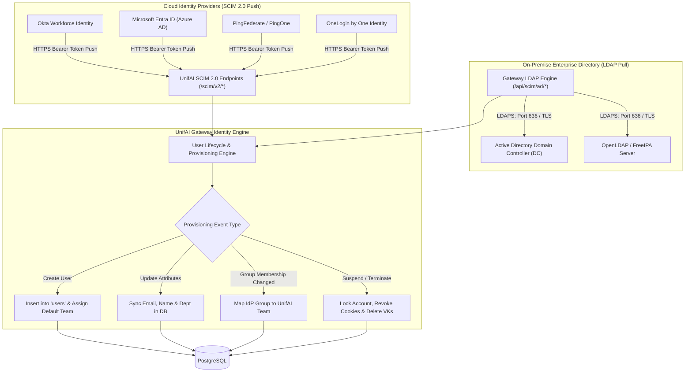
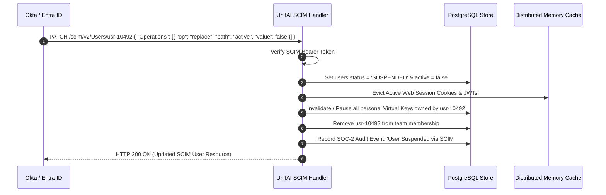

# UnifAI SCIM 2.0 & Active Directory Directory Sync Architecture

This document provides a comprehensive, production-grade technical specification of the **SCIM 2.0 Identity Provisioning & Active Directory (LDAP) Directory Synchronization** subsystem within the UnifAI Enterprise AI Gateway. It details the automated user lifecycle protocols (Just-In-Time provisioning, group-to-team mapping, suspension, deprovisioning), cloud identity provider integrations (Okta, Microsoft Entra ID, PingFederate, OneLogin), on-premise LDAP/LDAPS directory sweeps, complete UI workspace documentation (all buttons, forms, and dialogs), database schemas, and REST APIs.

---

## 1. System Overview & Identity Topology

The **SCIM Directory Sync** module synchronizes the enterprise Identity Provider (IdP) with the UnifAI Gateway. This guarantees that employee onboarding, departmental role assignments, team migrations, and offboarding terminations are automatically mirrored in the gateway's access control plane in real time without manual administrative intervention.



---

## 2. SCIM 2.0 Protocol Specifications (RFC 7643 & RFC 7644)

The gateway implements the standard SCIM 2.0 REST endpoints operating under the base path `/scim/v2`:

### 2.1. Endpoints & Operations

| HTTP Method | SCIM 2.0 URI | Description | IdP Event Trigger |
| :--- | :--- | :--- | :--- |
| `GET` | `/scim/v2/Users` | Paginated listing of provisioned users with attribute filtering (`filter=userName eq "john@enterprise.com"`). | IdP reconciliation sweep. |
| `POST` | `/scim/v2/Users` | Provisions a new user account. Automatically assigns the configured default team. | New employee onboarded or assigned to UnifAI application. |
| `GET` | `/scim/v2/Users/{id}` | Fetches SCIM user resource by UUID. | User inspection. |
| `PUT` | `/scim/v2/Users/{id}` | Full attribute replacement. | Profile information update. |
| `PATCH` | `/scim/v2/Users/{id}` | Partial attribute modification or deactivation (`active: false`). | Employee offboarding or suspension. |
| `DELETE` | `/scim/v2/Users/{id}` | Hard deletion of user account and historical references. | Employee permanent purging. |
| `GET` | `/scim/v2/Groups` | Lists synchronized enterprise directory groups. | Group synchronization. |
| `POST` / `PATCH` | `/scim/v2/Groups` | Maps IdP groups (e.g., `AI-Platform-Engineers`) to UnifAI Teams. | Departmental team reassignment. |
| `GET` | `/scim/v2/ServiceProviderConfig` | Declares gateway SCIM capabilities (e.g., `patch.supported: true`, `bulk.supported: false`). | Initial IdP handshake. |
| `GET` | `/scim/v2/Schemas` | Discovers schema definitions for `User` and `Group`. | IdP schema discovery. |

---

## 3. UI Deep Dive: SCIM & Active Directory Workspace (`/workspace/scim`)

The SCIM console is divided into two primary tabs: **Cloud SCIM** and **Active Directory (LDAP)**.

### 3.1. Tab 1: Cloud SCIM Providers (`activeTab = "scim"`)

Configures inbound push provisioning from cloud IdPs (Okta, Microsoft Entra ID, PingIdentity, OneLogin).

#### Master Controls & Cards
* **Master Enable Switch** (`<Switch />`): Activates SCIM endpoint listener.
* **SCIM 2.0 Base URL Display Card**:
  * Displays the public HTTPS webhook URL (e.g., `https://gateway.enterprise.com/scim/v2`).
  * **Copy URL Button** (`button#btn-copy-scim-url`): Copies base URL to clipboard for pasting into the IdP tenant configuration.
* **SCIM Bearer Token Card**:
  * Displays the encrypted authorization token used by the IdP.
  * **Show/Hide Token Button** (`button#btn-toggle-scim-token`): Toggles plain text visibility (`Eye` / `EyeOff`).
  * **Copy Token Button** (`button#btn-copy-scim-token`): Copies token.
  * **Regenerate Token Button** (`button#btn-regen-scim-token`): Rotates the bearer token, invalidating the previous secret.
* **Identity Provider Dropdown** (`select#scim-provider`): Selects the target provider template:
  * `Okta`
  * `Microsoft Entra ID (Azure AD)`
  * `PingIdentity`
  * `OneLogin`
  * `Generic SCIM 2.0`
* **Default Team Selector Dropdown** (`select#scim-default-team`): Selects which UnifAI Team newly provisioned users belong to by default (e.g., `General Employees`).
* **Save SCIM Configuration Button** (`button#btn-save-scim`): Commits changes via `PUT /api/scim/config`.

---

### 3.2. Tab 2: Active Directory & LDAP Synchronization (`activeTab = "active_directory"`)

Configures automated polling and synchronization from on-premise Windows Server Active Directory or LDAP servers.

#### Configuration Form Fields
* **Master AD Enable Switch** (`<Switch />`): Toggles periodic background LDAP sweeps.
* **LDAP Server Host & Port Input** (`input#ad-host`): Hostname and port (e.g., `dc01.corp.internal:636` for LDAPS or `389` for startTLS).
* **Use LDAPS / SSL Switch** (`<Switch id="ad-ssl" />`): Enforces encrypted TLS connection to domain controllers.
* **Bind Distinguished Name (DN) Input** (`input#ad-bind-dn`): Service account username (e.g., `CN=UnifAI-Sync,OU=ServiceAccounts,DC=corp,DC=internal`).
* **Bind Password Input** (`input#ad-bind-password`): Service account password with show/hide toggle.
* **Base Search DN Input** (`input#ad-base-dn`): Search root for user objects (e.g., `OU=Staff,DC=corp,DC=internal`).
* **User Search Filter Input** (`input#ad-search-filter`): LDAP query string (default: `(&(objectClass=user)(!(userAccountControl:1.2.840.113556.1.4.803:=2)))` to filter active non-disabled accounts).
* **Attribute Mapping Inputs**:
  * Email Attribute (`input#ad-attr-email`): e.g., `mail` or `userPrincipalName`.
  * Username Attribute (`input#ad-attr-username`): e.g., `sAMAccountName`.
  * Display Name Attribute (`input#ad-attr-name`): e.g., `displayName`.
  * Group Membership Attribute (`input#ad-attr-groups`): e.g., `memberOf`.

#### Action Buttons
* **Test Connection Button** (`button#btn-test-ad-conn`):
  * Invokes `POST /api/scim/ad/test`.
  * Connects to LDAP DC, performs TLS handshake, and executes a trial search.
  * Displays success alert: *"Connection successful. 1,420 users discovered in 48ms"* or highlights exact LDAP error codes.
* **Sync Users Now Button** (`button#btn-sync-ad-now`):
  * Invokes `POST /api/scim/ad/sync`.
  * Triggers an immediate full reconciliation sweep in the background.
* **Save AD Configuration Button** (`button#btn-save-ad`): Persists settings via `PUT /api/scim/ad/config`.

---

## 4. Automatic Deprovisioning & Security Termination Flow

When an employee departs the organization, the IdP emits a deprovisioning signal (`active: false` or HTTP `DELETE`). The gateway immediately terminates all access:



---

## 5. Complete Database Schemas & Storage Format

SCIM settings and LDAP synchronization logs are stored in PostgreSQL:

```sql
-- 1. SCIM Master Settings Table
-- Stored in workspace_settings under key: 'scim'
-- {
--   "enabled": true,
--   "provider": "okta",
--   "bearer_token": "uf-scim-sec-98124...",
--   "default_team_id": "team-general",
--   "config": {
--     "sync_groups": true,
--     "auto_create_teams": false
--   }
-- }

-- 2. Active Directory (LDAP) Configuration
-- Stored in workspace_settings under key: 'active_directory'
-- {
--   "enabled": true,
--   "host": "dc01.corp.internal",
--   "port": 636,
--   "use_ssl": true,
--   "bind_dn": "CN=UnifAI,OU=Services,DC=corp",
--   "bind_password_encrypted": "...",
--   "base_dn": "OU=Employees,DC=corp",
--   "search_filter": "(&(objectClass=user))",
--   "attr_email": "mail",
--   "attr_username": "sAMAccountName",
--   "attr_name": "displayName"
-- }

-- 3. SCIM Provisioned Identities Link Table
CREATE TABLE scim_identities (
    id SERIAL PRIMARY KEY,
    external_id VARCHAR(255) NOT NULL,               -- IdP unique user ID (e.g., Okta user ID)
    user_id VARCHAR(255) NOT NULL REFERENCES users(id) ON DELETE CASCADE,
    provider VARCHAR(100) NOT NULL,                  -- 'okta', 'entra', 'ad'
    raw_attributes JSONB DEFAULT '{}'::jsonb,
    last_synced_at TIMESTAMP WITH TIME ZONE DEFAULT NOW(),
    created_at TIMESTAMP WITH TIME ZONE DEFAULT NOW(),
    CONSTRAINT uix_scim_provider_external UNIQUE (provider, external_id)
);
```

---

## 6. Complete REST API Reference

### 6.1. Administration APIs

#### `GET /api/scim/config` & `PUT /api/scim/config`
Gets or updates the cloud SCIM configuration, provider type, bearer token, and default team.

#### `GET /api/scim/ad/config` & `PUT /api/scim/ad/config`
Gets or updates the on-premise Active Directory LDAP configuration.

#### `POST /api/scim/ad/test`
Validates connection to the Active Directory domain controller.
* **Response**:
  ```json
  {
    "success": true,
    "user_count": 1420,
    "duration_ms": 48,
    "message": "LDAP connection and search succeeded"
  }
  ```

#### `POST /api/scim/ad/sync`
Initiates an on-demand directory sync sweep.
* **Response**: `{ "status": "started", "sync_job_id": "ad-sync-8812" }`

---

### 6.2. Inbound SCIM 2.0 Webhook Endpoints

#### `POST /scim/v2/Users`
* **Header**: `Authorization: Bearer <scim_bearer_token>`
* **Request Payload**:
  ```json
  {
    "schemas": ["urn:ietf:params:scim:schemas:core:2.0:User"],
    "userName": "sarah.connor@enterprise.com",
    "name": {
      "givenName": "Sarah",
      "familyName": "Connor"
    },
    "emails": [
      {
        "primary": true,
        "value": "sarah.connor@enterprise.com",
        "type": "work"
      }
    ],
    "active": true
  }
  ```
* **Response**: HTTP 201 Created with full SCIM resource payload and allocated UnifAI user ID.

#### `PATCH /scim/v2/Users/{id}`
Deactivates or updates attributes.
* **Payload**:
  ```json
  {
    "schemas": ["urn:ietf:params:scim:api:messages:2.0:PatchOp"],
    "Operations": [
      {
        "op": "replace",
        "path": "active",
        "value": false
      }
    ]
  }
  ```
* **Response**: HTTP 200 OK.

---

## 7. Operational Runbook & Edge Cases

1. **Handling Duplicate Email Conflicts**:
   * If an IdP attempts to provision a user whose email already exists in UnifAI (e.g., created via initial manual signup), the gateway automatically links the SCIM `external_id` to the existing user row rather than failing with a duplicate constraint error.
2. **Network Partition during Offboarding**:
   * If the gateway is temporarily unreachable when an IdP sends a deprovisioning webhook, the IdP retries with exponential backoff.
   * Once connectivity is restored, the pending deactivation executes immediately, terminating all lingering sessions.
