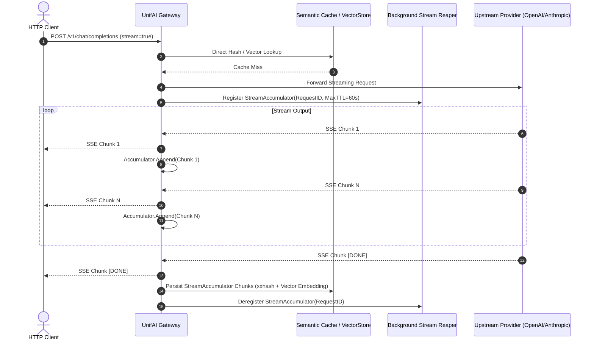

# UnifAI Platform — Semantic Cache & Direct Hash Caching Architecture

## 1. Executive & Technical Overview

The **UnifAI Semantic Cache** is a dual-tier caching engine engineered to eliminate redundant LLM API invocations, slash token expenditure by up to 85%, and reduce round-trip latency from hundreds of milliseconds to sub-millisecond execution times (< 5ms). 

The caching engine operates under two distinct operational paradigms:
1. **Direct Hash Matching (Deterministic Cache)**: Employs ultra-fast 64-bit non-cryptographic hashing (`xxhash64`) to compute exact lexical hits across normalized prompt representations, conversation history slices, system instructions, and hyperparameter vectors.
2. **Semantic Similarity Caching (Vector Similarity Cache)**: Converts user prompt prompts into high-dimensional vector embeddings (via OpenAI `text-embedding-3-small`, Voyage AI, Cohere, Bedrock, etc.) and performs approximate nearest neighbor (ANN) or cosine distance searches across configured Vector Stores (`Redis`, `Qdrant`, `Milvus`, `Pinecone`, `Weaviate`, In-Memory). If the cosine similarity exceeds a user-configured threshold (default: $0.80$, configurable $0.0 \dots 1.0$), the pre-cached completion is served immediately.

```mermaid
flowchart TD
    Req[Incoming Chat/Completion Request] --> Norm[Payload Normalization & Pre-Processing]
    Norm --> HistCheck{Conversation History Count <= Threshold?}
    HistCheck -- No (> Threshold) --> Bypass[Bypass Cache -> Upstream Model Route]
    HistCheck -- Yes --> DirectHash[Compute xxhash64 Direct Key]
    DirectHash --> LookupDirect{Direct Hash Hit?}
    LookupDirect -- Yes --> ServeDirect[Serve Cached Response Instantly\nLatency: <2ms | Token Savings: 100%]
    LookupDirect -- No --> CheckSemantic{Semantic Search Enabled?}
    CheckSemantic -- No --> Upstream[Forward to Upstream LLM Provider]
    CheckSemantic -- Yes --> GenEmbed[Generate Vector Embedding via Provider]
    GenEmbed --> VectorSearch[Query VectorStore for Nearest Vector in Namespace]
    VectorSearch --> SimCheck{Cosine Similarity >= Configured Threshold?}
    SimCheck -- Yes --> ServeSemantic[Serve Semantic Match\nInject Cached Metadata & TTFT Header]
    SimCheck -- No --> Upstream
    Upstream --> StreamOrBlock{Streaming or Non-Streaming?}
    StreamOrBlock -- Non-Streaming --> StoreEntry[Write Direct Hash + Vector to VectorStore with TTL]
    StreamOrBlock -- Streaming --> Accumulate[StreamAccumulator: Buffer StreamChunks in Memory]
    Accumulate --> StreamDone{Stream Final Chunk?}
    StreamDone -- Yes --> PersistStream[Serialize Full Stream & Persist to Cache]
    StoreEntry --> ClientOut[Return Response to Client]
    PersistStream --> ClientOut
```

---

## 2. Complete Technical Specifications & Configuration Schema

### 2.1 Configuration Schema (`semanticcache.Config`)
The semantic cache plugin is configured via JSON/YAML declarations inside the gateway plugins registry or runtime settings.

```go
type Config struct {
	// Embedding Model settings - REQUIRED for semantic similarity mode
	Provider       schemas.ModelProvider `json:"provider"`        // e.g. "openai", "voyage", "cohere", "bedrock"
	EmbeddingModel string                `json:"embedding_model"` // e.g. "text-embedding-3-small", "voyage-large-2"

	// Plugin behavior settings
	TTL                  time.Duration `json:"ttl"`                     // Duration ("1h", "30m", "300s") or integer seconds
	Threshold            float64       `json:"threshold"`               // Cosine similarity threshold (0.00 - 1.00, default: 0.80)
	VectorStoreNamespace string        `json:"vector_store_namespace"`  // Dedicated isolation namespace/index in Vector DB
	Dimension            int           `json:"dimension"`               // Vector dimensions (e.g. 1536 for OpenAI small; 1 for direct-only)

	// Advanced caching behavior
	DefaultCacheKey              string `json:"default_cache_key"`              // Global fallback cache partition key
	ConversationHistoryThreshold int    `json:"conversation_history_threshold"` // Max past turns evaluated (default: 3)
	CacheByModel                 *bool  `json:"cache_by_model"`                 // Partition cache per model (default: true)
	CacheByProvider              *bool  `json:"cache_by_provider"`              // Partition cache per provider (default: true)
	ExcludeSystemPrompt          *bool  `json:"exclude_system_prompt"`          // Omit system prompt from cache hashing (default: false)
}
```

### 2.2 Dual Operational Modes
| Configuration Field | Semantic Similarity Mode | Direct-Only Mode (Deterministic) |
| :--- | :--- | :--- |
| `provider` | Valid provider string (e.g. `"openai"`) | `""` (Empty string) |
| `embedding_model` | Specified embedding model | `""` (Omitted) |
| `dimension` | Target vector dimension ($> 0$, e.g. $1536$) | `1` (Dummy dimension to satisfy VectorStore constraints) |
| `threshold` | Active floating point value ($0.50 \dots 0.99$) | Ignored ($0$) |
| **Lookup Engine** | Direct Hash (`xxhash64`) + Cosine Vector Search | Direct Hash (`xxhash64`) strictly |
| **Latency Penalty on Miss** | $+20\text{ms} \dots 50\text{ms}$ (embedding roundtrip) | $\le 1\text{ms}$ (pure memory hash lookup) |

---

## 3. Streaming Response Caching Engine (`StreamAccumulator`)

When requests enable `stream: true`, the gateway cannot write to the cache immediately because chunks arrive progressively over Server-Sent Events (SSE). 

UnifAI implements a non-blocking streaming accumulator lifecycle:
1. **Chunk Ingestion**: During `PostLLMHook`, each `schemas.GatewayResponse` stream chunk is intercepted and appended to a memory-backed `StreamAccumulator`.
2. **Reaper Expiration**: A concurrent background reaper goroutine inspects the active accumulator table every 10 seconds. Any stream uncompleted within 60 seconds is automatically dropped to prevent memory leaks from abandoned HTTP client connections.
3. **Cache Storage**: Upon receiving `[DONE]` or `finish_reason != nil`, the accumulated chunks are marshaled and written to the configured VectorStore with the defined TTL.
4. **Cache Hit Replay Engine**: When a subsequent streaming request hits the cache, the gateway deserializes the cached chunks and streams them back to the downstream client with artificial micro-delays (10ms) mimicking real-time token delivery or emits an immediate zero-latency burst depending on client negotiation headers.



---

## 4. UI Dashboard & Administrative Controls

The caching subsystem is managed through the Gateway Workspace at `Workspace -> Config -> Caching` and `Workspace -> Observability -> Dashboard`.

### 4.1 Interface Controls & Form Elements
- **Semantic Caching Master Toggle** (`Switch`): Enables or disables the cache hook globally without requiring a gateway binary restart.
- **Cache Storage Driver Dropdown** (`Select`):
  - `Redis (Cluster / Standalone)`
  - `Qdrant Vector Engine`
  - `Milvus Vector Database`
  - `Pinecone Cloud`
  - `In-Memory LRU (Local node only)`
- **Similarity Threshold Slider** (`Slider: Range 0.00 to 1.00, Step 0.01`):
  - Dynamic visual indicator with warning badge if set lower than `0.70` (preventing semantic hallucination / false positive cache hits).
  - Recommended preset: `0.85` for high-precision enterprise Q&A; `0.80` for customer support bot deflection.
- **Default TTL Input** (`Number Input + Duration Unit Select`):
  - Values: `Seconds`, `Minutes`, `Hours`, `Days`.
  - Default: `300 Seconds` (5 Minutes).
- **Conversation History Depth Input** (`Number Spinner: 0 to 20`):
  - Requests containing more than $N$ previous conversational turns are bypassed from semantic caching to avoid multi-turn context drift.
- **Cache Partitioning Checkboxes**:
  - `[x] Partition Cache By Model`: Disallows a GPT-4 response from being served to a Claude-3.5 request.
  - `[x] Partition Cache By Provider`: Segregates cache keys by upstream vendor.
  - `[ ] Exclude System Prompts`: Ignores boilerplates when computing xxhash keys.

### 4.2 Buttons & Operational Actions
| Button Label | Action Triggered | Visual Style | Confirmation Modal |
| :--- | :--- | :--- | :--- |
| **Save Cache Config** | Submits `PUT /api/plugins/semantic_cache` payload | Primary Blue | None (Toast notification on success) |
| **Test Similarity Lookup** | Opens interactive sandbox modal to compare two sample strings | Secondary Outline | Interactive Vector Similarity Comparison Modal |
| **Flush Cache By Partition** | Opens dialog to input target `cacheId` or `cacheKey` | Warning Orange | Requires typing partition name |
| **Purge Entire Cache** | Emits atomic flush across Redis/VectorStore | Destructive Red | Warning Dialog: "This will invalidate all cached embeddings" |

---

## 5. REST API Handlers & Routing Specifications

The cache routes are managed via `handlers/cache.go` and wired into Fasthttp router.

### 5.1 Route Registrations
```go
func (h *CacheHandler) RegisterRoutes(r *router.Router, middlewares ...schemas.GatewayHTTPMiddleware) {
    r.DELETE("/api/cache/clear/{cacheId}", lib.ChainMiddlewares(h.clearCache, middlewares...))
    r.DELETE("/api/cache/clear-by-key/{cacheKey}", lib.ChainMiddlewares(h.clearCacheByKey, middlewares...))
}
```

### 5.2 API Reference

#### 1. Invalidate Cache by Cache Identifier
- **Endpoint**: `DELETE /api/cache/clear/{cacheId}`
- **Headers**:
  ```http
  Authorization: Bearer <Admin_Session_Token>
  Content-Type: application/json
  ```
- **Responses**:
  - `200 OK`:
    ```json
    {
      "message": "Cache cleared successfully"
    }
    ```
  - `400 Bad Request`: `semantic_cache plugin is not loaded` or `Invalid cache ID`.
  - `500 Internal Server Error`: `Failed to clear cache`.

#### 2. Invalidate Cache by Deterministic Cache Key
- **Endpoint**: `DELETE /api/cache/clear-by-key/{cacheKey}`
- **Headers**:
  ```http
  Authorization: Bearer <Admin_Session_Token>
  ```
- **URL Parameter**: `cacheKey` (hex-encoded string or direct hash key).
- **Responses**:
  - `200 OK`:
    ```json
    {
      "message": "Cache cleared successfully"
    }
    ```
  - `400 Bad Request`: `Invalid cache key`.

---

## 6. Observability, Telemetry & Cost Savings Meter

The gateway logs detailed telemetry for every cache interaction:
- **Response Headers**:
  - `X-Gateway-Cache: HIT | MISS | BYPASS`
  - `X-Gateway-Cache-Type: DIRECT_HASH | SEMANTIC_SIMILARITY`
  - `X-Gateway-Cache-Similarity: 0.9421` (Only present on semantic hits)
  - `X-Gateway-Time-Saved: 482ms`
- **Dashboard Metrics Integration**:
  - **Hit Ratio Gauge**: Calculated as $\frac{\text{Cache Hits}}{\text{Total Inference Requests}} \times 100$.
  - **Token Savings Counter**: Cumulative summation of `prompt_tokens + completion_tokens` deflected from paid vendor APIs.
  - **Financial Savings Meter**: Real-time dollar equivalent calculated using `Custom_Pricing.md` active rates for deflected tokens.
