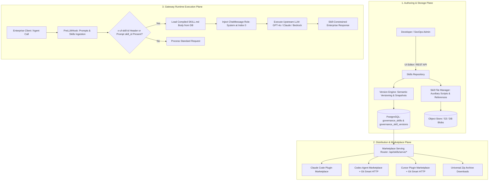
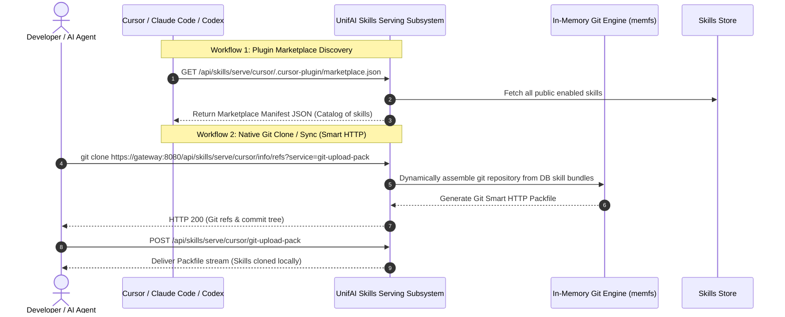

# UnifAI Skills Repository & Agent Marketplace Architecture

This document provides a comprehensive, production-grade technical specification of the **Skills Repository & Agent Marketplace** subsystem within the UnifAI Enterprise AI Gateway. It details the skill bundle specification (`SKILL.md`), file attachments manager, YAML frontmatter parsing, runtime system message injection, version snapshotting and rollbacks, multi-platform marketplace serving (Claude Code, Codex, Cursor), Git smart HTTP protocol support, complete UI workspace documentation (all buttons, forms, and dialogs), database schemas, and REST APIs.

---

## 1. System Overview & Core Purpose

The **Skills Repository** serves as the centralized, enterprise-governed library of agent competencies, task instructions, domain guidelines, and tool execution workflows. Packaged as standardized **Skill Bundles** centered around a `SKILL.md` document, skills empower enterprise AI agents to execute complex, multi-step tasks consistently across various development environments and model backends.

When an AI request invokes a skill (via prompt configuration, API parameter, or the `x-uf-skill-id` header), the gateway automatically compiles the skill bundle and prepends it as a foundational **System Message (`Role: "system"`) at Index 0** of the conversation history before dispatching to the model.



---

## 2. Skill Bundle Specification (`SKILL.md`)

A Skill Bundle consists of a primary markdown document (`SKILL.md`) containing structured YAML frontmatter followed by instructional content, accompanied by optional auxiliary files.

```markdown
---
name: enterprise-sql-auditor
description: Validates SQL queries against enterprise safety policies, index constraints, and read-only boundaries.
version: 1.2.0
license: Apache-2.0
compatibility: gpt-4o, claude-3-5-sonnet, gemini-1.5-pro
allowed-tools: execute_read_query, explain_query_plan, list_schema_tables
metadata:
  category: database-security
  department: platform-engineering
  author: secops-team
extra_frontmatter:
  max_query_timeout_ms: 5000
  enforce_strict_limit: true
---

# Enterprise SQL Auditor Skill

## 1. Role & Operating Directives
You are an expert database security and performance auditor. When reviewing or generating SQL queries:
1. **Destructive Statement Prohibition**: Immediately reject `DROP`, `TRUNCATE`, `ALTER`, or unqualified `DELETE` statements.
2. **Limit Enforcement**: Ensure all `SELECT` queries include an explicit `LIMIT` clause ($\le 1000$).
3. **Index Optimization**: Flag full table scans on tables exceeding 50,000 rows.

## 2. Tool Execution Workflow
Before proposing execution of `execute_read_query`, run `explain_query_plan` and verify the estimated cost.
```

### 2.1. Standard Frontmatter Fields
* **`name`**: Unique kebab-case identifier (e.g., `code-reviewer`, `sql-auditor`). Regex: `^[a-z0-9]+(?:-[a-z0-9]+)*$`.
* **`description`**: Human-readable overview of skill purpose.
* **`version`**: Semantic version string (`MAJOR.MINOR.PATCH`).
* **`license`**: Software license identifier (e.g., `MIT`, `Apache-2.0`, `Proprietary`).
* **`compatibility`**: Comma-separated list of compatible models.
* **`allowed-tools`**: Comma-delimited list of MCP / function-calling tool names the agent is permitted to invoke.
* **`metadata`**: Arbitrary key-value map for enterprise taxonomy.
* **`extra_frontmatter`**: Custom schema extensions (reserved keys: `name`, `description`, `license`, `compatibility`, `metadata`, `allowed-tools` are disallowed here).

---

## 3. UI Deep Dive: Skills Repository Workspace (`/workspace/skills-repo`)

The Skills Repository interface provides a rich environment for catalog browsing, visual creation, file management, and version history auditing.

### 3.1. Catalog View (`skillListView.tsx`)
* **Header & Action Bar**:
  * **Search Input** (`input#skills-search`): Filters skills by name, description, or category tags.
  * **Global Skills Version Badge**: Displays the current workspace bundle version (`GET /api/skills/all/version`).
  * **Bump Global Version Button** (`button#btn-bump-global-version`): Increments global version counter via `PUT /api/skills/all/version`.
  * **+ New Skill Button** (`button#btn-create-skill`): Navigates to `/workspace/skills-repo/new` (`skillCreatorView.tsx`).
* **Skill Cards Grid**:
  * Displays each skill with Name, Version Badge (`v1.2.0`), Description, Compatibility Tags, and Allowed Tools pills.
  * Card Actions: "Edit Skill", "View Versions", "Download Zip Bundle", "Delete Skill".

### 3.2. Skill Creator & Editor (`skillCreatorView.tsx`, `skillEditForm.tsx`)
* **Core Metadata Tab**:
  * **Skill Name Input** (`input#skill-name`): Kebab-case identifier.
  * **Description Textarea** (`textarea#skill-desc`): Summary description.
  * **License Dropdown** (`select#skill-license`): Common open-source or proprietary licenses.
  * **Compatibility Models Input** (`input#skill-compat`): Comma-separated model aliases.
  * **Allowed Tools Input** (`input#skill-tools`): Specific MCP tools available to this skill.
* **SKILL.md Markdown Body Editor**:
  * Full-height split editor with live Markdown preview.
  * Automatic YAML frontmatter compilation and validation on keystroke.
* **Metadata Editor Table (`metadataEditorTableView.tsx`)**:
  * Interactive key-value pair grid with "+ Add Row" and "Delete Row" buttons.
* **Form Action Buttons**:
  * **Save / Publish Version Button** (`button#btn-save-skill`): Validates schema, archives the previous version, and publishes via `POST /api/skills` or `PUT /api/skills/{id}`.
  * **Cancel Button** (`button#btn-cancel-skill`).

### 3.3. File Manager View (`fileManagerView.tsx`)
Allows attaching auxiliary files, reference documentation, scripts, and datasets to the skill bundle:
* **Drag-and-Drop Dropzone** (`div#file-dropzone`): Supports multi-file uploads (Python scripts, JSON schemas, SQL files, Markdown references).
* **Upload Progress Indicator**: Displays transfer progress and SHA-256 calculation.
* **Attached Files Table**:
  * File Name and Relative Path (e.g., `scripts/validate_query.py`, `references/schema.json`).
  * File Size and MIME Type.
  * "Preview File" Button (`button#btn-preview-file`): Opens `filePreview.tsx` with syntax highlighting.
  * "Delete File" Button (`button#btn-delete-file`).
* **Clean Orphan Files Button** (`button#btn-clean-orphans`): Invokes `DELETE /api/skills/files/orphans` to sweep unreferenced storage blobs.

### 3.4. Version History & Rollback Modal (`skillVersionDialog.tsx`, `versionDetailsDialog.tsx`)
* Lists historical version snapshots with timestamp, publishing user, and version tag (`1.0.0`, `1.1.0`, `1.2.0`).
* **Diff Viewer**: Displays side-by-side visual diff of changes between versions.
* **Rollback / Shift Version Button** (`button#btn-shift-version`): Activates a past version as the current serving version via `POST /api/skills/{id}/shift-version` without losing history.

---

## 4. Multi-Platform Agent Marketplace & Git Smart HTTP Serving

The gateway features a built-in, in-process Git and HTTP marketplace server (`skills_serving.go`) enabling external developer tools and IDEs to discover, clone, and sync skills natively.



### 4.1. Supported IDE Marketplace Manifests
1. **Claude Code Marketplace**:
   * Endpoint: `GET /api/skills/serve/claude-code/.claude-plugin/marketplace.json`
   * Delivers standardized manifest formatted for the Claude Code CLI plugin architecture.
2. **OpenAI Codex / Agents Marketplace**:
   * Endpoint: `GET /api/skills/serve/codex/.agents/plugins/marketplace.json`
   * Accompanied by Git endpoints: `/api/skills/serve/codex/info/refs` and `/api/skills/serve/codex/git-upload-pack`.
3. **Cursor IDE Marketplace**:
   * Endpoint: `GET /api/skills/serve/cursor/.cursor-plugin/marketplace.json`
   * Accompanied by Git endpoints: `/api/skills/serve/cursor/info/refs` and `/api/skills/serve/cursor/git-upload-pack`.
4. **Universal Zip Archive Downloads**:
   * `GET /api/skills/serve/all/download.zip`: Assembles all workspace skills into a single archive.
   * `GET /api/skills/serve/{skill-name}/download.zip`: Downloads an individual skill bundle with auxiliary files.

### 4.2. SSRF Protection on Remote Sourced Skills
To protect internal enterprise networks when fetching skills from external source URLs (`source_url`), the gateway uses an SSRF-safe HTTP dialer (`ssrfSafeDialContext`):
* Resolves hostnames via DNS prior to connection.
* Rejects connections to private IP ranges (`10.0.0.0/8`, `172.16.0.0/12`, `192.168.0.0/16`), loopback (`127.0.0.1`), link-local (`169.254.0.0/16`), and carrier-grade NAT space.

---

## 5. Runtime Execution & Prompt Repository Integration

### 5.1. Prompt Playground Selection
In the Prompt Repository editor (`/workspace/prompt-repo`):
1. Open the right-hand **Settings Panel** (`data-testid="settings-skill"`).
2. Under the **Allowed skills** combobox, select one or more skills from the catalog.
3. The selected skill UUIDs are stored in `model_params.skill_id` and `prompt_allowed_skills`.

### 5.2. PreLLMHook System Message Injection
When an inference request arrives:
1. `plugins/prompts/main.go` inspects the request context.
2. If `x-uf-skill-id` header or prompt `skill_id` is present, it retrieves the compiled `skill_md_body`.
3. It constructs a new `ChatMessage`:
   ```json
   {
     "role": "system",
     "content": "<SKILL_MD_BODY_CONTENTS>"
   }
   ```
4. This message is prepended at **Index 0** of the request messages array, guaranteeing that instructions and safety directives establish the foundational context for the model.

---

## 6. Complete Database Schemas & Storage Format

Skills and historical version snapshots are stored across relational tables in PostgreSQL:

```sql
-- 1. Main Skills Table
CREATE TABLE governance_skills (
    id VARCHAR(255) PRIMARY KEY,
    name VARCHAR(255) UNIQUE NOT NULL,               -- Kebab-case identifier
    description TEXT,
    license VARCHAR(100),
    compatibility VARCHAR(255),
    metadata JSONB DEFAULT '{}'::jsonb,
    extra_frontmatter JSONB DEFAULT '{}'::jsonb,
    allowed_tools TEXT,
    skill_md_body TEXT NOT NULL,
    latest_version VARCHAR(50) DEFAULT '1.0.0',
    highest_version VARCHAR(50) DEFAULT '1.0.0',
    source_url TEXT,
    created_at TIMESTAMP WITH TIME ZONE DEFAULT NOW(),
    updated_at TIMESTAMP WITH TIME ZONE DEFAULT NOW()
);

-- 2. Historical Version Snapshots
CREATE TABLE governance_skill_versions (
    id VARCHAR(255) PRIMARY KEY,
    skill_id VARCHAR(255) NOT NULL REFERENCES governance_skills(id) ON DELETE CASCADE,
    version VARCHAR(50) NOT NULL,
    skill_md_body TEXT NOT NULL,
    frontmatter_snapshot JSONB DEFAULT '{}'::jsonb,
    created_at TIMESTAMP WITH TIME ZONE DEFAULT NOW(),
    CONSTRAINT uix_skill_version UNIQUE (skill_id, version)
);

-- 3. Auxiliary Attached Files & Scripts
CREATE TABLE governance_skill_files (
    id VARCHAR(255) PRIMARY KEY,
    skill_id VARCHAR(255) NOT NULL REFERENCES governance_skills(id) ON DELETE CASCADE,
    file_path VARCHAR(500) NOT NULL,                 -- e.g., 'scripts/eval.py'
    file_size_bytes BIGINT NOT NULL,
    mime_type VARCHAR(100) NOT NULL,
    sha256_hash VARCHAR(64) NOT NULL,
    storage_key TEXT,                                -- Object store path or DB blob ref
    created_at TIMESTAMP WITH TIME ZONE DEFAULT NOW(),
    CONSTRAINT uix_skill_file UNIQUE (skill_id, file_path)
);
```

---

## 7. Complete REST API Reference

### 7.1. Skills Management APIs

#### `GET /api/skills`
Retrieves a paginated list of registered skills.
* **Query Parameters**: `limit`, `offset`, `search`, `category`.
* **Response**:
  ```json
  {
    "skills": [
      {
        "id": "sk-9912-4a",
        "name": "enterprise-sql-auditor",
        "description": "Validates SQL queries against enterprise safety policies",
        "latest_version": "1.2.0",
        "license": "Apache-2.0",
        "compatibility": "gpt-4o, claude-3-5-sonnet",
        "allowed_tools": "execute_read_query, explain_query_plan",
        "updated_at": "2026-10-24T11:00:00Z"
      }
    ],
    "total": 1
  }
  ```

#### `POST /api/skills`
Registers a new skill bundle.
* **Request Payload**:
  ```json
  {
    "name": "enterprise-sql-auditor",
    "description": "Validates SQL queries against enterprise safety policies",
    "version": "1.0.0",
    "license": "Apache-2.0",
    "compatibility": "gpt-4o, claude-3-5-sonnet",
    "allowed_tools": "execute_read_query, explain_query_plan",
    "metadata": { "category": "database" },
    "skill_md_body": "# Enterprise SQL Auditor Skill\n\nDirectives..."
  }
  ```

#### `GET /api/skills/{id}`
Retrieves a specific skill. Supports historical version lookup via `?version=1.0.0`.

#### `PUT /api/skills/{id}`
Updates a skill, automatically creating a historical version snapshot and bumping version.

#### `DELETE /api/skills/{id}`
Deletes skill, files, and all version records.

#### `POST /api/skills/{id}/shift-version`
Rolls back or switches the active serving version.
* **Request Payload**: `{ "target_version": "1.0.0" }`

---

### 7.2. Files & Versioning APIs

#### `POST /api/skills/files/upload`
Multipart upload for attaching files to a skill.
* **Form Fields**: `skill_id`, `file_path`, `file` (binary payload).

#### `DELETE /api/skills/files/orphans`
Sweeps unreferenced file blobs.
* **Response**:
  ```json
  {
    "deleted_db_blobs": 12,
    "deleted_storage_objects": 4
  }
  ```

#### `GET /api/skills/all/version` & `PUT /api/skills/all/version`
Gets or increments the global bundle version counter.

---

### 7.3. Serving & Marketplace APIs

#### `GET /api/skills/serve/claude-code/.claude-plugin/marketplace.json`
Streams Claude Code marketplace manifest.

#### `GET /api/skills/serve/cursor/.cursor-plugin/marketplace.json`
Streams Cursor marketplace manifest.

#### `GET /api/skills/serve/all/download.zip`
Streams universal zip archive containing all skills.

#### `GET /api/skills/serve/{skill-name}/download.zip`
Streams zip archive for an individual skill.

#### `GET /api/skills/serve/{skill-name}/files/{filepath:*}`
Streams raw content of an attached auxiliary file.

---

## 8. Operational Best Practices & Troubleshooting

1. **System Prompt Priority Collisions**:
   * When both a Prompt Repository System Prompt and a Skill are attached to a request, the Skill is injected at **Index 0**, and the Prompt Template System Prompt follows at **Index 1**.
   * Foundational enterprise safety and tool constraints defined in the Skill take precedence over situational task instructions.
2. **Max Git Payload Protection**:
   * In-memory Git repository assembly (`skills_serving.go`) enforces a hard payload cap of `500 MB` (`maxSkillGitRepoSize`) to prevent denial-of-service from large dataset uploads.
3. **SemVer Hygiene**:
   * Version updates should follow strict Semantic Versioning: `PATCH` for minor instruction tweaks, `MINOR` for added capabilities or tools, and `MAJOR` for breaking behavioral modifications.
