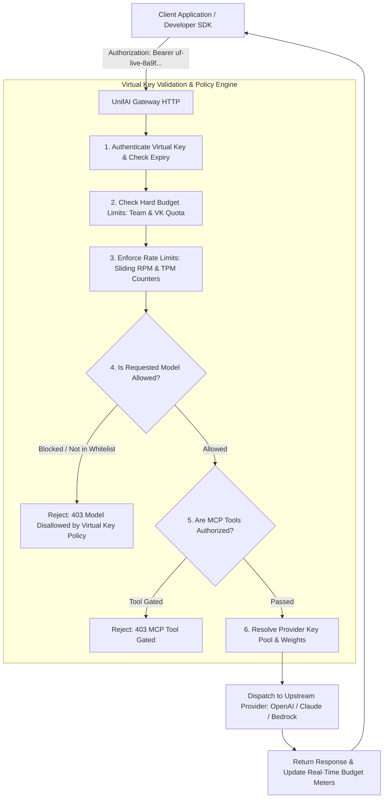
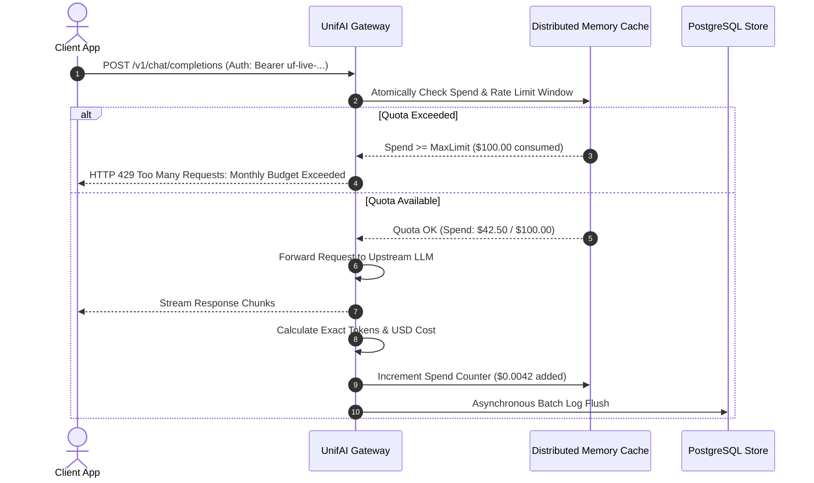

# UnifAI Virtual Keys Architecture & Quota Governance Guide

This document provides a comprehensive, production-grade technical specification of the **Virtual Keys** subsystem within the UnifAI Enterprise AI Gateway. It details the credential abstraction layer, multi-budget hierarchies, multi-tier rate limiting (RPM/TPM), provider-specific model whitelisting/blacklisting, MCP tool permission gating, cryptographic key rotation, complete UI workspace documentation (all buttons, sheets, and forms), database schemas, and REST APIs.

---

## 1. System Overview & Core Capabilities

A **Virtual Key (VK)** is an enterprise-governed client API key issued by the UnifAI Gateway to external applications, internal development teams, automated microservices, and end-users. Rather than distributing raw upstream provider credentials (e.g., OpenAI `sk-...`, Anthropic `sk-ant-...`, or AWS Access Keys), client applications authenticate exclusively using a UnifAI Virtual Key (`uf-live-...` or `vk-...`).



### Key Capabilities:
1. **Total Credential Concealment**: Upstream API keys remain encrypted in the gateway vault and are never exposed to developers or client devices.
2. **Multi-Horizon Spend Budgets**: Assign concurrent daily, weekly, monthly, and lifetime dollar quotas with configurable calendar alignment (e.g., reset on the 1st of every month).
3. **Multi-Tier Rate Limiting**: Limit both Requests Per Minute (RPM) and Tokens Per Minute (TPM) globally per key and per provider.
4. **Model Allowlisting & Blacklisting**: Enforce granular restrictions (e.g., permit `gpt-4o-mini` and `claude-3-5-haiku`, but strictly forbid `o1-preview` or `claude-3-opus`).
5. **MCP Tool Gating**: Restrict which Model Context Protocol (MCP) servers and tools can be executed by callers using this key.
6. **Zero-Downtime Key Rotation**: Rotate keys with grace periods or instant invalidation without modifying team assignments or budget accumulators.

---

## 2. UI Deep Dive: Virtual Keys Workspace (`/workspace/virtual-keys`)

The Virtual Keys workspace provides a command center for managing, monitoring, creating, and rotating API keys.

### 2.1. Header & Action Bar
* **Search Input Field** (`input#vk-search`): Filters keys by name, key prefix, or assigned team.
* **Team Filter Dropdown** (`select#vk-team-filter`): Filters keys assigned to a specific team or shows `All Teams`.
* **Status Filter Dropdown** (`select#vk-status-filter`): Filters by `Active`, `Paused`, `Expired`, `Budget Exceeded`.
* **Bulk Rotate Button** (`button#btn-bulk-rotate-vk`): Triggers bulk key rotation dialog.
* **+ Create Virtual Key Button** (`button[data-testid="create-virtual-key-btn"]`): Opens the full-height Virtual Key Sheet (`virtualKeySheet.tsx`).

### 2.2. Virtual Keys Data Table (`virtualKeysTable.tsx`)
1. **Key Name & Prefix**: Display name with masked token preview (e.g., `Prod-Customer-Chatbot (uf-live-8a9f...4f21)`).
2. **Assigned Entity**: Badge indicating ownership:
   * Team Name (e.g., `Engineering / Core Backend`).
   * Customer / Business Unit badge.
   * Direct User badge.
3. **Spend & Budget Progress**: Visual progress bar showing consumed spend vs. budget limit (e.g., `$42.50 / $100.00 (42.5%)`) with days remaining until calendar reset.
4. **Rate Limits**: Displays configured RPM and TPM badges (e.g., `60 RPM`, `100k TPM`).
5. **Model Governance**: Count of permitted models (e.g., `4 Models Allowed`).
6. **Status Badge**:
   * `Active` (Green badge).
   * `Disabled` (Gray badge).
   * `Budget Exceeded` (Red badge).
   * `Expired` (Amber badge).
7. **Actions Column**:
   * **View Details Button** (`button#btn-view-vk-{id}`): Opens `virtualKeyDetailsSheet.tsx`.
   * **Edit Key Button** (`button#btn-edit-vk-{id}`): Opens `virtualKeySheet.tsx`.
   * **Rotate Key Button** (`button#btn-rotate-vk-{id}`): Opens rotation confirmation dialog.
   * **Delete Key Button** (`button#btn-delete-vk-{id}`).

---

### 2.3. Virtual Key Creation & Edit Sheet (`virtualKeySheet.tsx`)

A multi-section slide-over form supporting comprehensive policy configuration:

#### Section 1: Core Key Identity
* **Key Name Input** (`input#vk-name`): Mandatory descriptive title.
* **Description Textarea** (`textarea#vk-desc`): Business context and project details.
* **Entity Assignment Dropdown**:
  * Assign to **Team** (`select#vk-team-id`): Automatically inherits team budget policies.
  * Assign to **Customer** (`select#vk-customer-id`).
  * Assign to **Business Unit** (`select#vk-bu-id`).
* **Active Status Switch** (`<Switch id="vk-active" />`): Toggle to enable or pause the key.
* **Expiration Date & Time Picker** (`DateTimePicker#vk-expires-at`): Optional expiration timestamp. Once reached, requests are rejected with HTTP 401.

#### Section 2: Budgets & Spend Quotas (`MultiBudgetLines`)
Supports concurrent budget lines:
* **Max Spend Limit ($)** (`input#budget-limit`): Dollar value (e.g., `250.00`).
* **Reset Duration Dropdown** (`select#budget-duration`):
  * `1d` (Daily)
  * `7d` (Weekly)
  * `30d` (Monthly)
  * `1y` (Annual)
  * `never` (Lifetime total spend cap)
* **Calendar Alignment Toggle**: If enabled, aligns monthly resets to the 1st of every month at 00:00 UTC.

#### Section 3: Rate Limiting
* **Token Limit (TPM)** (`input#vk-tpm`): Maximum tokens permitted per minute.
* **Request Limit (RPM)** (`input#vk-rpm`): Maximum HTTP requests permitted per minute.

#### Section 4: Provider & Model Access Rules
Allows defining custom model policies per provider:
* **+ Add Provider Config Button**: Adds a provider configuration card.
* **Provider Selector**: `OpenAI`, `Anthropic`, `Google Vertex AI`, `AWS Bedrock`, `Azure OpenAI`, `Groq`, `Ollama`.
* **Allowed Models Multi-Select** (`ModelMultiselect`): Whitelist specific models (e.g., `gpt-4o`, `claude-3-5-sonnet`).
* **Blacklisted Models Multi-Select**: Explicitly block forbidden models.
* **Weight Slider**: Controls selection probability ($0.0 \dots 1.0$) when multiple providers support the requested model.

#### Section 5: MCP Tool Access Control
* **Allowed MCP Tools Combobox** (`ComboboxSelect`): Restricts tool execution to specific MCP tools (e.g., `github_create_issue`, `query_postgres`). Leave blank for default tool policy.

#### Section 6: IP Allowlists & Security
* **Allowed IP Addresses / CIDRs Textarea**: Comma-separated list of IPv4/IPv6 addresses permitted to authenticate with this key (e.g., `10.0.0.0/8, 192.168.1.50`).

#### Sheet Footer Action Buttons
* **Save Virtual Key Button** (`button#btn-save-vk`): Submits via `POST /api/governance/virtual-keys` or `PUT /api/governance/virtual-keys/{id}`.
* **Cancel Button** (`button#btn-cancel-vk`).

---

### 2.4. Key Rotation Modal & Workflow

To rotate a compromised or scheduled key:
1. Click **Rotate Key** on the table row or details sheet.
2. An `<AlertDialog>` prompts: *"Rotating this Virtual Key will generate a new secret token. Do you want to invalidate the old key immediately or allow a 24-hour grace period?"*
3. Radio Selection:
   * **Immediate Invalidation**: Old token is rejected instantly.
   * **24-Hour Grace Period**: Both old and new tokens remain valid for 24 hours to enable rolling deployment across client services.
4. Click **Confirm Rotate**: Invokes `POST /api/governance/virtual-keys/{id}/rotate`.
5. The UI renders the new token once with a **Copy Token** button (`button#btn-copy-new-vk`).

---

## 3. Real-Time Quota Tracking & Budget Accumulator

The gateway tracks Virtual Key consumption using atomic, multi-node synchronized counters:



---

## 4. Complete Database Schemas & Storage Format

Virtual Keys, multi-budgets, and provider access restrictions are stored across PostgreSQL tables:

```sql
-- 1. Master Virtual Keys Table
CREATE TABLE governance_virtual_keys (
    id VARCHAR(255) PRIMARY KEY,
    name VARCHAR(255) NOT NULL,
    description TEXT,
    key_hash VARCHAR(64) UNIQUE NOT NULL,            -- SHA-256 hash of secret key
    key_prefix VARCHAR(16) NOT NULL,                -- e.g., 'uf-live-8a9f'
    team_id VARCHAR(255) REFERENCES governance_teams(id) ON DELETE SET NULL,
    customer_id VARCHAR(255) REFERENCES governance_customers(id) ON DELETE SET NULL,
    business_unit_id VARCHAR(255) REFERENCES governance_business_units(id) ON DELETE SET NULL,
    user_id VARCHAR(255) REFERENCES users(id) ON DELETE SET NULL,
    is_active BOOLEAN NOT NULL DEFAULT TRUE,
    expires_at TIMESTAMP WITH TIME ZONE,
    ip_allowlist JSONB DEFAULT '[]'::jsonb,
    allowed_mcp_tools JSONB DEFAULT '[]'::jsonb,
    metadata JSONB DEFAULT '{}'::jsonb,
    created_at TIMESTAMP WITH TIME ZONE DEFAULT NOW(),
    updated_at TIMESTAMP WITH TIME ZONE DEFAULT NOW()
);

-- 2. Virtual Key Budgets & Quotas
CREATE TABLE governance_virtual_key_budgets (
    id VARCHAR(255) PRIMARY KEY,
    virtual_key_id VARCHAR(255) NOT NULL REFERENCES governance_virtual_keys(id) ON DELETE CASCADE,
    max_limit NUMERIC(12, 4) NOT NULL,              -- Dollar limit, e.g., 250.0000
    current_spend NUMERIC(12, 4) NOT NULL DEFAULT 0.0,
    reset_duration VARCHAR(50) NOT NULL,            -- '1d', '7d', '30d', '1y', 'never'
    align_calendar BOOLEAN DEFAULT FALSE,
    last_reset_at TIMESTAMP WITH TIME ZONE DEFAULT NOW(),
    next_reset_at TIMESTAMP WITH TIME ZONE
);

-- 3. Virtual Key Rate Limits (RPM / TPM)
CREATE TABLE governance_virtual_key_rate_limits (
    virtual_key_id VARCHAR(255) PRIMARY KEY REFERENCES governance_virtual_keys(id) ON DELETE CASCADE,
    rpm_limit INT DEFAULT 60,
    tpm_limit INT DEFAULT 100000,
    updated_at TIMESTAMP WITH TIME ZONE DEFAULT NOW()
);

-- 4. Provider-Specific Model Whitelist / Blacklist
CREATE TABLE governance_virtual_key_provider_configs (
    id SERIAL PRIMARY KEY,
    virtual_key_id VARCHAR(255) NOT NULL REFERENCES governance_virtual_keys(id) ON DELETE CASCADE,
    provider VARCHAR(100) NOT NULL,
    weight NUMERIC(3, 2) DEFAULT 1.0,
    allowed_models JSONB DEFAULT '[]'::jsonb,
    blacklisted_models JSONB DEFAULT '[]'::jsonb,
    created_at TIMESTAMP WITH TIME ZONE DEFAULT NOW()
);
```

---

## 5. Complete REST API Reference

All requests require administrative or team-manager bearer authentication.

### 5.1. Virtual Key Management APIs

#### `GET /api/governance/virtual-keys`
Retrieves list of all Virtual Keys with spend meters and rate limits.
* **Query Parameters**: `team_id`, `search`, `limit`, `offset`.
* **Response**:
  ```json
  {
    "virtual_keys": [
      {
        "id": "vk-8812-4f9a",
        "name": "Prod-Customer-Chatbot",
        "key_prefix": "uf-live-8a9f",
        "team_id": "team-eng-core",
        "is_active": true,
        "budgets": [
          {
            "max_limit": 100.0,
            "current_spend": 42.50,
            "reset_duration": "30d"
          }
        ],
        "rate_limit": {
          "rpm_limit": 120,
          "tpm_limit": 200000
        },
        "created_at": "2026-10-24T10:00:00Z"
      }
    ],
    "total_count": 1
  }
  ```

#### `POST /api/governance/virtual-keys`
Creates a new Virtual Key.
* **Request Payload**:
  ```json
  {
    "name": "Analytics-Service-Key",
    "team_id": "team-data-platform",
    "is_active": true,
    "budgets": [
      {
        "max_limit": 500.0,
        "reset_duration": "30d",
        "align_calendar": true
      }
    ],
    "rate_limit": {
      "rpm_limit": 300,
      "tpm_limit": 500000
    },
    "provider_configs": [
      {
        "provider": "openai",
        "allowed_models": ["gpt-4o", "gpt-4o-mini"],
        "weight": 1.0
      }
    ],
    "ip_allowlist": ["10.200.0.0/16"]
  }
  ```
* **Response**: Returns HTTP 201 Created containing the full unmasked secret token (`uf-live-...`). **This token is shown only once.**

#### `GET /api/governance/virtual-keys/{vk_id}`
Retrieves full configuration and real-time usage metrics for a specific key.

#### `PUT /api/governance/virtual-keys/{vk_id}`
Updates key policies, budgets, models, or active status.

#### `POST /api/governance/virtual-keys/{vk_id}/rotate`
Rotates secret token.
* **Request Payload**: `{ "grace_period_hours": 24 }`
* **Response**: Returns HTTP 200 with the newly generated secret token.

#### `DELETE /api/governance/virtual-keys/{vk_id}`
Permanently deletes key and revokes all active client sessions.

#### `GET /api/governance/virtual-keys/quota`
Public endpoint allowing client applications to inspect their own remaining token and dollar quotas.
* **Header**: `Authorization: Bearer uf-live-...`
* **Response**:
  ```json
  {
    "key_name": "Analytics-Service-Key",
    "budget_limit": 500.0,
    "current_spend": 124.80,
    "remaining_spend": 375.20,
    "reset_duration": "30d",
    "resets_in_days": 7
  }
  ```

---

## 6. Operational Runbook & Edge Cases

1. **Compromised Secret Remediation**:
   * If a developer accidentally commits a Virtual Key to a public repository:
     1. Open `/workspace/virtual-keys`.
     2. Click **Rotate Key** -> Select **Immediate Invalidation**.
     3. Click **Confirm Rotate**. The compromised token is rejected across all gateway nodes within 500ms.
2. **Graceful Quota Handling**:
   * When spend reaches 80% and 100%, automated alerts trigger to designated Slack or PagerDuty channels (`Alert_Channels.md`).
   * When the limit is reached, the gateway returns HTTP 429 with header `x-ratelimit-remaining-budget: 0.00`.
