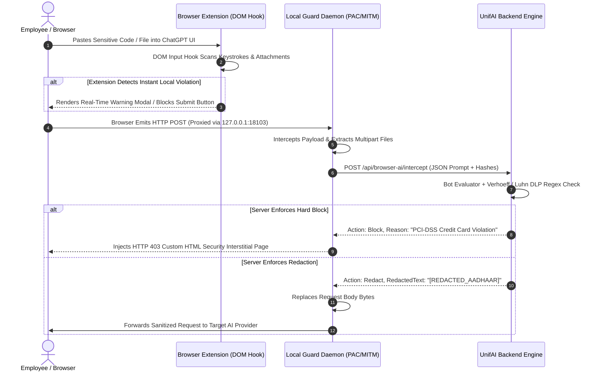

# UnifAI Platform — Workstation Guard Endpoint Suite & Hybrid Enterprise Deployment

## 1. Executive Summary & Architecture Overview

The **UnifAI Workstation Guard Endpoint Suite** (formerly *Gateway Guard / YP Raksha Guard*) is an enterprise-grade client-side daemon and network inspection architecture designed to secure, monitor, and enforce real-time Data Loss Prevention (DLP) across employee interactions with Generative AI tools (ChatGPT, Claude, Gemini, Microsoft Copilot, DeepSeek, Perplexity, Poe, Mistral, HuggingFace, etc.).

Workstation Guard bridges endpoint telemetry directly into the centralized **UnifAI Browser AI Console**, offering a single pane of glass for all endpoint and network-level AI activities across the enterprise.

```mermaid
flowchart TB
    subgraph Managed_Workstation [Managed Workstation: Windows 11 / macOS Sonoma]
        direction TB
        subgraph Browsers [Enterprise Web Browsers]
            Chrome[Google Chrome\nManifest v3 Extension]
            Edge[Microsoft Edge\nManifest v3 Extension]
            Brave[Brave / Firefox]
            Safari[macOS Safari\nMDM PAC Enforced]
        end

        subgraph Local_Daemon [Workstation Guard Agent Daemon]
            Tray[System Tray / LaunchDaemon\nProcess Watchdog]
            PAC_Engine[Local PAC Web Server\n127.0.0.1:18103]
            MITM[Mitmproxy Loopback Engine\nLocal Root CA Certified]
            Buffer[Encrypted SQLite Event Buffer\nOffline Resilient]
        end

        Browsers -->|PAC Routing: 127.0.0.1:18103| MITM
        Browsers -.->|Native Messaging API / DOM Hooks| Tray
        MITM --> Buffer
    end

    subgraph Corporate_Network [Corporate Perimeter / Gateway HA]
        CorpPAC[Network Auto-Proxy / PAC Server\nhttps://unifai.corp/api/browser-ai/pac]
        NetProxy[Gateway Docker Proxy Container\n0.0.0.0:8087]
    end

    subgraph UnifAI_Backend [UnifAI Enterprise Server]
        API[Gateway HTTP Ingestion Handlers\n/api/browser-ai/*]
        Engine[Bot Evaluator & CEL DLP Rules Engine]
        DB[(PostgreSQL\nbrowser_ai_* Tables)]
        UI[Workspace -> Browser AI Dashboard]
    end

    Tray -->|Heartbeat & Dynamic Rules Sync (TLS 1.3)| API
    Buffer -->|Async Intercept Batch Delivery| API
    NetProxy -->|Network-Level Intercepts| API
    API --> Engine
    Engine --> DB
    DB --> UI
```

---

## 2. Hybrid Deployment Topology: Endpoint vs. Network Proxy

Workstation Guard provides two deployment topologies reporting to **ONE unified dashboard** (`Workspace -> Browser AI`):

| Attribute | Mode A: Laptop Endpoint Guard (Default) | Mode B: Network / Server Proxy Guard |
| :--- | :--- | :--- |
| **Target Infrastructure** | Employee Laptops / Desktops (Off-network, WFH, Hybrid) | Corporate Branch Offices, Datacenters, VDI clusters |
| **Installed Package** | `Gateway_Guard_Setup.exe` (Windows) / `Gateway_Guard_macOS.zip` | Docker profile (`docker compose --profile network-proxy up`) |
| **Local Listener** | `127.0.0.1:18103` (Localhost loopback only) | `0.0.0.0:8087` (Bound to internal company network interface) |
| **PAC Script Source** | Applied locally on PC/Mac network adapters | GPO / DHCP Option 252 pointing to gateway URL |
| **Traffic Inspected** | Only traffic destined for configured AI target domains | Corporate egress traffic destined for AI target domains |
| **Non-AI Traffic** | Bypasses proxy completely (`DIRECT` in PAC script) | Bypasses proxy completely (`DIRECT` in PAC script) |
| **Offline Operation** | Buffers logs locally in AES-encrypted store until reconnected | Discards or spools depending on host disk availability |
| **Heartbeat Reporting** | `agent_type: endpoint` | `agent_type: network` |

> [!NOTE]
> **Anti-Collision Architecture**: To prevent double-MITM inspection loops, corporate PAC scripts detect if an endpoint is running a local Workstation Guard listener; if active, corporate proxies defer inspection to the local agent.

---

## 3. Native Packaging & Build Specifications

Workstation Guard utilizes hardened, native compilation toolchains to eliminate external runtime dependencies (no separate Python or Node.js runtime required on employee machines).

### 3.1 Windows Distribution
- **Compilation Toolchains**:
  - `build_windows_exe.bat`: Uses PyInstaller with encrypted bytecode (`--key`) and icon embedding.
  - `build_native_nuitka.py`: Translates Python daemon code into native C++ binaries compiled with MSVC, providing high performance and reverse-engineering protection.
- **Installer Framework**: Inno Setup (`installer/Gateway_Guard.iss`) producing `release/Gateway_Guard_Setup.exe`.
- **Silent Enterprise Installation (GPO / Microsoft Intune)**:
  ```powershell
  Gateway_Guard_Setup.exe /VERYSILENT /SUPPRESSMSGBOXES /NORESTART /SP-
  ```
- **Registry Injection**:
  - Enforces Chrome/Edge `ExtensionInstallForcelist`:
    `HKLM\SOFTWARE\Policies\Google\Chrome\ExtensionInstallForcelist\1 = "<EXTENSION_ID>;https://unifai.corp/api/browser-ai/extension/update.xml"`
  - Configures WinINet auto-proxy URL:
    `HKCU\Software\Microsoft\Windows\CurrentVersion\Internet Settings\AutoConfigURL = "http://127.0.0.1:18103/proxy.pac"`

### 3.2 macOS Distribution
- **Compilation Toolchains**:
  - `build_macos.sh`: Builds a standalone native Application Bundle (`Gateway_Guard.app`).
  - `build_pkg_macos.sh`: Packages the app into a macOS installer package (`Gateway_Guard_VERSION.pkg`).
  - `sign_and_notarize_macos.sh`: Signs binaries with Apple Developer ID Application certificates and notarizes against Apple notarytool servers.
- **MDM Guidance Profile (`disable_private_relay.mobileconfig`)**:
  - Modern macOS builds feature *iCloud Private Relay*, which bypasses local system PAC configurations. UnifAI provides a certified Mobile Device Management (MDM) profile for Jamf Pro, Microsoft Intune, and Kandji:
  ```xml
  <?xml version="1.0" encoding="UTF-8"?>
  <!DOCTYPE plist PUBLIC "-//Apple//DTD PLIST 1.0//EN" "http://www.apple.com/DTDs/PropertyList-1.0.dtd">
  <plist version="1.0">
  <dict>
    <key>PayloadContent</key>
    <array>
      <dict>
        <key>PayloadType</key>
        <string>com.apple.applicationaccess</string>
        <key>PayloadIdentifier</key>
        <string>com.gateway.guard.restrictions</string>
        <key>allowCloudPrivateRelay</key>
        <false/>
      </dict>
    </array>
    <key>PayloadDisplayName</key>
    <string>Gateway Guard — Disable Private Relay</string>
    <key>PayloadIdentifier</key>
    <string>com.gateway.guard.mdm.privaterelay</string>
    <key>PayloadType</key>
    <string>Configuration</string>
  </dict>
  </plist>
  ```

---

## 4. Multi-Layer Interception & Anti-Tamper Security

Workstation Guard operates via a resilient 3-tier interception pipeline:



### 4.1 Anti-Tampering & Challenge-Response Remote Uninstall
To prevent unauthorized employee termination or uninstallation:
1. **Administrative Uninstall Key**: The Windows Control Panel uninstaller and macOS `Uninstall_Gateway_Guard.command` require an enterprise master secret key.
2. **Challenge-Response OTP**: If an administrator needs to uninstall an individual endpoint remotely without sharing the global master key:
   - The user opens the Guard About dialog and generates a 6-digit challenge code.
   - The admin inputs the code into `Workspace -> Browser AI -> Agents -> Generate Uninstall Token`.
   - The console generates a one-time cryptographic response token valid for 15 minutes.
3. **Process Watchdog**: If the background daemon process is killed via Windows Task Manager or macOS Activity Monitor, an automated OS service monitor (`launchd` on macOS, Windows Service Recovery on Windows) relaunches the process within 3 seconds.

---

## 5. UI Administrative Controls (`Workspace -> Browser AI`)

### 5.1 Agents Fleet Management Tab
The **Guard Agents** table provides real-time monitoring across all deployed endpoints:
- **Filters**:
  - `Agent Type`: Dropdown (`All`, `Laptop Guard (Endpoint)`, `Network / Server Proxy`).
  - `Connection Status`: Pills (`Online`, `Offline > 24h`, `Uninstalled`).
  - `Operating System`: Filter (`Windows`, `macOS`, `Linux Docker`).
- **Data Columns**:
  - `Host / Machine Name` (e.g. `WORKSTATION-CORP-491`).
  - `Employee / Username` (Extracted from OS session or Active Directory SID).
  - `Agent Version` (e.g. `v2.4.1` with visual indicator if update required).
  - `Active Mode` (`Endpoint Localhost` vs `Corporate Network Proxy`).
  - `Last Heartbeat` (Relative timestamp, auto-refreshed via polling).
  - `Interception Count` (Total prompt submissions captured).
  - `DLP Violations Triggered` (Badge count with link to filtered logs).
- **Actions Menu**:
  - `Generate Uninstall Token`: Opens challenge-response modal.
  - `Force Rules Refresh`: Pushes real-time WebSocket packet instructing agent to pull updated targets and DLP rules.
  - `Revoke Agent Certificate`: Blocks agent from authenticating to the backend.

### 5.2 Setup & Deployment Tab
The **Setup** tab serves enterprise distribution artifacts directly from backend storage:
| Button / Card | Target URL / Action | Description |
| :--- | :--- | :--- |
| **Download Windows Installer** | `GET /api/browser-ai/download/windows-setup` | Downloads signed `Gateway_Guard_Setup.exe` |
| **Download macOS Package** | `GET /api/browser-ai/download/macos-zip` | Downloads `Gateway_Guard_macOS.zip` containing `.app` |
| **Download macOS PKG** | `GET /api/browser-ai/download/macos-pkg` | Enterprise `.pkg` for Jamf Pro / Intune push |
| **Download MDM Profile** | `GET /api/browser-ai/download/mobileconfig` | `disable_private_relay.mobileconfig` for Apple MDM |
| **Download GPO Script** | `GET /api/browser-ai/download/gpo-script` | PowerShell script for Active Directory deployment |
| **Chrome Web Store Link** | External Web Store URL | Official UnifAI Extension listing |
| **Test PAC URL Generator** | Form Modal | Dynamically generates PAC string with proxy parameter |

---

## 6. Backend REST API Handlers Reference

All workstation interactions are handled by dedicated Go routes in `transports/gateway-http/handlers/`:

### 6.1 Agent Heartbeat & Registration
- **Endpoint**: `POST /api/browser-ai/agents/heartbeat`
- **Request Body**:
  ```json
  {
    "agent_id": "ep-win-8f4b2a9e",
    "agent_type": "endpoint",
    "hostname": "FINANCE-LAPTOP-02",
    "os_version": "Microsoft Windows 11 Enterprise 10.0.22631",
    "agent_version": "2.4.1",
    "pac_status": "active",
    "mitm_status": "listening"
  }
  ```
- **Response (`200 OK`)**:
  ```json
  {
    "status": "acknowledged",
    "rules_version": 142,
    "targets_version": 89,
    "fleet_config": {
      "heartbeat_interval_seconds": 60,
      "log_attachments": true,
      "max_attachment_bytes": 10485760
    }
  }
  ```

### 6.2 Proxy Auto-Configuration (PAC) Generation
- **Endpoint**: `GET /api/browser-ai/pac` or `GET /api/browser-ai/proxy.pac`
- **Query Parameter**: `proxy=127.0.0.1:18103` (or corporate network proxy address)
- **Response Header**: `Content-Type: application/x-ns-proxy-autoconfig`
- **Generated PAC JavaScript**:
  ```javascript
  function FindProxyForURL(url, host) {
      // UnifAI Browser AI Target List (Auto-generated from database)
      var aiTargets = [
          "*.openai.com", "chatgpt.com", "*.anthropic.com", "claude.ai",
          "*.gemini.google.com", "*.deepseek.com", "*.perplexity.ai",
          "*.poe.com", "*.mistral.ai", "*.huggingface.co"
      ];
      for (var i = 0; i < aiTargets.length; i++) {
          if (shExpMatch(host, aiTargets[i])) {
              return "PROXY 127.0.0.1:18103; DIRECT";
          }
      }
      return "DIRECT";
  }
  ```

### 6.3 Interception Ingestion Route
- **Endpoint**: `POST /api/browser-ai/intercept`
- **Headers**:
  ```http
  X-Guard-Agent-ID: ep-win-8f4b2a9e
  X-Guard-Token: <HMAC_SHA256_AUTH_TOKEN>
  Content-Type: application/json
  ```
- **Payload**: Contains intercepted prompt text, target domain, user agent, browser session metadata, and attachment SHA-256 hashes.
- **Evaluation**: Backend runs `browser_ai_bot_eval.go` evaluating prompt content against active CEL DLP rules, returning synchronous enforcement commands (`Allow`, `Block`, `Redact`, `Alert`).
