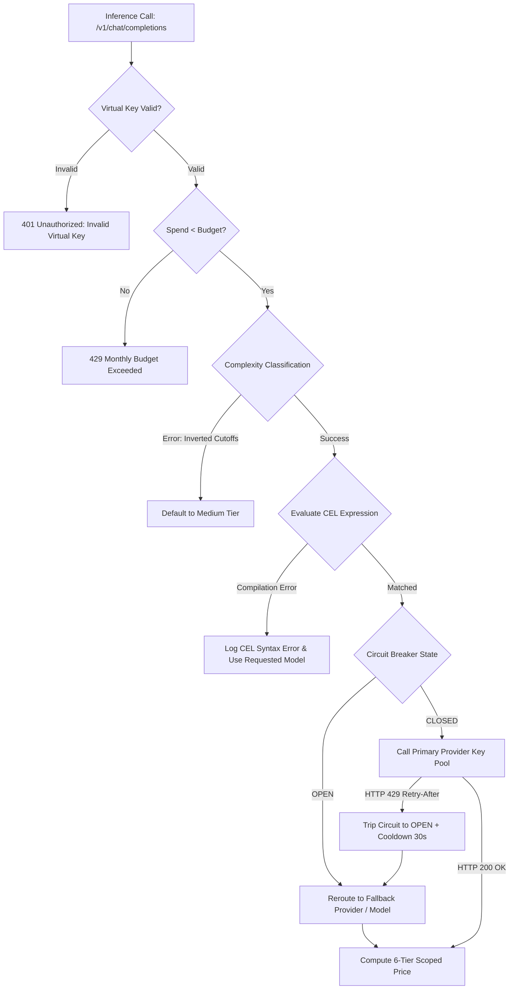

# UnifAI Enterprise Gateway — Complete Error Handling, Database Integrity & Troubleshooting Master Reference (`error.md`)

This document is the **definitive production runbook and error handling encyclopedia** for the entire UnifAI Enterprise AI Gateway. It consolidates every error code, failure symptom, root cause, database state, automated recovery mechanism, and administrative resolution across all gateway subsystems:

1. [Gateway Error Architecture & Envelope Specification](#1-gateway-error-architecture--envelope-specification)
2. [Section 1: Browser AI & Workstation Guard (`YP_Raksha` & Chrome Extension)](#2-section-1-browser-ai--workstation-guard)
3. [Section 2: Observability & Data Pipeline (PostgreSQL & Connectors)](#3-section-2-observability--data-pipeline)
4. [Section 3: Models & Intelligent Routing Subsystem](#4-section-3-models--intelligent-routing-subsystem)
5. [Section 4: MCP Gateway & Tool Execution](#5-section-4-mcp-gateway--tool-execution)
6. [Section 5: Authentication, RBAC, Encryption & Database Integrity](#6-section-5-authentication-rbac-encryption--database-integrity)
7. [Section 6: Governance, Multi-Tenancy & Plugins Subsystem](#7-section-6-governance-multi-tenancy--plugins-subsystem)
8. [Section 7: Guardrails, Cluster, Adaptive Routing, Repositories & Settings Subsystem](#8-section-7-guardrails-cluster-adaptive-routing-repositories--settings-subsystem)
9. [Section 8: Production SQL Diagnostic & Emergency Recovery Runbook](#9-section-8-production-sql-diagnostic--emergency-recovery-runbook)

---

## 1. Gateway Error Architecture & Envelope Specification

### 1.1 Standard JSON Error Envelope

All inbound REST API requests and upstream inference calls return structured, normalized JSON error responses adhering to the following schema:

```json
{
  "is_gateway_error": true,
  "status_code": 429,
  "error": {
    "message": "Monthly spending budget exceeded for Virtual Key 'dev-team-prod'",
    "type": "budget_exceeded_error",
    "code": "BUDGET_LIMIT_REACHED",
    "param": "virtual_key_id"
  },
  "extra_fields": {
    "routing_info": {
      "selected_provider": "openai",
      "selected_model": "gpt-4o",
      "failover_active": false
    }
  }
}
```

### 1.2 HTTP Status Code Matrix

| Status Code | Meaning | Typical Gateway Trigger |
| :---: | :--- | :--- |
| **`400 Bad Request`** | Payload schema validation error | Missing mandatory fields (e.g. `username`, `password`, `model`), malformed JSON, invalid duration strings (`"30"` without `"s"`). |
| **`401 Unauthorized`** | Authentication required or failed | Missing session cookie (`token=...`), revoked Bearer token, invalid upstream provider API key. |
| **`403 Forbidden`** | RBAC permission denied | User role lacks resource permission (e.g. `models.update`), Virtual Key not permitted for target model/tool. |
| **`404 Not Found`** | Resource does not exist | Model not registered in catalog, unknown Virtual Key, deleted circuit breaker policy. |
| **`409 Conflict`** | Resource collision | Provider or rule with identical name already exists, duplicate pricing override for exact same scope. |
| **`422 Unprocessable`** | Semantic compilation error | Google CEL syntax error, undeclared variable in routing rule, invalid regex pattern. |
| **`429 Too Many Requests`** | Rate limit or budget exceeded | Tokens-Per-Minute (TPM), Requests-Per-Minute (RPM), sliding window exhaustion, or monthly budget cap reached. |
| **`500 Internal Error`** | Unhandled system exception | PostgreSQL query failure, AES-256 decryption key mismatch, filesystem IO error. |
| **`502 Bad Gateway`** | Upstream provider connection failed | OpenAI, Anthropic, Bedrock endpoint unreachable, DNS failure, connection refused. |
| **`503 Service Unavailable`** | Circuit breaker open / pool exhausted | Active circuit breaker tripped into OPEN state with no healthy fallback target available. |
| **`504 Gateway Timeout`** | Upstream execution deadline exceeded | LLM inference or MCP tool run exceeded configured timeout (`network_config.timeout` or `mcp_tool_execution_timeout`). |

---

## 2. Section 1: Browser AI & Workstation Guard

**Components:** Desktop Agent (`YP_Raksha.exe`), Chrome Extension (`yp-raksha.zip`), Gateway Handlers (`browser_ai_guard_*.go`).

```mermaid
flowchart TD
    PromptInput[User Enters Prompt in Web Browser] --> ExtHook[Extension Content Script & Page Hook]
    ExtHook --> NativePipe{Native Messaging Pipe Connected?}
    NativePipe -->|No: Error| BrokenPipe[Fallback to HTTP Endpoint: http://localhost:6000/api/browser-ai/intercept]
    NativePipe -->|Yes| AgentInspect[Desktop Agent YP_Raksha.exe Memory Check]
    
    AgentInspect --> TamperCheck{Tamper Flag Active in Config?}
    TamperCheck -->|Yes| TamperAlert[Block Intercept & Log SECURITY_TAMPER_FLAG]
    TamperCheck -->|No| RuleMatch{DLP Guard Rules Check}
    
    RuleMatch -->|PII / Card / Secret Matched| BlockPrompt[Action: BLOCK -> Return Warning Modal & Log Event]
    RuleMatch -->|Anonymize Rule| MaskPrompt[Action: MASK -> Replace Sensitive Data with [REDACTED]]
    RuleMatch -->|Clean| AllowPrompt[Action: ALLOW -> Forward to AI Website]
```

### Error Scenarios & Resolution Matrix

| Error Code / Symptom | Exact Cause | System Impact | Database State | How to Fix |
| :--- | :--- | :--- | :--- | :--- |
| **`SECURITY_TAMPER_FLAG: Agent Tampered`** | Agent detected debugger, code modification, or registry bypass. `gateway_guard_config.json` has `"tamper_detected": true`. | Desktop agent halts prompt forwarding, disables UI controls, alerts security admin. | Recorded in `browser_guard_rules` and agent logs with `status = 'tampered'`. | 1. Decrypt company uninstall key `YP-GUARD-SECURE-KEY-2026`.<br>2. Edit `gateway_guard_config.json` and reset `"tamper_detected": false`.<br>3. Restart `YP_Raksha.exe`. |
| **`UNINSTALL_KEY_INVALID: Process Kill Denied`** | User attempted `taskkill /F /IM YP_Raksha.exe` or uninstall script without supplying company secret key. | Agent driver rejects termination signal and self-restarts. | Audit log event written to `mcp_tool_logs` and Windows Event Log. | Supply the corporate authorization key (`YP-GUARD-SECURE-KEY-2026`) via CLI: `YP_Raksha.exe --uninstall-key=YP-GUARD-SECURE-KEY-2026`. |
| **`DLP_PROMPT_BLOCKED: Sensitive Data Found`** | Prompt contained regex-matched credit card (PCI), Aadhaar/SSN (PII), or private keys. | Prompt blocked on user's browser; warning modal displayed. | Intercept event persisted in `request_logs` / Browser AI logs table with `action = 'blocked'`. | If false positive, edit rule in `/workspace/browser-ai?tab=rules` to refine regex pattern or add keyword exclusions. |
| **`Specified native messaging host not found`** | Chrome cannot find native messaging host registry key `com.yespanchi.guard`. | Extension switches to fallback loopback HTTP port `6000`. | Agent status shows `HTTP Fallback` instead of `Native Host`. | Run `register_native_host.bat` as Administrator to write registry path `HKCU\Software\Google\Chrome\NativeMessagingHosts\com.yespanchi.guard`. |
| **`AGENT_OFFLINE: Missed 3+ Heartbeats`** | Workstation host powered off, sleep mode, or network connectivity lost for >30 seconds. | UI `/workspace/browser-ai?tab=agents` flags device as **Offline** (red badge). | `last_heartbeat` timestamp in DB older than 30s. | Ensure `YP_Raksha.exe` is running as Windows Service; check outbound firewall allows port `6000`. |
| **`CORPORATE_WORKSPACE_BLOCKED: Personal Account Used`** | User attempted to sign in with personal email (`@gmail.com`, `@yahoo.com`) or unapproved tenant on monitored AI service. | Modal popup blocks page access; session authorization returns `decision = 'block'`. | Logged in `browser_ai_logs` with reason `UNAUTHORIZED_DOMAIN`. | Add user's corporate email domain to `corporate_email_domains` in `/workspace/browser-ai?tab=settings`. |
| **`CLIPBOARD_PASTE_BLOCKED: Policy Violation`** | User attempted to paste clipboard text into AI prompt field when clipboard protection is active. | Paste event cancelled; red toast alert "Pasting content is prohibited on this AI platform". | Event logged in `browser_ai_logs` with action `BLOCK`. | Review clipboard governance settings in `/workspace/browser-ai?tab=settings` or exempt target domain. |
| **`FILE_EXTENSION_RESTRICTED: Prohibited Upload`** | User dropped or attached restricted file type (e.g. `.zip`, `.py`, `.sql`, `.pem`) into AI conversation. | Upload dropzone rejects file; upload cancelled before transfer. | Intercept logged with `attachment_name` and status `BLOCKED`. | Adjust `restricted_file_extensions` or switch to whitelist mode in `/workspace/browser-ai?tab=settings`. |
| **`SCREENSHOT_PROTECTION_TRIGGERED: Screen Capture Prevented`** | Screen recording or snipping tool detected while employee viewing monitored AI conversation. | Chat window immediately blurred or blacked out with security overlay. | Security event recorded in audit logs. | Instruct employee to close screen sharing software or update screenshot target scopes in `/workspace/browser-ai?tab=settings`. |
| **`AI_REPLY_BOT_OUTSOURCE_TIMEOUT: Evaluation Failed`** | Outsource AI Bot evaluator LLM (e.g. local Ollama or remote model) took >20s or failed to return JSON verdict. | Gateway triggers fallback action (`bot_fallback_action`: `PASS` or `BLOCK`). | Log records `eval_error = 'AI bot evaluation timed out'`. | Verify local Ollama daemon is running or check provider API quotas in `/workspace/browser-ai?tab=rules`. |

---

## 3. Section 2: Observability & Data Pipeline

**Components:** Logging Engine (`transports/gateway-http/handlers/logging.go`), Connectors (`observability.go`), PostgreSQL (`Unifai_test`).

### Error Scenarios & Resolution Matrix

| Error Code / Symptom | Exact Cause | System Impact | Database State | How to Fix |
| :--- | :--- | :--- | :--- | :--- |
| **`DB_CONNECTION_LOST: dial tcp ...: connection refused`** | PostgreSQL server at `76.13.243.253:32768` stopped or network link down. | Gateway switches to in-memory circular buffer (up to 10,000 logs); UI displays red connection banner. | Influx logs buffered in RAM; unwritten logs replay on reconnect. | Check PostgreSQL service on remote server (`systemctl status postgresql`); verify port `32768` firewall open. |
| **`ZERO_DATA_RETENTION: Logs Not Appearing`** | Zero Data Retention (ZDR) enabled under `/workspace/config/logging` (`disable_log_storage: true`). | Prompt/completion payloads stripped from RAM immediately after inference. | `request_logs` table stores only metadata (tokens, latency, cost); payload columns are `NULL`. | Expected behavior for privacy. If logs are needed for debugging, toggle off Zero Data Retention in Logs Settings. |
| **`CONNECTOR_HANDSHAKE_FAILED: OTel / Datadog 401`** | Telemetry connector configured with revoked API key or unreachable gRPC collector URL. | External observability export fails; error count increments on connector card. | `connectors` table updates status to `failed` with last error message. | 1. Navigate to `/workspace/observability`.<br>2. Click **Configure** on connector.<br>3. Test Connection with valid Datadog API Key or OTel endpoint URL. |
| **`LOG_PRUNING_TIMEOUT: Query Cancelled`** | Auto-prune job attempting to delete millions of rows without indexed timestamp batching. | Database CPU spikes to 100%; transaction timeout after 30s. | Table lock held; incoming writes delayed. | Run manual indexed vacuum: `VACUUM ANALYZE request_logs;` and lower retention days from `90` to `30` in `/workspace/config/logging`. |
| **`LOG_EXPORT_MEMORY_EXHAUSTION: 500 Out of Memory`** | User triggered CSV/JSON export on >100,000 rows without pagination. | Gateway process RAM spikes; FastHTTP connection resets. | Database query completed, but web server buffer exceeded limit. | Export logs in filtered chunks (e.g. by date range or Virtual Key) rather than entire lifetime history. |

---

## 4. Section 3: Models & Intelligent Routing Subsystem

**Components:** Providers (`providers.go`), Routing Rules (`routing-rules.go`), Circuit Breakers (`framework/circuitbreaker/runtime.go`), Complexity Analyzer (`governance.go`).



### Error Scenarios & Resolution Matrix

| Error Code / Symptom | Exact Cause | System Impact | Database State | How to Fix |
| :--- | :--- | :--- | :--- | :--- |
| **`401 Unauthorized: Provider Model Discovery Failed`** | Upstream API key configured in `/workspace/providers` is invalid or expired. | Model discovery fails; provider badge turns red **Error**. | `config_keys` stores key with `status = 'error'`. | Update API key in `/workspace/providers`. The gateway automatically re-discovers models on save. |
| **`429 Too Many Requests: TPM / RPM Limit Reached`** | Client application generated tokens or calls faster than the quota in `/workspace/model-limits`. | Request rejected with `Retry-After: 60` header. | `governance_rate_limits` current usage equals max limit. | Implement exponential backoff in client, or increase TPM ceiling in `/workspace/model-limits`. |
| **`429 Too Many Requests: Monthly Budget Exceeded`** | Virtual Key or Model spend hit 100% of the allocated budget cap. | All subsequent calls on that Virtual Key blocked until reset. | `governance_model_configs` current spend $\ge$ `max_budget`. | 1. Increase `max_budget` in `/workspace/model-limits`.<br>2. Or reset spend counter via `POST /api/governance/budgets/{id}/reset`. |
| **`422 Unprocessable: CEL Expression Error`** | Syntax error in Routing Rule expression (e.g. `header.custom` instead of `headers["x-custom"]`). | Rule fails bytecode compilation and is skipped at runtime. | `routing_rules` row saved with `enabled = false`. | Verify syntax against CEL Context Variables (`model`, `provider`, `complexity_tier`, `headers`). |
| **`CIRCUIT_BREAKER_OPEN: Failover Active`** | Primary provider returned HTTP 429 or `retry-after` header, tripping circuit policy. | Traffic rerouted to Fallback Provider; `x-gateway-circuit-breaker` header set. | `circuit_breaker_policies` state is `open`; cooldown active. | System recovers automatically when cooldown expires. To force immediate reset, click **Reset Circuit** in UI. |
| **`COMPLEXITY_ROUTER_INVALID: Cutoff Order Broken`** | `simple_medium` configured $\ge$ `medium_complex` in `/workspace/complexity-router`. | Classifier fails boundary validation and defaults to factory weights. | `governance_config` rejects update transaction. | Ensure strict inequality: `simple_medium < medium_complex < complex_reasoning` (e.g. `0.15 < 0.35 < 0.60`). |
| **`400 Bad Request: Model Query Parameter Required`** | Client called `/api/models/parameters` without specifying `?model=xyz`. | FastHTTP handler aborts request. | No DB change. | Pass target model name in URL query: `/api/models/parameters?model=gpt-4o`. |

---

## 5. Section 4: MCP Gateway & Tool Execution

**Components:** MCP Reverse Proxy (`mcp.go`), Tool Groups (`mcptoolgroups.go`), Auth Sessions (`mcpsessions.go`), OAuth Server (`mcpoauth2*.go`).

### Error Scenarios & Resolution Matrix

| Error Code / Symptom | Exact Cause | System Impact | Database State | How to Fix |
| :--- | :--- | :--- | :--- | :--- |
| **`STDIO_SPAWN_FAILED: executable file not found`** | The command specified (`npx`, `python`, `node`) is not in the system `PATH`. | Local MCP server cannot be launched; status marked **Error**. | `config_mcp_clients` status set to `offline`. | Specify absolute binary path (e.g. `C:\Program Files\nodejs\npx.cmd`) or add binary to system `PATH`. |
| **`SSE_CONNECTION_REFUSED: dial tcp: connection refused`** | Remote SSE MCP server endpoint is offline or blocked by firewall. | Handshake timeout; tools cannot be introspected. | `config_mcp_clients` records last ping failure. | Verify upstream server is running, listening on specified port, and accepts HTTP/SSE handshakes. |
| **`OAUTH_TOKEN_EXPIRED: Refresh Failed`** | Upstream SaaS platform (GitHub/Slack/Google) revoked user's refresh token. | Tool call fails with 401; user must re-authorize. | `oauth_user_tokens` status updated to `expired`. | Click **Re-Auth** button on session row in `/workspace/mcp-sessions` to launch fresh OAuth consent flow. |
| **`403 Forbidden: Tool Execution Disallowed`** | Virtual Key policy whitelist does not include the invoked tool. | Tool call blocked before dispatching to upstream server. | Tool invocation logged in `mcp_tool_logs` with `status = 'forbidden'`. | Add the tool name or wildcard pattern (e.g. `github-*`) to Virtual Key authorized tools list. |
| **`TOOL_EXECUTION_TIMEOUT: Deadline Exceeded`** | Tool execution took longer than `mcp_tool_execution_timeout` (default: 30s). | Gateway terminates connection pipe; returns error to model. | Execution recorded in `mcp_tool_logs` with `status = 'timeout'`. | Increase execution timeout in `/workspace/mcp-settings` for long-running batch or database tasks. |
| **`MCP_AGENT_DEPTH_EXCEEDED: Max Recursion Hit`** | Autonomous agent entered an infinite tool-calling loop exceeding depth 10. | Gateway halts execution to prevent runaway compute costs. | Request logged in `request_logs` with `error = 'depth_exceeded'`. | Inspect agent system prompt to prevent recursive loops; adjust `mcp_agent_depth` in MCP Settings if legitimate. |

---

## 6. Section 5: Authentication, RBAC, Encryption & Database Integrity

**Components:** Cryptographic Vault (`framework/encrypt/encrypt.go`), Session Store (`handlers/session.go`), PostgreSQL Connection Manager.

### Error Scenarios & Resolution Matrix

| Error Code / Symptom | Exact Cause | System Impact | Database State | How to Fix |
| :--- | :--- | :--- | :--- | :--- |
| **`AES_GCM_DECRYPTION_FAILED: Ciphertext MAC Invalid`** | The `GATEWAY_ENCRYPTION_KEY` in `.env` was changed or differs from the key used during data insertion. | Gateway cannot decrypt provider keys, SMTP credentials, or OAuth tokens; red banner shown. | Database rows intact, but ciphertext cannot be unlocked. | Restore the exact original 32-character AES key in `.env` (or run key migration utility). |
| **`ACCOUNT_LOCKED: Too Many Failed Logins`** | User failed password authentication 5 consecutive times. | Account locked out for 15 minutes to prevent brute-force attacks. | In-memory lockout cache active for IP and username. | Wait 15 minutes for lockout window to clear, or run database unlock query: `UPDATE governance_users SET failed_attempts = 0 WHERE username = '...';` |
| **`PASSWORD_POLICY_FAILED: Weak Password`** | New password lacks required complexity (minimum 8 chars, uppercase, lowercase, number, symbol). | Password rejected with descriptive error message. | Database record unchanged. | Supply a strong password satisfying enterprise compliance requirements. |
| **`POSTGRES_POOL_EXHAUSTED: too many clients`** | High concurrency spike exceeded PostgreSQL `max_connections` limit. | Gateway receives connection refused; API requests fail with 500. | PostgreSQL backend rejecting new TCP connections. | Increase `max_connections = 300` in `postgresql.conf` and configure connection pooling (PgBouncer). |
| **`403 Forbidden: Missing Required RBAC Scope`** | User attempted action restricted by role (e.g. regular user attempting to delete a provider). | UI hides or disables action button; API returns 403. | Audit log captures unauthorized attempt. | Grant user required role in `/workspace/users` or assign custom RBAC scope. |

---
---

## 7. Section 6: Governance, Multi-Tenancy & Plugins Subsystem

**Components:** Governance Engine (`governance.go`), SCIM / Directory Sync (`scim_handlers.go`), RBAC System (`rbac.go`), Access Profiles (`workspace.go`), Plugins (`plugins.go`).

### Error Scenarios & Resolution Matrix

| Error Code / Symptom | Exact Cause | System Impact | Database State | How to Fix |
| :--- | :--- | :--- | :--- | :--- |
| **`409 Conflict: User already a member of another team`** | Strict single-team rule violated (CWE-284 defense). User cannot belong to $>1$ team simultaneously. | Addition to second team aborted with descriptive error. | `governance_team_members` row preserved; new row rejected. | Remove the user from their current team first via `/workspace/governance/teams`, or drag their prompt in Prompt Repository to the new team folder. |
| **`409 Conflict: Duplicate name collision`** | Customer, Business Unit, or Team created with a name matching an existing record (case-insensitive). | Entity creation blocked to prevent hierarchy ambiguity. | Database table preserves unique constraint. | Provide a distinct, unique name for the customer, business unit, or team. |
| **`400 Bad Request: Customer budget allocation exceeded`** | The sum of team budgets under a customer exceeds the parent customer's spending ceiling for that period. | Team budget creation/update rejected. | `governance_model_configs` prevents allocation shortfall. | Increase parent customer's budget limit in `/workspace/governance/customers` or reduce team allocations. |
| **`403 Forbidden: Super admin required to create administrators`** | A sub-admin or non-superadmin attempted to create or elevate an account with role `admin`. | Role escalation attempt blocked; audit log captures violation. | User role remains unchanged in `governance_users`. | Perform administrative role changes only from the primary root superadmin account. |
| **`SCIM_AUTH_FAILED: Bearer Token Invalid (HTTP 401)`** | External IdP (Microsoft Entra ID / Okta) provided an invalid SCIM 2.0 bearer token. | Automated provisioning sync rejected; IdP logs provisioning failure. | `governance_users` records unchanged. | Regenerate SCIM bearer token in `/workspace/scim` and copy into the IdP Provisioning credentials settings. |
| **`LDAP_BIND_FAILED: Active Directory Connection Refused`** | Active Directory server unreachable, invalid Bind DN, or incorrect service account password. | Manual or scheduled AD user sync fails. | Status marked `failed` in `workspace_settings` (`key = 'active_directory'`). | Test connection in `/workspace/scim` (Active Directory tab) with correct LDAP host, Base DN, and credentials. |
| **`403 Forbidden: Custom RBAC Permission Denied`** | Custom role lacks permission flag for requested operation (e.g. `plugins.create`). | User receives HTTP 403; UI hides mutation controls. | Audit log captures permission denial event. | Navigate to `/workspace/governance/rbac`, edit target custom role, and enable the required resource permission. |
| **`ACCESS_PROFILE_CONFLICT: Multiple Active Profiles`** | Attempted to activate an access profile that conflicts with an existing active profile binding. | Profile activation blocked. | `access_profiles` table marks profile as `inactive`. | Deactivate conflicting access profile in `/workspace/governance/access-profiles` before activating the new profile. |
| **`PLUGIN_LOAD_FAILED: Dynamic Shared Object Error`** | Custom Go plugin `.so` or `.dll` failed binary load due to missing symbol or ABI compiler mismatch. | Plugin cannot be placed into execution pipeline; status set to `error`. | `config_plugins` records last load failure stack trace. | Recompile plugin with identical Go version (`go build -buildmode=plugin`) matching gateway binary build flags. |
| **`AUDIT_LOG_EXPORT_TIMEOUT: Range Too Broad`** | Exporting audit logs spanning $>1,000,000$ historical records in a single synchronous query. | FastHTTP connection times out after 30s. | Database query aborted by statement timeout. | Filter export by date range, specific actor, or target entity in `/workspace/audit-logs`. |

---

## 8. Section 7: Guardrails, Cluster, Adaptive Routing, Repositories & Settings Subsystem

| Error Code / Symptom | Trigger Condition & Root Cause | Gateway Observable Impact | Database & Runtime State | Immediate Administrative Resolution |
| :--- | :--- | :--- | :--- | :--- |
| **`GUARDRAIL_PRE_HOOK_BLOCKED: Input Violation (HTTP 400)`** | User prompt matches an enabled input guardrail rule (e.g. credit card Luhn check, SSN, API secrets, PII). | Request rejected with HTTP 400 Bad Request; prompt never dispatched to upstream LLM. | Block event recorded in audit logs and log store; input tokens prevented from reaching provider. | Review input DLP policy in `/workspace/guardrails/configuration`. If legitimate query was blocked, refine regex patterns or adjust rule CEL expression. |
| **`GUARDRAIL_POST_HOOK_BLOCKED: Output Leak (HTTP 400)`** | Upstream model response contains prohibited content, leaked credentials, or sensitive enterprise data. | Streaming generation aborted or completion masked (`[REDACTED_DATA]`) before reaching client. | Audit log captures output violation; token count billed up to point of interception. | Inspect model output guardrail rule in `/workspace/guardrails/configuration`; configure token redaction instead of complete abort if partial response is acceptable. |
| **`GUARDRAIL_CEL_COMPILATION_ERROR: Syntax Error (HTTP 422)`** | Custom CEL expression contains invalid syntax, undeclared identifier, or type mismatch. | Rule cannot be compiled into expression program; rule activation blocked. | `workspace_settings` (`guardrails_config`) rejects update. | Test expression using CEL validator; ensure variables match supported context (`prompt.text`, `model`, `virtual_key_id`). |
| **`GUARDRAIL_REGEX_COMPILE_FAILURE: Invalid Pattern (HTTP 400)`** | Custom regex provider configured with invalid regular expression (e.g. unclosed parenthesis or unsupported Lookahead). | Provider configuration update rejected with error toast. | Provider pattern ignored; existing compiled patterns remain active. | Validate regex in `/workspace/guardrails/providers` using RE2-compatible syntax (PCRE lookarounds not supported). |
| **`CLUSTER_PEER_UNREACHABLE: Gossip / HTTP Error`** | Configured cluster peer at `IP:PORT` is offline, firewalled, or unreachable. | Node logs periodic connection retry warnings; local node operates in degraded standalone mode. | `workspace_settings` (`cluster`) retains peer address; peer marked `unhealthy`. | Verify network connectivity, security groups, and port 6000 accessibility between nodes in `/workspace/cluster`. |
| **`CLUSTER_SECRET_MISMATCH: Unauthorized Peer (HTTP 401)`** | Cluster secret token differs between peer nodes attempting replication. | Replication requests rejected with HTTP 401; state (budgets, rate limits) fails to synchronize. | Out-of-sync rate limit and budget counters across nodes. | Align cluster secret string across all cluster nodes in `/workspace/cluster`. |
| **`ROUTING_ALL_TARGETS_UNHEALTHY: No Fallback (HTTP 503)`** | All upstream provider API keys and directions for requested model have failed, timed out, or exhausted quota. | Gateway returns HTTP 503 Service Unavailable with routing failure details. | All routing directions cooldown active in Adaptive Load Balancer. | Inspect `/workspace/adaptive-routing`; add active provider API keys or enable fallback models in `/workspace/routing-rules`. |
| **`ROUTING_FALLBACK_LOOP_EXCEEDED: Chain Max Depth (HTTP 500)`** | Recursive fallback routing chain depth exceeds `routing_chain_max_depth` (default 5). | Request terminated with recursive routing error to prevent infinite dispatch loops. | Trace captures circular fallback path. | Review `/workspace/routing-rules` and ensure fallback chains terminate at a distinct, valid model tier. |
| **`PROMPT_FOLDER_CYCLE_DETECTED: Cyclic Hierarchy (HTTP 400)`** | User attempted to move a folder inside its own subfolder or descendant. | Operation rejected with "Cannot move folder into its own descendant". | Hierarchy integrity preserved in `folders` table. | Move folder only to valid parent folder or root level in `/workspace/prompt-repo`. |
| **`PROMPT_TEMPLATE_VARIABLE_UNBOUND: Missing Variable (HTTP 400)`** | Prompt execution invoked without supplying values for required variables `{{variable_name}}`. | Inference invocation rejected with unpopulated template error. | Prompt execution aborted before dispatch. | Supply all required variable key-values in playground or client request payload. |
| **`PROMPT_VERSION_CONFLICT: Immutable Version`** | Attempted to update an existing immutable prompt version directly. | Mutation rejected; historical versions cannot be overwritten. | `prompt_versions` table maintains immutable historical record. | Create a new version increment (e.g. `v1.2.1` or `v2.0.0`) in `/workspace/prompt-repo`. |
| **`SKILL_YAML_FRONTMATTER_INVALID: Parse Failure (HTTP 400)`** | Uploaded `SKILL.md` contains invalid YAML syntax, missing mandatory `name` or `version`. | Skill bundle compilation fails; cannot be registered into Agent Marketplace. | `skills` table rejects insert. | Correct YAML frontmatter at top of `SKILL.md` adhering to schema in `/workspace/skills-repo`. |
| **`SKILL_FILE_BLOB_SIZE_EXCEEDED: Quota Exceeded (HTTP 413)`** | Uploaded auxiliary skill script or file exceeds 10MB limit. | Upload rejected with HTTP 413 Payload Too Large. | `skill_file_blobs` rejects oversized record. | Compress file or reference external repository instead of bundling large binaries into skill bundle. |
| **`CONFIG_FEATURE_FLAG_LOCKED: Mutation Forbidden (HTTP 403)`** | Attempted to disable or modify a locked enterprise security feature flag. | Mutation rejected with "Feature flag is locked by system policy". | `feature_flags` table row remains `locked = true`. | Unlock flag via system administrator config or environment variable override in `/workspace/config/feature-flags`. |
| **`CONFIG_INVALID_CORS_ORIGIN: Wildcard with Credentials (HTTP 400)`** | Configured `allowed_origins = ["*"]` while authentication cookies / credentials are enabled. | Browser blocks cross-origin requests due to Fetch specification violation. | Security config rejected or browser refuses preflight. | Specify exact domain origins (e.g. `https://app.company.com`) in `/workspace/config/security`. |

---

## 9. Section 8: Production SQL Diagnostic & Emergency Recovery Runbook

Below is the certified set of SQL queries for diagnosing and resolving database issues directly against PostgreSQL (`Unifai_test` on `76.13.243.253:32768`):

### 8.1 Diagnostic Health Checks

```sql
-- 1. Check all critical table row counts across all subsystems
SELECT 'prompts' AS tbl, count(*) FROM prompts
UNION ALL
SELECT 'folders', count(*) FROM folders
UNION ALL
SELECT 'prompt_versions', count(*) FROM prompt_versions
UNION ALL
SELECT 'prompt_sessions', count(*) FROM prompt_sessions
UNION ALL
SELECT 'skills', count(*) FROM skills
UNION ALL
SELECT 'config_client', count(*) FROM config_client
UNION ALL
SELECT 'feature_flags', count(*) FROM feature_flags
UNION ALL
SELECT 'workspace_settings', count(*) FROM workspace_settings
UNION ALL
SELECT 'routing_rules', count(*) FROM routing_rules
UNION ALL
SELECT 'routing_targets', count(*) FROM routing_targets
UNION ALL
SELECT 'config_providers', count(*) FROM config_providers
UNION ALL
SELECT 'config_keys', count(*) FROM config_keys
UNION ALL
SELECT 'circuit_breaker_policies', count(*) FROM circuit_breaker_policies
UNION ALL
SELECT 'governance_model_configs', count(*) FROM governance_model_configs
UNION ALL
SELECT 'mcp_library', count(*) FROM mcp_library;

-- 2. Inspect workspace_settings keys & payload sizes (Guardrails, Cluster, LoadBalancer)
SELECT key, length(data) AS bytes, updated_at 
FROM workspace_settings 
ORDER BY key;

-- 3. Inspect active circuit breakers
SELECT name, enabled, primary_provider, primary_model, fallback_provider, fallback_model, default_cooldown 
FROM circuit_breaker_policies;

-- 4. Check for failed or expired OAuth tokens
SELECT id, mcp_client_id, user_id, auth_mode, status, expires_at 
FROM oauth_user_tokens 
WHERE status != 'active' OR expires_at < NOW();

-- 5. Review recent blocked prompt interceptions (DLP Guard)
SELECT timestamp, user_id, virtual_key_name, tool_name, status, arguments 
FROM mcp_tool_logs 
ORDER BY timestamp DESC 
LIMIT 10;
```

### 8.2 Emergency Recovery Queries

```sql
-- 1. Force Reset a Stuck Circuit Breaker Policy
UPDATE circuit_breaker_policies 
SET enabled = true, updated_at = NOW() 
WHERE name = 'TestCB_d2ff09f2';

-- 2. Clear Desktop Agent Tamper Flag
-- (After ensuring workstation is secure and malware-free)
UPDATE browser_guard_rules 
SET enabled = true 
WHERE id = 'tamper_defense';

-- 3. Reset User Account Lockout
UPDATE governance_users 
SET status = 'active', updated_at = NOW() 
WHERE email = 'admin@yespanchi.com';

-- 4. Purge Stale Sessions Older Than 30 Days
DELETE FROM sessions 
WHERE expires_at < NOW() - INTERVAL '30 days';

-- 5. Force Re-sync Guardrails Configuration from Default
UPDATE workspace_settings 
SET data = '{"guardrail_rules":[],"guardrail_providers":[]}', updated_at = NOW() 
WHERE key = 'guardrails_config';

-- 6. Force Standalone Mode for Cluster if Peer Network is Down
UPDATE workspace_settings 
SET data = '{"enabled":false,"type":"mesh","region":"standalone","peers":[]}', updated_at = NOW() 
WHERE key = 'cluster';

-- 7. Reset Adaptive Load Balancer Defaults
UPDATE workspace_settings 
SET data = '{"enabled":true,"direction_selection_enabled":true,"route_selection_enabled":true,"reroute_failed_directions":false,"prune_failed_fallbacks":false}', updated_at = NOW() 
WHERE key = 'load_balancer';
```


---

## 9. Browser AI & Desktop Guard (`YP_Raksha.exe`) Error Guide & Self-Healing Playbook

| Error Code | Symptom | Root Cause | Automated Self-Healing Resolution |
| :--- | :--- | :--- | :--- |
| `ERR_RAKSHA_UNINSTALL_LOCK` | `YP_Raksha.exe` immediately stops on boot with message: `Remote uninstall authorized — stopping Guard + removing install`. | In table `browser_ai_agents`, the machine's record has `status = 'uninstalled'` or `uninstall_requested = true` from a prior test. | Run SQL: `UPDATE browser_ai_agents SET status = 'active', uninstall_requested = false WHERE hostname = 'DESKTOP-K8CQD3T';` then delete local `C:\Users\<user>\AppData\Local\Gateway\Guard\tamper.flag`. |
| `ERR_GUARD_CONFIG_REMOTE_URL` | Agent logs `HTTP Error 401: Unauthorized` contacting `https://unifai.yespanchi.com/api/browser-ai/targets`. | Local configuration file `gateway_guard_config.enc` has cloud production URL instead of local daemon `http://127.0.0.1:6000`. | Run `python apps/browser-guard/scripts/sync_config_from_env.py` and re-encrypt via `python apps/browser-guard/installer/encrypt_proxy_bundle.py`. |
| `ERR_PAC_PORT_COLLISION` | Local PAC server cannot bind to port `18195` or MitM proxy fails on port `18103`. | Stale background `YP_Raksha.exe` or `python` process is already holding the listening socket. | Run `taskkill /F /IM YP_Raksha.exe`, verify with `netstat -ano \| findstr "18195"`, and restart `YP_Raksha.exe`. |
| `ERR_FILE_EXTRACTION_TIMEOUT` | Uploading high-page PDF or complex binary takes >5s during upload interception. | OCR or deep extraction thread blocking the primary proxy flow. | The proxy automatically streams the file to disk in a separate background thread, claims deduplication key, and posts to `/api/browser-ai/intercept-file` asynchronously without stalling user browser navigation. |
| `ERR_SITE_BLOCK_BYPASS` | Employee attempts to bypass blocked AI website (e.g. `deepseek.com`) via alternate subdomains. | Subdomain routing not mapped in PAC script. | The backend `GeneratePACScript` recursively compiles parent domains and wildcard masks (`*.deepseek.com`, `chat.deepseek.com`, `api.deepseek.com`) into the PAC file; the extension `content.js` matches `location.hostname` suffix and injects immediate `renderBlockedPage()`. |

*(End of UnifAI Gateway Error Handling & Database Recovery Reference Guide)*

