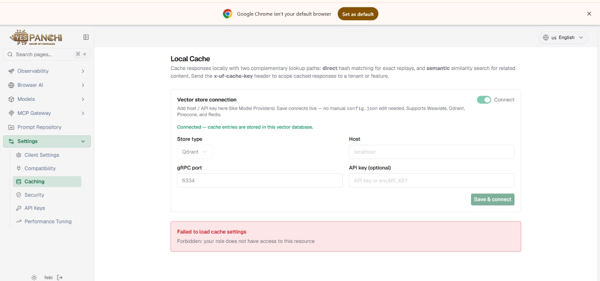
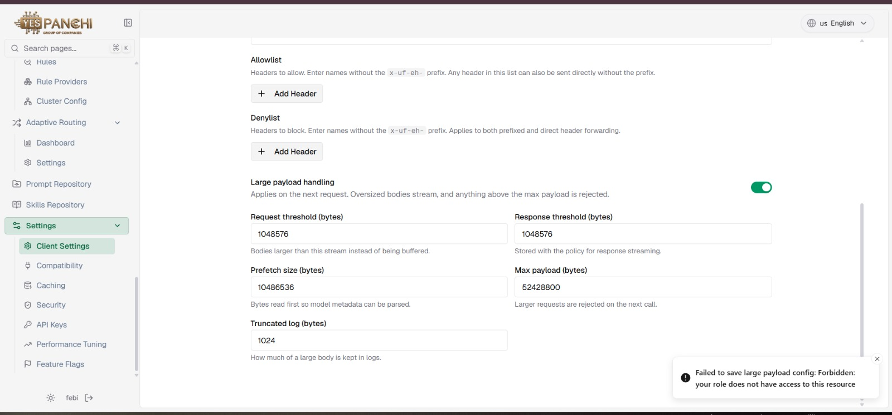

# RBAC live test report

**Date:** 2026-10-28  
**Environment checked:** [unifai.yespanchi.com](https://unifai.yespanchi.com)  
**Status:** Partial — Admin session and RBAC policy matrix inspected. User/Sub-Admin sign-in, API enforcement, and CRUD testing still require dedicated test identities; live permission changes require action-time confirmation.

## What was checked

- Opened the production workspace in the existing signed-in Admin session.
- Navigated 52 distinct workspace pages. They loaded without a visible `Forbidden`, unauthorized, or failed-to-load message in the Admin session.
- Opened **Roles & Permissions** and inspected the Admin, User, and Sub-Admin policy targets. The screen reports 59 workspace features across 8 categories. The RBAC page browser console had no errors at the time checked.
- Inspected all 59 rows in the global User policy and all 59 rows in the global Sub-Admin policy. No permission changes were saved.
- Reviewed the User Governance and account-creation flow. No account was submitted and no live records were changed.

## Findings

1. **Admin default:** The “All Admins” policy is shown as Full Access.
2. **User global policy:** All 59 rows currently display View Only, including Prompt Repository.
3. **Prompt Repository helper mismatch:** The page says User defaults have Full Access on Prompt Repository, but the actual Prompt Repository row under “All Users” displays View Only. The UI copy and matrix disagree.
4. **Existing User permissions:** The individual User `febi` currently shows Full Access for both Caching and Client Settings, while the global User policy remains View Only.
5. **403 enforcement mismatch:** Your screenshots show the `febi` session receiving Forbidden errors on Local Cache and Large Payload settings. The live RBAC matrix grants that User Full Access to Caching and Client Settings. The policy and reported enforcement disagree; I could not inspect the failing API request as that User from the current Admin session.
6. **Sub-Admin policy exception:** There are zero Sub-Admin accounts. In the “All Sub Admins” matrix, Observability → Dashboard displays Create & Edit while the other 58 features display No Access. That live policy exception does not match an all-No-Access default.
7. **Matrix refresh risk:** When switching from “All Sub Admins” to “All Users” with the Dashboard filter still active, the matrix briefly showed the previous Sub-Admin values. Clearing the filter refreshed the User matrix to View Only. I did not save. Recheck this UI behavior before relying on filtered rows or saving a policy.

## Test results

| Test | Result | Notes |
|---|---|---|
| Admin workspace page loading | Pass, 52 pages | Admin context only; does not prove User permissions are correct. |
| Admin sign-in flow | Not tested | The browser was already signed in as Admin. |
| User sign-in and logout | Not tested | Requires the test User session; enter any password or OTP yourself in the browser. |
| Create Admin/User/Sub-Admin accounts | Not tested | The form needs real test email address(es); no accounts were created. |
| Global User permission matrix | Pass, 59 rows inspected | Every row shows View Only; Prompt Repository helper text incorrectly says Full Access. This does not validate enforcement in a User session. |
| Existing User Caching / Client Settings | Policy says Full Access | The supplied `febi` screenshots show Forbidden on these pages; actual failing API request was not captured from a User session. |
| Global Sub-Admin permission matrix | Fail, 59 rows inspected | Observability Dashboard shows Create & Edit; other 58 rows show No Access. There are no Sub-Admin accounts. |
| User View Only enforcement | Not tested as a User | Global policy matrix is View Only; use a dedicated User identity for enforcement tests. |
| User Create Only / Edit Only / Delete Only / Full Access | Not tested | Each saved permission change affects live access and needs approval immediately before saving. |
| Sub-Admin assigned-feature access | Not tested | No Sub-Admin account exists; global policy currently has the Dashboard exception above. |
| Create/Edit/Delete actions across features | Not tested | No production records were changed. |
| Cache / Large Payload 403 reproduction | Not tested as a User | Your screenshots document the errors; the Admin route check cannot validate a User's API permissions. |

## What is needed to finish

- A dedicated test email address for each account you want created. I will not invent an email or create accounts using a real employee's address.
- You to complete password and OTP entry in the browser when a test sign-in is needed.
- Immediate confirmation before each live permission save. The test would temporarily apply View Only, Create Only, Edit Only, Delete Only, then Full Access to a dedicated test User and restore its original policy at the end. These changes alter production access.

No live permission changes, account creations, or CRUD operations were performed during this check.

## Screenshot evidence

The following are the original screenshots you supplied. They are included as reported evidence, not as fresh captures from this run. The new RBAC matrix findings above were inspected live, but no fresh screenshot file was saved during this turn.

### Local Cache Forbidden error

### Large Payload Forbidden error

